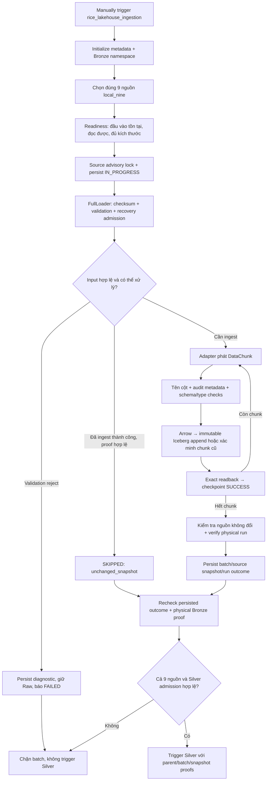

# Thuyết trình lớp Bronze — luồng hoạt động thực tế của TLCN

Ngày đối chiếu code: **31/10/2026**. Branch: `feat(gold)`. HEAD: `cd2f1a77b27d5bcba6f1d925e3d9305952551bae`.

Tài liệu này để giải thích và bảo vệ đồ án, dựa trên code hiện hành. Không chạy lại ingestion, không truy vấn runtime và không đo lại số dòng trong lần viết tài liệu này. Các ví dụ số dòng/chunk có ghi rõ là minh họa; không dùng làm kết quả nghiệm thu mới.

## 1. Mở đầu: em xây Bronze để giải quyết việc gì?

**Bạn có thể nói:**

> “Trong đồ án, dữ liệu lúa gạo đến từ nhiều tổ chức, có dạng CSV, Excel và cả bảng HTML nằm trong file có đuôi XLS. Em cần đưa các đầu vào này vào một lớp lưu trữ thống nhất, có thể truy vấn và truy vết được. Bronze thực hiện bước tiếp nhận đó: đọc dữ liệu nguồn, kiểm tra kỹ thuật, bổ sung thông tin nguồn/lần chạy và ghi thành bảng Iceberg. Việc chuẩn hóa nghiệp vụ chi tiết được thực hiện ở Silver.”

Đặt Bronze trong toàn bộ hệ thống:

```text
File Raw local
    → Bronze: tiếp nhận, bảo toàn dữ liệu nguồn và lineage
    → Silver: chuẩn hóa schema, nghiệp vụ và kiểm tra chất lượng
    → Gold: tổ chức các bảng phục vụ phân tích
    → Analytics: truy vấn đã kiểm soát
    → CSV → Power BI Desktop
```

Ba mục tiêu cần nhớ:

1. **Đọc được nhiều định dạng** qua adapter riêng cho từng nhóm nguồn.
2. **Truy vết được** dòng dữ liệu thuộc nguồn, file, run và chunk nào.
3. **Ghi có kiểm chứng và phục hồi có kiểm soát**, không chỉ gọi ghi rồi mặc định thành công.

Bronze là **lớp dữ liệu**, không phải một dịch vụ Docker riêng và cũng không chỉ là folder `jobs/bronze/`.

## 2. Phân biệt Raw, Bronze và Silver

| Lớp | Dữ liệu trong dự án | Trách nhiệm chính |
|---|---|---|
| Raw | Các file đầu vào local, được mount read-only vào container | Giữ bản file để đối chiếu và đọc lại |
| Bronze | Bảng `iceberg.bronze.<source_id>`; data files và Iceberg metadata được lưu trong MinIO | Đưa dữ liệu đã parse vào bảng có schema và thông tin truy vết |
| Silver | Các target thuộc `iceberg.silver_local` trong profile hiện tại | Chuẩn hóa tên cột nghiệp vụ, kiểu dữ liệu, thời gian, đơn vị, DQ và business keys |

**Không nên nói “Bronze không thay đổi bất cứ thứ gì”.** File Raw mới là bản file được giữ lại. Bronze đã parse file thành bảng, chuẩn hóa tên cột để tương thích SQL, chọn header/sheet/bảng và thêm metadata. Một số adapter bỏ dòng hoàn toàn trống hoặc ghép thông tin header. Vì vậy Bronze không phải bản sao byte-for-byte của Raw.

Tuy nhiên Bronze không phải nơi tự quy đổi paddy sang milled, suy luận mã tỉnh chính thức, thay giá thiếu bằng 0 hay tổng hợp sản lượng theo tỉnh/năm. Đây là những quyết định nghiệp vụ cần xử lý ở tầng phù hợp.

## 3. Em sử dụng những công nghệ nào và để làm gì?

| Thành phần | Vai trò trong Bronze | Cách diễn đạt dễ hiểu |
|---|---|---|
| Python | Viết engine, loader, adapters, validators và recovery | Điều khiển các bước xử lý |
| YAML / `SourceRegistry` | Khai báo đầu vào, schema dự kiến, adapter, kích thước chunk | Danh mục cấu hình nguồn |
| pandas | Đọc CSV/bảng và tạo DataFrame | Biến nội dung file thành dữ liệu dạng bảng |
| openpyxl | Đọc workbook XLSX ở adapter tương ứng | Đọc sheet/cell Excel |
| pandas `read_html` / lxml | Parse USDA PSD nếu nội dung thực là HTML | Đọc theo nội dung, không chỉ theo đuôi file |
| PyArrow | Chuyển DataFrame sang Arrow theo schema Iceberg | Cầu nối kiểu dữ liệu trước khi ghi |
| PyIceberg | Đọc catalog, append chunk và đọc lại snapshot | Writer native của đường ghi Bronze hiện tại |
| Apache Iceberg | Table format quản lý schema, snapshots và các data files | Giúp các file trở thành bảng có phiên bản |
| MinIO | Object storage tương thích S3 | Lưu data files và metadata files của Iceberg |
| Iceberg REST Catalog | Quản lý danh tính bảng và metadata hiện hành | Nơi writer/reader tìm và commit phiên bản bảng |
| PostgreSQL | Lưu runs, checkpoints, source snapshots, diagnostics; cấp advisory locks | Nhật ký vận hành bền vững và cơ chế khóa nguồn |
| Apache Airflow | Điều phối các task và chặn Silver khi Bronze chưa được chứng minh | Quyết định thứ tự chạy và điều kiện chuyển bước |
| Trino | SQL để tạo/kiểm tra schema và truy vấn bảng | Công cụ SQL trên Iceberg, không phải nơi lưu file |
| Docker Compose / WSL2 | Chạy các dịch vụ local của project `tlcn-local` | Môi trường tái sử dụng trên laptop |

**Nếu thầy hỏi Spark:** “Toàn dự án có Spark, đặc biệt ở Silver và Gold. Nhưng đường ghi Bronze `FullLoader → BronzeIcebergWriter` hiện tại sử dụng pandas/Arrow/PyIceberg; em không gọi mọi ingestion Bronze là Spark job.”

**Nếu thầy hỏi MinIO khác PostgreSQL:** MinIO giữ đối tượng dữ liệu của lakehouse; PostgreSQL giữ metadata vận hành. Iceberg cũng có metadata riêng, như snapshot/schema/data-file references. Không đánh đồng ba loại này.

## 4. Bronze nhận dữ liệu từ đâu?

Profile đang dùng là **`local_nine`**, gồm chín source IDs dưới đây. Cả chín được cấu hình `source_type: LOCAL_FILE` và `load_strategy: FULL`.

Các đường dẫn dưới đây tương đối với Raw root được đưa vào container tại `/workspace/data/raw`:

| Source ID / hậu tố tên bảng Bronze | File/thư mục Raw | Adapter |
|---|---|---|
| `faostat_production` | `faostat/production_world.csv` | `FaostatBulkAdapter` |
| `faostat_monthly_price` | `faostat/price.csv` | `FaostatBulkAdapter` |
| `faostat_supply_utilization` | `faostat/supply_utilization.csv` | `FaostatBulkAdapter` |
| `faostat_trade` | `faostat/Trade_DetailedTradeMatrix_E_All_Data_(Normalized)/rice_trade_data.csv` | `FaostatBulkAdapter` |
| `usda_psd` | `usda/usda.xls` | `UsdaPsdAdapter` |
| `usda_rice_yearbook` | `usda/Export-prices-Thailand-Vietnam-India-and-Pakistan.csv` | `UsdaLocalAdapter` |
| `worldbank_pinksheet` | `world_bank/CMO-Historical-Data-Monthly.xlsx` | `WorldBankAdapter` |
| `thitruongnongsan` | `thitruongnongsan/price_luagao.xlsx` | `ThitruongNongsanAdapter` |
| `nso` | `nso/V06.12.csv` đến `V06.24.csv` | `NsoVietnamAdapter` |

Ví dụ tên bảng đầy đủ: `iceberg.bronze.faostat_production`, `iceberg.bronze.nso`.

Registry còn có fixture `faostat_trade_validation`. **Không tính fixture này thành nguồn nghiệp vụ thứ mười.** Danh sách chín nguồn lấy từ whitelist `MAPPINGS`/`BRONZE_SOURCES` trong `src/silver/local_profile.py`, không lấy tất cả entries `enabled` một cách máy móc.

Trong local profile, endpoint trên registry dùng làm thông tin tham chiếu nguồn. Không trình bày rằng DAG hiện tự tải cả chín nguồn từ Internet. `frequency: annual/monthly/daily` cũng không có nghĩa Airflow đang tự chạy theo lịch đó.

## 5. Sơ đồ luồng từ đầu đến cuối



Nếu readiness không đạt, engine trả `NOT_READY`; local profile không chấp nhận trạng thái này để đi tiếp. Nếu không lấy được lock hoặc có `UNKNOWN_COMMIT` chưa giải quyết, pipeline cũng dừng, không tự suy đoán thành công.

## 6. Chi tiết từng bước — phần chính để bảo vệ

### Bước 1 — Airflow nhận yêu cầu chạy và xác định phạm vi

File điều phối: [dag_ingestion_pipeline.py](../../dags/dag_ingestion_pipeline.py).

DAG có ID **`rice_lakehouse_ingestion`**. Compose kích hoạt `local_nine`, nên cấu hình hiện tại là manual-only: `schedule=None`, `catchup=False`, `max_active_runs=1`, `max_active_tasks=1`. Các source task được nối tuần tự; source lỗi sẽ chặn các bước phụ thuộc phía sau.

Thứ tự nguồn theo `MAPPINGS`: FAOSTAT production → monthly price → SUA → trade → USDA PSD → Yearbook → World Bank → thị trường nông sản → NSO.

Task `initialize_metadata` khởi tạo/kiểm tra các bảng metadata PostgreSQL và thử chuẩn bị namespace Bronze. Sau đó các task tên `ingest_<source_id>` gọi `run_ingestion_task()`.

**Câu nói mẫu:** “Airflow chỉ giữ vai trò điều phối. Logic đọc file, kiểm tra và ghi nằm trong package `src/ingestion`, nên DAG không chứa toàn bộ xử lý dữ liệu.”

### Bước 2 — Đọc source registry

Files: [source_registry.yaml](../../config/ingestion/source_registry.yaml), [registry.py](../../src/ingestion/config/registry.py).

Ví dụ cấu hình thực của nguồn production, trích các trường cần giải thích:

```yaml
source_type: LOCAL_FILE
load_strategy: FULL
local_path: data/raw/faostat/production_world.csv
chunk_size: 50000
encoding: utf-8
adapter_class: ingestion.adapters.faostat_bulk_adapter.FaostatBulkAdapter
```

`expected_columns` khai báo các cột nguồn phải có. `readiness.min_file_size_bytes` đặt điều kiện kích thước tối thiểu. Registry kiểm tra cấu hình và từ chối YAML keys trùng; local profile còn kiểm tra fingerprint registry để chặn cấu hình lệch baseline đã duyệt.

Ý nghĩa thiết kế: thêm/quản lý nguồn bằng cấu hình và adapter, thay vì viết lại toàn bộ engine cho từng file.

### Bước 3 — Kiểm tra readiness

Entry point: `IngestionEngine.run_with_readiness_check()` gọi [ReadinessChecker](../../src/ingestion/readiness/source_readiness.py).

Nó kiểm tra đường dẫn có được cấu hình không, tồn tại không, có quyền đọc không, file/thư mục có dữ liệu không và có đáp ứng ngưỡng kích thước không.

Đây là kiểm tra **khả năng tiếp cận đầu vào**, chưa phải chứng minh mọi giá trị đúng nghiệp vụ. Engine dùng `ReadinessChecker` chung; các adapter cũng có phương thức `check_readiness()`, nhưng không nên nói mọi kiểm tra chuyên biệt của adapter đều đã được gọi trong entry point này.

### Bước 4 — Khóa nguồn và ghi trạng thái bắt đầu

File: [ingestion_engine.py](../../src/ingestion/core/ingestion_engine.py).

Engine sinh `run_id` cho lần chạy và `batch_id` cho batch, sau đó lấy **PostgreSQL session advisory lock theo source ID**. Trong lock, engine ghi run `IN_PROGRESS` trước khi thực hiện ingestion, resolve adapter qua `adapter_class` rồi chọn `FullLoader`.

Tác dụng của lock: hai tiến trình cùng tuân thủ protocol không được ghi đồng thời cùng nguồn. Lock không tự làm nhiều commit thành một transaction, cũng không ngăn được một công cụ bên ngoài cố ý ghi mà bỏ qua protocol.

`run_id` trong ingestion metadata khác với Airflow DagRun ID. Mối liên hệ được kiểm soát thông qua kết quả task và batch proof, không phải mặc định hai ID bằng nhau.

### Bước 5 — Checksum, validation và quyết định có cần xử lý

File: [full_loader.py](../../src/ingestion/core/full_loader.py).

FullLoader tính **SHA-256** của file hoặc checksum thư mục theo pattern nguồn. Đây là dấu vân tay nội dung: cùng tên file nhưng nội dung đổi thì checksum đổi; checksum không chứng minh nội dung đúng nghiệp vụ.

Với đường dẫn là file, loader gọi `BronzeQualityValidator.validate_file()` trước quyết định skip/write. Validator kiểm tra file rỗng, tính checksum, parse cấu trúc và so cột bắt buộc khi có khai báo.

Các giới hạn phải nói đúng:

- CSV preflight chỉ thử parse header và **100 dòng đầu**; adapter vẫn phải đọc phần còn lại.
- Số bản ghi trong CSV preflight được ước lượng bằng số dòng vật lý, không phải bằng chứng exact row count cho CSV có newline trong quoted fields.
- Validator hỗ trợ so checksum kỳ vọng khi caller cung cấp; FullLoader hiện không truyền checksum kỳ vọng từ Raw manifest vào lời gọi này. Không tuyên bố mọi lần ingest đều so file với hash manifest cố định.
- File Excel/định dạng khác nhận kiểm tra generic ở validator; parse chuyên biệt do adapter đảm nhiệm.
- Đầu vào NSO là thư mục nên không đi qua nhánh `validate_file()` cho toàn thư mục; adapter xử lý các file bên trong.

Sau validation, idempotency kiểm tra checksum và bằng chứng lần ingest thành công trước. Chỉ khi metadata và physical proof hợp lệ mới được `SKIPPED` với lý do `unchanged_snapshot`.

**Câu nói mẫu:** “Em không skip chỉ vì file cùng tên hoặc bảng đã tồn tại. Hệ thống cần checksum cùng bản nguồn và bằng chứng lần ingest thành công, đồng thời đọc lại membership của physical run.”

### Bước 6 — Đầu vào bị từ chối thì lưu gì?

Files: [quarantine_manager.py](../../src/ingestion/reliability/quarantine_manager.py), `MetadataRepository.persist_quarantine_diagnostic()`.

Với validation failure đi qua QuarantineManager, diagnostic giữ source/run/batch, file gốc, checksum khi có, loại lỗi, message, schema diff và context khả dụng. Diagnostic được commit vào **`ingestion.dead_letter_records`** rồi đọc lại xác nhận ID.

Diagnostic có ID xác định từ nội dung/context; persistence khóa cùng identity để tránh tạo lặp khi retry cùng diagnostic. Run/context khác có thể tạo diagnostic khác, không phải dedup mọi lỗi của cùng file vĩnh viễn.

Chỉ sau persistence thành công mới trả `is_quarantined=True`. Nếu lưu lỗi, raise `QuarantinePersistenceError`; không báo đã quarantine thành công. Input bị từ chối không đi tiếp tới Bronze writer.

**Quarantine ở đây là ghi diagnostic và chặn xử lý, không phải di chuyển/xóa Raw.** URI `postgresql://ingestion.dead_letter_records/<id>` là tham chiếu record, không phải connection string. Raw vẫn ở vị trí cũ.

Không nói mọi lỗi adapter/runtime đều tự biến thành dead-letter: lỗi phát sinh ngoài nhánh validation này có thể được ghi vào failed run/logs và chặn pipeline.

### Bước 7 — Adapter đọc và phát DataChunk

Adapter chuyển định dạng riêng của nguồn thành đối tượng **`DataChunk`** để loader xử lý thống nhất. Chunk chứa `data` (DataFrame), `chunk_id`, `row_start`, `row_end`, `record_count`, `checksum` khi có.

| Adapter | Cách đọc thực tế | Điểm cần trình bày |
|---|---|---|
| FAOSTAT | `pandas.read_csv(..., chunksize=50000)` theo registry | CSV lớn được đọc từng phần; kiểm tra cột dự kiến |
| USDA Yearbook | CSV theo chunk | Giữ source fields và file lineage |
| USDA PSD | Nhận dạng nội dung; `read_html` nếu là HTML, hoặc parser tương ứng | Đuôi `.xls` không đủ để kết luận định dạng nhị phân Excel |
| World Bank | Đọc sheet `Monthly Prices`, tách phần tiêu đề và ghép thông tin commodity/unit thành header | Vẫn giữ dạng wide ở Bronze; không tự melt sang bảng giá chuẩn tại đây |
| Thị trường nông sản | Đọc sheet `price_lua_gao`, bỏ dòng hoàn toàn trống | Không tự tính giá trung bình giữa các quotes |
| NSO | Khám phá các file `V06.*.csv`, đọc header union rồi đọc từng file | Giữ `_source_file`, checksum từng file và structural NULL padding |

**Không nói mọi adapter đều stream 50.000 dòng.** FAOSTAT/Yearbook dùng chunked CSV; NSO phát một chunk cho mỗi file; các adapter workbook/PSD hiện có thể đọc cả bảng hoặc sheet vào bộ nhớ. Đây là giới hạn cần đánh giá khi dữ liệu tăng.

NSO cần header union vì 13 file không nhất thiết có cùng các cột. Adapter bổ sung cột thiếu bằng nullable strings để schema ban đầu không làm mất cột ở file sau. NULL bổ sung vì cấu trúc không đồng nghĩa nguồn đã công bố một quan sát với giá trị thiếu; Silver cần phân biệt sau đó.

### Bước 8 — Chuẩn bị schema và thêm audit columns

File: [bronze_writer.py](../../src/ingestion/storage/bronze_writer.py).

Writer copy DataFrame, chuẩn hóa tên cột bằng `sanitize_column_name()` và từ chối collision. Ví dụ `Area Code (M49)` thành `area_code_m49`; `Item Code (CPC)` thành `item_code_cpc`.

Nó không được bỏ cột không tương thích để ghi cho xong. Default schema policy là `fail_fast`; code có đường `approved_evolution` cho bổ sung nullable source strings được allowlist, không phải tự chấp nhận mọi schema drift.

Tám cột kỹ thuật:

| Cột | Kiểu SQL | Ý nghĩa |
|---|---|---|
| `_ingestion_run_id` | `VARCHAR` | Physical ingestion run identity của rows; có thể được tái sử dụng có kiểm chứng khi recovery |
| `_ingestion_batch_id` | `VARCHAR` | Batch identity của rows |
| `_ingestion_chunk_id` | `BIGINT` | Chunk identity trong physical run |
| `_ingestion_timestamp` | `TIMESTAMP(6) WITH TIME ZONE` | Thời điểm ingestion theo UTC, không phải ngày công bố nguồn |
| `_source_id` | `VARCHAR` | Source canonical, ví dụ `nso` |
| `_source_file` | `VARCHAR` | Tên file/nhãn nguồn; giữ thông tin từng file khi adapter cung cấp |
| `_source_checksum` | `VARCHAR` | Checksum nguồn; NSO có checksum theo file |
| `_source_snapshot_id` | `BIGINT`, nullable | ID metadata source snapshot PostgreSQL nếu biết; **không phải Iceberg snapshot ID** |

FullLoader hiện truyền `_source_snapshot_id=None` khi ghi vì PostgreSQL source snapshot record chưa được tạo ở thời điểm đó. Không dùng số 0 hay NULL này làm bằng chứng physical commit. Các giá trị 0 ở utility/rows lịch sử là unknown sentinel, không thay thế catalog proof.

Trước commit, writer đối chiếu schema thực, kiểm tra giá trị có biểu diễn được bằng kiểu đích và chuyển sang Arrow. Giá trị không vừa kiểu số phải làm fail; không âm thầm `coerce` thành NULL để ghi thành công.

### Bước 9 — Append Iceberg và đọc lại chính xác

Đường ghi chính:

```text
DataFrame → Arrow Table → PyIceberg table.append()
    → Parquet data file(s) / Iceberg metadata trên MinIO
    → Catalog commit snapshot mới
    → Reload catalog, scan chunk identity và so nội dung
```

Một chunk được định danh trong bảng nguồn bằng **physical run ID + chunk ID**. `_commit_chunk()` kiểm tra dữ liệu cũ trước append:

1. Chưa có chunk: thực hiện một append commit.
2. Đã có chunk giống hoàn toàn: coi là dữ liệu đã ghi, không append lại.
3. Đã có chunk khác/thiếu/thừa: `RECOVERY_REQUIRED`, giữ nguyên dữ liệu và dừng.

Sau append, writer đọc lại từ catalog mới và so **schema, values, NULLs và số lần xuất hiện của từng row**. Code dùng multiset comparison, không chỉ so tổng dòng hoặc checksum. Riêng `_ingestion_timestamp` không tham gia so bằng vì thời điểm retry có thể khác.

Nếu append báo lỗi nhưng readback thấy chunk đúng hoàn toàn, code có thể xác nhận commit đã xảy ra. Nếu không thể đọc lại hoặc nội dung không khớp, báo **`UNKNOWN_COMMIT`** và cấm tự fallback ghi thêm.

Không trình bày “PyIceberg lỗi thì INSERT lại qua Trino”. Native writer không khả dụng sẽ fail closed. Trino vẫn được dùng cho SQL/schema, nhưng không được dùng để ghi lại một commit đang không rõ kết quả.

Một append commit là đơn vị atomic của chunk. Không hứa chính xác một file Parquet cho mọi kích thước/cấu hình, và không hứa cả FULL source là một transaction.

### Bước 10 — Lưu checkpoint sau readback

Files: [checkpoint.py](../../src/ingestion/core/checkpoint.py), [metadata_repository.py](../../src/ingestion/storage/metadata_repository.py).

Sau khi writer xác nhận chunk, loader lưu checkpoint `SUCCESS` vào PostgreSQL. Checkpoint giữ source/run/batch/chunk, khoảng dòng và checksum khả dụng. Nếu ghi/checkpoint lỗi thì run không được báo thành công chỉ vì một số chunk đã có trên Iceberg.

**Checkpoint là trạng thái tiến độ; physical readback là bằng chứng dữ liệu.** Hai loại thông tin hỗ trợ nhau nhưng không thay thế nhau.

Với Bronze writer hiện tại, recovery không đơn giản nhảy qua mọi chunk có checkpoint SUCCESS. Loader đọc lại mọi chunk để xác minh dữ liệu đã commit theo immutable identity.

### Bước 11 — Hoàn tất source run và persist metadata

Khi đọc hết chunks:

1. Tính lại checksum nguồn để phát hiện thay đổi trong lúc đọc.
2. Gọi `verify_run()` để kiểm tra physical run có đúng số rows và source identity.
3. Lưu batch commit metadata có Bronze proof vào PostgreSQL.
4. Ghi `ingestion.source_snapshots` cho checksum nguồn thành công.
5. Dọn checkpoints của run hoàn tất.
6. Engine persist kết quả cuối qua `complete_run()`.

Các bảng PostgreSQL cần nhớ:

| Bảng | Nội dung |
|---|---|
| `ingestion.ingestion_runs` | Status, records, errors, source metadata và batch proof |
| `ingestion.source_snapshots` | Phiên bản artifact nguồn theo checksum và run |
| `ingestion.ingestion_checkpoints` | Tiến độ chunks |
| `ingestion.dead_letter_records` | Diagnostic của input bị từ chối |
| `ingestion.source_watermarks` | Hỗ trợ incremental trong framework; không phải cơ chế chính của chín FULL sources |

Raw vẫn local; `artifact_uri` dùng tham chiếu `local://...`. Loader tạo manifest trong memory và trả trong result; **`local://manifest/...` không chứng minh tồn tại file manifest vật lý trên MinIO**. Không nhầm manifest ingestion này với publication manifest riêng của Gold.

Nếu metadata persistence lỗi sau commit, chunk đã commit được giữ lại nhưng không được phát hành bằng chứng SUCCESS giả. PostgreSQL và Iceberg không có transaction chung bao trùm hai hệ thống.

### Bước 12 — Chỉ chuyển Silver sau gate cả chín nguồn

File: [pipeline_tasks.py](../../src/ingestion/orchestration/pipeline_tasks.py).

Trong local profile, source task chấp nhận `SUCCESS` hoặc `SKIPPED` đã có bằng chứng; SKIPPED do unchanged source được trả thành kết quả hợp lệ để gate kiểm tra, không mặc định làm mất source khỏi batch.

`verify_local_bronze_batch()` yêu cầu đúng chín source IDs, registry fingerprint đúng, task result khớp persisted ingestion outcome. `local_bronze_proof()` đọc catalog để lấy **table UUID, snapshot ID, schema ID, metadata location, số rows, proved run ID và checksum**, rồi đối chiếu lại proof sau task.

Sau đó kiểm tra Silver DAG sẵn sàng, không paused/import error/active run hoặc duplicate child run, rồi dùng `TriggerDagRunOperator` gọi **`rice_lakehouse_silver_pipeline`** với `profile` và `bronze_batch` đã xác minh. Child run ID xác định từ parent run; `reset_dag_run=False`, `wait_for_completion=True`.

Silver còn kiểm tra parent DagRun, gate task và XCom đã persist, sau đó xác minh lại Bronze inputs. Vì vậy **bảng Bronze tồn tại** không đủ để cho Silver chạy.

Lưu ý khi demo: trigger DAG Bronze bình thường có thể tự trigger Silver sau gate. Không bấm chạy chỉ để minh họa giao diện khi mục tiêu là trình bày read-only.

## 7. Ví dụ xuyên suốt: FAOSTAT production

**Bạn có thể kể một nguồn từ đầu đến cuối như sau:**

> “Em lấy `faostat_production` làm ví dụ. Registry trỏ vào `data/raw/faostat/production_world.csv`, khai báo cột dự kiến và `FaostatBulkAdapter`. Airflow gọi engine; engine kiểm tra file, khóa source và ghi run bắt đầu. Loader tính checksum, kiểm tra cấu trúc và xem bản nguồn này đã được ingest thành công chưa. Nếu chưa, adapter đọc CSV theo chunk. Writer chuẩn hóa tên cột, thêm tám trường truy vết, kiểm tra kiểu rồi chuyển sang Arrow. Sau đó PyIceberg append vào `iceberg.bronze.faostat_production`. Writer đọc lại chunk và so nội dung trước khi lưu checkpoint. Khi hết dữ liệu, hệ thống kiểm tra nguồn không đổi, lưu metadata và xác minh physical proof. Chỉ khi cả chín nguồn đạt gate thì pipeline mới chuyển sang Silver.”

Ví dụ tên cột sau khi ghi:

```text
Area Code (M49) → area_code_m49
Item Code (CPC) → item_code_cpc
Element Code   → element_code
Year           → year
Value          → value
+ 8 technical metadata columns
```

`Value` phải được hiểu cùng `Element` và `Unit`: có thể là diện tích, sản lượng hoặc năng suất. Bronze chưa SUM chung cột này và chưa biến tất cả thành một đơn vị.

Ví dụ chunk **minh họa**: nếu CSV có 120.000 rows và chunk size 50.000, adapter tạo ba chunks 50.000, 50.000, 20.000. Con số 120.000 không phải row count đo lại của production trong lần viết tài liệu này.

## 8. Hệ thống xử lý lỗi và chạy lại như thế nào?

| Tình huống | Cách xử lý hiện tại |
|---|---|
| File không tồn tại/không đọc được | `NOT_READY`, local batch không đi tiếp |
| File bị validation từ chối | Persist diagnostic nếu thuộc nhánh quarantine; run FAILED, không ghi chunk đó |
| Parse lỗi ở phần sau khi vài chunk đã commit | Run fail; chunks trước vẫn tồn tại, chưa đủ proof để chuyển Silver |
| Schema drift hoặc tên cột đụng nhau | Fail, không bỏ cột để ép ghi |
| Có writer giữ cùng source lock | Không được đồng thời ghi nguồn theo protocol |
| Append thành công nhưng mất response | Fresh exact readback để xác định; không tự append lần nữa |
| Không xác định được commit | `UNKNOWN_COMMIT`, chặn automatic replay cho đến recovery có bằng chứng |
| Metadata/checkpoint fail sau physical commit | Giữ chunks, không phát SUCCESS proof; phục hồi theo durable context |
| Cùng nguồn/checksum đã thành công | Kiểm tra proof rồi SKIPPED, không ghi lại |
| Chunk retry cùng identity và nội dung giống | Readback khớp, không append trùng |
| Chunk cũ cùng identity nhưng nội dung khác | `RECOVERY_REQUIRED`, không DELETE/overwrite để vượt lỗi |
| Raw đổi trong lúc extraction | Kiểm tra checksum cuối phát hiện, chặn hoàn tất |

Recovery từ run dở dang cần durable context khớp **source checksum và layout**. Layout fingerprint hiện gồm `source_id`, `adapter_class`, `format`, `encoding`, `chunk_size`, `expected_columns`, `expected_schema` và `extra`; không nên mô tả nó như hash toàn bộ code parser. Retry có thể tái sử dụng physical run/batch ID ban đầu, đọc lại chunks và chỉ append phần chưa có. Logical run mới không biến run FAILED cũ thành SUCCESS.

Giới hạn transaction: source gồm nhiều chunks có thể commit một phần rồi fail. Đây không phải “toàn bộ nguồn cùng thành công hoặc cùng rollback”. Source lock chỉ điều phối writers; không làm các append và metadata writes trở thành một transaction phân tán.

**FULL không phải replace:** khi file mới mất một business key, hệ thống hiện không tự xóa key cũ trong Bronze/Silver. Bronze giữ lịch sử; Silver giữ absent keys theo chính sách upsert hiện tại. Muốn withdrawal/delete cần quyết định retention và đánh giá tác động Gold riêng.

## 9. Chỉ code cho thầy: mở file nào và giải thích gì?

Nên đi theo thứ tự này, thay vì đọc toàn bộ repository từ trên xuống:

| Thứ tự | File/folder | Điều cần chỉ |
|---|---|---|
| 1 | [source_registry.yaml](../../config/ingestion/source_registry.yaml) | Path, FULL, adapter, expected columns, chunk size |
| 2 | [dag_ingestion_pipeline.py](../../dags/dag_ingestion_pipeline.py) | Manual DAG, source tasks tuần tự, gate và trigger Silver |
| 3 | [pipeline_tasks.py](../../src/ingestion/orchestration/pipeline_tasks.py) | Wrapper gọi engine, persisted/physical proofs |
| 4 | [ingestion_engine.py](../../src/ingestion/core/ingestion_engine.py) | Readiness, source lock, run start/end, chọn loader |
| 5 | [full_loader.py](../../src/ingestion/core/full_loader.py) | Checksum, validation, idempotency, chunk loop, checkpoint, metadata |
| 6 | [faostat_bulk_adapter.py](../../src/ingestion/adapters/faostat_bulk_adapter.py) | `read_csv(chunksize=...)`, phát `DataChunk` |
| 7 | [bronze_writer.py](../../src/ingestion/storage/bronze_writer.py) | Tám audit fields, schema checks, Arrow, `_commit_chunk()` và exact readback |
| 8 | [metadata_repository.py](../../src/ingestion/storage/metadata_repository.py) | PostgreSQL source lock, run/snapshot/checkpoint/diagnostic persistence |
| 9 | [quarantine_manager.py](../../src/ingestion/reliability/quarantine_manager.py) | Diagnostic thật, failure không báo success |
| 10 | [nso_adapter.py](../../src/ingestion/adapters/nso_adapter.py) | Multi-file identity, union schema và structural NULL |

Các folder còn lại trong `src/ingestion/`:

- `core/`: interfaces, config/result/enums, engine, FullLoader; có IncrementalLoader/watermark để hỗ trợ framework nhưng chín nguồn local đang FULL.
- `adapters/`: parser riêng theo định dạng nguồn.
- `config/`: đọc và validate registry.
- `readiness/`: kiểm tra khả năng đọc đầu vào trước ingestion.
- `reliability/`: quality validator, idempotency, quarantine diagnostics.
- `storage/`: writer Iceberg, PostgreSQL repository và storage helpers. Sự tồn tại của `minio_storage.py` không đồng nghĩa FullLoader đang archive Raw lên MinIO.
- `manifest/`: xây mô tả lần ingestion; trong FullLoader hiện là in-memory.
- `orchestration/`: tích hợp với Airflow và kiểm tra batch/parent proofs.
- `utils/`: hash/log/error/retry helpers; một số utilities tái sử dụng `src/common/` qua compatibility imports.

`jobs/bronze/validate_nso_bronze.py` là utility kiểm thử NSO trên **namespace thử nghiệm riêng**, không phải nơi chứa toàn bộ Bronze ETL. Script này có writes vào tài nguyên isolated; không gọi nó là read-only rồi chạy trong demo vô tình.

## 10. Có bằng chứng kiểm thử gì?

Các tests phù hợp để giải thích thiết kế:

| Tests | Nội dung đối chiếu |
|---|---|
| [test_source_registry.py](../../tests/unit/test_source_registry.py) | Cấu hình nguồn |
| [test_adapters.py](../../tests/unit/test_adapters.py) | Parser và chunk behavior |
| [test_full_loader.py](../../tests/unit/test_full_loader.py) | Luồng loader |
| [test_quarantine_diagnostics.py](../../tests/unit/test_quarantine_diagnostics.py) | Diagnostic persistence và input rejection |
| [test_chunk_idempotency.py](../../tests/unit/test_chunk_idempotency.py) | Chunk identity, retry và duplicate protection |
| [test_foundation_recovery.py](../../tests/unit/test_foundation_recovery.py) | Failure/recovery/metadata correctness |
| [test_bronze_schema_preservation.py](../../tests/unit/test_bronze_schema_preservation.py) | Schema/cột không được âm thầm mất |
| [test_nso_union_schema.py](../../tests/unit/test_nso_union_schema.py) | Union schema NSO |
| [test_advisory_lock.py](../../tests/unit/test_advisory_lock.py) | Source lock |
| [test_pipeline_tasks.py](../../tests/unit/test_pipeline_tasks.py) | Orchestration proofs |

Bằng chứng nghiệm thu foundation trước đây: [ACCEPTANCE.md](../foundation/ACCEPTANCE.md). Failure-state matrix và chính sách retention: [RECOVERY.md](../foundation/RECOVERY.md). Môi trường/lệnh test: [TESTING.md](../foundation/TESTING.md).

**Cách nói trung thực:** “Em có unit/failure-injection tests và các isolated integration tests được ghi trong acceptance. Điều đó không có nghĩa em đã kill process và kiểm thử crash vật lý ở mọi thời điểm cho mọi nguồn. Khi trình bày kết quả, em phân biệt test mock với physical runtime evidence.”

## 11. Kịch bản demo an toàn khi bảo vệ

1. Mở registry và chỉ một nguồn cụ thể, ví dụ FAOSTAT production.
2. Mở Airflow tại `http://localhost:8085`, chọn DAG ingestion và xem **run có sẵn**: source task, logs và batch gate. Không phải tự động trigger lại.
3. Mở Trino tại `http://localhost:18080` để xem trạng thái/query history. Trino Web UI không phải SQL worksheet mặc định; chạy SQL bằng client đã được cấu hình của dự án.
4. Qua SQL client, dùng `SHOW TABLES FROM iceberg.bronze;` và `DESCRIBE iceberg.bronze.faostat_production;` để minh họa namespace/schema.
5. Nếu runtime được phép đọc và đủ tài nguyên, lấy tối đa vài rows để chỉ audit columns:

```sql
SELECT
    _source_id,
    _source_file,
    _ingestion_run_id,
    _ingestion_batch_id,
    _ingestion_chunk_id,
    _source_checksum,
    _source_snapshot_id,
    _ingestion_timestamp
FROM iceberg.bronze.faostat_production
LIMIT 5;
```

6. Chỉ snapshot metadata bằng query read-only:

```sql
SELECT snapshot_id, committed_at, operation
FROM iceberg.bronze."faostat_production$snapshots"
ORDER BY committed_at DESC
LIMIT 5;
```

7. Đối chiếu run/checkpoint/diagnostic qua repository hoặc client PostgreSQL được cấu hình sẵn; không đưa credentials lên slide.
8. Kết thúc phần Bronze ở proof/gate sang Silver, không chuyển ngay sang giải thích mọi Silver transformer.

`LIMIT` phù hợp minh họa vài rows, **không phải bằng chứng reconciliation toàn bộ dữ liệu**. Các query ở trên là gợi ý demo, chưa được thực thi trong lần viết tài liệu. Không suy số dòng hiện tại từ số liệu cũ hoặc từ sample.

## 12. Câu hỏi thầy có thể hỏi và câu trả lời gợi ý

### Vì sao không đọc Raw rồi ghi thẳng Gold?

> “Em cần tách tiếp nhận khỏi chuẩn hóa và mô hình phân tích. Bronze cho phép truy vấn dữ liệu đã parse và truy vết file/run; Silver xử lý nghiệp vụ; Gold phục vụ phân tích. Khi số liệu sai, em có đường lần ngược về nguồn.”

### Tại sao không chỉ copy CSV lên MinIO?

> “Copy file mới giải quyết nơi chứa. Iceberg bổ sung schema, snapshots và commit metadata để truy vấn bảng có kiểm soát. Trong thiết kế local hiện tại, Raw giữ local, còn Bronze là bảng Iceberg trên MinIO.”

### Vì sao dùng adapter thay vì một hàm đọc chung?

> “Các nguồn khác cách tổ chức: CSV dài, Excel nhiều hàng header, HTML giả đuôi XLS, NSO nhiều file lệch cột. Adapter xử lý khác biệt định dạng nhưng đều trả DataChunk, giúp loader và writer tái sử dụng.”

### Checksum khác business key thế nào?

> “Checksum nhận diện nội dung artifact. Business key nhận diện quan sát nghiệp vụ. File đổi thứ tự dòng có thể đổi checksum dù cùng business observations; Bronze idempotency không thay thế dedup theo business key ở Silver.”

### Chạy hai lần có nhân đôi dữ liệu không?

> “Với cùng bản nguồn đã thành công, checksum và proof hợp lệ cho phép skip. Với retry chunk cùng physical identity, writer đọc lại và chỉ chấp nhận khi nội dung/multiplicity khớp, không append lại. Nhưng bản nguồn mới được giữ như lịch sử; không nói Bronze đã dedup mọi business key giữa mọi phiên bản.”

### Đang chạy mà máy tắt thì sao?

> “Các chunk đã commit vẫn tồn tại. Recovery kiểm tra durable context và đọc lại các chunk. Nếu có commit chưa xác định hoặc source/layout không khớp thì dừng để kiểm chứng, không tự xóa hay ghi đè. Toàn source không có rollback nguyên tử.”

### Nếu file bị lỗi thì dữ liệu có bị xóa không?

> “Raw vẫn giữ nguyên. Validation rejection qua quarantine sẽ ghi diagnostic PostgreSQL và chặn writer. Nếu lỗi xuất hiện sau vài chunk thì những chunk trước có thể đã commit, nhưng batch không được chuyển Silver khi thiếu proof.”

### Tại sao vừa có checkpoint vừa có Iceberg snapshot?

> “Checkpoint mô tả tiến độ xử lý. Iceberg snapshot mô tả phiên bản physical table. PostgreSQL source snapshot lại mô tả artifact nguồn theo checksum. Ba khái niệm khác nhau; admission cần đối chiếu chúng, không chỉ tin checkpoint.”

### Tại sao Bronze không tự sửa giá trị thiếu thành 0?

> “Thiếu quan sát và giá trị 0 có ý nghĩa khác. Việc tự thay sẽ làm sai phân tích. Bronze giữ trạng thái parser/source; Silver áp dụng quy tắc missing và units cụ thể theo từng nguồn.”

### Tại sao chạy tuần tự dù Airflow hỗ trợ song song?

> “Dự án local trên laptop 16 GB, các writer/catalog có giới hạn tài nguyên. Profile hiện chọn một source task tại một thời điểm và dừng chuỗi khi lỗi. Đây là lựa chọn vận hành của profile, không phải Airflow không hỗ trợ song song.”

### Có đảm bảo exactly-once tuyệt đối không?

> “Em có immutable chunk identity, source lock, exact readback và fail-closed recovery để tránh các trường hợp ghi trùng đã biết. Em không khẳng định exactly-once toàn hệ thống trong mọi sự cố, vì Iceberg và PostgreSQL không chung một transaction và FULL source có nhiều commit.”

## 13. Bài nói liền mạch khoảng ba phút

> “Bronze là tầng tiếp nhận dữ liệu của đồ án. Đầu vào hiện tại là chín nguồn file local gồm FAOSTAT, USDA, World Bank, thị trường nông sản và NSO. Các file Raw được giữ nguyên trên máy và mount read-only vào container.
>
> Đầu tiên, em cấu hình mỗi nguồn trong YAML: đường dẫn file, định dạng, adapter, cột dự kiến và kích thước chunk. Airflow điều phối DAG `rice_lakehouse_ingestion`, chạy các nguồn tuần tự theo profile local để phù hợp tài nguyên laptop.
>
> Mỗi task gọi IngestionEngine. Engine kiểm tra đầu vào, lấy lock theo nguồn trong PostgreSQL và lưu trạng thái bắt đầu. Vì các nguồn hiện là FULL, engine chọn FullLoader. Loader tính checksum SHA-256, kiểm tra kỹ thuật và xác định bản nguồn đã được ingest thành công hay chưa. Input bị validation từ chối được ghi diagnostic; không được báo quarantine thành công nếu persistence thất bại.
>
> Adapter đọc định dạng riêng của từng nguồn và trả DataChunk. Với FAOSTAT CSV lớn, em đọc theo chunk 50.000 dòng; với NSO, em giữ từng file và hợp schema để không mất cột. Writer chuẩn hóa tên cột, bổ sung tám trường audit như source ID, file, checksum, run ID và chunk ID, sau đó kiểm tra schema/kiểu và chuyển sang Arrow.
>
> PyIceberg append chunk vào bảng `iceberg.bronze.<source_id>`. Data files và metadata nằm trong MinIO, còn REST Catalog quản lý phiên bản bảng. Sau ghi, writer reload catalog và so lại nội dung chunk, bao gồm NULL và số lần xuất hiện từng row. Chỉ khi khớp mới lưu checkpoint thành công.
>
> Khi hết chunks, hệ thống kiểm tra nguồn không đổi, xác minh physical run và persist metadata PostgreSQL. Gate Airflow kiểm tra lại cả chín nguồn và các snapshot proofs rồi mới trigger Silver. Nếu commit chưa xác định, metadata lỗi hoặc proof không khớp, pipeline dừng thay vì giả định thành công.
>
> Bronze của em ghi nguyên tử theo chunk, không nguyên tử cho toàn bộ nguồn. FULL nghĩa là đọc đầy đủ nguồn, không có nghĩa xóa lịch sử rồi nạp lại. Việc chuẩn hóa nghiệp vụ chi tiết và business-key handling thuộc Silver.”

## 14. Tự kiểm tra trước khi trình bày

- Giải thích được Raw local khác Bronze Iceberg như thế nào.
- Nhớ đúng chín source IDs và không tính fixture là nguồn thứ mười.
- Kể được chuỗi **Airflow → Engine → FullLoader → Adapter → Writer → readback → metadata → batch gate → Silver**.
- Phân biệt MinIO, REST Catalog, PostgreSQL và Trino.
- Nhớ tám audit fields; `_source_snapshot_id` không phải Iceberg snapshot ID.
- Phân biệt checksum, checkpoint, source snapshot và Iceberg snapshot.
- Nói đúng `FULL`, historical retention, idempotent skip và recovery.
- Không gọi Bronze writer là Spark job, không khẳng định mọi adapter đều streaming.
- Không dùng table existence/sample COUNT làm proof ingestion thành công.
- Phân biệt tài liệu mô tả code với kết quả runtime đã thực sự nghiệm thu.
