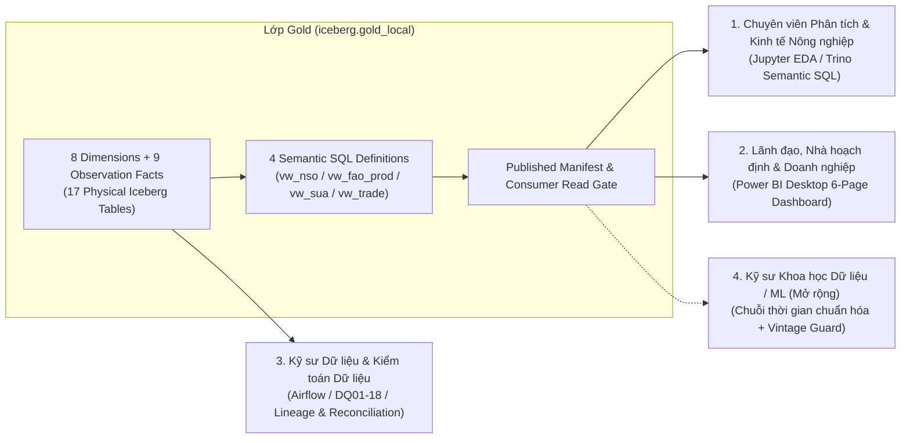

# Đặc tả Bài toán Nghiệp vụ, Câu hỏi Phân tích, Chỉ số (Measures) và Đối tượng Sử dụng Lớp Gold

**Phiên bản thiết kế:** `gold-20261025.1` · **Semantic SQL:** `gold-semantic-20261026.1` · **Data Marts:** `powerbi-marts-1`  
**Cập nhật:** 09/11/2026 · **Trạng thái nghiệm thu:** `GOLD_MVP_COMPLETE` & `DATA_MARTS_POWERBI_COMPLETE` (Batch `ec421297c194…`, 17 bảng vật lý, 1.414.527 dòng quan sát Fact).

Tài liệu này hệ thống hóa **mục đích sử dụng thực tiễn** của thiết kế lớp Gold trong dự án **TLCN Rice Lakehouse**, dùng trực tiếp để trình bày trong cuốn báo cáo đồ án và trả lời phản biện về:
1. Thiết kế các **chỉ số (Measures/KPIs)** trong bảng Fact và tầng Semantic SQL.
2. Các **bài toán nghiệp vụ** mà lớp Gold giải quyết.
3. Các **câu hỏi phân tích cụ thể** mà mô hình trả lời được (kèm số liệu thực tế đã kiểm chứng).
4. **Đối tượng sử dụng (Target Users)** và phương thức khai thác tương ứng.

---

## 1. Kiến trúc Chỉ số (Measures Architecture): Tại sao tách Physical Observation Fact và Semantic Pivot SQL?

Một điểm đặc trưng trong sơ đồ [`dim_fact_v3.dbml`](dim_fact_v3.dbml) và [`rice_lakehouse_gold_v1.drawio`](rice_lakehouse_gold_v1.drawio) là cả **9 bảng Fact vật lý** đều lưu trữ ở dạng **Long / Observation Grain** (mỗi dòng là một quan sát đơn lẻ với cột giá trị `value`), sau đó được xoay (Pivot) thành bảng rộng (Wide format) tại **4 Semantic SQL Query Definitions** ([`queries/gold/`](../../queries/gold/)) và **8 Analytics Data Marts** ([`DATA_MART_DESIGN.md`](../analytics/DATA_MART_DESIGN.md)).

### 1.1. Lý do kỹ thuật của thiết kế 2 tầng chỉ số

1. **Bảo toàn 100% Metadata, Cờ chất lượng (`flag`) và Lý do khuyết (`missing_reason`) theo từng chỉ số**:
   - Trong dữ liệu thống kê nông nghiệp (FAOSTAT, NSO, USDA), mỗi chỉ số (`area`, `production`, `yield`, hoặc 12 chỉ số cân đối cung cầu SUA) có cờ chất lượng nguồn riêng (số chính thức, số ước tính, số nội suy), lý do khuyết riêng và khóa dòng quan sát (`observation_key`) riêng.
   - Nếu gộp cứng (pivot) 12–15 chỉ số vào cùng một dòng vật lý trong bảng Fact, bảng sẽ phải nhân bản hàng chục cột phụ (`flag_1..12`, `missing_reason_1..12`, `dq_warnings_1..12`) hoặc làm mất khả năng truy vết chính xác tới từng ô dữ liệu gốc ở tầng Silver.
2. **Phân biệt rõ 3 trạng thái dữ liệu (Absent vs. Present-NULL vs. True Zero)**:
   - **Absent (`present = 0`, `value = NULL`)**: Nguồn dữ liệu không công bố chỉ số đó trong kỳ.
   - **Present-NULL (`present = 1`, `value = NULL`, có `observation_key` & `missing_reason`)**: Nguồn có dòng báo cáo cho chỉ số đó nhưng giá trị bị khuyết (`..`, `NA`).
   - **True Zero (`present = 1`, `value = 0`)**: Giá trị thực tế bằng `0`.
3. **Ngăn chặn cộng nhầm đơn vị hoặc cộng sai bản chất thống kê**:
   - Tại tầng vật lý, mỗi dòng Fact liên kết chặt chẽ với [`dim_observation_type`](dim_fact_v3.dbml) (quản lý 34 chỉ số sản xuất/thương mại/cung cầu) hoặc [`dim_price_series`](dim_fact_v3.dbml) (quản lý 1.042 chuỗi giá/chỉ số giá).
   - Cột `aggregation_rule` trong `dim_observation_type` quy định rõ chỉ số nào được phép `SUM` và chỉ số nào bị cấm (`NEVER_SUM`, `NO_SUM_OVER_TIME`, `NO_SUM_WITH_COMPONENTS`, `SIGNED_FLOW`).

### 1.2. Danh mục đầy đủ các Chỉ số (Measures & Derived KPIs) tại lớp Gold

| Nhóm nghiệp vụ | Bảng Fact vật lý & Kiểu dữ liệu `value` | Các chỉ số gốc (Base Measures) được chuẩn hóa đơn vị tại Gold | Chỉ số xoay cột & dẫn xuất (Pivoted & Derived KPIs) tại Semantic SQL / Data Marts | Quy tắc cộng gộp (`aggregation_rule` / Guardrails) |
|---|---|---|---|---|
| **1. Sản xuất lúa gạo toàn cầu (FAOSTAT)** | `fact_fao_production_observation` `value decimal(18,2)` | • `5312`: Diện tích thu hoạch (`hectare`) • `5510`: Sản lượng lúa (`tonne`) • `5412`: Năng suất công bố (`kg/hectare`) | **Tại `vw_fao_production_yield` & Mart `03`:** • `area_ha`, `production_t`, `reported_yield_kg_ha` • **Năng suất tính lại (`computed_yield_kg_ha`)**: $$\frac{1000 \times \text{production\_t}}{\text{area\_ha}} \quad (\text{area\_ha} > 0)$$ • **Năng suất bình quân gia quyền (`weighted_yield_kg_ha`)**: $$\frac{1000 \times \sum \text{production\_t (paired)}}{\sum \text{area\_ha (paired)}}$$ | • `5312`, `5510`: `AREA_OR_FLOW_NONOVERLAP` (chỉ `SUM` các vùng không chồng lấn). • `5412`: **`NEVER_SUM`** (không bao giờ cộng hoặc lấy trung bình cộng giản đơn `AVG` năng suất giữa các nước/năm). |
| **2. Thương mại lúa gạo song phương (FAOSTAT)** | `fact_fao_trade_observation` `value decimal(22,2)` | • `5610`: Lượng nhập khẩu (`tonne`, `×1`) • `5622`: Kim ngạch nhập khẩu (`USD`, **đã nhân `×1000`** từ `1000 USD`) • `5910`: Lượng xuất khẩu (`tonne`, `×1`) • `5922`: Kim ngạch xuất khẩu (`USD`, **đã nhân `×1000`** từ `1000 USD`) | **Tại `vw_trade_reported_unit_values` & Mart `08`:** • `import_quantity_t`, `import_value_usd` • `export_quantity_t`, `export_value_usd` • **Đơn giá nhập khẩu (`reported_import_unit_value_usd_t`)**: $$\frac{\text{import\_value\_usd}}{\text{import\_quantity\_t}}$$ • **Đơn giá xuất khẩu (`reported_export_unit_value_usd_t`)**: $$\frac{\text{export\_value\_usd}}{\text{export\_quantity\_t}}$$ | • `AREA_OR_FLOW_NONOVERLAP` trong cùng một chiều báo cáo (`reporter`) và cùng mã CPC. • Không cộng gộp chiều Xuất khẩu của nước A với Nhập khẩu đối ứng của nước B (tránh đếm trùng mirror flow). • Đơn giá tổng hợp nhiều năm/đối tác phải tính bằng **Ratio-of-Paired-Sums**, không `AVG` đơn giá. |
| **3. Cân đối Cung – Sử dụng (FAOSTAT SUA)** | `fact_fao_sua_observation` `value decimal(18,2)` | **12 chỉ số cân đối** (`tonne`, `×1`): • Nguồn cung & Dự trữ: `5113` (Tồn kho đầu kỳ), `5510` (Sản xuất), `5610` (Nhập khẩu), `5071` (Biến động tồn kho) • Phân bổ & Sử dụng: `5910` (Xuất khẩu), `5141` (Lương thực/Thực phẩm), `5520` (Thức ăn chăn nuôi), `5525` (Hạt giống), `5023` (Chế biến), `5016` (Hao hụt sau thu hoạch), `5165` (Sử dụng phi thực phẩm khác), `5166` (Sai số thống kê / Residuals) | **Tại `vw_sua_supported_balance` & Mart `04`:** • 12 cột tường minh: `opening_stocks_t`, `production_t`, `import_quantity_t`, `stock_variation_t`, `export_quantity_t`, `food_supply_quantity_t`, `feed_t`, `seed_t`, `processed_t`, `loss_t`, `other_uses_t`, `residuals_t` • Kèm 12 cờ `present_*` và 12 khóa `observation_*` | • `5113` (Opening stocks): **`NO_SUM_OVER_TIME`** (tồn kho là biến trạng thái tại một thời điểm, cấm cộng dồn qua các năm). • `5071` (Stock Variation) & `5166` (Residuals): **`SIGNED_FLOW`** (giữ nguyên dấu âm/dương của nguồn, không lấy `ABS` hay ép về `0`). |
| **4. Cân đối Cung – Cầu Niên vụ (USDA PSD)** | `fact_usda_psd_observation` `value decimal(22,4)` | **15 chỉ số theo niên vụ (`market_year`)**: • **Nhân `×1000` sang `hectare` / `tonne`**: `Area Harvested`, `Beginning Stocks`, `Ending Stocks`, `Production` (gạo xay xát), `Rough Production` (lúa nguyên liệu), `Imports`, `Exports`, `TY Imports`, `TY Exports`, `TY Imp. from U.S.`, `Domestic Consumption`, `Total Supply`, `Total Distribution` • **Giữ nguyên (`×1`)**: `Yield` (`tonne/hectare`), `Milling Rate (.9999)` (`fraction`, đã chia 10.000 ở Silver) | **Tại Mart `05` (`usda_psd.csv`):** • Biểu diễn theo từng `attribute` và `market_year` (`crop_year` dạng `YYYY/YYYY+1`) • So sánh biến động sản lượng, tiêu thụ nội địa và tồn kho cuối kỳ giữa các niên vụ | • `Beginning/Ending Stocks`: **`NO_SUM_OVER_TIME`**. • `Total Supply` / `Total Distribution`: **`NO_SUM_WITH_COMPONENTS`** (cấm cộng tổng với các thành phần con). • `MY_FLOW` (niên vụ canh tác) tách biệt với `TY_FLOW` (năm thương mại) và `TY_SUBSET` (`TY Imp. from U.S.`). • `Yield` & `Milling Rate`: **`NEVER_SUM`**. |
| **5. Thống kê Sản xuất Lúa gạo Việt Nam (NSO)** | `fact_nso_observation` `value decimal(28,8)` `value_source decimal(28,8)` | Tổ hợp `measure` $\times$ `statistic_kind` $\times$ `season` trên 13 bảng công bố (`V06.12`–`V06.24`): • `area` (`hectare` hoặc `percent` chỉ số phát triển) • `production` (`tonne` hoặc `percent`) • `yield` (`kg/hectare` hoặc `percent`) • 5 vụ (`season`): `annual`, `winter_spring` (Đông Xuân), `summer_autumn` (Hè Thu), `summer_autumn_autumn_winter` (Hè Thu + Thu Đông), `main_season` (Mùa) | **Tại `vw_nso_source_observations` & Mart `02`:** • `production_t`, `area_ha` (cả năm & theo vụ tại `V06.12`) • `yield_kg_ha` (năng suất công bố tại `V06.14`) • **Tăng trưởng cả giai đoạn (`Endpoint Change %`)** và **Tăng trưởng năm liền kề (`YoY %`)** • Xác định **Năm đạt đỉnh (`Peak Year / Peak Production`)** và mức thay đổi sau đỉnh | • Không cộng gộp cấp Quốc gia (`national`) + Vùng (`region`) + Tỉnh (`province`). • Không cộng số Cả năm (`annual`) với các vụ (`season`), không gộp hai bảng công bố (`source_table`) khác nhau. • Không diễn giải `development_index` (kỳ gốc năm trước = 100) thành tốc độ tăng trưởng thuần (ví dụ: `102,5%` là tăng `2,5%`, không phải tăng `102,5%`). |
| **6. Chuỗi Giá & Chỉ số Giá Đa tầng (WB, FAO, USDA, VN)** | • `fact_price_monthly` (`decimal(20,4)`) • `fact_fao_price_annual` (`decimal(18,4)`) • `fact_usda_price_reference` (`decimal(18,2)`) • `fact_vn_market_quote_daily` (`decimal(18,2)`) | • **World Bank**: 71 chuỗi giá hàng hóa/gạo chuẩn quốc tế (`USD/tonne`, `USD/barrel`, `index 2010=100`...) • **FAOSTAT**: Giá sản xuất tháng/năm (`USD/tonne`, `LCU/tonne`, `SLC/tonne`) và Chỉ số giá (`index 2014-2016=100`) • **USDA Yearbook**: Giá xuất khẩu tham chiếu (`USD/tonne`) theo tháng và kỳ `MARKETING` • **VN Market Quote**: Giá thu mua/bán nội địa hàng ngày (`VND/kg`) theo thị trường, giống lúa, nguồn tin | **Tại Mart `06` (`wb_benchmark.csv`) & Mart `07` (`vn_quote.csv`):** • Mức giá cực đại (`Peak Price`), cực tiểu (`Minimum Price`), biên độ dao động (`Price Range`) • **Thay đổi theo tháng (`MoM %`)**: $$\frac{P_t - P_{t-1}}{P_{t-1}}$$ • **Độ biến động trượt 12 tháng (`12M Rolling Volatility`)**: Độ lệch chuẩn mẫu ($s$, `ddof=1`) của 12 lợi suất logarit ($\ln(P_t / P_{t-1})$) liên tiếp | • **Cấm `SUM` mọi loại giá và chỉ số giá.** • Cấm lấy trung bình cộng (`AVG`) giữa các đồng tiền khác nhau (`LCU`, `USD`, `VND`), giữa các phẩm cấp gạo khác nhau (5% tấm, 25% tấm, đồ/parboiled, lúa tươi IR 50404 vs OM 5451) hoặc giữa các nguồn báo giá khác nhau. • Không tự nội suy (interpolate) vào các ngày nghỉ/tháng khuyết. |

---

## 2. Thiết kế Lớp Gold Phục vụ các Bài toán Nghiệp vụ Gì?

Với 8 Dimensions, 9 Facts và 4 Semantic SQL, lớp Gold giải quyết **6 bài toán nghiệp vụ cốt lõi** trong phân tích kinh tế và chuỗi cung ứng ngành lúa gạo:

1. **Bài toán 1 — Đánh giá quy mô, cơ cấu mùa vụ và chững lại sau đỉnh của sản xuất lúa gạo Việt Nam**:
   - Theo dõi sự dịch chuyển dài hạn (1990–2024) giữa mở rộng diện tích canh tác (`area_ha`) và thâm canh tăng năng suất (`yield_kg_ha`).
   - Phân tích vai trò của từng vụ lúa (Đông Xuân, Hè Thu, Mùa) trong tổng sản lượng quốc gia mà không làm lẫn lộn các kỳ xuất bản niên giám khác nhau của Cục Thống kê (NSO).
2. **Bài toán 2 — Định vị năng lực sản xuất và năng suất lúa của Việt Nam trong nhóm các quốc gia sản xuất lớn (Châu Á)**:
   - Đối sánh tốc độ cải thiện năng suất (`computed_yield_kg_ha`) và quy mô sản lượng (`production_t`) giữa Việt Nam với các quốc gia trọng điểm như Ấn Độ, Thái Lan, Indonesia trên cùng một hệ quy chiếu lịch dương và mã sản phẩm CPC `0113` (Paddy rice) của FAOSTAT trong hơn 6 thập kỷ (1961–2024).
3. **Bài toán 3 — Phân tích Cân đối Cung – Cầu – Dự trữ và An ninh Lương thực**:
   - Theo dõi cấu trúc sử dụng gạo xay xát trong nước (tiêu dùng thực phẩm `food_supply_quantity_t`, chế biến, thức ăn chăn nuôi, giống, hao hụt sau thu hoạch) và lượng dự trữ (`opening_stocks_t`, `Ending Stocks`) dưới cả góc nhìn năm dương lịch (FAOSTAT SUA) lẫn năm niên vụ canh tác (USDA PSD).
4. **Bài toán 4 — Phân tích Thị trường Xuất khẩu Song phương và Giá trị Gia tăng Thương mại**:
   - Đánh giá khối lượng xuất khẩu (`export_quantity_t`), kim ngạch (`export_value_usd`) và đơn giá xuất khẩu bình quân (`reported_export_unit_value_usd_t`) của gạo xay xát Việt Nam sang các thị trường đối tác chiến lược (Philippines, Trung Quốc đại lục, Malaysia...), giúp nhận diện sự dịch chuyển thị trường và xu hướng giá trị trên mỗi tấn gạo xuất khẩu.
5. **Bài toán 5 — Giám sát Biến động Giá Lúa Gạo Đa Tầng (Từ Thị trường Thế giới đến Điểm Thu mua Nội địa)**:
   - Theo dõi các cú sốc giá lương thực toàn cầu và độ biến động rủi ro giá (`12M Volatility`) qua chuỗi giá chuẩn World Bank (`rice_thai_5`) và USDA Yearbook.
   - Giám sát sát sao biến động giá thu mua lúa tươi hàng ngày (`VND/kg`) tại các địa phương trọng điểm Đồng bằng sông Cửu Long (như An Giang, Long Xuyên...) theo từng giống lúa cụ thể (`IR 50404`, `OM 5451`...).
6. **Bài toán 6 — Quản trị Chất lượng Dữ liệu Đa Nguồn, Kiểm toán (Data Auditing) và Minh bạch Hóa Độ Phủ (Data Coverage)**:
   - Đánh giá tỷ lệ dữ liệu có giá trị số (`numeric_coverage_pct`), tỷ lệ dữ liệu khuyết có ghi nhận (`present_null_rows`) và khoảng trống thời gian (`absent_periods`) trên toàn bộ 1.414.527 quan sát trước khi đưa vào mô hình phân tích hoặc báo cáo quản trị.

---

## 3. Các Câu hỏi Phân tích Cụ thể mà Lớp Gold Trả lời Được (Kèm Bằng chứng Số liệu Thực tế)

Toàn bộ các câu hỏi phân tích dưới đây đã được thực thi và kiểm chứng trực tiếp trên dữ liệu lớp Gold thông qua 6 Jupyter Notebooks ([`EDA_FINDINGS.md`](../analytics/EDA_FINDINGS.md)) và 6 trang Dashboard Power BI ([`REPORT_INSIGHTS.md`](../powerbi/REPORT_INSIGHTS.md)):

### Nhóm A: Sản xuất Lúa gạo Việt Nam (Nguồn NSO — `fact_nso_observation` & `vw_nso_source_observations`)

| Mã | Câu hỏi phân tích nghiệp vụ | Bảng / Chỉ số khai thác | Câu trả lời từ dữ liệu lớp Gold (Đã kiểm chứng) |
|---|---|---|---|
| **VN01** | Sản lượng lúa cả năm của Việt Nam đã tăng trưởng như thế nào trong hơn 3 thập kỷ qua (1990–2024)? | `fact_nso_observation` (`V06.12`, `national`, `annual`, `production`, `tonne`) | Tăng từ **19.225.100 tấn** (năm 1990) lên **43.451.600 tấn** (năm 2024), tương ứng mức tăng **+126,01%**. |
| **VN02** | Diện tích gieo trồng lúa cả năm của Việt Nam thay đổi ra sao trong cùng giai đoạn 1990–2024? | `fact_nso_observation` (`V06.12`, `national`, `annual`, `area`, `hectare`) | Tăng từ **6.042.800 ha** (năm 1990) lên **7.127.100 ha** (năm 2024), tương ứng mức tăng **+17,94%** (thấp hơn nhiều so với mức tăng sản lượng, phản ánh vai trò chủ đạo của tăng năng suất). |
| **VN03** | Năng suất lúa bình quân cả năm công bố chính thức của Việt Nam cải thiện thế nào từ 1995 đến 2024? | `fact_nso_observation` (`V06.14`, `national`, `annual`, `yield`, `kg/hectare`) | Tăng từ **3.690 kg/ha** (năm 1995) lên **6.100 kg/ha** (năm 2024), tương ứng **+65,31%**. |
| **VN04** | Trong các vụ lúa chính tại Việt Nam hiện nay, vụ nào đóng góp sản lượng lớn nhất? | `fact_nso_observation` (`V06.12`, `season` $\in$ `{winter_spring, summer_autumn, main_season}`) | Năm 2024, **vụ Đông Xuân (`winter_spring`)** đạt sản lượng cao nhất với **20.333.900 tấn** trong 3 vụ được công bố. |
| **VN05** | Sản lượng lúa Việt Nam có tăng liên tục hay đã đạt đỉnh rồi điều chỉnh giảm? | `fact_nso_observation` (`V06.12`, chuỗi 1990–2024, chỉ số `Peak Year` & `Endpoint Change`) | Sản lượng đạt đỉnh quan sát tại năm **2015** với **45.091.000 tấn**. Từ 2015 đến 2024, sản lượng giảm nhẹ **−3,64%** (về 43,45 triệu tấn) trong bối cảnh diện tích gieo trồng giảm **−8,95%** do chuyển đổi cơ cấu cây trồng/đô thị hóa. |

### Nhóm B: Sản xuất & Năng suất Lúa Toàn cầu (Nguồn FAOSTAT — `fact_fao_production_observation` & `vw_fao_production_yield`)

| Mã | Câu hỏi phân tích nghiệp vụ | Bảng / Chỉ số khai thác | Câu trả lời từ dữ liệu lớp Gold (Đã kiểm chứng) |
|---|---|---|---|
| **FAO01** | Xét trong chuỗi lịch sử dài hạn 1961–2024 của FAOSTAT, diện tích, sản lượng và năng suất lúa của Việt Nam thay đổi bao nhiêu phần trăm? | `vw_fao_production_yield` (M49 `704`, CPC `0113`, `area_ha`, `production_t`, `computed_yield_kg_ha`) | Giai đoạn 1961–2024 tại Việt Nam: Sản lượng tăng **+382,92%**, diện tích thu hoạch tăng **+48,89%**, và năng suất tính từ cặp sản lượng/diện tích tăng **+224,35%**. |
| **FAO02** | Năng suất lúa tính toán (`computed_yield_kg_ha`) của Việt Nam đã tiến bộ từ mức nào lên mức nào trong giai đoạn 1961–2024? | `vw_fao_production_yield` (`computed_yield_kg_ha`, M49 `704`) | Tăng hơn 3,2 lần: từ **1.896,59 kg/ha** (năm 1961) lên **6.151,66 kg/ha** (năm 2024) — dẫn đầu tốc độ cải thiện năng suất trong nhóm 4 quốc gia đối sánh. |
| **FAO03** | Trong nhóm 4 quốc gia sản xuất lúa trọng điểm châu Á được chọn đối sánh (Ấn Độ, Indonesia, Thái Lan, Việt Nam), quốc gia nào có quy mô sản lượng lớn nhất năm 2024? | `vw_fao_production_yield` (M49 `356, 360, 704, 764`, CPC `0113`, năm 2024) | Năm 2024, **Ấn Độ (M49 `356`)** dẫn đầu nhóm 4 nước với sản lượng **217.867.864,16 tấn**. |

### Nhóm C: Cân đối Cung – Cầu & Dự trữ Lương thực (Nguồn FAOSTAT SUA & USDA PSD)

| Mã | Câu hỏi phân tích nghiệp vụ | Bảng / Chỉ số khai thác | Câu trả lời từ dữ liệu lớp Gold (Đã kiểm chứng) |
|---|---|---|---|
| **SUA01** | Lượng gạo xay xát dùng làm lương thực/thực phẩm (`food_supply_quantity_t`) tại Việt Nam theo FAOSTAT thay đổi thế nào giai đoạn 2010–2023? | `vw_sua_supported_balance` (M49 `704`, CPC `23161.02`, element `5141`) | Giảm nhẹ **−1,51%**, từ **14.050.000 tấn** (năm 2010) xuống **13.837.660,13 tấn** (năm 2023), phản ánh xu hướng đa dạng hóa khẩu phần ăn khi thu nhập tăng. |
| **SUA02** | Mức tồn kho đầu kỳ (`opening_stocks_t`) gạo xay xát của Việt Nam theo FAOSTAT SUA giai đoạn 2010–2023 biến động ra sao? | `vw_sua_supported_balance` (M49 `704`, CPC `23161.02`, element `5113`) | Tăng **+3,31%**, từ **5.917.024,29 tấn** (năm 2010) lên **6.113.011,31 tấn** (năm 2023). |
| **PSD01** | Theo báo cáo niên vụ của Bộ Nông nghiệp Hoa Kỳ (USDA PSD), sản lượng gạo xay xát của Việt Nam từ niên vụ 2010/2011 đến 2025/2026 giữ ở mức nào? | `fact_usda_psd_observation` (`Vietnam`, `Rice, Milled`, `Production`, `market_year` 2010–2025) | Duy trì ổn định quanh ngưỡng 26,2–26,4 triệu tấn: từ **26.371.000 tấn** (MY 2010) sang **26.200.000 tấn** (MY 2025, **−0,65%**). |
| **PSD02** | Tồn kho cuối niên vụ (`Ending Stocks`) của gạo Việt Nam theo USDA PSD thay đổi như thế nào từ MY 2010 đến MY 2025? | `fact_usda_psd_observation` (`Vietnam`, `Rice, Milled`, `Ending Stocks`, `market_year` 2010–2025) | Tăng **+18,34%**, từ **1.941.000 tấn** (MY 2010) lên **2.297.000 tấn** (MY 2025), củng cố đệm dự trữ lương thực. |

### Nhóm D: Biến động Giá Quốc tế & Báo giá Nội địa (Nguồn World Bank, FAO, USDA, Thị trường Nông sản VN)

| Mã | Câu hỏi phân tích nghiệp vụ | Bảng / Chỉ số khai thác | Câu trả lời từ dữ liệu lớp Gold (Đã kiểm chứng) |
|---|---|---|---|
| **PR01** | Trong phần tư thế kỷ đầu tiên (2000–2025), giá gạo chuẩn quốc tế (`rice_thai_5` của World Bank) đạt đỉnh lịch sử và đáy lịch sử ở mức nào, vào thời điểm nào? | `fact_price_monthly` + `dim_price_series` (`worldbank_pinksheet`, `rice_thai_5`, `USD/tonne`) | • **Đỉnh lịch sử (High):** **907,00 USD/tấn** vào tháng **04/2008** (khủng hoảng giá lương thực toàn cầu). • **Đáy lịch sử (Low):** **163,75 USD/tấn** vào tháng **04/2001**. |
| **PR02** | Giai đoạn nào thị trường gạo quốc tế trải qua mức độ biến động rủi ro giá (Volatility 12 tháng) dữ dội nhất? | `fact_price_monthly` (`rice_thai_5`, chỉ số `12M Trailing Log-Return Sample Std`) | Độ biến động trượt 12 tháng đạt đỉnh cao nhất là **17,47%** vào tháng **01/2009** (ngay sau cú sốc giá năm 2008). |
| **PR03** | Giá lúa tươi IR 50404 thương lái thu mua tại An Giang biến động trong khoảng nào từ năm 2021 đến năm 2026? | `fact_vn_market_quote_daily` + `dim_price_series` (`An Giang`, `Lúa IR 50404 (lúa tươi)`, `Thương lái thu mua`, `VND/kg`, `CTV địa phương`) | Trên **484 ngày có báo giá** (từ 01/04/2021 đến 03/08/2026), mức giá dao động trong biên độ từ **4.500,00 VND/kg** đến **9.400,00 VND/kg**. |

### Nhóm E: Thương mại Lúa gạo Song phương Quốc tế (Nguồn FAOSTAT Trade — `fact_fao_trade_observation` & `vw_trade_reported_unit_values`)

| Mã | Câu hỏi phân tích nghiệp vụ | Bảng / Chỉ số khai thác | Câu trả lời từ dữ liệu lớp Gold (Đã kiểm chứng) |
|---|---|---|---|
| **TR01** | Khối lượng gạo xay xát Việt Nam xuất khẩu sang Trung Quốc đại lục (M49 `156`) thay đổi thế nào giai đoạn 2019–2023? | `vw_trade_reported_unit_values` (Reporter `704`, Partner `156`, CPC `23161.02`, `export_quantity_t`) | Tăng mạnh **+117,19%**, từ **347.012,45 tấn** (năm 2019) lên **753.672,54 tấn** (năm 2023). |
| **TR02** | Khối lượng gạo xay xát Việt Nam xuất khẩu sang Malaysia (M49 `458`) giai đoạn 2019–2023 biến động theo chiều hướng nào? | `vw_trade_reported_unit_values` (Reporter `704`, Partner `458`, CPC `23161.02`, `export_quantity_t`) | Giảm **−26,72%**, từ **546.516,60 tấn** (năm 2019) xuống **400.504,18 tấn** (năm 2023). |
| **TR03** | Thị trường nhập khẩu gạo lớn nhất của Việt Nam là Philippines (M49 `608`) đã tăng khối lượng nhập từ Việt Nam ra sao trong giai đoạn 2019–2023? | `vw_trade_reported_unit_values` (Reporter `704`, Partner `608`, CPC `23161.02`, `export_quantity_t`) | Tăng **+41,62%**, từ **2.129.613,10 tấn** (năm 2019) lên **3.015.899,86 tấn** (năm 2023). Tổng 5 năm (2019–2023) đạt **12.863.751,28 tấn** trị giá **6,295 tỷ USD**. |
| **TR04** | Đơn giá xuất khẩu bình quân (`reported_export_unit_value_usd_t`) gạo xay xát của Việt Nam sang Philippines đã cải thiện như thế nào? | `vw_trade_reported_unit_values` (Reporter `704`, Partner `608`, CPC `23161.02`, `export_value_usd / export_quantity_t`) | Tăng **+35,16%**, từ **414,96 USD/tấn** (năm 2019) lên **560,88 USD/tấn** (năm 2023); đơn giá bình quân gia quyền cả giai đoạn 5 năm đạt **489,38 USD/tấn**. |

### Nhóm F: Kiểm toán Độ phủ & Chất lượng Dữ liệu (Data Governance — Toàn bộ 17 bảng Gold)

| Mã | Câu hỏi phân tích / Kiểm toán dữ liệu | Bảng / Chỉ số khai thác | Câu trả lời từ dữ liệu lớp Gold (Đã kiểm chứng) |
|---|---|---|---|
| **OV01** | Tỷ lệ quan sát có giá trị số thực tế so với các dòng khuyết (`Present-NULL`) trên toàn bộ lớp Gold là bao nhiêu? Nguồn nào có tỷ lệ khuyết cao nhất? | 9 bảng Fact (`rows_total`, `numeric_rows`, `present_null_rows`, `numeric_coverage_pct`) | Toàn bộ 9 bảng Fact có **1.414.527 quan sát**, trong đó **1.402.167 quan sát có số (99,13%)** và **12.360 quan sát `Present-NULL` (0,87%)**. Bảng `fact_usda_price_reference` có tỷ lệ `Present-NULL` cao nhất: **4.523 / 12.936 dòng (34,96%)** do nguồn USDA đánh dấu `NA` ở các tháng không có báo giá. |
| **OV02** | Độ phủ thời gian (`Calendar Span` vs. `Represented Periods`) của từng bảng Fact có liên tục không? | 9 bảng Fact + `dim_year` / `dim_month` / `dim_date` | 8/9 bảng Fact theo năm và tháng có độ phủ kỳ đạt 100% trong khoảng thời gian nguồn (0 kỳ bị đứt quãng cấp toàn bảng). Riêng bảng giá nội địa theo ngày `fact_vn_market_quote_daily` có **1.211 ngày có báo giá** trên tổng khung lịch **2.038 ngày** (827 ngày không có báo giá do cuối tuần/nghỉ lễ/không phát sinh tin). |
| **OV03** | Hệ thống danh mục (Dimensions) của lớp Gold quản lý bao nhiêu loại chỉ số, bao nhiêu chuỗi giá và bao nhiêu không gian định danh địa lý? | `dim_observation_type`, `dim_price_series`, `dim_source_geography`, `dim_source_product` | Quản lý chính xác **34 loại chỉ số đo lường (`dim_observation_type`)**, **1.042 chuỗi giá (`dim_price_series`)**, **295 định danh sản phẩm/phẩm cấp (`dim_source_product`)**, và **987 thực thể địa lý (`dim_source_geography`)** thuộc 6 `identity_namespace`. |

---

## 4. Đối tượng Sử dụng (Target Personas) của Lớp Gold là Ai?

Thiết kế của lớp Gold được phân tầng rõ ràng để phục vụ **4 nhóm đối tượng sử dụng** khác nhau với quyền hạn và công cụ truy cập phù hợp:

### 4.1. Nhóm 1: Chuyên viên Phân tích Dữ liệu & Nghiên cứu Kinh tế Nông nghiệp (Data Analysts / Agricultural Economists)
- **Nhu cầu**: Truy vấn chuyên sâu theo từng mùa vụ, từng mặt hàng (CPC), phân tích tương quan diện tích – năng suất – sản lượng, phân tích biến động giá (log-return volatility) và thương mại song phương mà không sợ bị sai lệch đơn vị hay mất cờ cảnh báo của nguồn.
- **Điểm chạm trong lớp Gold**:
  - Sử dụng **4 Semantic SQL Definitions** (`vw_nso_source_observations`, `vw_fao_production_yield`, `vw_sua_supported_balance`, `vw_trade_reported_unit_values`) và trình khách `EDAClient` (trong 6 Jupyter Notebooks tại [`notebooks/analytics/`](../../notebooks/analytics/)).
  - Tận dụng các cột `present_*`, `missing_reason`, `release_status` (`provisional` / `unconfirmed`) và `source_context_json` để đưa ra nhận định kinh tế có căn cứ xác thực.

### 4.2. Nhóm 2: Nhà Quản lý, Hoạch định Chính sách & Doanh nghiệp Xuất nhập khẩu Lúa gạo (BI Users / Decision Makers)
- **Nhu cầu**: Theo dõi bức tranh tổng thể và trực quan qua các chỉ số KPI, biểu đồ xu hướng (Trend lines), so sánh thị trường xuất khẩu và theo dõi giá lúa gạo quốc tế/nội địa mà không cần viết câu lệnh SQL.
- **Điểm chạm trong lớp Gold**:
  - Khai thác thông qua **8 Analytics Data Marts (10 file CSV đã kiểm định)** được kết nối trực tiếp vào **Báo cáo Power BI Desktop 6 trang tiếng Việt** ([`TLCN_Rice_Analytics.pbip`](../../powerbi/TLCN_Rice_Analytics.pbip)):
    - *Trang 1*: Tổng quan Độ phủ & Chất lượng Dữ liệu lớp Gold.
    - *Trang 2*: Sản xuất Lúa gạo Việt Nam (NSO Quốc gia & Mùa vụ).
    - *Trang 3*: Sản xuất & Năng suất Lúa Toàn cầu (Đối sánh FAOSTAT).
    - *Trang 4*: Cân đối Cung – Cầu & Tồn kho (FAOSTAT SUA & USDA PSD).
    - *Trang 5*: Biến động Giá Gạo Quốc tế (World Bank) & Giá Lúa Nội địa (An Giang).
    - *Trang 6*: Thương mại Xuất khẩu Gạo Song phương Việt Nam (FAOSTAT Trade).

### 4.3. Nhóm 3: Kỹ sư Dữ liệu & Quản trị viên Dữ liệu (Data Engineers / Data Stewards)
- **Nhu cầu**: Vận hành pipeline ổn định trên hạ tầng giới hạn tài nguyên (Laptop 16 GB RAM, Trino 512 MiB heap), đảm bảo tính toàn vẹn dữ liệu từ Silver sang Gold, kiểm soát phiên bản (Snapshot Isolation) và truy vết lỗi về tận file Raw/Bronze.
- **Điểm chạm trong lớp Gold**:
  - Quản lý thông qua DAG [`rice_lakehouse_gold_pipeline`](../../dags/dag_gold_pipeline.py), 18 nhóm cổng chất lượng **DQ01–DQ18** ([`quality.py`](../../src/gold/quality.py)), đối chiếu tập hợp hai chiều `EXCEPT ALL` và cơ chế `Publication Manifest` / `Consumer Read Gate` ([`publication.py`](../../src/gold/publication.py), [`consumer.py`](../../src/gold/consumer.py)).
  - Tra cứu 15 cột kỹ thuật trên mỗi bảng Fact (`silver_table_uuid`, `silver_read_snapshot_id`, `_ingestion_run_id`, `_source_file`, `_source_checksum`, `source_business_key_json`, `dq_warnings_json`) để kiểm toán bất kỳ con số nào xuất hiện trên báo cáo.

### 4.4. Nhóm 4: Kỹ sư Khoa học Dữ liệu / Học máy (Data Scientists — Định hướng Mở rộng)
- **Nhu cầu**: Xây dựng mô hình dự báo giá gạo hoặc sản lượng (Time-series Forecasting) mà không gặp lỗi rò rỉ dữ liệu tương lai (*Data Leakage*) hoặc lỗi nhảy kỳ do tháng bị khuyết.
- **Điểm chạm trong lớp Gold**:
  - Sử dụng trục lịch liên tục (`dim_year`, `dim_month`, `dim_date`) kết hợp với chuỗi giá chuẩn hóa (`fact_price_monthly`, `fact_vn_market_quote_daily`).
  - Thiết kế lớp Gold hiện tại bảo vệ người làm ML bằng cách **tách rõ thời điểm xử lý kỹ thuật (`_silver_processed_at`) khỏi thời điểm công bố thực tế (publication vintage)** và giữ nguyên các tháng khuyết thay vì tự động điền số (`COALESCE(value, 0)` hoặc dùng `LEAD()` bỏ qua tháng khuyết), đặt nền tảng chuẩn mực cho cổng kiểm định chống rò rỉ dữ liệu (`DQ19`) khi bổ sung dữ liệu lịch sử công bố.

---

## 5. Tóm tắt các Giới hạn Nghiệp vụ Công khai (Cần nhấn mạnh khi Báo cáo Thầy)

Để bài báo cáo thể hiện tính trung thực khoa học cao nhất, khi trình bày trước hội đồng bạn nên chủ động nêu rõ **5 nguyên tắc giới hạn (Scope Boundaries)** mà lớp Gold tuân thủ nghiêm ngặt:

1. **Không tự động đồng nhất địa giới hành chính lịch sử khi chưa có bảng đối chiếu pháp lý**: Các nhãn địa phương của NSO (64 nhãn tỉnh bao gồm cả tỉnh cũ như Hà Tây) và nhãn thị trường nội địa (`An Giang`, `Long Xuyên`) được giữ nguyên trong `dim_source_geography` theo từng `identity_namespace`, không tự ý gộp hay chia tách theo tỷ lệ giả định.
2. **Không trộn lẫn các hệ quy chiếu thời gian khác bản chất**: Năm dương lịch (`dim_year`) chỉ dùng cho dữ liệu thực sự theo lịch dương (FAOSTAT, NSO, World Bank, VN Quotes). Niên vụ canh tác (`market_year` của USDA PSD) và kỳ tham chiếu (`reference_year` / `MARKETING` của USDA Yearbook) được giữ riêng để tránh nối sai kỳ.
3. **Không quy đổi chéo phẩm cấp sản phẩm hoặc tiền tệ khi thiếu hệ số chuẩn**: Không tự nhân hệ số xay xát mặc định để biến lúa (`paddy`) thành gạo (`milled`), và không tự quy đổi tỷ giá lịch sử cho các đồng nội tệ (`LCU`/`SLC`).
4. **Không suy diễn nhân quả (Causality) từ thống kê mô tả**: Các chỉ số phần trăm thay đổi (như sản lượng giảm sau đỉnh 2015 hay biến động đơn giá xuất khẩu) là kết quả đối chiếu mô tả chính xác trên dữ liệu đã công bố, không tự gán kết luận nhân quả kinh tế vĩ mô khi chưa chạy mô hình kiểm định.
5. **Chỉ đọc dữ liệu từ Batch đã Publish (`PUBLISHED`)**: Mọi truy vấn phân tích và xuất CSV cho Power BI đều phải đi qua `consumer.read_window()`, đảm bảo 100% số liệu báo cáo lấy từ cùng một bộ Snapshot Iceberg đồng nhất.
