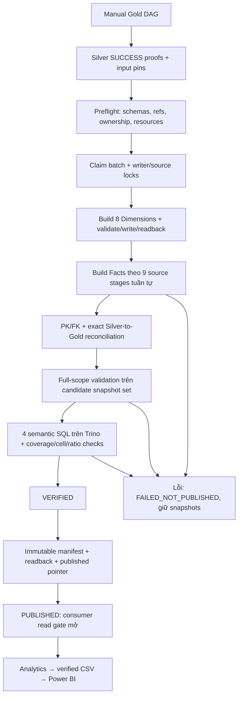

# Thuyết trình lớp Gold — mô hình, luồng xử lý và dữ liệu được phép báo cáo

Ngày đối chiếu code: **31/10/2026**. Branch `feat(gold)`, HEAD `cd2f1a77b27d5bcba6f1d925e3d9305952551bae`.

Tài liệu tiếp nối [Bronze](../bronze/BRONZE_PRESENTATION.md) và [Silver](../silver/SILVER_PRESENTATION.md). Dựa trên active Gold code, canonical DBML, mapping và bằng chứng nghiệm thu có sẵn. Lần viết này chỉ đọc repository và thêm tài liệu; không chạy DAG, Spark, Trino hoặc kiểm chứng lại physical snapshots. Số liệu nghiệm thu ghi dưới đây thuộc **evidence ngày 26/10/2026**, không phải phép đo runtime mới ngày 31/10.

## 1. Từ Silver sang Gold: nên mở đầu thế nào?

**Bạn có thể nói:**

> “Silver đã chuẩn hóa từng nguồn và kiểm tra business keys, types, units và chất lượng. Gold tổ chức các quan sát hợp lệ đó thành dimensions và facts để phân tích có quy tắc. Ngoài việc ghi bảng, em còn kiểm tra exact reconciliation với Silver, xác nhận các semantic queries và publish một batch có snapshot manifest. Analytics chỉ được đọc batch đã publish qua consumer gate, tránh đọc dữ liệu đang ghi dở hoặc trộn phiên bản.”

Ba tầng khác nhau:

| Tầng | Câu hỏi chính | Đầu ra |
|---|---|---|
| Bronze | Dữ liệu từ file nào, ingest lần nào, đã ghi được chưa? | Bảng gần nguồn + audit/lineage |
| Silver | Quan sát có schema/units/grain/DQ đúng theo nguồn không? | Bảng chuẩn hóa theo từng contract |
| Gold | Phân tích theo đối tượng/chỉ tiêu nào và phiên bản nào được phép đọc? | Dimensions, facts, semantic SQL và published snapshot batch |

**Không chỉ nói “Gold là tổng hợp dữ liệu”.** Gold hiện giữ nhiều facts ở observation grain để không mất thông tin. Việc pivot/tính chỉ tiêu thuận tiện nằm ở semantic SQL; không phải tất cả Gold tables đều đã GROUP BY thành số tổng.

## 2. Gold hiện có gì?

Canonical model: **`gold-20261025.1`**.

```text
Input: 9 nguồn trong iceberg.silver_local
        ↓
8 physical Dimensions + 9 physical Facts
Output: iceberg.gold_local
        ↓
4 version-controlled Semantic SQL Query Definitions
        ↓
Published manifest + consumer read gate
        ↓
Analytics allowlisted queries → CSV → Power BI Desktop
```

Mô hình có **17 physical tables, 262 columns và 40 logical FK references**. Canonical field mapping có **488 source-branch mappings**; một cột có thể nhận nhiều source branches nên số mapping lớn hơn số cột.

Không có bốn physical aggregate tables thay semantic queries. Các tên `vw_*` là tên query definitions, **không phải native persisted catalog views**.

Artifacts chính:

- [dim_fact_v3.dbml](dim_fact_v3.dbml): schema chính thức hiện tại; filename có `v3` vì giữ link ổn định, không có nghĩa vẫn là mô hình cũ 27 bảng.
- [source_to_gold_mapping.csv](source_to_gold_mapping.csv): field mappings chính thức.
- [IMPLEMENTATION.md](IMPLEMENTATION.md): protocol và vận hành.
- [VALIDATION.md](VALIDATION.md), [runtime_acceptance.json](runtime_acceptance.json): evidence nghiệm thu, gồm cả lịch sử lỗi.

README/audit có các đoạn lịch sử giai đoạn thiết kế. Khi nói trạng thái hiện tại, phân biệt banner G12 và runtime evidence với các câu “chưa triển khai/chưa full-data PASS” thuộc giai đoạn trước.

## 3. Em sử dụng công nghệ gì?

| Thành phần | Vai trò |
|---|---|
| Python / PySpark / Spark SQL | Build dimensions/facts, typed projections, exact reconciliation và ghi Iceberg |
| DBML + CSV mapping | Một schema canonical và nguồn gốc field có thể audit |
| Decimal / canonical JSON / SHA-256 | Kiểm conversion chính xác và tạo deterministic keys/fingerprints |
| Iceberg | Physical tables, schema, snapshots và commit theo từng bảng |
| MinIO | Lưu data files, Iceberg metadata và Gold publication objects |
| REST Catalog | Kiểm table UUID, snapshots và commit metadata |
| PostgreSQL | Đọc Airflow/ingestion proofs và cấp writer/source/shared-read advisory locks |
| Airflow | Manual DAG gồm 16 tasks, chạy dependencies và chặn publication khi lỗi |
| Runner HTTP API | Gọi các stage allowlisted, serialize Spark writers |
| Trino 448 | Thực thi và kiểm chứng semantic SQL trên candidate/published snapshots |
| Analytics Python CLI | Truy cập theo allowlist, typed filters và published read gate |
| Power BI Desktop | Dựng báo cáo local từ CSV export đã kiểm chứng, không trực tiếp vận hành ETL |

Trino hiện giữ JVM heap **512 MiB**. Spark làm transformation/write; Trino làm semantic execution. Trino không lưu thay Iceberg, PostgreSQL không chứa toàn bộ Gold fact rows và MinIO không tự enforce business keys.

## 4. Dimension và Fact nghĩa là gì trong dự án này?

**Dimension** mô tả đối tượng hoặc trục phân tích: nguồn, năm, tháng, địa lý nguồn, sản phẩm nguồn, chỉ tiêu, price series.

**Fact** lưu quan sát đo lường tại grain cụ thể: ví dụ sản lượng của một source area, sản phẩm, năm và element. Fact liên kết dimensions bằng keys.

Ví dụ ý tưởng:

```text
dim_year ──────────────────┐
dim_source_geography ──────┤
dim_source_product ────────┼→ fact_fao_production_observation
dim_observation_type ──────┤      observation_key
dim_source_system ─────────┘      value + provenance
```

Một nhóm subject areas chia sẻ dimensions tạo mô hình dimensional có nhiều facts. Không cần cố gọi đây là Galaxy 27 bảng như đề xuất cũ. Giá trị chính là grain, relationships và semantics được kiểm chứng.

## 5. Tám Dimensions — mỗi bảng dùng để làm gì?

| Bảng | Grain và mục đích | Khóa/giới hạn quan trọng |
|---|---|---|
| `dim_source_system` | Một canonical source ID; provider/dataset từ registry | K1 theo source ID; đúng chín nguồn, không tính fixture |
| `dim_year` | Một calendar year | `year_key = YYYY`, decade và leap-year attributes |
| `dim_month` | Một calendar month | `month_key = YYYYMM`, liên kết year, quarter, month start |
| `dim_date` | Một calendar day trong khoảng ngày báo giá VN | `date_key = YYYYMMDD`, liên kết month, weekday |
| `dim_source_geography` | Một identity địa lý trong namespace/scope của nguồn | K1 theo namespace/scope/identity; không phải official universal geography |
| `dim_source_product` | Một product/code/class/benchmark identity theo namespace | Không tự gộp paddy, milled, grade và benchmark |
| `dim_observation_type` | Một metric code/attribute của nguồn production/SUA/trade/PSD | Unit, conversion factor, aggregation rule gắn với exact metric |
| `dim_price_series` | Một series/quote identity đầy đủ của bốn nhóm giá | Giữ source, geography, product, unit/currency/price kind theo định nghĩa nguồn |

Calendar spines được tạo liên tục trong khoảng nguồn phù hợp; **có calendar member không có nghĩa fact đã có dữ liệu mỗi kỳ**. PSD và USDA Yearbook không được gắn calendar FK chỉ vì có cột số năm.

Geography source namespaces tách FAOSTAT M49, USDA country/location, VN market labels và NSO publication-scoped raw labels. FAOSTAT reporter/partner dùng cùng source geography dimension nhưng là hai FK roles khác nhau.

World Bank benchmark không có geography tương ứng thì dùng member kỹ thuật `not_applicable`, key là 64 số 0. Member này được giới hạn cho World Bank; không gom mọi địa lý chưa biết của nguồn khác vào đó.

Dimension labels có thể được tái dựng từ source snapshot, nhưng MVP **không triển khai official administrative SCD2**, province transitions hoặc historical geographic crosswalks.

## 6. Chín Facts — mỗi record có ý nghĩa gì?

| Fact | Grain phân tích | Value/giới hạn |
|---|---|---|
| `fact_fao_production_observation` | Năm × source geography × product × metric | Area, production hoặc reported yield; unit qua observation type |
| `fact_fao_sua_observation` | Năm × source geography × product × metric | 12 elements; giữ signed Stock Variation/Residuals |
| `fact_fao_trade_observation` | Năm × reporter × partner × product × metric | Import/export quantity hoặc value; quantity tonne, value USD |
| `fact_usda_psd_observation` | Source geography × product × attribute × market year | Giữ crop-year label; stock/flow/rate/yield khác nhau |
| `fact_price_monthly` | Source price series × calendar month | Chứa World Bank và monthly FAOSTAT, phân biệt bằng series/source |
| `fact_fao_price_annual` | FAOSTAT source price series × calendar year | Annual price/index, không đưa vào monthly fact |
| `fact_usda_price_reference` | USDA price series × reference year × reference period | Giữ month/YEAR/MARKETING, không ép mọi row thành monthly |
| `fact_vn_market_quote_daily` | Exact VN quote series × calendar date | Không AVG market/source/unit khác nhau |
| `fact_nso_observation` | Publication × source geography × year × measure × season × statistic kind | Giữ quantity/index, annual/seasonal, release/missing/evidence |

Mỗi fact có `observation_key` xác định từ **source ID và đầy đủ Silver business key**, không từ số thứ tự row. Không dedup thêm hoặc bỏ observations để làm Gold ít dòng hơn.

**Vì sao chín nguồn vẫn có chín facts dù có bảng dùng chung?** World Bank và FAOSTAT monthly cùng vào một monthly fact; nhưng FAOSTAT annual được tách sang một fact khác. Hai thay đổi này bù nhau về số bảng, không có nghĩa một source luôn tương ứng một fact.

## 7. Deterministic keys: tại sao dùng K1?

File: [keys.py](../../src/gold/keys.py).

Ý tưởng code:

```python
key(domain, values)
# SHA-256 của canonical_json(["K1", domain, values])
```

Ví dụ nguồn:

```python
key("dim_source_system", ["faostat_production"])
```

Key là chuỗi SHA-256 lowercase đầy đủ, không phải ID tự tăng. Khi cùng domain và exact typed natural tuple, rebuild/repartition vẫn tạo cùng key.

Canonical JSON phân biệt NULL với chuỗi `"null"`, cấu trúc arrays và các trường chứa delimiter; giữ Unicode/source identity, không ghép chuỗi thô kiểu `country + '|' + product`.

Calendar dimensions dùng integer keys YYYY/YYYYMM/YYYYMMDD như bảng trên; không phải mọi Gold key đều là hash.

**Cách nói:** “Em dùng key xác định để cùng nguồn/identity luôn ra cùng khóa khi rebuild. Nhưng hash không thay cho integrity checks: Gold vẫn kiểm uniqueness, recompute observation key từ retained tuple và kiểm FK.”

## 8. Sơ đồ luồng Gold hoàn chỉnh



## 9. Bước 1 — Manual DAG nhận Silver batch

File: [dag_gold_pipeline.py](../../dags/dag_gold_pipeline.py).

DAG ID **`rice_lakehouse_gold_pipeline`**, `schedule=None`, `catchup=False`, một active run, một active task, retries 0. Nó không trigger Bronze hoặc Silver.

16 tasks gồm:

1. `start`.
2. `verify_silver_readiness_and_pin`.
3. `validate_source_schemas_and_snapshots`.
4. `build_dimensions`.
5. Chín tasks `fact_<source_id>` chạy theo dependencies.
6. `dq_reconciliation_views_and_snapshot_readback`.
7. `publish_gold_batch_manifest`.
8. `end`.

Tên task có chữ `views` là tên kỹ thuật đang được giữ; nội dung thực là semantic SQL validation, không CREATE VIEW.

DAG chỉ nhận optional `silver_run_id`, không cho người gọi tự đổi namespace hoặc mở rộng source scope. Stage logic chung nằm trong `src/gold/pipeline.py`, được dùng bởi runner/CLI và Airflow.

## 10. Bước 2 — Admission từ persisted Silver SUCCESS proof

File: [admission.py](../../src/gold/admission.py), hàm `success_context()`.

Gold kiểm tra PostgreSQL/Airflow metadata:

- Không có Bronze/Silver DagRun running/queued.
- Latest Bronze và latest Silver outcomes là SUCCESS.
- Nếu truyền Silver run ID, phải là latest proven batch.
- `publish_silver_signal` có DQ_PASSED, đúng local profile và đủ chín datasets.
- Persisted Silver audit của cả chín nguồn đều PASSED.
- Mỗi `transform_<dataset>` đã success và có `commit_verified` hợp lệ.
- Target đúng `iceberg.silver_local`, table UUID có thật và snapshot ID dương.

Sau đó đọc catalog để kiểm UUID/snapshot hiện hành còn khớp proof. Khi đọc dùng pinned snapshot, không suy input pin từ `_source_snapshot_id` trong lineage.

**Ba thứ khác nhau:** source snapshot record PostgreSQL, Bronze snapshot ID của lần Silver đọc và Silver snapshot ID của lần Gold đọc. Gold giữ đúng provenance cho từng tầng; không thay chúng bằng nhau.

Resource gate runtime yêu cầu WSL MemAvailable tối thiểu 3 GiB; khi vận hành host còn phải tuân thủ admission Windows tối thiểu 2 GiB theo workflow local. Không tăng heap hoặc reset stack khi gate không đạt.

## 11. Bước 3 — Schema/mapping và batch fingerprint

Files: [spec.py](../../src/gold/spec.py), [preflight.py](../../src/gold/preflight.py).

`spec.py` đọc **subset DBML đã duyệt**, lấy tên cột, types, requiredness, primary/unique/FK specifications. Nó kiểm đúng 17 tables và 262 columns, relationships/type compatibility; không tạo một schema copy khác để hai nơi bị lệch.

Mapping validation kiểm tra source columns/contracts, namespace, Gold column/type và coverage của canonical mapping. Nó không đồng nghĩa mọi transformation expression là code sinh tự động từ CSV; transformation thực nằm trong `dimensions.py`, `facts.py`, `rules.py`.

Batch context gồm:

```text
model version
code fingerprint
reference fingerprints: registry, DBML, mapping, Silver contracts
source scope
9 input table UUIDs/snapshot IDs
```

`batch = fingerprint(context)`. Vì vậy đổi code/refs/input pin sẽ đổi batch identity; một Airflow run ID mới với cùng context có thể replay cùng batch.

Kiểm inventory/ownership để không ghi đè table ngoài phạm vi owner-approved. Gold tables có owner/model properties và location dưới `s3://warehouse/gold_local/`.

## 12. Bước 4 — Khóa writer và quản lý batch state

`writer_guard()` lấy advisory lock cho `tlcn-local:gold_local` và các source locks theo thứ tự ổn định. Lock được giữ trong từng stage; guard kiểm connection còn sống trước những thao tác quan trọng.

Publication state trong MinIO có prefix:

```text
warehouse/gold_publications/local_nine/
    active.json
    working/<batch>.json
    <batch>.json
    published.json
    validation/<scope>/...
```

| Object | Ý nghĩa |
|---|---|
| `working/<batch>.json` | Stage state, outputs, completed sources, DQ và lỗi khi có |
| `active.json` | Batch/owner/run/status đang được protocol quản lý |
| `<batch>.json` | Immutable manifest của batch đã verified/publish |
| `published.json` | Pointer duy nhất được quảng bá cho consumer |
| `validation/<scope>/...` | Semantic validation progress/checkpoints có provenance |

Đây là protocol trên object storage dưới writer locks, không phải distributed transaction của 17 Iceberg tables. Không sửa JSON thủ công để biến FAILED thành PUBLISHED.

## 13. Bước 5 — Build Dimensions trước Facts

File: [dimensions.py](../../src/gold/dimensions.py).

Thứ tự build: source system → calendar year/month/date → source geography → source product → observation type → price series.

Dimensions được lấy từ exact source identities và finite reviewed rules. Code kiểm **functional dependency**: một natural key không được dẫn tới nhiều thuộc tính không tương thích, tránh join fan-out.

Ví dụ: một price-series key phải xác định duy nhất unit/currency/source attributes. Không được chọn `MAX(unit)` để che sự bất nhất.

Trước write, frame được project theo DBML và kiểm types, required fields, unique keys và FK tới dimensions đã có. Rebuild validation đối chiếu exact multiset của dimensions đã lưu với kết quả tái dựng.

Một số dictionary/calendar nhỏ được collect có giới hạn. Không collect hơn một triệu Trade observations về Python để build fact.

## 14. Bước 6 — Build Facts và giữ provenance

File: [facts.py](../../src/gold/facts.py).

Source build order thực:

```text
World Bank → FAOSTAT production → SUA → Trade → USDA PSD
    → NSO → giá thị trường VN → FAOSTAT price → USDA Yearbook
```

Mỗi source transform giữ một observation cho mỗi Silver business key hợp lệ, tạo dimension keys và measure projection; không physical pivot để giảm rows.

Mỗi fact giữ các thông tin giải trình:

- `observation_key`, `source_system_key`, exact `source_business_key_json`.
- Tám Bronze audit fields và `_silver_processed_at`.
- `dq_warnings_json`, `missing_reason` và source context theo dataset.
- **`silver_table_uuid` và `silver_read_snapshot_id`** thật.
- `gold_model_version`.

Các source flags/notes/raw units/value representations không nhất thiết nằm ở các cột riêng giống Silver; `source_context_json` giữ phần mô tả cần thiết theo mapping. Không nói tất cả physical column names được giữ nguyên.

Với shared `fact_price_monthly`, stage/replay phải giữ cả WB và FAO branches khi chúng đã hoàn tất. Code có `monthly_snapshot_frame()` để replay World Bank không tạm xóa FAO rồi tạo snapshot thừa.

## 15. Bước 7 — Đơn vị và phép cộng phải có quy tắc

File: [rules.py](../../src/gold/rules.py).

| Dữ liệu | Silver → Gold |
|---|---|
| FAOSTAT production | Đã hectare/tonne/kg per hectare, giữ normalized value |
| FAOSTAT SUA | Đã tonne; giữ số âm hợp lệ của Stock Variation/Residuals |
| Trade quantity | Tonne ×1 |
| Trade monetary value | `1000 USD ×1000 → USD` |
| USDA PSD quantity/area | `1000 MT ×1000 → tonne`; `1000 HA ×1000 → hectare` |
| USDA PSD yield | `MT/HA → tonne/hectare`, factor 1 |
| USDA milling rate | Silver đã fraction, Gold factor 1; không chia 10000 thêm lần nữa |
| NSO | Silver đã convert; Gold giữ value/unit, không nhân 1000 thêm |
| FAOSTAT prices | Chuẩn nghĩa unit monetary per tonne/index theo exact element; không FX |
| World Bank/USDA/VN prices | Giữ series-specific units/currency, không tự đổi benchmark basis |

`checked_decimal()` kiểm multiplication đúng precision/scale, overflow và rounding loss; gặp unsupported metric/unit thì fail. Không làm giá trị lỗi thành NULL để vượt gate.

Aggregation rules được giữ trong observation type, ví dụ:

- `NEVER_SUM`: yields, milling rates không cộng.
- `NO_SUM_OVER_TIME`: tồn kho đầu/cuối kỳ không cộng qua năm.
- `NO_SUM_WITH_COMPONENTS`: total không cộng thêm với thành phần.
- `SIGNED_FLOW`: giữ dấu theo ý nghĩa của chỉ tiêu.
- MY/TY flows và subsets được phân biệt, không gộp mù.

Đây là metadata + assertions và quy tắc dùng dữ liệu; không phải Trino tự ngăn người dùng viết mọi câu SQL sai nghiệp vụ. Báo cáo phải áp dụng đúng filters/grain.

## 16. Bước 8 — Ghi snapshot hoặc physical NOOP

File: [catalog.py](../../src/gold/catalog.py), hàm `write_snapshot()`.

Với bảng đã tồn tại, writer kiểm owner/model/schema trước, rồi so frame mới với current table bằng `exceptAll` hai chiều.

| Kết quả | Hành vi |
|---|---|
| Nội dung giống hoàn toàn | Không ghi; so lại UUID/snapshot/metadata location/file paths để ghi nhận NOOP |
| Nội dung khác và được admission | Full snapshot overwrite trên bảng owned, rồi đọc lại đối chiếu |
| Append/write response bị mất | Reload catalog, kiểm persisted content trước khi quyết định outcome |
| Không xác minh được commit | Fail, giữ snapshots, yêu cầu recovery/readback |

Gold sử dụng full-table overwrite có kiểm chứng, **khác Silver upsert MERGE**. Không DROP/recreate bảng để vượt lỗi. Một overwrite commit nguyên tử trên một bảng; table creation và 17 bảng không chung một transaction.

Gold reflect đúng **admitted Silver snapshot**: nếu một row thực sự vắng khỏi Silver mới được duyệt, expected Gold snapshot cũng không giữ row đó. Nhưng Raw FULL mới mất row không đồng nghĩa Silver hiện đã xóa row — chính sách retention Silver vẫn phải xét riêng.

Trước publish và khi final validate, code kiểm outputs vẫn đúng UUID/snapshots được ghi nhận. Việc có 17 table names chưa chứng minh scope đã hoàn tất hoặc batch được phép đọc.

## 17. Bước 9 — Exact reconciliation, không chỉ COUNT/SUM

File: [quality.py](../../src/gold/quality.py).

Gold kiểm các nhóm:

1. Exact input schema/types, requiredness, business-key uniqueness và source identity.
2. Gold PK/unique constraints, FK anti-joins và source attribution.
3. Full source business-key observations được đưa sang Gold không thiếu/thừa.
4. Values sau transformation, NULL/0/sign, lineage/context/warnings và input pins.
5. Time grain, units và source branches không giao nhau.

Đối chiếu giá trị dùng exact multiset:

```text
Expected Gold rows EXCEPT ALL Actual Gold rows = rỗng
Actual Gold rows EXCEPT ALL Expected Gold rows = rỗng
```

`EXCEPT ALL` giữ multiplicity. Hai bảng cùng count/sum vẫn có thể khác rows; hai chiều mới phát hiện cả missing và extra. Code có thể dùng `limit(1)` để kiểm tra có phần tử sai hay không; đó là existence test trên exact difference, không phải chỉ sample một row để kết luận bằng nhau.

Riêng FAOSTAT price: monthly UNION annual phải phủ đúng nguồn và không trùng observation key. Shared monthly fact được reconciliation theo source, không nhầm observations WB là extra của FAO.

Gold không quarantine/drop thêm observations để làm reconciliation xanh. Blocking mismatch nghĩa batch không publish; source corrections phải được xử lý đúng upstream protocol.

## 18. Bước 10 — Bốn Semantic SQL Query Definitions

Files SQL trong [queries/gold](../../queries/gold/), loader/validation tại [views.py](../../src/gold/views.py).

| Query name | Cung cấp gì? | Giới hạn |
|---|---|---|
| `vw_nso_source_observations` | Join NSO fact với source geography labels/status | Giữ nguyên publication/measure/season/kind; không tự chọn publication ưu tiên |
| `vw_fao_production_yield` | Pivot area, production, reported yield; thêm computed yield | Ghép cùng year/geography/product, area >0 |
| `vw_sua_supported_balance` | Pivot 12 observed SUA elements, presence và contributor IDs | Không tự bịa closing stocks/domestic supply hoặc tổng cộng mọi cột |
| `vw_trade_reported_unit_values` | Pivot import/export quantity/value và tính reported unit values | Ghép đúng year/reporter/partner/product; không gọi là giá giao dịch chuẩn |

Hai công thức quan trọng:

```text
computed_yield_kg_ha = 1000 × production_t / area_ha
    khi area_ha > 0 và production_t không NULL

reported_trade_unit_value_usd_t = reported_value_usd / quantity_t
    khi quantity_t > 0 và monetary value không NULL
```

Reported yield vẫn được giữ riêng; computed yield không thay thế số nguồn công bố. Trade unit value là tỷ số thống kê của cùng flow/group, không mặc định tương đương giá quote trên thị trường.

SQL pivot có `MAX(CASE...)` nhưng uniqueness/contributor gates phải chứng minh mỗi metric cell tối đa một observation. MAX không được dùng để tùy tiện chọn giữa nhiều conflicting records.

Presence fields giữ khác biệt:

| Trạng thái | Giá trị | Presence/contributor |
|---|---|---|
| Không có observation cho metric | NULL | present = 0, không có contributor |
| Có observation nhưng source missing | NULL | present = 1, có observation key |
| Có giá trị 0 thật | 0 | present = 1, có observation key |

Loader chỉ nhận đúng bốn SQL names, exact approved references và một SELECT; chặn DDL/DML/multiple statements và relation không được duyệt. Đây là validator cho cấu trúc SQL cố định của repository, không phải general-purpose sandbox nhận SQL tùy ý.

Mỗi query có semantic version, definition hash và bound SQL hash. Placeholder tables được bind thành:

```sql
iceberg.gold_local.<table> FOR VERSION AS OF <published_snapshot_id>
```

Candidate semantic validation chạy Trino thật, kiểm schema/types, group/cell coverage, NULL/presence, contributor keys và paired ratios. Manifest giữ definition hashes, bindings và validation outcomes; sửa SQL không tự được dùng với manifest cũ.

## 19. Trade lớn: kiểm đủ dữ liệu mà không làm cạn heap

File: [trade_validation.py](../../src/gold/trade_validation.py).

Full Trade validation được chia theo **năm + bốn deterministic reporter-key buckets**. Bucket từ reporter K1 key; toàn group `(year, reporter, partner, product)` thuộc đúng một bucket nên import/export quantity/value liên quan vẫn nằm cùng partition.

Domain lấy từ actual pinned fact, có cả present-NULL rows, không gõ tay một danh sách quốc gia. Exact multiset comparisons hai chiều, group uniqueness, presence và ratio checks được chạy cho mọi partition; không sampling hoặc chỉ COUNT/hash equality.

Evidence G12: 1986–2024, 39 năm ×4 =156 nonempty partitions, 1.226.470 Trade observations và 526.986 groups; exact differences bằng 0. Đây là số lịch sử đã nghiệm thu, không vừa scan lại.

Checkpoints chỉ ACCEPT sau đầy đủ assertions và có scope bao gồm code/refs/input/output snapshots/semantic definitions. Khác code fingerprint không được tái dùng kết quả như thể tương thích; incomplete progress không được publish.

Trino client fetch kết quả kiểm tra nhỏ, không buffer cả Trade fact. Queries chạy tuần tự, có query-memory/time/result limits và JVM headroom/cooldown gates. Reporter bucket lọc trước pivot giúp giới hạn aggregation state; không khẳng định nó là Parquet scan pushdown hoặc loại bỏ toàn bộ I/O.

**Cách nói về lỗi cũ:** “G12 đã tối ưu bounded validation và nghiệm thu full scope ở heap hiện có. Nhưng query details/heap dump của lần lỗi thứ hai không còn, nên em không khẳng định đã chứng minh chính xác root cause JVM của lỗi lịch sử đó.”

## 20. Bước 11 — Publish một batch hoàn chỉnh

File: [publication.py](../../src/gold/publication.py).

Các trạng thái chính:

```text
ADMITTED → DIMENSIONS_BUILT → FACTS_BUILDING → VERIFIED → PUBLISHED
                                     lỗi → FAILED_NOT_PUBLISHED
```

Chỉ VERIFIED mới được publish. Trước publication kiểm đủ 17 outputs, current UUID/snapshots/file sets đúng candidate, semantic records hợp lệ và các DQ results không có FAIL.

Manifest immutable chứa model, batch context, 17 output UUID/snapshots/rows/files, semantic definitions/bindings/results, reconciliation và DQ ACCEPT. Publication object writes đều có readback. Sau đó mới cập nhật published pointer và lưu active state PUBLISHED.

**Câu nói mẫu:** “Publish là cam kết ứng dụng rằng toàn bộ snapshot set đã được kiểm chứng. Các table commits có thể xảy ra trước đó, nhưng consumer không được coi chúng là bộ dữ liệu hoàn chỉnh cho tới khi publication protocol đạt.”

Không có transaction nguyên tử xuyên tất cả object writes; nếu mất response/gián đoạn giữa các bước, read gate đóng cho đến khi state/manifest/pointer được xác minh lại. Không mark Airflow success hoặc sửa pointer bằng tay để vượt lỗi.

## 21. Bước 12 — Consumer chỉ đọc published snapshots

File: [consumer.py](../../src/gold/consumer.py), entrypoint [query_gold.py](../../jobs/gold/query_gold.py).

`read_window()` lấy shared advisory lock, từ chối nếu writer đang active. Nó kiểm active/published pointer cùng batch, manifest fingerprint/model/inventory/semantic hashes/checkpoints, rồi đọc catalog kiểm 17 UUID/snapshots và schemas.

Nếu chưa published, state không khớp, query definition bị sửa hoặc catalog đã dịch chuyển khỏi published snapshot set, consumer fail closed. Shared lock bảo vệ cửa sổ đọc trước writer cùng tuân thủ protocol.

**Giới hạn cần nói rõ:** client SQL trực tiếp có credentials vẫn có thể bỏ qua application protocol. Đây không phải catalog-level security chặn mọi công cụ ngoài hệ thống. Vì vậy báo cáo dự án dùng consumer/Analytics access path được duyệt.

`query_gold.py` trả **tối đa 20 sample rows** qua year/bucket phù hợp, có batch identity. Không dùng 20 rows này để tính tổng facts, production totals hoặc numeric coverage. Analytics có full-data aggregate templates riêng; Power BI exporter dùng chúng dưới published gate.

Trong một batch mới đang build hoặc đang replay stage, protocol có thể đóng cửa sổ đọc. Không hứa old publication luôn truy cập liên tục trong mọi maintenance/writer state.

## 22. DQ01–18 nên trình bày như thế nào?

Không cần đọc 18 tên liên tiếp. Chia thành các nhóm để thầy thấy vấn đề và bằng chứng:

| Nhóm | Các gate IDs liên quan | Mục tiêu |
|---|---|---|
| Input/scope và source grain | DQ01–02 | Đúng Silver proofs/schema, không duplicate/missing keys |
| Keys/dimensions/relationships | DQ03–05 | Deterministic uniqueness, FK/source attribution, required/source member handling |
| Coverage/time/units/missing | DQ06–09 | Không mất/thừa observations, đúng time grain và conversion/NULL/zero/sign |
| Semantic pivot/aggregation | DQ10–13 | Đúng cells/contributors/ratios, tránh scope double count và stock/flow confusion |
| Lineage và exact values | DQ14–15 | Giữ provenance, input pins và transformed values |
| Replay/publication/conformance scope | DQ16–18 | Physical NOOP, committed readback/publication, technical geography chỉ trong phạm vi được phép |

Một gate ID có nhiều scopes/results; DQ01–18 không phải chỉ có đúng 18 SQL statements. Tên/design intent không đồng nghĩa hệ thống ngăn được mọi truy vấn người dùng sai nghiệp vụ. Code đang kiểm những assertions cụ thể; official geography rollup và ML anti-leakage không tự được chứng nhận bằng việc các gate MVP PASS.

Forecasting/availability/vintage, official province transitions, universal product/geography conformance và FX histories vẫn ngoài MVP. Không nói ML leakage-free chỉ vì Gold đã hoàn tất.

## 23. Kết quả nghiệm thu có sẵn để trình bày

Theo [runtime_acceptance.json](runtime_acceptance.json), evidence ngày **26/10/2026**:

| Dimension | Rows |
|---|---:|
| `dim_source_system` | 9 |
| `dim_year` | 67 |
| `dim_month` | 800 |
| `dim_date` | 2.038 |
| `dim_source_geography` | 987 |
| `dim_source_product` | 295 |
| `dim_observation_type` | 34 |
| `dim_price_series` | 1.042 |

| Fact | Rows |
|---|---:|
| `fact_fao_production_observation` | 22.738 |
| `fact_fao_sua_observation` | 36.380 |
| `fact_fao_trade_observation` | 1.226.470 |
| `fact_usda_psd_observation` | 990 |
| `fact_price_monthly` | 61.573 |
| `fact_fao_price_annual` | 9.993 |
| `fact_usda_price_reference` | 12.936 |
| `fact_vn_market_quote_daily` | 20.387 |
| `fact_nso_observation` | 23.060 |
| **Tổng fact observations** | **1.414.527** |

Hai Gold DagRuns SUCCESS đã được ghi nhận:

- `manual__gold_g12_20261026_01`.
- `manual__gold_g12_noop_20261026_01`.

DQ01–18, nine-source reconciliation, bốn full-scope semantic validations, immutable manifest/readback và consumers đạt trong phạm vi nghiệm thu G12. Formal post-publication replay giữ nguyên UUID/snapshot/metadata/files cho **17/17 unique tables** và giữ manifest hash.

Có 18 NOOP readbacks trong replay vì shared monthly table được xử lý ở hai source stages; không nhầm thành 18 physical tables. Các failed runs cũ được giữ làm lịch sử, không sửa thành success.

Batch nghiệm thu viết rút gọn `ec421297c194…`; full identity và manifest SHA nằm trong JSON. Khi làm slide nên hiển thị rút gọn, mở full evidence khi cần.

## 24. Mở code theo thứ tự nào khi thầy hỏi sâu?

| Thứ tự | File | Điều cần chỉ |
|---|---|---|
| 1 | [dim_fact_v3.dbml](dim_fact_v3.dbml) | 8 dims/9 facts, grain, PK/FK và notes |
| 2 | [source_to_gold_mapping.csv](source_to_gold_mapping.csv) | Một field lấy từ Silver nào, convert/NULL policy ra sao |
| 3 | [dag_gold_pipeline.py](../../dags/dag_gold_pipeline.py) | Manual-only, source stages tuần tự, validate trước publish |
| 4 | [admission.py](../../src/gold/admission.py) | Persisted Silver SUCCESS, pins, context fingerprint, writer guard |
| 5 | [dimensions.py](../../src/gold/dimensions.py), [keys.py](../../src/gold/keys.py) | Source identity dimensions và K1 |
| 6 | [facts.py](../../src/gold/facts.py), [rules.py](../../src/gold/rules.py) | Fact projection, conversion, provenance và additivity |
| 7 | [catalog.py](../../src/gold/catalog.py) | Content comparison, overwrite/readback và physical NOOP |
| 8 | [quality.py](../../src/gold/quality.py) | PK/FK, exact key/value multiset reconciliation |
| 9 | [views.py](../../src/gold/views.py), [queries/gold/](../../queries/gold/) | Allowlisted SQL, bound snapshots, full semantic validation |
| 10 | [publication.py](../../src/gold/publication.py), [consumer.py](../../src/gold/consumer.py) | Immutable manifest, pointer và fail-closed read window |
| 11 | [trade_validation.py](../../src/gold/trade_validation.py), [recovery.py](../../src/gold/recovery.py) | Bounded exact validation và explicit recovery |

`pipeline.py` kết nối các modules thành stage executor; `jobs/gold/` là CLI entrypoints. `api.py`/`orchestration.py` tích hợp runner/Airflow. Không chỉ mở folder `jobs` rồi kết luận toàn logic nằm ở đó.

## 25. Demo read-only với baseline đã có

1. Mở Airflow `http://localhost:8085`, xem hai Gold runs SUCCESS đã nghiệm thu và task graph 16 tasks; không trigger lại chỉ để trình bày.
2. Mở canonical DBML và đối chiếu một fact với Silver mapping.
3. Mở JSON evidence để chỉ pinned inputs, outputs, DQ, semantic results và formal replay.
4. Nếu đủ resource admission và services sẵn sàng, dùng published consumer CLI:

```powershell
docker exec tlcn-local-runner-1 python3 /workspace/jobs/gold/query_gold.py --view vw_nso_source_observations --year 2024

docker exec tlcn-local-runner-1 python3 /workspace/jobs/gold/query_gold.py --view vw_fao_production_yield --year 2024

docker exec tlcn-local-runner-1 python3 /workspace/jobs/gold/query_gold.py --view vw_sua_supported_balance --year 2023

docker exec tlcn-local-runner-1 python3 /workspace/jobs/gold/query_gold.py --view vw_trade_reported_unit_values --year 2024
```

Các năm trên thuộc historical validated coverage; CLI vẫn kiểm manifest/domain thực tế. Nếu batch/gate thay đổi thì không dùng output cũ giả làm live response. Lần viết tài liệu này không chạy các commands này.

Trino Web UI ở `http://localhost:18080` để xem query history/status, không mặc định là SQL worksheet. Không chạy `SELECT * FROM ...vw_*` như physical view vì không có các catalog objects đó.

Gold consumer sample chỉ để giải thích cấu trúc. Báo cáo Power BI dùng exporter/guide tại [docs/powerbi](../powerbi/README.md), không lấy sample rows để tạo KPI. File `.pbix` được dựng thủ công trên Desktop, không tuyên bố đã có report nếu chưa author/verify.

## 26. Câu hỏi phản biện và câu trả lời gợi ý

**“Silver sạch rồi thì sao không làm báo cáo trực tiếp?”**

> “Gold thêm dimensional identities, metric/unit/aggregation rules, source-grain preservation và published snapshot contract. Nhờ đó mỗi chỉ tiêu có phạm vi, nguồn và phiên bản được kiểm chứng, thay vì mỗi report tự join/convert khác nhau.”

**“Gold có gộp FAOSTAT và USDA cùng một quốc gia không?”**

> “Chưa có universal crosswalk được duyệt nên em không join theo display name. Gold giữ source-scoped geography/product, chỉ chia sẻ identities đã có cơ sở. Đây là giới hạn công khai để tránh so sánh sai.”

**“Vì sao facts vẫn dạng long, không pivot hết cho dễ?”**

> “Long observation facts giữ đủ source metrics, NULL và provenance. Semantic SQL pivot sau uniqueness checks, vẫn giữ presence và contributor key; như vậy thuận tiện phân tích mà không đánh mất observation gốc.”

**“Gold có view không?”**

> “Có bốn semantic SQL definitions được version-control và chạy qua Trino trên published snapshots. Chúng không phải native persisted catalog views; manifest giữ hash/version và validation result của từng definition.”

**“EXCEPT ALL khác so row count thế nào?”**

> “Count bằng nhau vẫn có thể mất một row và thừa một row khác. EXCEPT ALL hai chiều kiểm exact values và multiplicity nên phát hiện cả missing, extra và duplicate differences.”

**“SUM hoặc AVG yield được không?”**

> “Yield không cộng và không lấy simple AVG giữa các vùng. Nếu tính tổng hợp phải dùng paired production/area cùng source/product/basis/scope, có coverage rõ ràng; source aggregate và components không được trộn chồng.”

**“Có bảng vật lý rồi sao consumer vẫn từ chối?”**

> “Table commits xảy ra từng phần. Consumer còn phải kiểm batch đã PUBLISHED, manifest/hash/schema/pins và writer state. Bảng tồn tại chỉ chứng minh có object, chưa chứng minh toàn scope đạt DQ.”

**“Một bảng lỗi thì các bảng trước có rollback không?”**

> “Không có multi-table atomic transaction. Em giữ committed snapshots và failed state, đóng publication/read gate và recovery theo physical evidence. Không DROP/reset để làm mất dấu lỗi.”

**“Chạy lại có ghi đè file mới không?”**

> “Nếu cùng context và exact content, writer phát hiện NOOP và kiểm physical UUID/snapshot/metadata/files không đổi. Nếu dữ liệu thực sự thay đổi, một batch mới phải được kiểm chứng và publish lại.”

**“Dữ liệu có luôn cập nhật trực tiếp trên Power BI không?”**

> “MVP dùng CSV Import từ published Gold qua exporter. Report là extract, phải export/refresh lại có kiểm soát; không phải live automatic refresh và không bypass Gold publication.”

## 27. Bài nói mẫu khoảng ba đến bốn phút

> “Gold là tầng tổ chức dữ liệu chuẩn hóa từ Silver để phục vụ phân tích. Mô hình của em có tám dimensions và chín facts, tất cả nằm trong `iceberg.gold_local`, đầu vào là chín bảng thuộc `iceberg.silver_local`.
>
> Dimensions mô tả nguồn, thời gian, địa lý/sản phẩm theo nguồn, loại chỉ tiêu và price series. Facts giữ observations ở grain cụ thể như năm–địa lý–sản phẩm–metric hoặc reporter–partner–product–year–metric. Em không gộp quốc gia theo tên giữa FAOSTAT và USDA, không gộp paddy với milled và không trộn annual với monthly.
>
> Luồng chạy bắt đầu từ manual Airflow DAG. Gold kiểm latest Bronze và Silver runs đã SUCCESS, đầy đủ persisted task/audit proofs và chín input UUID/snapshot IDs. Sau preflight schema, mapping, ownership và tài nguyên, hệ thống claim batch với fingerprint gồm inputs, model, code và reference files.
>
> Spark build dimensions trước rồi build facts tuần tự theo nguồn. Keys dùng canonical typed identities và SHA-256 để rebuild vẫn ổn định. Facts giữ source business key, lineage, warnings và actual Silver read snapshot để truy ngược. Conversion chỉ áp dụng theo reviewed rule, ví dụ Trade từ nghìn USD sang USD; NSO đã chuẩn ở Silver thì không nhân lại.
>
> Trước và sau ghi, hệ thống kiểm types, unique keys và FK. Writer so nội dung exact: nếu giống thì physical NOOP, nếu khác thì overwrite snapshot của bảng owned và readback. Toàn bộ chín nguồn được reconcile bằng EXCEPT ALL hai chiều để giữ đủ keys, values, NULL, dấu và provenance, không chỉ so count hoặc sum.
>
> Sau đó Trino thực thi bốn semantic SQL definitions trên đúng candidate snapshots. Chúng cung cấp NSO observations, production/yield, SUA elements và Trade unit values. Pivot giữ presence và contributor keys để phân biệt absent, present-NULL và zero. Trade lớn được kiểm đầy đủ theo năm và reporter buckets để giới hạn memory, không giảm correctness bằng sampling.
>
> Chỉ khi toàn bộ 17 bảng và các gates đạt, hệ thống mới ghi immutable publication manifest và published pointer. Consumer kiểm manifest, hashes, snapshots, schemas và writer state trước khi mở read window. Analytics và CSV exporter dùng đường đọc đó để đưa dữ liệu sang Power BI.
>
> Em không coi 17 bảng là một transaction nguyên tử. Nếu stage lỗi, snapshots đã commit được giữ, batch không publish và recovery phải đọc evidence thật. Evidence G12 hiện có ghi nhận đủ 17 bảng, 1.414.527 fact observations, DQ01–18, hai Gold DagRuns SUCCESS và formal NOOP 17/17. Những số đó là nghiệm thu được lưu, không phải chỉ kết quả từ mock tests.”

## 28. Checklist trước khi bảo vệ

- Nhớ 8 dimensions, 9 facts, 4 SQL definitions và namespace input/output.
- Phân biệt grain, logical PK/FK, source identity và universal conformance.
- Kể đúng pin → dimensions → facts → exact reconciliation → semantic validation → publication → consumer.
- Biết K1 khác sequence và calendar keys không phải hash.
- Không double-convert units, không cộng stock/yield hoặc mixed source scopes.
- Giải thích được present-NULL, absent và genuine zero trong pivot.
- Hiểu Silver MERGE khác Gold full snapshot write và physical NOOP.
- Không gọi `vw_*` là persisted Iceberg views.
- Không hứa multi-table atomicity hay catalog-level enforcement của consumer protocol.
- Không dùng 20 sample rows để làm full-data KPI.
- Trình bày historical evidence đúng ngày và không tuyên bố vừa chạy lại runtime.
