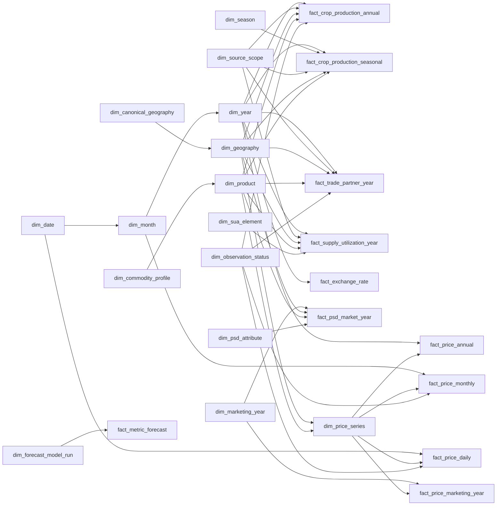

# Gold Serving Galaxy Schema (v2)

Version `gold-serving-galaxy-20261108.2` — nâng cấp khắc phục các giới hạn phân tích từ phiên bản `.1` trên cơ sở đối chiếu trực tiếp dữ liệu nguồn (`data/raw/`), code thực tế (`src/`) và hợp đồng Gold Core (`gold_local`).

## 1. Mục tiêu và quyết định thiết kế v2

Mô hình `gold_serving_local` là **Galaxy Schema (Fact Constellation)** phục vụ **Power BI Import**, đứng độc lập phía sau lớp Gold Core bất biến (`gold_local` — `dim_fact_v3.dbml`). Phiên bản **v2 (`17 dimensions`, `11 facts`)** giải quyết triệt để các điểm nghẽn thiết kế của bản v1 mà **không phá vỡ tính bất biến hay tính kiểm toán của `gold_local`**:

1. **Bảo toàn 100% cả 9 bảng fact của Gold Core (Zero Core Data Loss)**: Khôi phục `fact_price_annual` (từ `fact_fao_price_annual`, chứa giá USD/tấn & PPI) và toàn bộ `12,936` dòng báo giá FOB từ `fact_usda_price_reference` (tách minh bạch vào `fact_price_monthly` theo quy tắc lịch niên vụ Hoa Kỳ đã kiểm chứng thực nghiệm và `fact_price_marketing_year` cho trung bình niên vụ); đồng thời bổ sung năng suất mùa vụ (`V06.17`, `V06.20`, `V06.23`) và chỉ số phát triển (`V06.12`) vào 2 bảng crop của NSO.
2. **Mở khóa tính Thị phần Đối tác & Tỷ trọng Toàn cầu có kiểm soát (`Partner Share %` & `Atomic Global Share %`)**: Bỏ bộ lọc cắt bớt 3 đối tác / 4 quốc gia ở mart CSV cũ; bổ sung cờ `is_atomic_member` trên `dim_geography` (chặn cộng trùng mã tổng `159 China` với `156+158+344+446`, hoặc `CẢ NƯỚC` với vùng/tỉnh NSO) kết hợp `allows_share_denominator` trên `dim_source_scope` và `reporter_year_universe_complete` trên `fact_trade_partner_year`.
3. **Liên kết xuyên nguồn an toàn qua Cầu nối Chuẩn hóa (`Governed Canonical Bridges`)**: Giữ nguyên khóa nguồn (`dim_geography`, `dim_product`) để kiểm toán, nhưng bổ sung `dim_canonical_geography` (ISO3 quốc gia & mã vùng/tỉnh chuẩn VN) và `dim_commodity_profile` (cấp chế biến & tỷ lệ tấm) quản trị bằng bảng tham chiếu duyệt trước, cho phép lọc đồng bộ đa nguồn trên Power BI mà không join bừa theo tên hiển thị hay tự nhân hệ số quy đổi `paddy → milled`.
4. **Mở khóa phân tích Chênh lệch giá (`Price Spread`) & Tích hợp Khung Tỷ giá (`fact_exchange_rate`)**: Phục vụ ngay chênh lệch giá xuất khẩu FOB cùng đơn vị `USD/tonne` (Việt Nam – Thái Lan – Ấn Độ – Pakistan từ World Bank & USDA Yearbook), chênh lệch lúa – gạo nội địa `VND/tonne` (`unit_scale_to_tonne`), chênh lệch cổng trại – xuất khẩu theo năm (`USD/tonne` từ FAO Annual), và cung cấp bảng `fact_exchange_rate` sẵn sàng cho quy đổi ngoại tệ.
5. **Bảo toàn Trạng thái Công bố, Cờ Chất lượng & Điểm neo Dự báo ML**: Bổ sung `dim_observation_status` (giữ nguyên cờ `Sơ bộ` của NSO, cờ `A/E/I/X` của FAO, và khóa lọc các dòng lỗi thang đơn vị như `13.56 VND/kg` ở giá nội địa) cùng ngôi sao mở rộng `fact_metric_forecast` + `dim_forecast_model_run`.

Đặc tả đầy đủ khóa, kiểu dữ liệu và ràng buộc nằm tại [gold_serving_galaxy.dbml](file:///c:/Windows_Application/TLCN/docs/gold/gold_serving_galaxy.dbml).

---

## 2. Conformed & Governed Bridge Dimensions (17 bảng)

| Dimension | Grain | Vai trò & Thay đổi ở v2 | Quy tắc quản trị bắt buộc |
|---|---|---|---|
| `dim_source_system` | 1 hệ nguồn dữ liệu | Định danh 9 nguồn chuẩn `local_nine` (+ nguồn FX/Forecast khi mở rộng) | Luôn hiển thị/lọc nguồn khi đặt các chỉ tiêu khác nguồn cạnh nhau. |
| `dim_source_scope` | 1 ấn phẩm / phạm vi lọc được duyệt | Dùng cho Crop, Trade, SUA; **thêm `universe_completeness` & `allows_share_denominator`** | Chặn gộp NSO `V06.12` với `V06.14`; chỉ cho phép tính `% Share` khi `allows_share_denominator = true`. |
| `dim_year`, `dim_month`, `dim_date` | Năm / Tháng / Ngày dương lịch | Trục lịch chuẩn `dim_date → dim_month → dim_year`; thêm `is_leap_year` | Không dùng làm khóa chính của niên vụ tiếp thị (`MY`). |
| `dim_marketing_year` | 1 nhãn niên vụ USDA theo nguồn | Dùng cho `fact_psd_market_year`, `fact_price_marketing_year`; **thêm `start_month_number`, `end_month_number`, `trade_year_calendar_key`** | `trade_year_calendar_key` (`YYYY+1`) để **inactive** mặc định, chỉ kích hoạt có kiểm soát cho thuộc tính `TY` (Trade Year Jan–Dec) của USDA. |
| `dim_canonical_geography` *(Mới)* | 1 thực thể địa lý chuẩn hóa (`VNM`, `THA`, `VN-P*`...) | Cầu nối lọc xuyên nguồn (FAO `'704'` ↔ USDA `'Vietnam'` ↔ NSO `'CẢ NƯỚC'`; chuẩn hóa lỗi gõ `'Hậu GIang'` ↔ `'Hậu Giang'`) | Nạp 100% từ file tham chiếu kiểm duyệt (`config/gold_serving/canonical_geography_bridge.yaml`), cấm join mờ theo chuỗi tên. |
| `dim_geography` | 1 định danh địa lý trong `(source, namespace, scope, code)` | **Thêm `identity_scope` (bảo toàn 1:1 NSO), `canonical_geography_key`, `is_atomic_member`, `valid_from_year`, `valid_to_year`** | Khi cộng gộp toàn cầu/quốc gia, bắt buộc lọc `is_atomic_member = true` để loại trừ dòng tổng chồng lấn (như FAO M49 `159 China` hay dòng `CẢ NƯỚC`/vùng NSO). |
| `dim_commodity_profile` *(Mới)* | 1 hồ sơ cấp chế biến & phẩm cấp tấm | Chuẩn hóa `processing_stage` (`paddy_rough`, `milled_white`, `broken`...) và `broken_grade_pct` (`5%`, `25%`, `100%`) | Cho phép so sánh chênh lệch giá cùng phẩm cấp (`allows_direct_price_spread = true`); **cấm tự động cộng khối lượng khác cấp chế biến**. |
| `dim_product` | 1 sản phẩm/chủng loại nguồn | **Thêm `commodity_profile_key`, `identity_kind`, `commodity_alias_group`**; seed bản ghi chuẩn `(nso, rice_paddy_total)` cho NSO | Giữ tách biệt `paddy`, `milled`, `milled_equivalent`, giống lúa nội địa và benchmark. |
| `dim_season` | 1 mùa vụ lúa | Dùng cho `fact_crop_production_seasonal` (`dong_xuan`, `he_thu`, `thu_dong`, `he_thu_thu_dong`, `mua`) | Cấm nạp dòng `annual` (`is_annual = false`) vào bảng seasonal. |
| `dim_price_series` | 1 chuỗi giá/chỉ số nguồn | **Thêm `price_kind`, `pricing_stage`, `unit_scale_to_tonne`, `benchmark_origin_canonical_geography_key`** | `unit_scale_to_tonne = 1000` cho `VND/kg`, `= 1` cho `USD/tonne` & `LCU/tonne`, `NULL` cho index; gắn tag xuất xứ (`VNM`, `THA`) cho benchmark WB mà không biến WB thành quốc gia báo cáo. |
| `dim_trade_direction` | Chiều `import` / `export` | Dùng cho `fact_trade_partner_year` theo góc nhìn `Reporter` | Không cộng gộp dòng `export` với dòng `import` đối ứng. |
| `dim_sua_element` | 1 phần tử cân đối FAOSTAT SUA | Bảo toàn 12 elements cùng `unit`, `time_aggregation_rule`, `additivity` | Tồn kho đầu kỳ (`5113`) là `semi_additive`; biến động tồn kho (`5071`) & phần dư (`5166`) giữ nguyên dấu âm/dương. |
| `dim_psd_attribute` | 1 thuộc tính cân đối USDA PSD | Bảo toàn 15 attributes; **thêm `temporal_basis` (`marketing_year` vs `trade_year_jan_dec`)** | Phân tách rõ chỉ tiêu niên vụ `MY` và năm thương mại `TY`; cấm cộng dồn tồn kho/tỷ lệ qua các năm. |
| `dim_observation_status` *(Mới)* | 1 trạng thái tin cậy / công bố | Bảo toàn `release_status` NSO (`Sơ bộ 2024`), `flag` FAO (`A/E/I/X`), và gắn cờ `dq_scale_suspect` | Các KPI nhạy cảm với nhiễu (như `MIN`, `Spread`, `Volatility`) bắt buộc lọc `is_trusted_for_kpi = true`. |
| `dim_forecast_model_run` *(Mới)* | 1 phiên bản chạy mô hình dự báo | Quản lý `model_name`, `model_version`, `training_cutoff_label`, `backtest_mape_pct` | Phục vụ riêng `fact_metric_forecast`, tách biệt hoàn toàn khỏi số liệu thực tế lịch sử. |

---

## 3. Fact Constellation (11 bảng) & Ánh xạ bảo toàn 100% từ Gold Core

| Fact Serving (`gold_serving_local`) | Nguồn từ Gold Core (`gold_local`) | Grain | Bổ sung quan trọng ở v2 |
|---|---|---|---|
| `fact_crop_production_annual` | `fact_fao_production_observation` + `fact_nso_observation` (`season='annual'`, `V06.12–V06.15`) | `year × source_scope × geography × product` | Bổ sung `area_yoy_index_pct`, `production_yoy_index_pct` (hấp thụ trọn vẹn dòng `development_index` của `V06.12`) và `observation_status_key` (giữ cờ `provisional` năm sơ bộ). |
| `fact_crop_production_seasonal` | `fact_nso_observation` (`season != 'annual'`, `V06.12`, `V06.16–V06.24`) | `year × season × source_scope × geography × product` | **Khôi phục `reported_yield_kg_ha`, `paired_production_t`, `paired_area_ha`** để phục vụ 3 bảng năng suất mùa vụ (`V06.17`, `V06.20`, `V06.23`) và tính năng suất gia quyền cấp tỉnh/vùng theo vụ! |
| `fact_price_monthly` | `fact_price_monthly` (WB + FAO monthly) + `fact_usda_price_reference` (12 tháng báo giá FOB) | `month × price_series` | Đưa báo giá xuất khẩu FOB hàng tháng của Thái Lan, Việt Nam, Ấn Độ, Pakistan từ USDA Yearbook vào trục tháng dương lịch theo quy tắc niên vụ Hoa Kỳ đã kiểm chứng (`Aug..Dec → Y`, `Jan..Jul → Y+1`), giữ khóa truy vết `source_marketing_year_key`. |
| `fact_price_annual` *(Mới)* | `fact_fao_price_annual` (`9,993` dòng, `month_code = 7021`) | `year × price_series` | Khôi phục toàn bộ giá nhà sản xuất theo năm của FAO gồm cả **`USD/tonne` (`5532`)**, `LCU/tonne` (`5530`), `SLC/tonne` (`5531`) và chỉ số `PPI` (`5539`, 1991–2025). |
| `fact_price_marketing_year` *(Mới)* | `fact_usda_price_reference` (`reference_period = 'MARKETING'`) | `marketing_year × price_series` | Phục vụ giá xuất khẩu bình quân niên vụ của USDA Yearbook mà không trộn lẫn vào năm dương lịch. |
| `fact_price_daily` | `fact_vn_market_quote_daily` (`thitruongnongsan`) | `date × price_series` | Thêm `price_value_per_tonne_native` (`VND/tonne = price_value × 1000`) và cổng chất lượng `is_usable_quote` chặn giá `0` hoặc lỗi nhập sai thang đơn vị (`13.56 VND/kg`). |
| `fact_exchange_rate` *(Mới)* | Suy dẫn minh bạch từ cặp FAO `5530/5532` (cấp năm) + Nguồn FX ngoài (khi nạp thêm tháng/ngày) | `rate_grain × period_key × from_currency × to_currency × rate_type` | Tách tỷ giá hối đoái thành bảng tham chiếu độc lập; giữ nguyên tiền tệ gốc trong các bảng giá. |
| `fact_trade_partner_year` | `fact_fao_trade_observation` (`1,226,470` dòng → `526,986` cặp song phương) | `year × source_system × reporter × partner × product × direction` | Nạp toàn bộ `195` reporters × `211` partners; thêm `source_scope_key` và cờ `reporter_year_universe_complete` mở khóa tính chính xác `Partner Share %`. |
| `fact_supply_utilization_year` | `fact_fao_sua_observation` (`36,380` dòng) | `year × source_system × geography × product × sua_element` | Bổ sung `source_scope_key` và `observation_status_key`; dùng `dim_geography.is_atomic_member` để chặn trùng `China (159)`. |
| `fact_psd_market_year` | `fact_usda_psd_observation` (`990` dòng) | `marketing_year × source_system × geography × product × psd_attribute` | Giữ nguyên trục `dim_marketing_year`; hỗ trợ đối chiếu năm thương mại `TY` qua thuộc tính `dim_psd_attribute.temporal_basis`. |
| `fact_metric_forecast` *(Mới)* | Pipeline dự báo thống kê / ML (mở rộng) | `model_run × period_grain × target_period × metric × entity` | Lưu dự báo điểm (`point_forecast`) và khoảng tin cậy `80%`/`95%` tách biệt hoàn toàn với dữ liệu lịch sử. |

---

## 4. Semantic Contract & Danh mục KPI Dẫn xuất (Đã mở khóa ở v2)

| KPI dẫn xuất (DAX) | Công thức chuẩn | Điều kiện bảo vệ ngữ nghĩa (Guardrails) |
|---|---|---|
| **Năng suất tính lại (Năm & Mùa vụ)** | `1000 * DIVIDE(SUM(paired_production_t), SUM(paired_area_ha))` | Cùng `source_scope_key`, `product_key`; nếu gộp nhiều vùng/quốc gia phải lọc `dim_geography[is_atomic_member] = TRUE()`. |
| **Tăng trưởng sản lượng YoY (%)** | `DIVIDE(Current_Prod - Prior_Year_Prod, Prior_Year_Prod) * 100` | Cùng `source_scope_key`, `geography_key`, `product_key` (và cùng `season_key` nếu tính theo vụ). |
| **Tỷ trọng đối tác thương mại (`Partner Share %`)** *(Mới mở khóa)* | `DIVIDE(SUM(quantity_t), CALCULATE(SUM(quantity_t), ALL(Partner_Geography), Partner_Geography[is_atomic_member] = TRUE())) * 100` | Chỉ trả kết quả khi `SELECTEDVALUE(fact_trade_partner_year[reporter_year_universe_complete]) = TRUE()`, chọn đúng 1 `Reporter`, 1 `product_key`, 1 `direction_key`. |
| **Thị phần sản xuất toàn cầu / vùng (`Atomic Global/Regional Share %`)** *(Mới mở khóa)* | `DIVIDE(SUM(production_t), CALCULATE(SUM(production_t), ALL(dim_geography), dim_geography[is_atomic_member] = TRUE())) * 100` | Yêu cầu `dim_source_scope[allows_share_denominator] = TRUE()` và loại bỏ mã tổng chồng lấn (`M49 = 159 China`, `CẢ NƯỚC` NSO). |
| **Chênh lệch giá xuất khẩu FOB quốc tế (`International FOB Spread USD/t`)** *(Mới mở khóa)* | `Price_Series_A_USD_t - Price_Series_B_USD_t` (ví dụ Gạo VN 5% tấm trừ Gạo Thái 5% tấm hoặc Ấn Độ 5% tấm) | Cùng `month_key` (trên `fact_price_monthly`) hoặc `marketing_year_key`, `currency = "USD"`, `unit_scale_to_tonne = 1`, `allows_direct_price_spread = TRUE()`. |
| **Chênh lệch giá Lúa – Gạo nội địa (`Domestic Milling/Export-Grade Spread VND/t`)** *(Mới mở khóa)* | `AVG_Quote_Milled_VND_t - AVG_Quote_Paddy_VND_t` (dùng `price_value_per_tonne_native`) | Lọc `is_usable_quote = TRUE()`, cùng `date_key`/`month_key` và cùng địa phương `market_name` (hoặc `canonical_geography_key`), ghi rõ chênh lệch danh nghĩa chưa trừ hao hụt xay xát, hoặc nhân `Milling Rate` được duyệt. |
| **Chênh lệch giá Cổng trại – Xuất khẩu theo năm (`Farmgate-to-FOB Spread USD/t`)** *(Mới mở khóa)* | `Trade_Unit_Value_USD_t (hoặc Annual_FOB_USD_t) - FAO_Producer_Price_5532_USD_t` | Dùng `fact_price_annual` (`element 5532 USD/tonne`) đặt cạnh đơn giá xuất khẩu năm (`fact_trade_partner_year`) hoặc trung bình năm WB `rice_viet_namese_5`. |
| **Giá quy đổi USD tham chiếu (`FX-Normalized Price USD/t`)** *(Mới mở khóa khung)* | `price_value_per_tonne_native * LOOKUPVALUE(fact_exchange_rate[fx_rate], ...)` | Cấp năm dùng ngay `fao_implied_annual`; cấp tháng/ngày chỉ kích hoạt khi `fact_exchange_rate` đã nạp tỷ giá `external_official_fx`. |
| **Đơn giá thương mại (`Trade Unit Value`)** | `DIVIDE(SUM(paired_value_usd), SUM(paired_quantity_t))` | Không bao giờ `AVG` tỷ số cấp dòng; tách biệt vai trò `Reporter` và `Partner`. |
| **Thay đổi giá MoM (%) & Biến động 12 tháng** | `MoM = (P_t / P_{t-1} - 1) * 100`; `Vol_12M = STDEV.S(12 log returns)` | Đòi hỏi tháng lịch liền kề hợp lệ (`MoM`) hoặc đủ 13 tháng dương liên tiếp (`Vol_12M`) trên `is_trusted_for_kpi = TRUE()`. |
| **Tỷ lệ Tồn kho / Sử dụng (`Stock-to-Use %`)** | `Ending_or_Opening_Stocks / Total_Domestic_Use * 100` | Tính riêng trong SUA (năm lịch) hoặc PSD (niên vụ tiếp thị); cấm cộng dồn tồn kho qua nhiều năm. |

---

## 5. Quy tắc Quan hệ (Relationships) trên Power BI Import

Để tránh 100% lỗi đường dẫn nhập nhằng (ambiguous paths) và giữ hiệu năng nén tối ưu cho VertiPaq:

1. **Mọi quan hệ vật lý đều là một chiều (`Single-direction 1:*`)** từ Dimension xuống Fact (hoặc chuỗi phân cấp sạch `dim_canonical_geography → dim_geography → fact_*`, `dim_commodity_profile → dim_product → fact_*`, `dim_year → dim_month → dim_date → fact_*`). Tuyệt đối không bật `Bidirectional cross-filtering` và không nối Fact-to-Fact.
2. **Xử lý `dim_source_system` không gây vòng lặp (Diamond-free)**: Trong DBML, `source_system_key` có mặt ở cả Dimension lẫn Fact để kiểm tra toàn vẹn khóa ngoại lúc publish Iceberg. Khi nạp vào Power BI Model, thuộc tính `source_id` / `source_label` được phẳng hóa (denormalize) trực tiếp vào `dim_source_scope`, `dim_geography`, `dim_product`, `dim_price_series`, `dim_sua_element`, `dim_psd_attribute` (hoặc chỉ giữ một bảng `dim_source_system` nối trực tiếp vào các Fact không đi qua `dim_source_scope`), đảm bảo không bao giờ có 2 đường lọc từ 1 bảng nguồn xuống cùng 1 Fact.
3. **Role-playing Geography cho Thương mại (`fact_trade_partner_year`)**: Nhân bản `dim_geography` thành 2 bảng độc lập trong Power BI: `Reporter Geography` (nhận luồng lọc từ `dim_canonical_geography`) và `Partner Geography` (có sẵn các cột phẳng `canonical_code`, `canonical_name_vi`, `is_atomic_member` để lọc đối tác độc lập).
4. **Quan hệ phụ không kích hoạt mặc định (`Inactive Relationship`)**: Khóa `dim_marketing_year[trade_year_calendar_key] → dim_year[year_key]` phải đặt ở trạng thái **Inactive**, chỉ gọi tường minh bằng `USERELATIONSHIP` bên trong measure chuyên biệt dành cho thuộc tính năm thương mại (`temporal_basis = "trade_year_jan_dec"`).
5. **Tra cứu Tỷ giá (`fact_exchange_rate`)**: Không nối vật lý tạo vòng lặp thời gian với các bảng giá; sử dụng `LOOKUPVALUE` / `TREATAS` trong DAX theo bộ khóa `(rate_grain, period_key, currency, "USD")`.

---

## 6. Cổng kiểm định chất lượng (Publication & Quality Gates)

Mỗi batch publish lên `iceberg.gold_serving_local` bắt buộc vượt qua 7 cổng kiểm định tự động:

1. **Bảo toàn số lượng & đối soát tổng (Zero-Loss Reconciliation Gate)**: Đối soát 100% tổng `production_t`, `harvested_area_ha`, `quantity_t`, `value_usd` và số dòng hợp lệ của cả **9 bảng `gold_local`** sang `gold_serving_local` (chứng minh không rơi rớt `fact_fao_price_annual`, `fact_usda_price_reference`, hay các bảng NSO `V06.16–V06.24`).
2. **Kiểm định quy tắc lịch USDA Rice Yearbook (Empirical Calendar Gate)**: Xác nhận mọi bảng trong `fact_usda_price_reference` tuân thủ chu kỳ niên vụ Hoa Kỳ Tháng 8 – Tháng 7 (`Aug..Dec → reference_year`, `Jan..Jul → reference_year + 1`), không sinh trùng `(month_key, price_series_key)` và khớp chuỗi đối chiếu với World Bank Pink Sheet.
3. **Kiểm định tập nguyên tử không chồng lấn (Atomic Universe Gate)**: Chứng minh trong FAO Production & SUA, tổng `156 + 158 + 344 + 446` khớp với mã tổng `159 (China)` và `159` bắt buộc mang `is_atomic_member = false`; trong NSO, dòng `national` và `region` mang `is_atomic_member = false` ở phạm vi gộp cấp tỉnh.
4. **Cổng chặn nhiễu thang đơn vị báo giá nội địa (Price Scale Sanity Gate)**: Mọi dòng báo giá lúa/gạo nội địa (`unit = 'VND/kg'`) có `price_value <= 0` hoặc `0 < price_value < 500` (như lỗi nhập `13.56` thay vì `13,560 VND/kg` trong dữ liệu thô) phải bị gắn `observation_status = 'dq_scale_suspect'` và `is_usable_quote = false` (vẫn giữ giá gốc ở `price_value` để kiểm toán, nhưng chặn không làm hỏng `MIN`, `AVG` hay `Price Spread`).
5. **Toàn vẹn khóa tự nhiên (Unique Grain) & Khóa ngoại (100% FK Coverage)** cho tất cả 17 dimensions và 11 facts.
6. **Kiểm định cặp cơ sở tỷ số (`paired_*`)**: Đảm bảo `paired_production_t / paired_area_ha` và `paired_value_usd / paired_quantity_t` chỉ khác `NULL` khi cả tử số và mẫu số đều hiện diện hợp lệ và mẫu số `> 0`.
7. **Kiểm định tính cộng tính (`additivity`) của SUA & PSD**: Đảm bảo mọi mã `element_code` / `attribute_code` đều khớp danh mục quy tắc tổng hợp đã phê duyệt.

---

## 7. Đối chiếu Code & Dữ liệu Thực tế Xuyên suốt Các Lớp (Layer-by-Layer Impact Audit)

Bảng dưới đây đối chiếu trực tiếp thiết kế v2 với dữ liệu vật lý trên đĩa (`data/raw/`) và mã nguồn hiện hành (`src/`, `config/`, `contracts/`) để chỉ rõ **chỗ nào xử lý ngay ở lớp Serving**, **chỗ nào nên tinh chỉnh thêm ở code xuất Mart**, và **chỗ nào là giới hạn vật lý của nguồn dữ liệu thô**:

| Lớp dữ liệu | File dữ liệu / Code thực tế đã đối chiếu | Hiện trạng thực tế phát hiện được | Cần chỉnh sửa gì để vận hành Thiết kế v2? |
|---|---|---|---|
| **1. Raw Data** | [data/raw/](file:///c:/Windows_Application/TLCN/data/raw), [local_raw_manifest.json](file:///c:/Windows_Application/TLCN/config/local_raw_manifest.json) | • **Đã có đủ nhưng chưa khai thác hết**: `rice_trade_data.csv` có đủ 195 reporters × 211 partners (VN 2022–2023 đủ 82–85 đối tác, 0 dòng World aggregate; riêng **năm 2024 VN có 0 dòng vai trò Reporter** do trễ công bố); WB Pink Sheet có sẵn giá FOB gạo VN `rice_viet_namese_5` (`USD/mt`, 2003–2025); USDA Yearbook có 12.936 dòng FOB 4 nước (chu kỳ Aug–Jul); FAO Price có giá năm `USD/tonne` (`5532`); NSO có đủ năng suất mùa vụ `V06.17, V06.20, V06.23`. • **Giới hạn vật lý tại nguồn**: (1) **Không có file tỷ giá `USD/VND` theo ngày/tháng**; (2) `usda.xls` **chỉ có 1 nước `Vietnam`** (990 dòng), thiếu PSD toàn cầu; (3) `price_luagao.xlsx` có lỗi gõ `'Hậu GIang'` (12 dòng), phân mảnh tên giống lúa, và lỗi nhập sai thang đơn vị `13.56`, `12.80`, `0.00 VND/kg`; (4) Raw chỉ lưu 1 bản chụp tĩnh (`single snapshot`), không có lịch sử nhiều kỳ công bố (multi-vintage). | • **Không bắt buộc thêm file Raw** cho 95% bài toán đã mở khóa ở v2. • **Chỉ cần bổ sung Raw mới khi**: (a) Muốn quy đổi giá nội địa hàng ngày/tháng sang `USD/tonne` → thêm 1 nguồn tỷ giá `fx_usd_vnd` (NHNN/IMF); (b) Muốn so sánh/xếp hạng PSD đa quốc gia → thay `usda.xls` bằng CSV PSD toàn cầu của USDA FAS; (c) Muốn phân tích lịch sử hiệu chỉnh dữ liệu (vintage) → lưu trữ bản chụp Raw theo ngày công bố. |
| **2. Ingestion / Bronze** | [source_registry.yaml](file:///c:/Windows_Application/TLCN/config/ingestion/source_registry.yaml), [usda_adapter.py](file:///c:/Windows_Application/TLCN/src/ingestion/adapters/usda_adapter.py) | Đang nạp đầy đủ 9 nguồn chuẩn `local_nine` với `load_strategy: FULL`. | **Giữ nguyên 100%** cho 9 nguồn hiện hữu. Chỉ đăng ký thêm source mới vào `source_registry.yaml` nếu sau này nạp thêm bảng tỷ giá `FX` hàng ngày/tháng hoặc file PSD toàn cầu. |
| **3. Silver** | [thitruongnongsan.py](file:///c:/Windows_Application/TLCN/src/silver/transformers/thitruongnongsan.py), [usda_rice_yearbook.py](file:///c:/Windows_Application/TLCN/src/silver/transformers/usda_rice_yearbook.py), [nso.py](file:///c:/Windows_Application/TLCN/src/silver/transformers/nso.py), [nso_v2_metadata.json](file:///c:/Windows_Application/TLCN/config/silver/nso_v2_metadata.json) | • `nso.py` đã bóc chuẩn `season`, `measure`, `statistic_kind` (`quantity` / `development_index`), `release_status` (`provisional`). • `thitruongnongsan.py` chỉ `trim` chuỗi (nên lọt `'Hậu GIang'`) và chỉ chặn `< 0` (lọt giá `0.00` và `13.56 VND/kg` vào Silver/Gold). • `usda_rice_yearbook.py` giữ nguyên `year` và `reference_period` theo đúng hợp đồng bảo toàn nguồn. | • **Không bắt buộc sửa Silver đang đóng băng** vì tầng Serving v2 đã xử lý sạch qua `canonical_geography_bridge.yaml` (`'Hậu GIang' → VN-P-HAUGIANG`), `usda_yearbook_calendar_rule.yaml` và cổng `is_usable_quote` (`>= 500 VND/kg`). • *(Khuyến nghị tùy chọn nếu mở đợt nâng cấp Silver)*: Bổ sung cảnh báo `PRICE_SCALE_SUSPECT` vào `dq_warnings` trong [thitruongnongsan.py](file:///c:/Windows_Application/TLCN/src/silver/transformers/thitruongnongsan.py). |
| **4. Gold Core (`gold_local`)** | [dim_fact_v3.dbml](file:///c:/Windows_Application/TLCN/docs/gold/dim_fact_v3.dbml), [dimensions.py](file:///c:/Windows_Application/TLCN/src/gold/dimensions.py), [facts.py](file:///c:/Windows_Application/TLCN/src/gold/facts.py) | Đã chứa đầy đủ 8 dimensions & 9 facts nguyên bản, lưu trọn vẹn `flag` FAO trong `source_context_json`, `identity_scope` của NSO, `fact_fao_price_annual` và `fact_usda_price_reference`. | **Giữ nguyên tuyệt đối (0 chỉnh sửa)** theo đúng nguyên tắc Gold Core bất biến (`gold-20261025.1`). |
| **5. Gold Serving & Power BI Exporter** | [powerbi.py](file:///c:/Windows_Application/TLCN/src/analytics/marts/powerbi.py), `src/gold_serving/` *(mới)*, `config/gold_serving/` *(mới)* | Code cũ trong [powerbi.py](file:///c:/Windows_Application/TLCN/src/analytics/marts/powerbi.py) đang xuất 6 bảng CSV phẳng rời rạc và **hardcode lọc cứng** chỉ 4 nước sản xuất (dòng 130: `356, 360, 704, 764`) và 3 đối tác xuất khẩu của VN (dòng 192: `156, 458, 608`), bỏ sót hoàn toàn `fact_fao_price_annual`, `fact_usda_price_reference`, `fact_vn_market_quote_daily` và năng suất mùa vụ NSO. | **Đây là nơi cần triển khai code chính khi hiện thực hóa thiết kế v2**: 1. Tạo bộ cấu hình kiểm duyệt `config/gold_serving/{canonical_geography_bridge.yaml, commodity_profile_bridge.yaml, source_scope_catalog.yaml, usda_yearbook_calendar_rule.yaml}`. 2. Xây dựng builder `gold_serving_local` đọc trực tiếp cả 9 facts của `gold_local`, gỡ bỏ bộ lọc cắt bớt 3 đối tác / 4 nước của [powerbi.py](file:///c:/Windows_Application/TLCN/src/analytics/marts/powerbi.py), trích xuất `flag`/`release_status` ra `dim_observation_status`, tính tỷ giá năm FAO sang `fact_exchange_rate`, và xuất đủ 17 dims + 11 facts cho Power BI Import. |
