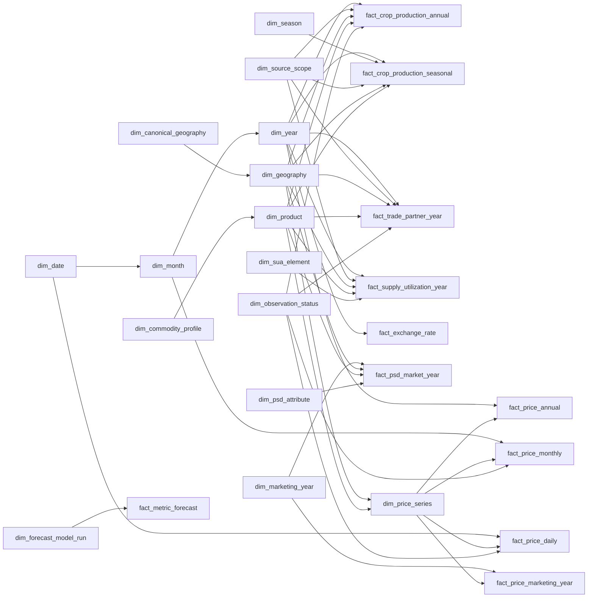

# Gold Serving Galaxy Schema (v2)

Version `gold-serving-galaxy-20261108.2` — nâng cấp khắc phục các giới hạn phân tích từ phiên bản `.1` trên cơ sở đối chiếu trực tiếp dữ liệu nguồn (`data/raw/`), code thực tế (`src/`) và hợp đồng Gold Core (`gold_local`).

## 1. Mục tiêu và quyết định thiết kế v2

Mô hình `gold_serving_local` là **Galaxy Schema (Fact Constellation)** phục vụ **Power BI Import**, đứng độc lập phía sau lớp Gold Core bất biến (`gold_local` — `dim_fact_v3.dbml`). Phiên bản **v2 (`17 dimensions`, `11 facts`)** giải quyết triệt để các điểm nghẽn thiết kế của bản v1 mà **không phá vỡ tính bất biến hay tính kiểm toán của `gold_local`**:

1. **Bảo toàn 100% cả 9 bảng fact của Gold Core (Zero Core Data Loss)**: Khôi phục `fact_price_annual` (từ `fact_fao_price_annual`, chứa giá USD/tấn & PPI) và toàn bộ `12,936` dòng báo giá FOB từ `fact_usda_price_reference` (tách minh bạch vào `fact_price_monthly` theo quy tắc lịch niên vụ Hoa Kỳ đã kiểm chứng thực nghiệm và `fact_price_marketing_year` cho trung bình niên vụ); đồng thời bổ sung năng suất mùa vụ (`V06.17`, `V06.20`, `V06.23`) và chỉ số phát triển (`V06.12`) vào 2 bảng crop của NSO.
2. **Mở khóa tính Thị phần Đối tác & Tỷ trọng Toàn cầu có kiểm soát (`Partner Share %` & `Atomic Global Share %`)**: Bỏ bộ lọc cắt bớt 3 đối tác / 4 quốc gia ở mart CSV cũ; bổ sung cờ `is_atomic_member` trên `dim_geography` (chặn cộng trùng mã tổng `159 China` với `156+158+344+446`, hoặc `CẢ NƯỚC` với vùng/tỉnh NSO) kết hợp `allows_share_denominator` trên `dim_source_scope` và `reporter_year_universe_complete` trên `fact_trade_partner_year`.
3. **Liên kết xuyên nguồn an toàn qua Cầu nối Chuẩn hóa (`Governed Canonical Bridges`)**: Giữ nguyên khóa nguồn (`dim_geography`, `dim_product`) để kiểm toán, nhưng bổ sung `dim_canonical_geography` (ISO3 quốc gia & mã vùng/tỉnh chuẩn VN) và `dim_commodity_profile` (cấp chế biến & tỷ lệ tấm) quản trị bằng bảng tham chiếu duyệt trước, cho phép lọc đồng bộ đa nguồn trên Power BI mà không join bừa theo tên hiển thị hay tự nhân hệ số quy đổi `paddy → milled`.
4. **Mở khóa phân tích Chênh lệch giá (`Price Spread`) & Tích hợp Khung Tỷ giá (`fact_exchange_rate`)**: Phục vụ ngay chênh lệch giá xuất khẩu FOB cùng đơn vị `USD/tonne` (Việt Nam – Thái Lan – Ấn Độ – Pakistan từ World Bank & USDA Yearbook), chênh lệch lúa – gạo nội địa `VND/tonne` (`unit_scale_to_tonne`), chênh lệch cổng trại – xuất khẩu theo năm (`USD/tonne` từ FAO Annual), và cung cấp bảng `fact_exchange_rate` sẵn sàng cho quy đổi ngoại tệ.
5. **Bảo toàn Trạng thái Công bố, Cờ Chất lượng & Điểm neo Dự báo ML**: Bổ sung `dim_observation_status` (giữ nguyên cờ `Sơ bộ` của NSO, cờ `A/E/I/X` của FAO, và khóa lọc các dòng lỗi thang đơn vị như `13.56 VND/kg` ở giá nội địa) cùng ngôi sao mở rộng `fact_metric_forecast` + `dim_forecast_model_run`.

Đặc tả đầy đủ khóa, kiểu dữ liệu và ràng buộc nằm tại [gold_serving_galaxy.dbml](file:///c:/Windows_Application/TLCN/docs/gold/gold_serving_galaxy.dbml).

---

## 2. Conformed & Governed Bridge Dimensions (17 bảng)

| Dimension | Grain | Vai trò & Thay đổi ở v2 | Quy tắc quản trị bắt buộc |
|---|---|---|---|
| `dim_source_system` | 1 hệ nguồn dữ liệu | Định danh 9 nguồn chuẩn `local_nine` (+ nguồn FX/Forecast khi mở rộng) | Luôn hiển thị/lọc nguồn khi đặt các chỉ tiêu khác nguồn cạnh nhau. |
| `dim_source_scope` | 1 ấn phẩm / phạm vi lọc được duyệt | Dùng cho Crop, Trade, SUA; **thêm `universe_completeness` & `allows_share_denominator`** | Chặn gộp NSO `V06.12` với `V06.14`; chỉ cho phép tính `% Share` khi `allows_share_denominator = true`. |
| `dim_year`, `dim_month`, `dim_date` | Năm / Tháng / Ngày dương lịch | Trục lịch chuẩn `dim_date → dim_month → dim_year`; thêm `is_leap_year` | Không dùng làm khóa chính của niên vụ tiếp thị (`MY`). |
| `dim_marketing_year` | 1 nhãn niên vụ USDA theo nguồn | Dùng cho `fact_psd_market_year`, `fact_price_marketing_year`; **thêm `start_month_number`, `end_month_number`, `trade_year_calendar_key`** | `trade_year_calendar_key` (`YYYY+1`) để **inactive** mặc định, chỉ kích hoạt có kiểm soát cho thuộc tính `TY` (Trade Year Jan–Dec) của USDA. |
| `dim_canonical_geography` *(Mới)* | 1 thực thể địa lý chuẩn hóa (`VNM`, `THA`, `VN-P*`...) | Cầu nối lọc xuyên nguồn (FAO `'704'` ↔ USDA `'Vietnam'` ↔ NSO `'CẢ NƯỚC'`; chuẩn hóa lỗi gõ `'Hậu GIang'` ↔ `'Hậu Giang'`) | Nạp 100% từ file tham chiếu kiểm duyệt (`config/gold_serving/canonical_geography_bridge.yaml`), cấm join mờ theo chuỗi tên. |
| `dim_geography` | 1 định danh địa lý trong `(source, namespace, scope, code)` | **Thêm `identity_scope` (bảo toàn 1:1 NSO), `canonical_geography_key`, `is_atomic_member`, `valid_from_year`, `valid_to_year`**; tên hiển thị NSO đọc trực tiếp từ cột `geography_name_candidate` đã được lớp Bạc giải mã sạch UTF-8 | Khi cộng gộp toàn cầu/quốc gia, bắt buộc lọc `is_atomic_member = true` để loại trừ dòng tổng chồng lấn trong `silver_local` (mã M49 `159 China` trong Production/SUA và dòng `national`/`region` trong NSO). |
| `dim_commodity_profile` *(Mới)* | 1 hồ sơ cấp chế biến & phẩm cấp tấm | Chuẩn hóa `commodity_group` (`rice_grain`, `rice_byproduct_or_processed`, `other_grain`, `energy_metal_fertilizer`), `processing_stage` và `broken_grade_pct` | Cho phép so sánh chênh lệch giá cùng phẩm cấp (`allows_direct_price_spread = true`); tách biệt hạt gạo với 6 chế phẩm/phụ phẩm gạo trong `silver_local.faostat_trade` và 67 mặt hàng ngoài gạo của World Bank. |
| `dim_product` | 1 sản phẩm/chủng loại nguồn | **Thêm `is_derived_aggregate`, `commodity_profile_key`, `identity_kind`, `commodity_alias_group`**; seed bản ghi chuẩn `(nso, rice_paddy_total)` cho NSO | **`is_derived_aggregate = true` cho mã `F0030` (`Rice, paddy (rice milled equivalent)`, `166.361` dòng trong `silver_local.faostat_trade`)** để chặn lỗi cộng trùng gấp đôi với các mã CPC hạt rời (`0113`, `23161.01/02/03`, `23162`), đồng thời cho phép truy vấn độc lập tổng thương mại gạo quy đổi khi chọn riêng `F0030`. |
| `dim_season` | 1 mùa vụ lúa | Khớp chính xác 4 mã mùa vụ đã chuẩn hóa ở `silver_local.nso_rice_statistics`: **`winter_spring`, `summer_autumn`, `summer_autumn_autumn_winter`, `main_season`** (và `annual` có `is_annual = true`) | Cấm nạp dòng `annual` vào bảng seasonal; lưu ý trong `silver_local`, mùa `summer_autumn` (`V06.12`) chỉ có `area` và `production` (`0` dòng `yield`). |
| `dim_price_series` | 1 chuỗi giá/chỉ số nguồn | **Thêm `price_kind`, `pricing_stage`, `unit_scale_to_tonne`, `benchmark_origin_canonical_geography_key`** | Ánh xạ đúng đặc thù cột `silver_local`: với FAO `unit` ở Silver là `LCU/SLC/USD/NULL` nên phải map qua `element_code` (`5530/5531/5532/5539`) sang `*/tonne` và `index(...)`; với WB cột `series_name` ở Silver là `NULL` nên lấy `commodity_name` và suy `currency = 'USD'` khi `unit LIKE 'USD/%'`. |
| `dim_trade_direction` | Chiều `import` / `export` | Dùng cho `fact_trade_partner_year` theo góc nhìn `Reporter` | Không cộng gộp dòng `export` với dòng `import` đối ứng. |
| `dim_sua_element` | 1 phần tử cân đối FAOSTAT SUA | Bảo toàn 12 elements cùng `unit`, `time_aggregation_rule`, `additivity` | Tồn kho đầu kỳ (`5113`) là `semi_additive`; biến động tồn kho (`5071`) & phần dư (`5166`) giữ nguyên dấu âm/dương. |
| `dim_psd_attribute` | 1 thuộc tính cân đối USDA PSD | Bảo toàn 15 attributes; **thêm `temporal_basis` (`marketing_year` vs `trade_year_jan_dec`)** | Phân tách rõ chỉ tiêu niên vụ `MY` và năm thương mại `TY`; cấm cộng dồn tồn kho/tỷ lệ qua các năm. |
| `dim_observation_status` *(Mới)* | 1 trạng thái tin cậy / công bố | Bảo toàn `release_status` NSO (`Sơ bộ 2024`), `flag` FAO (`A/E/I/X`), và gắn cờ `dq_scale_suspect` | Các KPI nhạy cảm với nhiễu (như `MIN`, `Spread`, `Volatility`) bắt buộc lọc `is_trusted_for_kpi = true`. |
| `dim_forecast_model_run` *(Mới)* | 1 phiên bản chạy mô hình dự báo | Quản lý `model_name`, `model_version`, `training_cutoff_label`, `backtest_mape_pct` | Phục vụ riêng `fact_metric_forecast`, tách biệt hoàn toàn khỏi số liệu thực tế lịch sử. |

---

## 3. Fact Constellation (11 bảng) & Ánh xạ bảo toàn 100% từ Gold Core

| Fact Serving (`gold_serving_local`) | Nguồn từ Gold Core (`gold_local`) | Grain | Bổ sung quan trọng ở v2 |
|---|---|---|---|
| `fact_crop_production_annual` | `fact_fao_production_observation` + `fact_nso_observation` (`season='annual'`, `V06.12–V06.15`) | `year × source_scope × geography × product` | Bổ sung `area_yoy_index_pct`, `production_yoy_index_pct` (hấp thụ trọn vẹn dòng `development_index` của `V06.12`) và `observation_status_key` (giữ cờ `provisional` năm sơ bộ). |
| `fact_crop_production_seasonal` | `fact_nso_observation` (`season != 'annual'`, `V06.12`, `V06.16–V06.24`) | `year × season × source_scope × geography × product` | **Khôi phục `reported_yield_kg_ha`, `paired_production_t`, `paired_area_ha`** để phục vụ 3 bảng năng suất mùa vụ (`V06.17`, `V06.20`, `V06.23`) và tính năng suất gia quyền cấp tỉnh/vùng theo vụ! |
| `fact_price_monthly` | `fact_price_monthly` (WB + FAO monthly) + `fact_usda_price_reference` (12 tháng báo giá FOB) | `month × price_series` | Đưa báo giá xuất khẩu FOB hàng tháng của Thái Lan, Việt Nam, Ấn Độ, Pakistan từ USDA Yearbook vào trục tháng dương lịch theo quy tắc niên vụ Hoa Kỳ đã kiểm chứng (`Aug..Dec → Y`, `Jan..Jul → Y+1`), giữ khóa truy vết `source_marketing_year_key`. |
| `fact_price_annual` *(Mới)* | `fact_fao_price_annual` (`9,993` dòng, `month_code = 7021`) | `year × price_series` | Khôi phục toàn bộ giá nhà sản xuất theo năm của FAO gồm cả **`USD/tonne` (`5532`)**, `LCU/tonne` (`5530`), `SLC/tonne` (`5531`) và chỉ số `PPI` (`5539`, 1991–2025). |
| `fact_price_marketing_year` *(Mới)* | `fact_usda_price_reference` (`reference_period = 'MARKETING'`) | `marketing_year × price_series` | Phục vụ giá xuất khẩu bình quân niên vụ của USDA Yearbook mà không trộn lẫn vào năm dương lịch. |
| `fact_price_daily` | `fact_vn_market_quote_daily` (`silver_local.thitruongnongsan`, `20,387` dòng) | `date × price_series` | Thêm `price_value_per_tonne_native` (`VND/tonne = price_value × 1000`) và cổng `is_usable_quote` (`price_value >= 500`) chặn đúng `29` dòng `0.00` (Kiên Giang) và `331` dòng nhập sai thang đơn vị (`7.30..26.50 VND/kg` tại Đồng Tháp & Thái Bình) đang nằm trong `silver_local`. |
| `fact_exchange_rate` *(Mới)* | Suy dẫn minh bạch từ cặp FAO `5530/5532` (cấp năm) + Nguồn FX ngoài (khi nạp thêm tháng/ngày) | `rate_grain × period_key × from_currency × to_currency × rate_type` | Tách tỷ giá hối đoái thành bảng tham chiếu độc lập; giữ nguyên tiền tệ gốc trong các bảng giá. |
| `fact_trade_partner_year` | `fact_fao_trade_observation` (`silver_local.faostat_trade`, `1,226,470` dòng → `526,986` nhóm) | `year × source_system × reporter × partner × product × direction` | Nhân `value × 1000` cho `unit = '1000 USD'` của Silver; nạp toàn bộ `195` reporters × `211` partners (`0` dòng `M49=159`); chặn cộng trùng mã quy đổi `F0030` qua `dim_product.is_derived_aggregate`. |
| `fact_supply_utilization_year` | `fact_fao_sua_observation` (`silver_local.faostat_supply_utilization`, `36,380` dòng) | `year × source_system × geography × product × sua_element` | Giữ hệ số `1` từ Silver (`unit` đã là `tonne`); dùng `dim_geography.is_atomic_member` để chặn trùng `China (159)`. |
| `fact_psd_market_year` | `fact_usda_psd_observation` (`silver_local.usda_rice_psd`, `990` dòng) | `marketing_year × source_system × geography × product × psd_attribute` | Nhân `1000` chỉ khi `unit IN ('1000 MT', '1000 HA')` của Silver; **giữ nguyên hệ số `1`** cho `MT/HA` và `Milling Rate (.9999)` (do Silver đã nhân `0.0001` thành `fraction`). |
| `fact_metric_forecast` *(Mới)* | Pipeline dự báo thống kê / ML (mở rộng) | `model_run × period_grain × target_period × metric × entity` | Lưu dự báo điểm (`point_forecast`) và khoảng tin cậy `80%`/`95%` tách biệt hoàn toàn với dữ liệu lịch sử. |

### 3.1. Đặc tả Đầu ra Thực tế của 9 Bảng Lớp Bạc (`iceberg.silver_local.*`) khi Đọc lên Lớp Vàng

> [!IMPORTANT]
> Lớp Vàng (`gold_local` và `gold_serving_local`) **chỉ đọc duy nhất từ 9 bảng `iceberg.silver_local.*`** (`1.414.527` dòng quan sát sạch sau khi lớp Bạc đã cách ly `17` dòng lỗi cấu trúc/xung đột vào `silver_local.dead_letters`), **tuyệt đối không đọc lại `data/raw/`**. Bảng dưới đây ghi nhận chính xác trạng thái từng cột trên Trino `iceberg.silver_local` để tránh nhân trùng hệ số hoặc đọc sai tên cột:

| Bảng vật lý trong `iceberg.silver_local` (Số dòng thực tế) | Lớp Bạc ĐÃ làm sạch & chuẩn hóa sẵn (Lớp Vàng dùng trực tiếp, KHÔNG làm lại) | Trạng thái cột ở Lớp Bạc mà Lớp Vàng BẮT BUỘC xử lý / bảo vệ |
|---|---|---|
| `nso_rice_statistics` (`23.060` dòng; đã loại 13 dòng trống/NUL vào `dead_letters`) | • Đã xoay dọc (unpivot) toàn bộ 13 file `V06.12–V06.24`. • **Đã nhân xong hệ số đơn vị vào cột `value`**: `area → hectare` (`×1000`), `production → tonne` (`×1000`), `yield → kg/hectare` (`×100`), `development_index → percent` (`×1`). • **Đã giải mã sạch tiếng Việt UTF-8 vào `geography_name_candidate`** (`Việt Nam`, `Đồng bằng sông Cửu Long`, 64 tỉnh) và gán sẵn `geography_level` (`national`, `region`, `province`), `season` (`annual`, `winter_spring`, `summer_autumn`, `summer_autumn_autumn_winter`, `main_season`), `release_status` (`provisional` / `unconfirmed`), `quality_status` (`NORMALIZED` / `MISSING`), `diagnostic_evidence`. | • **Tuyệt đối không nhân `1000` hay `100` lần nữa trên cột `value`**. • Không có cột sản phẩm → Vàng seed `(nso, rice_paddy_total)`. • Dòng `national`, `region` và `province` cùng tồn tại trong `V06.13–V06.24` → phải gán `is_atomic_member = false` cho `national`/`region` khi cộng cấp tỉnh. • Tên hiển thị lấy từ `geography_name_candidate` (không lấy `geography_raw` bị lỗi font `"C? NU?C"`). |
| `faostat_production` (`22.738` dòng) | • Đã chuẩn hóa `country_code` M49 đủ 3 chữ số, phục hồi mã CPC `'0113'` (`Rice`), chuẩn hóa `unit` về `'hectare'`, `'kg/hectare'`, `'tonne'`. | • Hệ số đơn vị lên Vàng = `1`. • **Mã tổng `country_code = '159'` (`China`, 192 dòng) vẫn nằm chung với `'156'`, `'158'`, `'344'`, `'446'`** → Vàng bắt buộc gắn `is_atomic_member = false` cho `'159'`. |
| `faostat_supply_utilization` (`36.380` dòng) | • Đã chuẩn hóa 12 `element_code`, 2 mã CPC (`'0113'`, `'23161.02'`), `unit = 'tonne'`, bảo toàn dấu âm của `5071` (`Stock Variation`) và `5166` (`Residuals`, kèm 236 cảnh báo `_dq_warnings`). | • Hệ số đơn vị lên Vàng = `1`. • Vẫn có mã tổng `country_code = '159'` (`China`) chồng lấn → gắn `is_atomic_member = false`. |
| `faostat_trade` (`1.226.470` dòng) | • Đã chuẩn hóa `reporter_country_code` (`195` mã) & `partner_country_code` (`211` mã, **`0` dòng `'159'`**), chuẩn hóa lượng (`5610, 5910`) về `unit = 'tonne'`. | • **Đơn vị trị giá (`5622, 5922`) ở Silver vẫn là `'1000 USD'`** → Vàng **bắt buộc nhân `value × 1000`** để ra `value_usd` (`USD`). • Chỉ có cột `flag` (`A/E/I/X`), **không có cột `flag_description`**. • Có **11 mã `commodity_code`**, gồm cả **mã tổng quy đổi `'F0030'` (`166.361` dòng)** và **6 chế phẩm/phụ phẩm** (`23120.01`, `39120.02`, `21691.01`, `21910.01`, `23490.01`, `24230.02`) → Vàng gắn `is_derived_aggregate = true` cho `'F0030'` và phân nhóm `commodity_group` để không cộng trùng gấp đôi. |
| `faostat_monthly_price` (`15.334` dòng = `5.341` monthly + `9.993` annual) | • Đã tách sẵn `time_grain` (`'monthly'` vs `'annual'`), `month` (`1..12` hoặc `NULL`), `currency` (`'LCU'`, `'SLC'`, `'USD'`, `NULL`), `price_kind` (`'producer_price'` vs `'producer_price_index'`). | • **Cột `unit` ở Silver đang là `'LCU'`, `'SLC'`, `'USD'` và `NULL` (chứ không phải `'USD/tonne'`)** → Vàng phải chuẩn hóa nhãn đơn vị qua `element_code` (`5530 → 'LCU/tonne'`, `5531 → 'SLC/tonne'`, `5532 → 'USD/tonne'`, `5539 → 'index(2014-2016=100)'`), hệ số giá trị = `1`. |
| `usda_rice_psd` (`990` dòng) | • Đã unpivot ra `market_year` (`int`) & `crop_year` (`'YYYY/YYYY+1'`). • **Đã nhân `0.0001` cho `'Milling Rate (.9999)'`** thành `unit = 'fraction'` (`0.63..0.675`). | • **Các thuộc tính lượng và diện tích ở Silver vẫn mang `unit = '1000 MT'` và `'1000 HA'`** (`conversion_factor = 1` ở Silver) → Vàng **phải nhân `1000`** cho `'1000 MT'` / `'1000 HA'`, nhưng **tuyệt đối giữ hệ số `1`** cho `'MT/HA'` và `'fraction'`. |
| `usda_rice_yearbook` (`12.936` dòng = `11.929` tháng + `1.007` `MARKETING`) | • Đã chuẩn hóa 100% `unit = 'USD/tonne'`, chuyển `'NA'` thành `NULL` (`missing_reason = 'source_marker'`). | • Silver **không có cột `currency`** → Vàng gán `currency = 'USD'` từ `unit = 'USD/tonne'`. • Tách 12 tên tháng vào `fact_price_monthly` (theo quy tắc niên vụ Hoa Kỳ `Aug..Dec → year`, `Jan..Jul → year + 1`) và `'MARKETING'` vào `fact_price_marketing_year`. |
| `worldbank_commodity_monthly` (`56.232` dòng / `71` mặt hàng) | • Đã unpivot, lọc bỏ cột rỗng, parse `period_date` (`YYYY-MM-01`), `year`, `month`, chuẩn hóa `$/mt → 'USD/tonne'` (có đủ `rice_viet_namese_5`, `rice_thai_5`, `rice_thai_25`, `rice_thai_a_1`). | • Cột giá ở Silver tên là **`price`** (không phải `value`), cột **`series_name` đang là `NULL`**, và **không có cột `currency`** → Vàng lấy tên từ `commodity_name`, suy `currency = 'USD'` khi `unit LIKE 'USD/%'` (`NULL` cho `cents/sheet` và `index(2010=100)`), và phân loại 67 mặt hàng ngoài gạo trong `dim_commodity_profile`. |
| `thitruongnongsan` (`20.387` dòng; đã cách ly 4 dòng xung đột giá ngày `2025-01-03` vào `dead_letters`) | • Đã parse chuẩn `date` (`DATE`), `year` (`int`), chuẩn hóa 100% `unit = 'VND/kg'`, 100% `currency = 'VND'`, và gắn cảnh báo `VN_ZERO_QUOTE` trong `_dq_warnings` cho `29` dòng giá `0.00` tại Kiên Giang. | • **Vẫn còn trong bảng Silver**: (1) Lỗi hoa/thường `'Hậu GIang'` (`12` dòng) bên cạnh `'Hậu Giang'` (`708` dòng); (2) **`331` dòng nhập sai thang đơn vị `7.30..26.50 VND/kg`** (`252` dòng ở Đồng Tháp, `79` dòng ở Thái Bình, `_dq_warnings = []`); (3) `176` nhãn `commodity` phân mảnh → Vàng xử lý trọn vẹn qua `dim_canonical_geography`, `is_usable_quote = (price_value >= 500)` và `commodity_alias_group`. |

---

## 4. Semantic Contract & Danh mục KPI Dẫn xuất (Đã mở khóa ở v2)

| KPI dẫn xuất (DAX) | Công thức chuẩn | Điều kiện bảo vệ ngữ nghĩa (Guardrails) |
|---|---|---|
| **Năng suất tính lại (Năm & Mùa vụ)** | `1000 * DIVIDE(SUM(paired_production_t), SUM(paired_area_ha))` | Cùng `source_scope_key`, `product_key`; nếu gộp nhiều vùng/quốc gia phải lọc `dim_geography[is_atomic_member] = TRUE()`. |
| **Tăng trưởng sản lượng YoY (%)** | `DIVIDE(Current_Prod - Prior_Year_Prod, Prior_Year_Prod) * 100` | Cùng `source_scope_key`, `geography_key`, `product_key` (và cùng `season_key` nếu tính theo vụ). |
| **Tỷ trọng đối tác thương mại (`Partner Share %`)** *(Mới mở khóa)* | `DIVIDE(SUM(quantity_t), CALCULATE(SUM(quantity_t), ALL(Partner_Geography), Partner_Geography[is_atomic_member] = TRUE())) * 100` | Chỉ trả kết quả khi `SELECTEDVALUE(fact_trade_partner_year[reporter_year_universe_complete]) = TRUE()`, chọn đúng 1 `Reporter`, 1 `product_key`, 1 `direction_key`. |
| **Thị phần sản xuất toàn cầu / vùng (`Atomic Global/Regional Share %`)** *(Mới mở khóa)* | `DIVIDE(SUM(production_t), CALCULATE(SUM(production_t), ALL(dim_geography), dim_geography[is_atomic_member] = TRUE())) * 100` | Yêu cầu `dim_source_scope[allows_share_denominator] = TRUE()` và loại bỏ mã tổng chồng lấn (`M49 = 159 China`, `CẢ NƯỚC` NSO). |
| **Chênh lệch giá xuất khẩu FOB quốc tế (`International FOB Spread USD/t`)** *(Mới mở khóa)* | `Price_Series_A_USD_t - Price_Series_B_USD_t` (ví dụ Gạo VN 5% tấm trừ Gạo Thái 5% tấm hoặc Ấn Độ 5% tấm) | Cùng `month_key` (trên `fact_price_monthly`) hoặc `marketing_year_key`, `currency = "USD"`, `unit_scale_to_tonne = 1`, `allows_direct_price_spread = TRUE()`. |
| **Chênh lệch giá Lúa – Gạo nội địa (`Domestic Milling/Export-Grade Spread VND/t`)** *(Mới mở khóa)* | `AVG_Quote_Milled_VND_t - AVG_Quote_Paddy_VND_t` (dùng `price_value_per_tonne_native`) | Lọc `is_usable_quote = TRUE()`, cùng `date_key`/`month_key` và cùng địa phương `market_name` (hoặc `canonical_geography_key`), ghi rõ chênh lệch danh nghĩa chưa trừ hao hụt xay xát, hoặc nhân `Milling Rate` được duyệt. |
| **Chênh lệch giá Cổng trại – Xuất khẩu theo năm (`Farmgate-to-FOB Spread USD/t`)** *(Mới mở khóa)* | `Trade_Unit_Value_USD_t (hoặc Annual_FOB_USD_t) - FAO_Producer_Price_5532_USD_t` | Dùng `fact_price_annual` (`element 5532 USD/tonne`) đặt cạnh đơn giá xuất khẩu năm (`fact_trade_partner_year`) hoặc trung bình năm WB `rice_viet_namese_5`. |
| **Giá quy đổi USD tham chiếu (`FX-Normalized Price USD/t`)** *(Mới mở khóa khung)* | `price_value_per_tonne_native * LOOKUPVALUE(fact_exchange_rate[fx_rate], ...)` | Cấp năm dùng ngay `fao_implied_annual`; cấp tháng/ngày chỉ kích hoạt khi `fact_exchange_rate` đã nạp tỷ giá `external_official_fx`. |
| **Đơn giá thương mại (`Trade Unit Value`)** | `DIVIDE(SUM(paired_value_usd), SUM(paired_quantity_t))` | Không bao giờ `AVG` tỷ số cấp dòng; tách biệt vai trò `Reporter` và `Partner`. |
| **Thay đổi giá MoM (%) & Biến động 12 tháng** | `MoM = (P_t / P_{t-1} - 1) * 100`; `Vol_12M = STDEV.S(12 log returns)` | Đòi hỏi tháng lịch liền kề hợp lệ (`MoM`) hoặc đủ 13 tháng dương liên tiếp (`Vol_12M`) trên `is_trusted_for_kpi = TRUE()`. |
| **Tỷ lệ Tồn kho / Sử dụng (`Stock-to-Use %`)** | `Ending_or_Opening_Stocks / Total_Domestic_Use * 100` | Tính riêng trong SUA (năm lịch) hoặc PSD (niên vụ tiếp thị); cấm cộng dồn tồn kho qua nhiều năm. |

---

## 5. Quy tắc Quan hệ (Relationships) trên Power BI Import

Để tránh 100% lỗi đường dẫn nhập nhằng (ambiguous paths) và giữ hiệu năng nén tối ưu cho VertiPaq:

1. **Mọi quan hệ vật lý đều là một chiều (`Single-direction 1:*`)** từ Dimension xuống Fact (hoặc chuỗi phân cấp sạch `dim_canonical_geography → dim_geography → fact_*`, `dim_commodity_profile → dim_product → fact_*`, `dim_year → dim_month → dim_date → fact_*`). Tuyệt đối không bật `Bidirectional cross-filtering` và không nối Fact-to-Fact.
2. **Xử lý `dim_source_system` không gây vòng lặp (Diamond-free)**: Trong DBML, `source_system_key` có mặt ở cả Dimension lẫn Fact để kiểm tra toàn vẹn khóa ngoại lúc publish Iceberg. Khi nạp vào Power BI Model, thuộc tính `source_id` / `source_label` được phẳng hóa (denormalize) trực tiếp vào `dim_source_scope`, `dim_geography`, `dim_product`, `dim_price_series`, `dim_sua_element`, `dim_psd_attribute` (hoặc chỉ giữ một bảng `dim_source_system` nối trực tiếp vào các Fact không đi qua `dim_source_scope`), đảm bảo không bao giờ có 2 đường lọc từ 1 bảng nguồn xuống cùng 1 Fact.
3. **Role-playing Geography cho Thương mại (`fact_trade_partner_year`)**: Nhân bản `dim_geography` thành 2 bảng độc lập trong Power BI: `Reporter Geography` (nhận luồng lọc từ `dim_canonical_geography`) và `Partner Geography` (có sẵn các cột phẳng `canonical_code`, `canonical_name_vi`, `is_atomic_member` để lọc đối tác độc lập).
4. **Quan hệ phụ không kích hoạt mặc định (`Inactive Relationship`)**: Khóa `dim_marketing_year[trade_year_calendar_key] → dim_year[year_key]` phải đặt ở trạng thái **Inactive**, chỉ gọi tường minh bằng `USERELATIONSHIP` bên trong measure chuyên biệt dành cho thuộc tính năm thương mại (`temporal_basis = "trade_year_jan_dec"`).
5. **Tra cứu Tỷ giá (`fact_exchange_rate`)**: Không nối vật lý tạo vòng lặp thời gian với các bảng giá; sử dụng `LOOKUPVALUE` / `TREATAS` trong DAX theo bộ khóa `(rate_grain, period_key, currency, "USD")`.

---

## 6. Cổng kiểm định chất lượng (Publication & Quality Gates)

Mỗi batch publish lên `iceberg.gold_serving_local` bắt buộc vượt qua 7 cổng kiểm định tự động:

1. **Bảo toàn số lượng & đối soát tổng từ Lớp Bạc (Zero-Loss Silver-to-Gold Reconciliation Gate)**: Đối soát 100% tổng khối lượng/giá trị và số dòng hợp lệ từ toàn bộ **9 bảng `iceberg.silver_local.*` (`1.414.527` dòng sạch + `17` `dead_letters`)** sang `gold_local` / `gold_serving_local`, kiểm tra nghiêm ngặt hệ số đơn vị theo Mục 3.1 (tuyệt đối không nhân lặp `1000`/`100` cho NSO hay `0.0001` cho `Milling Rate` USDA PSD đã chuẩn hóa ở Silver; bắt buộc nhân `1000` cho `1000 USD` của FAO Trade và `1000 MT` / `1000 HA` của USDA PSD).
2. **Kiểm định quy tắc lịch USDA Rice Yearbook (Empirical Calendar Gate)**: Xác nhận toàn bộ `12.936` dòng của `silver_local.usda_rice_yearbook` (`11.929` dòng 12 tháng + `1.007` dòng `'MARKETING'`) tuân thủ chu kỳ niên vụ Hoa Kỳ Tháng 8 – Tháng 7 (`Aug..Dec → year`, `Jan..Jul → year + 1`), không sinh trùng `(month_key, price_series_key)` và khớp chuỗi đối chiếu với World Bank Pink Sheet.
3. **Kiểm định tập nguyên tử địa lý & sản phẩm không chồng lấn (Atomic Geography & Non-Derived Product Gate)**: Chứng minh trong `silver_local.faostat_production` & `faostat_supply_utilization`, tổng `156 + 158 + 344 + 446` khớp với mã tổng `'159'` (`China`) và `'159'` mang `is_atomic_member = false`; trong `silver_local.nso_rice_statistics`, dòng `geography_level IN ('national', 'region')` mang `is_atomic_member = false`; trong `silver_local.faostat_trade`, mã gộp `'F0030'` (`Rice, paddy (rice milled equivalent)`, `166.361` dòng) mang `dim_product.is_derived_aggregate = true` để không cộng trùng gấp đôi với 5 mã CPC hạt rời (`0113`, `23161.01`, `23161.02`, `23161.03`, `23162`).
4. **Cổng chặn nhiễu thang đơn vị báo giá nội địa (Price Scale Sanity Gate)**: Trên `20.387` dòng sạch của `silver_local.thitruongnongsan` (`100%` đã chuẩn hóa `unit = 'VND/kg'`), toàn bộ `29` dòng `price_value = 0.00` (`Kiên Giang`, có cảnh báo `VN_ZERO_QUOTE` từ Silver) và `331` dòng lỗi nhập sai thang đơn vị `0 < price_value < 500` (`7.30..26.50 VND/kg` tại `Đồng Tháp` [252 dòng] và `Thái Bình` [79 dòng], chưa có cờ trong `_dq_warnings` ở Silver) — tổng cộng `360` dòng — phải được gắn `observation_status` tương ứng và `is_usable_quote = false` (giữ nguyên `price_value` gốc để kiểm toán nhưng chặn khỏi `MIN`, `AVG` và `Price Spread`).
5. **Toàn vẹn khóa tự nhiên (Unique Grain) & Khóa ngoại (100% FK Coverage)** cho tất cả 17 dimensions và 11 facts.
6. **Kiểm định cặp cơ sở tỷ số (`paired_*`)**: Đảm bảo `paired_production_t / paired_area_ha` và `paired_value_usd / paired_quantity_t` chỉ khác `NULL` khi cả tử số và mẫu số đều hiện diện hợp lệ và mẫu số `> 0`.
7. **Kiểm định tính cộng tính (`additivity`) của SUA & PSD**: Đảm bảo mọi mã `element_code` / `attribute_code` đều khớp danh mục quy tắc tổng hợp đã phê duyệt.

---

## 7. Đối chiếu Code & Dữ liệu Thực tế Xuyên suốt Các Lớp (Layer-by-Layer Impact Audit)

Bảng dưới đây đối chiếu trực tiếp thiết kế v2 với **9 bảng dữ liệu thực tế đang chạy trên Trino ở Lớp Bạc (`iceberg.silver_local.*`)** cùng hợp đồng (`contracts/silver/*.yaml`) và mã nguồn (`src/`, `config/`) để phân định rõ **những gì Lớp Bạc đã làm sạch hoàn chỉnh**, **những gì Lớp Vàng cần chuyển đổi từ Lớp Bạc**, và **đâu là giới hạn vật lý của nguồn dữ liệu**:

| Lớp dữ liệu | Bảng / Hợp đồng / Code thực tế đã đối chiếu | Hiện trạng đầu ra thực tế đã kiểm chứng | Quy tắc xử lý cho Lớp Vàng (`gold_serving_local` v2) |
|---|---|---|---|
| **1. Raw & Bronze** | [data/raw/](file:///c:/Windows_Application/TLCN/data/raw), [source_registry.yaml](file:///c:/Windows_Application/TLCN/config/ingestion/source_registry.yaml) | Đã nạp đầy đủ 9 nguồn chuẩn `local_nine` vào Bronze. **Giới hạn vật lý tại nguồn (không có bảng tương ứng ở Silver)**: (1) Không có nguồn tỷ giá `USD/VND` theo ngày/tháng; (2) Nguồn USDA PSD chỉ nạp 1 nước `Vietnam`; (3) FAO Trade năm 2024 chưa có báo cáo `Reporter = '704'` (Việt Nam); (4) Dữ liệu lưu 1 bản chụp tĩnh (`single snapshot`), chưa lưu lịch sử nhiều kỳ công bố (`multi-vintage`). | **Giữ nguyên 100%** cho 9 nguồn hiện hữu. Chỉ đăng ký thêm nguồn mới vào Bronze → Silver nếu sau này muốn mở rộng tỷ giá `FX` ngày/tháng hoặc PSD đa quốc gia. |
| **2. Silver (`iceberg.silver_local.*` — Nguồn chuẩn tắc trực tiếp cho Lớp Vàng)** | 9 bảng Iceberg trên Trino (`1.414.527` dòng sạch + `17` dòng `dead_letters`), [contracts/silver/](file:///c:/Windows_Application/TLCN/contracts/silver), [src/silver/transformers/](file:///c:/Windows_Application/TLCN/src/silver/transformers) | **Lớp Bạc đã xây dựng hoàn chỉnh và làm sạch sâu**: • **`nso_rice_statistics` (`23.060` dòng, loại `13` dòng chân trang vào `dead_letters`)**: Đã unpivot 13 bảng, **đã nhân sẵn đơn vị chuẩn** (`hectare`, `tonne`, `kg/hectare`, `percent`), **đã chuẩn hóa 5 mã `season` tiếng Anh** (`annual`, `winter_spring`, `summer_autumn`, `summer_autumn_autumn_winter`, `main_season`), **đã khử lỗi font mojibake sang UTF-8 chuẩn** tại `geography_name_candidate` + gắn `geography_level` (`national`/`region`/`province`) & `release_status` (`provisional`). • **`faostat_*` (`1.300.922` dòng gộp 4 bảng)**: Đã chuẩn hóa M49 3 chữ số, đơn vị diện tích/khối lượng sang `hectare`, `kg/hectare`, `tonne`; riêng `faostat_trade` giữ giá trị tiền ở `'1000 USD'` và có cả 11 mã CPC/FAO (gồm mã gộp `'F0030'` `166.361` dòng & 6 phụ phẩm); `faostat_monthly_price` lưu cột `unit` = `'LCU'`/`'SLC'`/`'USD'`/`NULL`; `faostat_production` & `SUA` giữ mã tổng `'159'` (`China`). • **`usda_rice_psd` (`990` dòng)**: Đã nhân sẵn `0.0001` cho `'Milling Rate (.9999)'` (`unit = 'fraction'`), giữ `'1000 MT'` và `'1000 HA'` cho 13 thuộc tính diện tích/sản lượng. • **`usda_rice_yearbook` (`12.936` dòng)**: Đã chuẩn hóa `unit = 'USD/tonne'`, đổi `'NA'` thành `NULL` (`missing_reason = 'source_marker'`), gồm `11.929` dòng 12 tháng + `1.007` dòng `'MARKETING'`. • **`worldbank_commodity_monthly` (`56.232` dòng)**: Đã unpivot toàn bộ **71 mặt hàng** vào cột **`price`** (không phải `value`), `series_name = NULL`, chưa tách cột `currency`. • **`thitruongnongsan` (`20.387` dòng, loại `4` dòng xung đột giá vào `dead_letters`)**: Đã chuẩn hóa 100% `unit = 'VND/kg'`, `currency = 'VND'`, gắn cờ `VN_ZERO_QUOTE` cho `29` dòng giá `0.00` (`Kiên Giang`); còn tồn tại `12` dòng `'Hậu GIang'` và `331` dòng lỗi thang giá `7.30..26.50 VND/kg` (`Đồng Tháp`, `Thái Bình`). | **Không sửa Lớp Bạc đang vận hành ổn định; Lớp Vàng bắt buộc đọc 100% từ `iceberg.silver_local.*` theo đúng Mục 3.1**: • Đọc trực tiếp `geography_name_candidate`, `season`, `value` (hệ số `1`) của NSO. • Chỉ nhân `1000` cho `'1000 USD'` (FAO Trade) và `'1000 MT'`/`'1000 HA'` (USDA PSD); giữ nguyên `'Milling Rate (.9999)'`. • Suy dẫn `unit` chuẩn từ `element_code` cho FAO Price; đọc cột `price` & `commodity_name` của World Bank. • Áp cầu nối `canonical_geography_bridge.yaml` gộp `'Hậu GIang'`, cờ `is_atomic_member` cho `'159'`/NSO tổng, cờ `is_derived_aggregate` cho `'F0030'`, và cổng `is_usable_quote` (`price_value >= 500`) cho `thitruongnongsan`. |
| **3. Gold Core (`gold_local`)** | [dim_fact_v3.dbml](file:///c:/Windows_Application/TLCN/docs/gold/dim_fact_v3.dbml), [dimensions.py](file:///c:/Windows_Application/TLCN/src/gold/dimensions.py), [facts.py](file:///c:/Windows_Application/TLCN/src/gold/facts.py) | Đặc tả 8 dimensions & 9 facts bảo toàn nguồn (`gold-20261025.1`). *(Lưu ý runtime hiện tại trên Trino: `iceberg.silver_local` đang có đầy đủ dữ liệu live, trong khi schema `iceberg.gold_local` chưa được materialize trên container hiện hành).* | **Giữ nguyên đặc tả bất biến của `dim_fact_v3.dbml`**. Pipeline build `gold_serving_local` có thể đọc qua `gold_local` hoặc materialize trực tiếp từ `iceberg.silver_local.*` theo đúng hợp đồng ánh xạ Mục 3.1. |
| **4. Gold Serving & Power BI Exporter** | [powerbi.py](file:///c:/Windows_Application/TLCN/src/analytics/marts/powerbi.py), `src/gold_serving/` *(mới)*, `config/gold_serving/` *(mới)* | Code cũ trong [powerbi.py](file:///c:/Windows_Application/TLCN/src/analytics/marts/powerbi.py) chỉ xuất 6 bảng CSV phẳng rời rạc và **hardcode lọc cứng** 4 nước sản xuất (`356, 360, 704, 764`) cùng 3 đối tác xuất khẩu của VN (`156, 458, 608`), bỏ sót hoàn toàn giá năm FAO, giá USDA Yearbook, báo giá nội địa ngày và năng suất mùa vụ NSO. | **Nơi triển khai code chính khi hiện thực hóa thiết kế v2**: 1. Khai báo `config/gold_serving/{canonical_geography_bridge.yaml, commodity_profile_bridge.yaml, source_scope_catalog.yaml, usda_yearbook_calendar_rule.yaml}` khớp 100% mã thực tế trong `iceberg.silver_local.*`. 2. Xây dựng builder `gold_serving_local` xuất đủ **17 dimensions + 11 facts** chuẩn Galaxy Schema cho Power BI Import, gỡ bỏ toàn bộ bộ lọc cắt bớt 3 đối tác / 4 nước của [powerbi.py](file:///c:/Windows_Application/TLCN/src/analytics/marts/powerbi.py). |
