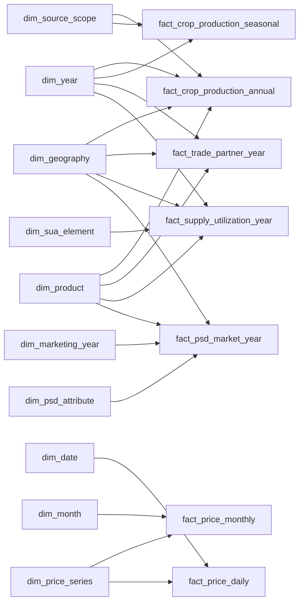

# Gold Serving Galaxy Schema

Version `gold-serving-galaxy-20261108.1`.

## 1. Mục tiêu và quyết định thiết kế

Đây là mô hình **galaxy schema (fact constellation)** cho Power BI Import. Mỗi subject area có một fact table với grain riêng; các fact dùng chung các conformed dimensions. Nó thay thế ý tưởng xuất các bảng aggregate rời rạc không có relationship.

`gold_local` vẫn là Gold Core bất biến. Schema mới `gold_serving_local` là lớp phục vụ BI, được build từ một published Core batch và publish theo bundle snapshot. Mọi key là source-scoped: mô hình **không** tuyên bố FAOSTAT, NSO, USDA và thị trường Việt Nam có geography/product conformed toàn cầu.

Sơ đồ đầy đủ, khóa và FK nằm trong [gold_serving_galaxy.dbml](gold_serving_galaxy.dbml).

## 2. Conformed dimensions

| Dimension | Grain | Dùng cho | Quy tắc quan trọng |
|---|---|---|---|
| `dim_source_system` | Một hệ nguồn | Tất cả facts | Luôn lọc/hiển thị source trước khi so sánh chỉ tiêu khác nguồn. |
| `dim_source_scope` | Một publication/filter scope được duyệt | Crop annual và seasonal | Chặn việc gộp V06.12 với V06.14 hoặc population nguồn khác nhau. |
| `dim_year`, `dim_month`, `dim_date` | Một năm/tháng/ngày lịch | Annual, monthly, daily facts | `dim_date → dim_month → dim_year`; không dùng cho marketing year. |
| `dim_marketing_year` | Một nhãn marketing year của USDA | PSD | Không suy ra ngày bắt đầu/kết thúc nếu nguồn không cung cấp. |
| `dim_geography` | Một identity địa lý trong namespace nguồn | Crop, trade, SUA, PSD, price series | Không join theo display name khác nguồn. Trade dùng hai role: reporter và partner. |
| `dim_product` | Một identity sản phẩm trong namespace nguồn | Crop, trade, SUA, PSD, price series | Paddy, milled, variety và benchmark là các identity tách biệt. |
| `dim_season` | Một mùa vụ nguồn | Crop seasonal | Cấm dòng annual trong fact seasonal. |
| `dim_price_series` | Một series giá/quote nguồn | Price facts | Giữ đầy đủ market, commodity, price type, unit, currency, information source. |
| `dim_trade_direction` | Import/export theo reporter | Trade | Không cộng mirror flow. |
| `dim_sua_element` | Một FAOSTAT SUA element trong hệ nguồn | SUA | Giữ unit và quy tắc tổng hợp của element; không phải catalogue metric dùng chung. |
| `dim_psd_attribute` | Một USDA PSD attribute trong hệ nguồn | PSD | Phân biệt flow, stock, rate và quy tắc tổng hợp theo attribute. |

## 3. Fact tables và grain

| Fact | Grain | Measures chính | Không được làm |
|---|---|---|---|
| `fact_crop_production_annual` | year × source scope × geography × product | production, harvested area, reported yield, paired bases | AVG yield; trộn NSO/FAO hay scope khác nhau. |
| `fact_crop_production_seasonal` | annual grain + season | production, area | Cộng annual và seasonal. |
| `fact_price_monthly` | month × price series | `price_value` | SUM price hay nội suy giá thiếu; MoM/volatility là KPI dẫn xuất. |
| `fact_price_daily` | date × price series | `price_value` | Forward-fill hoặc cộng quote theo ngày. |
| `fact_trade_partner_year` | year × reporter × partner × product × direction | quantity, value, paired bases | AVG unit value; lẫn reporter với partner. |
| `fact_supply_utilization_year` | year × source system × geography × product × SUA element | `element_value` | Xem các components như một balance hoàn chỉnh nếu nguồn không xác nhận. |
| `fact_psd_market_year` | marketing year × source system × geography × product × PSD attribute | `attribute_value` | Join nhầm vào calendar year hoặc SUM stocks theo thời gian. |

Mô hình là galaxy vì các stars cùng chia sẻ dimensions như `dim_geography`, `dim_product`, `dim_source_system` và các dimensions thời gian phù hợp. Không có fact-to-fact hoặc bidirectional relationship.

## 4. Semantic contract và KPI dẫn xuất

Các **base measures** đã được nêu một lần ở mục 3, theo đúng fact chứa chúng. Giá trị luôn nằm trong fact: crop/trade là wide facts; price dùng `price_value`; SUA dùng `element_value` với `dim_sua_element`; PSD dùng `attribute_value` với `dim_psd_attribute`. MoM và volatility không có row riêng trong fact price.

Mục này chỉ liệt kê các KPI được tính ở semantic/DAX layer, không lưu thành một cột KPI độc lập:

| KPI dẫn xuất | Công thức | Điều kiện bắt buộc |
|---|---|---|
| Năng suất tính lại | `1000 × SUM(paired_production_t) / SUM(paired_area_ha)` | Cùng source scope, product, population; mẫu số dương. |
| Tăng trưởng sản lượng YoY | `(current / prior_calendar_year - 1) × 100` | Hai năm lịch liên tiếp, cùng filter scope. |
| Thay đổi giá MoM | `(price_t / price_t-1 - 1) × 100` | Tháng lịch liền trước có giá hợp lệ; không dùng previous available row. |
| Biến động giá 12 tháng | Sample standard deviation của 12 log returns | Cần 13 tháng dương liên tiếp; không annualize. |
| Đơn giá thương mại | `SUM(paired_value_usd) / SUM(paired_quantity_t)` | Cùng reporter, partner, product, direction; không average row-level ratio. |
| Stock-to-use ratio | Theo tử/mẫu số của SUA element hoặc PSD attribute đã được phê duyệt | Không publish nếu denominator hoặc period semantics chưa xác định. |

Các KPI “share theo đối tác”, “chênh giá nội địa–quốc tế” hoặc “forecast” chưa được publish mặc định: chúng cần universe đầy đủ, FX/currency rule hoặc nguồn forecast được duyệt.

## 5. Power BI relationship rules

1. Tạo relationship một chiều từ dimension sang fact, cardinality `1:*`.
2. `dim_date`, `dim_month`, `dim_year` dùng cho các fact calendar. `dim_marketing_year` chỉ dùng cho PSD.
3. Trade dùng `dim_geography` ở hai role. Trong mô hình Power BI, dùng hai role-playing dimension copies (`Reporter Geography`, `Partner Geography`) từ cùng serving dimension để hai slicer cùng active, không dùng bidirectional filtering.
4. Không tạo relationship giữa các facts. So sánh cross-source chỉ hợp lệ khi report ghi rõ source, product form, geography scope và period semantics.
5. Thiết lập `Do not summarize` cho `reported_yield`, ratio, price, volatility, stock và rate; DAX measures là lớp duy nhất được phép tổng hợp những chỉ số này.

## 6. Publication và quality gates

Một serving batch phải bind Core manifest/snapshots, DBML/schema version, revision của SUA element/PSD attribute, transformation hash và từng output snapshot. Batch chỉ được publish khi toàn bộ dimensions và facts cùng version đã qua các gate sau:

- Unique natural key cho từng fact/dimension và FK coverage 100% cho key bắt buộc.
- SUA element/PSD attribute: unit, additivity và quy tắc tổng hợp hợp lệ; element/attribute không được dùng ngoài subject area của nó.
- `present`, `present-NULL` và zero được giữ riêng; calendar scaffold không biến thiếu dữ liệu thành zero.
- Recompute weighted yield và trade unit value từ paired bases; kiểm tra mẫu số bằng 0/NULL.
- Kiểm source scope, product form, calendar-vs-marketing-year và reporter/partner role.
- Export CSV chỉ có columns allowlisted, giữ Decimal dưới dạng text khi Power BI cần đối soát precision.

## 7. Phạm vi triển khai

Thiết kế này là mục tiêu serving model; nó không tự thay đổi `gold_local`, không tạo crosswalk quốc tế giả định và không chứng minh rằng measure đã có dữ liệu. Trước khi triển khai, mapping từ các 9 facts Core sang 7 serving facts phải được kiểm theo batch published, source scope và danh mục SUA element/PSD attribute đã phê duyệt.
