# Gold Serving Galaxy (v2) — Các Bài Toán Nghiệp Vụ, Câu Hỏi Phân Tích & Đối Chiếu Khắc Phục Giới Hạn

Tài liệu tham chiếu đi kèm:
- Thiết kế kiến trúc, semantic contract & đối chiếu code từng lớp: [GOLD_SERVING_GALAXY_DESIGN.md](file:///c:/Windows_Application/TLCN/docs/gold/GOLD_SERVING_GALAXY_DESIGN.md) (`gold-serving-galaxy-20261108.2`)
- Đặc tả lược đồ vật lý/logic (DBML v2): [gold_serving_galaxy.dbml](file:///c:/Windows_Application/TLCN/docs/gold/gold_serving_galaxy.dbml) (`rice_lakehouse_gold_serving_galaxy_20261108_v2`)

---

## 1. Tổng quan vai trò của thiết kế v2

Mô hình `gold_serving_local` (v2) là lớp **BI Serving theo kiến trúc Galaxy Schema (Fact Constellation)** dành cho **Power BI Import**, bao gồm **17 conformed & governed bridge dimensions** và **11 fact tables**, ánh xạ **bảo toàn 100% dữ liệu từ cả 9 bảng fact của Gold Core bất biến (`gold_local`)** đồng thời mở rộng khung tỷ giá tham chiếu và dự báo ML.

Thiết kế v2 giải quyết trọn vẹn **hai tầng bài toán**:
1. **Bài toán kiến trúc & quản trị ngữ nghĩa BI (Data Modeling & Semantic Governance)**: Duy trì mô hình quan hệ một chiều `1:*` không vòng lặp, bảo toàn định danh nguồn để kiểm toán nhưng cung cấp **cầu nối chuẩn hóa có kiểm duyệt (`dim_canonical_geography`, `dim_commodity_profile`)**, **cờ kiểm chứng tập vũ trụ (`is_atomic_member`, `allows_share_denominator`, `reporter_year_universe_complete`)** và **cổng lọc chất lượng quan sát (`dim_observation_status`, `is_usable_quote`)**.
2. **Bài toán phân tích toàn diện chuỗi giá trị lúa gạo (End-to-End Rice Domain Analytics)**: Phục vụ xuyên suốt từ **Sản xuất & Năng suất (cả năm & từng mùa vụ cấp tỉnh/vùng) → Thị phần sản xuất & xuất khẩu đối tác → Cán cân cung cầu & Tồn kho (SUA năm lịch & PSD niên vụ) → Chu kỳ giá, Chênh lệch giá FOB quốc tế / Nội địa & Tỷ giá → Dự báo tương lai**.

```mermaid
flowchart TD
  subgraph Sources["9 Hệ nguồn Gold Core + Điểm mở rộng"]
    S1["NSO Việt Nam (V06.12–V06.24)"]
    S2["FAOSTAT (Prod, SUA, Trade, Price)"]
    S3["USDA PSD"]
    S4["USDA Rice Yearbook (Tables 25–28)"]
    S5["World Bank Pink Sheet"]
    S6["Thị trường nông sản VN"]
    S7["FX Implied / External & ML Forecast"]
  end

  subgraph Galaxy["Gold Serving Galaxy v2 (11 Fact Stars)"]
    F1["fact_crop_production_annual"]
    F2["fact_crop_production_seasonal"]
    F3["fact_price_monthly"]
    F4["fact_price_annual"]
    F5["fact_price_marketing_year"]
    F6["fact_price_daily"]
    F7["fact_exchange_rate"]
    F8["fact_trade_partner_year"]
    F9["fact_supply_utilization_year"]
    F10["fact_psd_market_year"]
    F11["fact_metric_forecast"]
  end

  subgraph Problems["Nhóm bài toán phân tích đáp ứng"]
    P1["1. Quy mô, năng suất, chỉ số phát triển & thị phần sản xuất năm"]
    P2["2. Cơ cấu sản lượng & năng suất lúa từng vụ cấp tỉnh/vùng"]
    P3["3. Giá tháng, MoM, biến động 12T & Spread FOB quốc tế (USD/t)"]
    P4["4. Giá nhà sản xuất năm, PPI, Spread Cổng trại–FOB & Giá niên vụ"]
    P5["5. Báo giá ngày & Spread Lúa–Gạo nội địa (VND/t)"]
    P6["6. Thương mại song phương, Đơn giá & Thị phần đối tác (%)"]
    P7["7. Cán cân cung – sử dụng & tồn kho năm lịch (SUA)"]
    P8["8. Cung – cầu, xay xát & đối chiếu niên vụ MY / năm thương mại TY (PSD)"]
    P9["9. Lọc đồng bộ đa nguồn (Canonical Slicing) & Dự báo ML"]
  end

  S1 --> F1
  S1 --> F2
  S2 --> F1
  S2 --> F3
  S2 --> F4
  S2 --> F8
  S2 --> F9
  S3 --> F10
  S4 --> F3
  S4 --> F5
  S5 --> F3
  S6 --> F6
  S7 --> F7
  S7 --> F11

  F1 --> P1
  F2 --> P2
  F3 --> P3
  F4 --> P4
  F5 --> P4
  F6 --> P5
  F7 --> P4
  F7 --> P5
  F8 --> P6
  F9 --> P7
  F10 --> P8
  F11 --> P9
```

---

## 2. Các bài toán kiến trúc & quản trị dữ liệu mà thiết kế v2 giải quyết

| Mã | Bài toán kiến trúc / quản trị | Cơ chế giải quyết trong `gold_serving_local` (v2) trên nền `iceberg.silver_local.*` |
|---|---|---|
| **T1** | **Liên kết đa chủ đề trên Power BI không sinh quan hệ đa-đa hay đường lọc nhập nhằng** | Mọi quan hệ vật lý đều là `1:*` một chiều từ Dimension xuống Fact; tách role-playing `Reporter Geography` / `Partner Geography`; tra cứu `fact_exchange_rate` bằng DAX `LOOKUPVALUE`/`TREATAS` không gây vòng lặp thời gian. |
| **T2** | **Kế thừa chuẩn hóa Lớp Bạc & Lọc xuyên nguồn an toàn không mất khóa gốc** | Kế thừa trực tiếp cột chuẩn hóa của `silver_local` (`geography_name_candidate` UTF-8 của NSO, M49 3 chữ số của FAO, 5 mã `season` tiếng Anh của NSO), giữ nguyên định danh gốc trên `dim_geography` / `dim_product`, đồng thời nối lên `dim_canonical_geography` (`VNM`, `THA`, `VN-P*`...) và `dim_commodity_profile`. |
| **T3** | **Chống cộng trùng địa lý & chống cộng trùng mã gộp sản phẩm (Double-Counting Prevention)** | • `dim_geography.is_atomic_member = false` loại trừ dòng tổng chồng lấn (`'159'` `China` trùng với `156+158+344+446` trong FAO Production/SUA; dòng `national`/`region` khi cộng 64 tỉnh lịch sử trong NSO). • `dim_product.is_derived_aggregate = true` tách riêng mã gộp chính thức `'F0030'` (`Rice, paddy (rice milled equivalent)`, `166.361` dòng trong `silver_local.faostat_trade`) khỏi 5 mã CPC hạt rời (`0113`, `23161.01/02/03`, `23162`) và tách 6 mã phụ phẩm/thực phẩm chế biến qua `dim_commodity_profile.product_role`. |
| **T4** | **Hài hòa lịch niên vụ có kiểm chứng thực nghiệm mà không làm méo niên vụ gốc** | Giữ `dim_marketing_year` cho cân đối PSD và `1.007` dòng giá trung bình `'MARKETING'` (`fact_price_marketing_year`); ánh xạ `11.929` dòng 12 tháng của `silver_local.usda_rice_yearbook` sang `dim_month` theo quy tắc niên vụ Hoa Kỳ (`Aug..Dec → Y`, `Jan..Jul → Y+1`) kèm khóa truy vết `source_marketing_year_key`; hỗ trợ đối chiếu năm thương mại `TY` qua `trade_year_calendar_key` (inactive). |
| **T5** | **Bảo toàn toán học cho tỷ số (`Ratio-of-Sums`), không nhân lặp đơn vị Lớp Bạc & lọc nhiễu thang giá** | Tuân thủ đúng đơn vị đầu ra của `silver_local` (hệ số `1` cho NSO và `Milling Rate` USDA PSD; `×1000` cho `1000 USD` FAO Trade và `1000 MT`/`1000 HA` USDA PSD); giữ cặp `paired_*`; bảo toàn `release_status = 'provisional'` (NSO), `flag` (`A/E/I/X`, FAO) và chặn `360` dòng lỗi giá `0.00` / sai thang đơn vị (`7.30..26.50 VND/kg`) trong `silver_local.thitruongnongsan` qua `is_usable_quote`. |

---

## 3. Các bài toán nghiệp vụ & câu hỏi phân tích trả lời được theo từng miền

### 3.1. Bài toán 1: Quy mô, tốc độ tăng trưởng, năng suất & thị phần sản xuất lúa thường niên
- **Bảng trung tâm**: `fact_crop_production_annual` (từ `silver_local.nso_rice_statistics` [`season = 'annual'`] & `silver_local.faostat_production`)
- **Chiều phân tích**: `dim_year`, `dim_source_scope`, `dim_geography` (`→ dim_canonical_geography`), `dim_product` (`→ dim_commodity_profile`), `dim_observation_status`
- **Measures & KPI**: `production_t`, `harvested_area_ha`, `reported_yield_kg_ha`, `paired_production_t`, `paired_area_ha`, `area_yoy_index_pct`, `production_yoy_index_pct`; DAX **Năng suất gia quyền**, **YoY %**, **Tỷ trọng sản lượng toàn cầu / vùng (%)**.

**Các câu hỏi phân tích trả lời được:**
1. *Sản lượng lúa (`production_t`) và diện tích thu hoạch (`harvested_area_ha`) của Việt Nam (cấp cả nước `"Việt Nam"`, 6 vùng kinh tế - xã hội, 64 tỉnh/thành lịch sử gồm cả Hà Tây đã được Lớp Bạc khử lỗi font sang UTF-8 chuẩn tại `geography_name_candidate`) và 145 quốc gia/lãnh thổ nguyên tử trong FAOSTAT biến động ra sao qua các năm và thập kỷ?*
2. *Tốc độ tăng trưởng sản lượng YoY (%) tính từ số lượng thực tế so với chỉ số phát triển công bố chính thức của NSO (`production_yoy_index_pct` từ bảng `V06.12`, `statistic_kind = 'development_index'`, kỳ trước = 100%) khớp hay lệch nhau bao nhiêu?*
3. *Năng suất lúa bình quân gia quyền (`1000 × SUM(paired_production_t) / SUM(paired_area_ha)`) đạt bao nhiêu kg/ha, và đóng góp của cải thiện năng suất so với mở rộng diện tích vào tăng trưởng sản lượng dài hạn là bao nhiêu?*
4. *(Mới mở khóa ở v2) **Thị phần sản lượng lúa của Việt Nam, Thái Lan, Ấn Độ trên tổng sản lượng thế giới công bố bởi FAOSTAT** (lọc `is_atomic_member = true` để không cộng trùng mã tổng `'159'` `China`) hoặc **tỷ trọng đóng góp của vùng ĐBSCL / từng tỉnh vào tổng sản lượng cả nước (NSO)** qua từng năm là bao nhiêu %?*
5. *(Mới mở khóa ở v2) Những con số sản lượng năm gần nhất (ví dụ năm 2024 của NSO) đang ở trạng thái chính thức hay số **Sơ bộ (`release_status = 'provisional'`)**, và của FAOSTAT là số chính thức (`A`) hay ước tính/nội suy (`E`, `I`)?*

---

### 3.2. Bài toán 2: Cơ cấu sản xuất & năng suất lúa theo mùa vụ cấp quốc gia, vùng và tỉnh
- **Bảng trung tâm**: `fact_crop_production_seasonal` (từ `silver_local.nso_rice_statistics` với `season <> 'annual'`)
- **Chiều phân tích**: `dim_year`, `dim_season` (khớp chuẩn mã tiếng Anh của Lớp Bạc: `winter_spring`, `summer_autumn`, `summer_autumn_autumn_winter`, `main_season`), `dim_source_scope`, `dim_geography`, `dim_product`, `dim_observation_status`
- **Measures & KPI**: `production_t`, `harvested_area_ha`, **`reported_yield_kg_ha`, `paired_production_t`, `paired_area_ha`**, `area_yoy_index_pct`, `production_yoy_index_pct`; DAX **Năng suất mùa vụ gia quyền**.

**Các câu hỏi phân tích trả lời được:**
1. *Sản lượng và diện tích thu hoạch của từng vụ lúa biến động ra sao ở cấp cả nước (`V06.12`: `winter_spring`, `summer_autumn`, `main_season`) và từng tỉnh/vùng (`V06.16, V06.18`: `winter_spring`; `V06.19, V06.21`: `summer_autumn_autumn_winter` cho 32 tỉnh phía Nam + 4 vùng + cả nước; `V06.22, V06.24`: `main_season`)?*
2. *(Mới mở khóa ở v2) **Năng suất lúa của từng vụ** (`winter_spring` từ `V06.17`, `summer_autumn_autumn_winter` từ `V06.20`, `main_season` từ `V06.23`, cũng như năng suất gia quyền tính từ `paired_production_t / paired_area_ha`, kể cả cho `summer_autumn` ở `V06.12` vốn không có dòng `yield` công bố riêng trong Lớp Bạc) chênh lệch lớn tới mức nào giữa vụ Đông Xuân với vụ Hè Thu – Thu Đông và vụ Mùa tại từng tỉnh ĐBSCL và Đồng bằng sông Hồng?*
3. *Vụ lúa nào giữ vai trò trụ cột ổn định năng suất, và vụ nào chịu rủi ro biến động mạnh nhất theo thời tiết/vùng sinh thái?*
4. *Tỷ trọng đóng góp của từng mùa vụ vào cơ cấu lúa năm của từng địa phương dịch chuyển như thế nào qua 25 năm qua?*

---

### 3.3. Bài toán 3: Chu kỳ giá tháng, rủi ro biến động, Chênh lệch giá xuất khẩu FOB quốc tế (`USD/tonne`) & Tương quan hàng hóa vĩ mô
- **Bảng trung tâm**: `fact_price_monthly` (từ `silver_local.worldbank_commodity_monthly` [`56.232` dòng, 71 mặt hàng], `silver_local.usda_rice_yearbook` [`11.929` dòng tháng], `silver_local.faostat_monthly_price` [`5.341` dòng tháng])
- **Chiều phân tích**: `dim_month` (`→ dim_year`), `dim_price_series` (`→ dim_geography`, `dim_product → dim_commodity_profile`, `benchmark_origin_canonical_geography_key`), `dim_observation_status`
- **Measures & KPI**: `price_value`, `price_value_per_tonne_native`; DAX **MoM (%)**, **Biến động trượt 12 tháng (`12M Volatility`)**, **Chênh lệch giá FOB quốc tế (`International FOB Spread USD/t`)**.

**Các câu hỏi phân tích trả lời được:**
1. *Mặt bằng giá gạo chuẩn quốc tế hàng tháng (4 chuỗi gạo World Bank Pink Sheet `rice_viet_namese_5`, `rice_thai_5`, `rice_thai_25`, `rice_thai_a_1` cùng 31 chuỗi báo giá FOB hàng tháng của Việt Nam, Thái Lan, Ấn Độ, Pakistan từ USDA Rice Yearbook) diễn biến ra sao qua từng tháng, quý, năm?*
2. *(Mới mở khóa ở v2) **Chênh lệch giá xuất khẩu FOB (`USD/tonne`) giữa Gạo 5% tấm Việt Nam với Gạo 5% tấm Thái Lan, Ấn Độ và Pakistan** trong từng tháng là dương (premium) hay âm (discount)? Giai đoạn nào gạo Việt Nam vượt giá gạo Thái Lan và Ấn Độ?*
3. *(Mới mở khóa ở v2) **Khoảng cách giá theo phẩm cấp tấm (`Grade Spread USD/t`)** ngay trong cùng một nước xuất khẩu (Gạo thơm Jasmine vs Gạo 5% tấm vs 15% tấm vs 25% tấm vs 100% tấm trên USDA Yearbook) co giãn thế nào khi thị trường khan hiếm nguồn cung?*
4. *Tốc độ tăng giảm theo tháng (`MoM %`), rủi ro biến động 12 tháng (`12M Rolling Volatility`) của giá gạo thế giới đạt đỉnh vào những cú sốc nào, và **đồng biến động ra sao với 67 chuỗi hàng hóa đối chiếu khác có sẵn trong `silver_local.worldbank_commodity_monthly`** (phân bón Urea/DAP/Kali, dầu thô, lúa mì, ngô)?*
5. *Giá thu mua cổng trại theo tháng bằng nội tệ (`LCU/tonne`, suy dẫn từ `element_code = '5530'` của `silver_local.faostat_monthly_price`) tại từng quốc gia có nhịp mùa vụ thu hoạch theo tháng nào trong năm?*

---

### 3.4. Bài toán 4: Giá nhà sản xuất thường niên, Chỉ số PPI, Giá niên vụ & Chênh lệch Cổng trại – Xuất khẩu (`USD/tonne`)
- **Bảng trung tâm**: `fact_price_annual` (`9.993` dòng năm từ `silver_local.faostat_monthly_price`), `fact_price_marketing_year` (`1.007` dòng `'MARKETING'` từ `silver_local.usda_rice_yearbook`), kết hợp `fact_exchange_rate`
- **Chiều phân tích**: `dim_year` (hoặc `dim_marketing_year`), `dim_price_series`, `dim_observation_status`

**Các câu hỏi phân tích trả lời được (Hoàn toàn mới mở khóa ở v2):**
1. *Giá cổng trại/nhà sản xuất lúa (`Producer Price`) công bố chính thức theo năm của FAOSTAT quy ra **`USD/tonne` (`element 5532`, ví dụ Việt Nam 2023 = `326.7 USD/t`, 2024 = `356.0 USD/t`)** và nội tệ **`LCU/tonne` (`element 5530`)** giữa Việt Nam, Thái Lan, Ấn Độ, Trung Quốc, Hoa Kỳ so sánh với nhau như thế nào từ 1991–2024?*
2. *Chỉ số giá sản xuất lúa (`Producer Price Index`, gốc `2014–2016 = 100`, `element 5539` — cập nhật tới năm `2025` trong Lớp Bạc, ví dụ Việt Nam 2025 = `154.06`) phản ánh mức lạm phát giá nông sản tích lũy tại từng nước ra sao?*
3. ***Biên độ chênh lệch theo năm giữa Giá lúa cổng trại (`USD/tonne` từ `fact_price_annual`) và Đơn giá gạo xuất khẩu bình quân (`USD/tonne` từ `fact_trade_partner_year` hoặc giá FOB năm)** của Việt Nam và Thái Lan mở rộng hay thu hẹp qua các năm?*
4. *Mức giá xuất khẩu FOB bình quân cả niên vụ tiếp thị (`reference_period = 'MARKETING'` trên `fact_price_marketing_year`) của 4 nước xuất khẩu lớn biến chuyển ra sao tương ứng với tồn kho niên vụ trên `fact_psd_market_year`?*

---

### 3.5. Bài toán 5: Giám sát báo giá hàng ngày & Chênh lệch giá Lúa – Gạo nội địa Việt Nam
- **Bảng trung tâm**: `fact_price_daily` (từ `20.387` dòng sạch của `silver_local.thitruongnongsan`, sau khi Lớp Bạc đã cách ly `4` dòng xung đột giá sang `dead_letters` và chuẩn hóa 100% `unit = 'VND/kg'`, `currency = 'VND'`)
- **Chiều phân tích**: `dim_date` (`→ dim_month → dim_year`), `dim_price_series` (`market_name`, `price_type`, `information_source`, `product_key → commodity_alias_group & dim_commodity_profile`, `geography_key → dim_canonical_geography`), `dim_observation_status`
- **Measures & KPI**: `price_value` (`VND/kg`), `price_value_per_tonne_native` (`VND/tonne`), `is_usable_quote`; DAX **Chênh lệch giá Lúa tươi – Gạo nguyên liệu – Gạo xuất khẩu nội địa (`VND/tonne`)**.

**Các câu hỏi phân tích trả lời được:**
1. *Báo giá thu mua/bán buôn/bán lẻ hàng ngày (`VND/kg` và `VND/tonne`) của 176 tên giống lúa/gạo nguồn (được gộp nhóm chuẩn hóa qua `commodity_alias_group` như IR 50404, OM 18, Đài Thơm 8, Gạo NL 5% tấm, Gạo XK 5%/15%/25% tấm...) tại 16 tỉnh/thành nội địa (đã gộp chuẩn `12` dòng lỗi gõ `'Hậu GIang'` với `708` dòng `'Hậu Giang'` về cùng tỉnh `Hậu Giang` qua `dim_canonical_geography`) bằng bao nhiêu?*
2. *(Mới mở khóa ở v2) **Chênh lệch giá nội địa cùng đơn vị `VND/tonne`** giữa lúa đầu vào (ví dụ nhóm `Lúa IR 50404`) với `Gạo nguyên liệu 5% tấm` và `Gạo XK 5% tấm` tại ĐBSCL biến động thế nào theo ngày/tháng?*
3. *Kiểm toán chất lượng dữ liệu: Toàn bộ **`360` dòng bất thường còn nằm trong `silver_local.thitruongnongsan`** — gồm `29` dòng giá `0.00` tại `Kiên Giang` (đã có cảnh báo `VN_ZERO_QUOTE` ở Silver) và `331` dòng lỗi nhập sai thang đơn vị `7.30..26.50 VND/kg` tại `Đồng Tháp` (`252` dòng) & `Thái Bình` (`79` dòng) — được cổng `is_usable_quote = false` chặn sạch để bảo vệ biên độ `Min – Max – Avg` thực tế như thế nào?*

---

### 3.6. Bài toán 6: Dòng chảy thương mại song phương, Tổng thương mại quy gạo, Đơn giá & Thị phần đối tác (`Partner Share %`)
- **Bảng trung tâm**: `fact_trade_partner_year` (từ `1.226.470` dòng của `silver_local.faostat_trade`, quy đổi `'1000 USD' × 1000 → value_usd`)
- **Chiều phân tích**: `dim_year`, `dim_source_scope`, `Reporter Geography` (`→ dim_canonical_geography`), `Partner Geography`, `dim_product` (`is_derived_aggregate`, `→ dim_commodity_profile.product_role`), `dim_trade_direction`, `dim_observation_status`
- **Measures & KPI**: `quantity_t`, `value_usd`, `paired_quantity_t`, `paired_value_usd`, `reporter_year_universe_complete`; DAX **Đơn giá thương mại (`USD/t`)** và **Tỷ trọng đối tác (`Partner Share %`)**.

**Các câu hỏi phân tích trả lời được:**
1. *Khối lượng (`quantity_t`) và kim ngạch (`value_usd`) xuất/nhập khẩu của Việt Nam (và toàn bộ `195` quốc gia báo cáo tới `211` đối tác trong `silver_local.faostat_trade`) qua các năm đạt bao nhiêu — cả ở góc nhìn **Tổng gạo quy đổi chính thức của FAO (`commodity_code = 'F0030'` `Rice, paddy (rice milled equivalent)`, `166.361` dòng; ví dụ xuất khẩu Việt Nam 2023 = `7.679.831,92` tấn tới `85` đối tác)** lẫn góc nhìn **từng mã CPC hạt rời** (`is_derived_aggregate = false`, không bao giờ cộng trùng gấp đôi với `'F0030'`)?*
2. *(Mới mở khóa ở v2) **Tỷ trọng thị phần (`Partner Share %`) của Philippines, Trung Quốc đại lục, Indonesia, Malaysia, Bờ Biển Ngà, Ghana... trên tổng lượng/kim ngạch xuất khẩu gạo của Việt Nam** trong từng năm (1986–2023, khi `reporter_year_universe_complete = true`) là bao nhiêu %? Mức độ tập trung thị trường xuất khẩu của Việt Nam (Top 3 / Top 5 partner concentration / chỉ số HHI) tăng hay giảm?*
3. *Thị trường đối tác nào trả **đơn giá bình quân gia quyền (`SUM(paired_value_usd) / SUM(paired_quantity_t)`)** cao nhất và thị trường nào mua phân khúc giá phổ thông?*
4. *Cơ cấu chủng loại xuất nhập khẩu tách bạch giữa **5 mã lúa/gạo hạt nguyên tử** (`23161.02` gạo xát trắng, `23161.03` gạo tấm, `23161.01` & `23162` gạo lứt, `0113` thóc) so với **6 mã phụ phẩm & chế biến từ gạo có sẵn trong Lớp Bạc** (`23120.01` bột gạo, `39120.02` cám gạo, `21691.01` dầu cám gạo, `21910.01` khô dầu cám, `23490.01` bánh tráng/vỏ bánh `107.589` dòng, `24230.02` đồ uống lên men từ gạo) diễn biến thế nào?*
5. *Độ lệch đối xứng thương mại song phương (mirror discrepancy) giữa số xuất khẩu nước A khai báo sang nước B và số nhập khẩu nước B khai báo từ nước A lớn tới mức nào (đặc biệt cho năm `2024` khi Việt Nam chưa có dòng `Reporter = '704'` trong Lớp Bạc nhưng các nước đối tác đã khai báo nhập khẩu từ Việt Nam)?*

---

### 3.7. Bài toán 7: Cán cân cung – sử dụng & tồn kho năm lịch (FAOSTAT SUA)
- **Bảng trung tâm**: `fact_supply_utilization_year`
- **Chiều phân tích**: `dim_year`, `dim_source_scope`, `dim_geography` (`is_atomic_member`), `dim_product`, `dim_sua_element`, `dim_observation_status`

**Các câu hỏi phân tích trả lời được:**
1. *Cơ cấu sử dụng gạo nội địa theo năm lịch tại Việt Nam và 178 quốc gia/vùng lãnh thổ nguyên tử gồm Lương thực (`Food`), Chăn nuôi (`Feed`), Giống (`Seed`), Chế biến (`Processed`), Hao hụt sau thu hoạch (`Loss`), Sử dụng khác (`Other uses`) phân bổ ra sao?*
2. *Tồn kho đầu năm (`Opening stocks`), biến động tồn kho (`Stock variation`) và tỷ lệ **Stock-to-Use (%)** phản ánh mức đệm an ninh lương thực của từng nước dày hay mỏng?*

---

### 3.8. Bài toán 8: Cán cân cung – cầu, Tỷ lệ xay xát & Đối chiếu Niên vụ `MY` / Năm thương mại `TY` (USDA PSD)
- **Bảng trung tâm**: `fact_psd_market_year`
- **Chiều phân tích**: `dim_marketing_year` (`trade_year_calendar_key` inactive), `dim_geography`, `dim_product`, `dim_psd_attribute` (`temporal_basis`), `dim_observation_status`

**Các câu hỏi phân tích trả lời được:**
1. *Qua 66 niên vụ (`1960/61 – 2025/26`) của Việt Nam trong USDA PSD, sản lượng lúa thô (`Rough Production`), tỷ lệ thu hồi xay xát (`Milling Rate`), sản lượng gạo quy đổi (`Production`), tiêu thụ nội địa (`Domestic Consumption`), tồn kho đầu/cuối vụ (`Beginning/Ending Stocks`) và `Stock-to-Use %` diễn biến ra sao?*
2. *(Mới mở khóa ở v2) Khi kích hoạt đường tham chiếu có kiểm soát cho các thuộc tính năm thương mại (`temporal_basis = 'trade_year_jan_dec'`, tức `TY Exports` và `TY Imports` định nghĩa từ Tháng 1–12 năm `YYYY+1`), ước tính xuất khẩu năm thương mại của USDA PSD lệch bao nhiêu % so với số thực tế báo cáo hải quan trên FAOSTAT (`fact_trade_partner_year`) trong cùng năm dương lịch?*

---

### 3.9. Bài toán 9: Phân tích Đồng bộ Đa nguồn (`Canonical Cross-Source Slicing`) & Dự báo Tương lai (`Forecast Overlay`)
- **Bảng trung tâm**: Kết hợp toàn bộ các ngôi sao qua `dim_canonical_geography`, `dim_commodity_profile`, `dim_year`/`dim_month` và `fact_metric_forecast` + `dim_forecast_model_run`.

**Các câu hỏi phân tích trả lời được:**
1. *(Mới mở khóa ở v2) Khi người dùng chọn duy nhất **`Việt Nam (VNM)`** trên bộ lọc `dim_canonical_geography`, toàn bộ bức tranh 360° gồm: Sản lượng NSO & FAOSTAT, Cán cân SUA, Niên vụ PSD, Thương mại xuất khẩu, Giá cổng trại năm và Giá xuất khẩu FOB hiển thị đồng thời cạnh nhau (với nhãn nguồn rõ ràng) như thế nào?*
2. *(Mới mở khóa ở v2) Trên biểu đồ chuỗi thời gian lịch sử, đường dự báo điểm (`point_forecast`) và dải tin cậy `80% / 95%` của các mô hình dự báo (`SARIMAX`, `Prophet`, `LightGBM`... lưu trong `fact_metric_forecast`) cho 6–12 kỳ tới nằm ở vùng giá/sản lượng nào và sai số kiểm định quá khứ (`backtest_mape_pct`) của phiên bản mô hình đó là bao nhiêu?*

---

## 4. Ma trận tra cứu nhanh: Câu hỏi phân tích ↔ Bảng & Chỉ số trong Thiết kế v2

| Nhóm câu hỏi phân tích | Fact Table sử dụng | Dimensions chính | Base Columns / DAX Measures |
|---|---|---|---|
| Quy mô, YoY, năng suất gia quyền, chỉ số NSO & thị phần sản xuất năm | `fact_crop_production_annual` | `dim_year`, `dim_source_scope`, `dim_geography` (`is_atomic_member`), `dim_product`, `dim_observation_status` | `production_t`, `harvested_area_ha`, `paired_*`, `production_yoy_index_pct`, DAX Weighted Yield, DAX Atomic Share % |
| Sản lượng, diện tích & năng suất từng mùa vụ cấp tỉnh/vùng | `fact_crop_production_seasonal` | `dim_year`, `dim_season`, `dim_source_scope`, `dim_geography`, `dim_product` | `production_t`, `harvested_area_ha`, `reported_yield_kg_ha`, `paired_*`, DAX Seasonal Weighted Yield |
| Chu kỳ giá tháng, MoM, biến động 12T & Spread FOB quốc tế (`USD/t`) | `fact_price_monthly` | `dim_month`, `dim_price_series` (`→ dim_commodity_profile`), `dim_observation_status` | `price_value`, `price_value_per_tonne_native`, DAX MoM %, DAX 12M Vol, DAX International FOB Spread |
| Giá nhà sản xuất năm (`USD/t` & `LCU/t`), PPI & Spread Cổng trại – FOB | `fact_price_annual`, `fact_exchange_rate` | `dim_year`, `dim_price_series`, `dim_observation_status` | `price_value`, `fx_rate`, DAX Farmgate-to-FOB Spread (`USD/t`) |
| Giá xuất khẩu FOB bình quân theo niên vụ tiếp thị | `fact_price_marketing_year` | `dim_marketing_year`, `dim_price_series` | `price_value` (`USD/tonne`) |
| Báo giá lúa gạo ngày & Spread Lúa – Gạo nội địa (`VND/t`) | `fact_price_daily` | `dim_date`, `dim_price_series` (`→ dim_canonical_geography`), `dim_observation_status` | `price_value`, `price_value_per_tonne_native`, `is_usable_quote`, DAX Domestic Spread |
| Thương mại song phương, Tổng gạo quy đổi (`F0030`), Đơn giá & Thị phần đối tác (`Partner Share %`) | `fact_trade_partner_year` | `dim_year`, `dim_source_scope`, `Reporter/Partner Geography`, `dim_product` (`is_derived_aggregate`), `dim_trade_direction` | `quantity_t`, `value_usd`, `paired_*`, `reporter_year_universe_complete`, DAX Unit Value, DAX Partner Share % |
| Cán cân cung – sử dụng & tồn kho năm lịch | `fact_supply_utilization_year` | `dim_year`, `dim_geography`, `dim_product`, `dim_sua_element` | `element_value`, DAX Stock-to-Use (SUA) |
| Cán cân cung – cầu, xay xát & đối chiếu `MY` / `TY` | `fact_psd_market_year` | `dim_marketing_year`, `dim_geography`, `dim_product`, `dim_psd_attribute` | `attribute_value`, DAX Stock-to-Use (PSD), DAX TY Calendar Comparison |
| Dự báo sản lượng / giá / thương mại kèm khoảng tin cậy | `fact_metric_forecast` | `dim_forecast_model_run`, `dim_year` / `dim_month` / `dim_marketing_year`, `dim_geography`, `dim_product` | `point_forecast`, `ci_lower_80/95`, `ci_upper_80/95` |

---

## 5. Phân tích Gốc rễ 6 Giới hạn cũ trên Dữ liệu Lớp Bạc (`iceberg.silver_local.*`): Đâu là do Thiết kế (Đã khắc phục ở v2) vs. Đâu là Giới hạn Vật lý của Nguồn?

Qua truy vấn kiểm định trực tiếp toàn bộ **9 bảng Lớp Bạc đang chạy trên Trino (`iceberg.silver_local.*`, tổng `1.414.527` dòng sạch + `17` dòng `dead_letters`)** đối chiếu với hợp đồng [contracts/silver/](file:///c:/Windows_Application/TLCN/contracts/silver) và code [powerbi.py](file:///c:/Windows_Application/TLCN/src/analytics/marts/powerbi.py), bảng dưới đây phân định minh bạch kết quả xử lý từng giới hạn:

| # | Giới hạn ở bản v1 | Chẩn đoán gốc rễ từ `iceberg.silver_local.*` | Đã khắc phục trong Thiết kế v2 (`gold_serving_local`) | Phần giới hạn vật lý không có trong `silver_local` (Không thể tự bịa ở BI) |
|---|---|---|---|---|
| **1** | **Thị phần đối tác & Thị phần toàn cầu (`Partner Share % / Global Share %`)** | **90% do code mart cũ & thiếu cờ thiết kế**: [powerbi.py](file:///c:/Windows_Application/TLCN/src/analytics/marts/powerbi.py) lọc cứng 4 nước và 3 đối tác của VN. Trong khi đó `silver_local.faostat_trade` đã có đủ **`1.226.470` dòng (`195` reporters × `211` partners, không có mã `'159'`, có sẵn cả mã gộp `'F0030'` `166.361` dòng)**; còn `faostat_production` & `SUA` chỉ vướng mã tổng `'159'` (`China`) trùng với `156+158+344+446` và `nso_rice_statistics` có sẵn `geography_level` (`national`/`region`/`province`). | **Đã giải quyết triệt để**: Đọc toàn bộ `silver_local`; thêm `dim_geography.is_atomic_member` (loại `'159'` và dòng `national`/`region` NSO), `dim_product.is_derived_aggregate` (ngăn cộng trùng `'F0030'` với 5 mã CPC hạt rời), `dim_source_scope.allows_share_denominator` và `reporter_year_universe_complete`. | • Trong `silver_local.faostat_trade`, **năm 2024** Việt Nam (`reporter_country_code = '704'`) có **`0` dòng** (độ trễ công bố FAOSTAT) → cờ `reporter_year_universe_complete = false` tự động khóa không tính sai thị phần 2024. • `silver_local.usda_rice_psd` chỉ có duy nhất 1 nước `'Vietnam'` (`990` dòng) nên không tính được thị phần thế giới bằng PSD nếu chưa nạp PSD toàn cầu vào Bronze/Silver. |
| **2** | **Chênh lệch giá nội địa – quốc tế & Quy đổi ngoại tệ (`Price Spread / FX`)** | **50% do bỏ sót bảng giá có sẵn ở Silver, 50% do không có bảng FX ngày/tháng ở Silver**: `silver_local` đã có sẵn `rice_viet_namese_5` (`USD/tonne`, World Bank), `12.936` dòng FOB `USD/tonne` của 4 nước (USDA Yearbook), giá cổng trại năm `USD` (`element_code = '5532'`, FAO Price), và `20.387` dòng báo giá lúa/gạo nội địa đã chuẩn hóa `100%` sang `'VND/kg'`. Tuy nhiên, trong 9 bảng `silver_local` **không có bảng tỷ giá `USD/VND` theo ngày/tháng**. | **Đã giải quyết tối đa trên dữ liệu Silver + Mở sẵn khung FX**: • Mở khóa ngay **Spread FOB quốc tế (`USD/t`)**, **Spread Cổng trại – FOB theo năm (`USD/t`)** qua `fact_price_annual`, và **Spread Lúa – Gạo nội địa (`VND/t`)** qua `unit_scale_to_tonne = 1000`. • Thêm `fact_exchange_rate` (cấp năm có ngay tỷ giá ngầm định từ cặp `5530/5532` trong `silver_local.faostat_monthly_price`). • Thêm `is_usable_quote` chặn `29` dòng `0.00` (`Kiên Giang`) và `331` dòng lỗi thang đơn vị `7.30..26.50 VND/kg` (`Đồng Tháp`, `Thái Bình`) còn nằm trong `silver_local.thitruongnongsan`. | • Muốn quy đổi báo giá nội địa **hàng ngày/hàng tháng** từ `VND` sang `USD/tonne`, **cần bổ sung 1 bảng tỷ giá hối đoái (`USD/VND` NHNN/IMF) vào Bronze → Silver** để cấp cho `fact_exchange_rate` ở grain `monthly`/`daily`. • Chi phí vận tải/cảng biển nội địa → FOB không có trong Silver nên không tự cộng trừ chi phí giả định. |
| **3** | **Đối chiếu & Lọc đồng bộ xuyên nguồn (`Cross-Source Conformance`)** | **Lớp Bạc đã chuẩn hóa trong từng nguồn, còn thiếu tầng cầu nối xuyên nguồn ở Gold**: `silver_local` đã khử mojibake NSO thành `"Việt Nam"` tại `geography_name_candidate` và chuẩn hóa M49 `'704'` ở FAO, nhưng giữa các bảng vẫn là `'704'` vs `'Vietnam'` vs `'VIETNAM'` vs `"Việt Nam"`, cộng thêm `12` dòng `'Hậu GIang'` trong `silver_local.thitruongnongsan`. | **Đã giải quyết triệt để cho bài toán lọc & đặt cạnh nhau**: Kế thừa trực tiếp cột sạch của `silver_local` (`geography_name_candidate`, M49, `season` tiếng Anh), đồng thời bổ sung `dim_canonical_geography` và `dim_commodity_profile` gộp sạch `'Hậu GIang' → VN-P-HAUGIANG` mà vẫn giữ nguyên khóa gốc ở `dim_geography` / `dim_product`. | **Giữ nguyên ranh giới thống kê hợp lý**: Vẫn **cấm tự động `SUM` khối lượng xuyên nguồn** (vì NSO và FAO là 2 nguồn thống kê độc lập cho cùng một nước). *(Riêng trong nội bộ FAO Trade, Lớp Bạc đã có sẵn mã quy đổi chính thức `'F0030'` của FAO nên dùng trực tiếp mà không cần tự bịa hệ số xay xát).* |
| **4** | **Ghép niên vụ USDA PSD vào trục năm lịch dương (`MY` vs `Calendar Year`)** | **Bản chất nghiệp vụ của `silver_local.usda_rice_psd`**: Lưu theo `market_year` (`1960..2025`) và `crop_year` (`'1960/1961'..'2025/2026'`). Riêng 2 thuộc tính `'TY Exports'` và `'TY Imports'` được USDA định nghĩa chuẩn theo năm dương lịch `Tháng 1 – Tháng 12` của năm `market_year + 1`. | **Đã giải quyết phần đối chiếu hợp lệ**: Giữ `dim_marketing_year` làm khóa chính cho `fact_psd_market_year`, bổ sung `dim_psd_attribute.temporal_basis` và khóa tham chiếu `trade_year_calendar_key` (`inactive`) để đối chiếu hợp lệ `TY Exports/Imports` với `dim_year`. | Các chỉ tiêu sản lượng và tồn kho niên vụ (`MY`) trong `silver_local.usda_rice_psd` vẫn thuộc hệ quy chiếu niên vụ tiếp thị; không thể ép chia theo tháng dương lịch khi nguồn không công bố. |
| **5** | **Dự báo tương lai (`Forecasting`) & Lịch sử phiên bản công bố (`Vintage`)** | **50% do thiết kế v1 chưa mở bảng dự báo & chưa xuất cờ trạng thái có sẵn ở Silver; 50% do Silver lưu bản chụp hiện hành**: `silver_local` đã bóc sẵn `release_status = 'provisional'` (NSO 2024) và `flag` (`A/E/I/X`, FAO), nhưng chỉ lưu trạng thái mới nhất của 1 lần nạp. | **Đã giải quyết khung Dự báo & Trạng thái sơ bộ**: Thêm `dim_observation_status` (hiển thị rõ `provisional` của NSO, `flag` của FAO, `VN_ZERO_QUOTE`) và cặp bảng `dim_forecast_model_run` + `fact_metric_forecast` để tích hợp đầu ra ML vào Power BI. | **Lịch sử hiệu chỉnh quá khứ (`Point-in-time Vintage`)**: Cần lưu trữ nhiều kỳ phát hành (`as-of snapshot`) từ Bronze → Silver theo thời gian nếu muốn so sánh số sơ bộ cũ và số chính thức mới của cùng một năm. |
| **6** | **Rơi rớt dữ liệu & Nguy cơ nhân lệch đơn vị khi đọc từ Lớp Bạc** | **Do thiết kế v1 rút gọn quá mức & chưa bám sát cột đầu ra `silver_local`**: Bỏ sót `9.993` dòng giá năm FAO, `12.936` dòng USDA Yearbook, các bảng năng suất mùa vụ `V06.17/20/23`, chỉ số `development_index` (`V06.12`), 67 mặt hàng phi lúa gạo của World Bank (`price`), và chưa ghi rõ nơi nào Lớp Bạc đã nhân đơn vị sẵn vs. nơi nào giữ `'1000 USD'` / `'1000 MT'`. | **Đã khắc phục 100% (Zero Data Loss & Exact Silver Contract)**: Mở rộng lên **11 facts + 17 dims**, đặc tả tường minh bảng ánh xạ 9 bảng `iceberg.silver_local.*` (Mục 3.1 trong [GOLD_SERVING_GALAXY_DESIGN.md](file:///c:/Windows_Application/TLCN/docs/gold/GOLD_SERVING_GALAXY_DESIGN.md)), bảo vệ tuyệt đối không nhân lặp đơn vị và không bỏ rơi bất kỳ dòng hợp lệ nào của Lớp Bạc. | **Không còn bất kỳ giới hạn nào**: Toàn bộ `1.414.527` dòng sạch của 9 bảng `iceberg.silver_local.*` đều có đích đến chính xác, đúng tên cột, đúng mã chuẩn hóa và đúng thang đơn vị trong `gold_serving_local` v2. |
