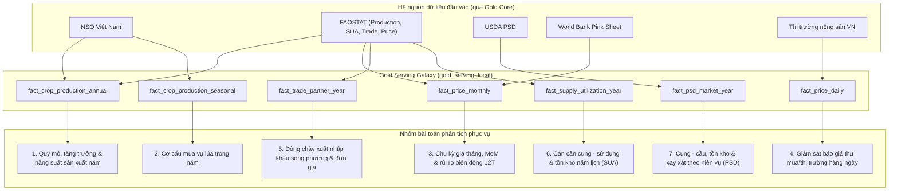

# Gold Serving Galaxy — Các Bài Toán Nghiệp Vụ & Câu Hỏi Phân Tích Đáp Ứng Được

Tài liệu tham chiếu đi kèm:
- Thiết kế kiến trúc & semantic contract: [GOLD_SERVING_GALAXY_DESIGN.md](GOLD_SERVING_GALAXY_DESIGN.md) (`gold-serving-galaxy-20261108.1`)
- Đặc tả lược đồ vật lý/logic: [gold_serving_galaxy.dbml](gold_serving_galaxy.dbml) (`rice_lakehouse_gold_serving_galaxy_20261107`)

---

## 1. Tổng quan vai trò của thiết kế

Mô hình `gold_serving_local` là lớp **BI Serving theo kiến trúc Galaxy Schema (Fact Constellation)** dành cho **Power BI Import**, bao gồm **13 conformed dimensions** và **7 fact tables** đại diện cho 7 miền phân tích (subject areas) cốt lõi của ngành lúa gạo, đứng tách biệt phía sau lớp Gold Core bất biến (`gold_local`).

Thiết kế này đồng thời giải quyết **hai tầng bài toán**:
1. **Bài toán kiến trúc & quản trị ngữ nghĩa BI (Data Modeling & Semantic Governance)**: Tổ chức dữ liệu đa nguồn, đa độ mịn thời gian (năm lịch, mùa vụ, tháng, ngày, niên vụ tiếp thị) thành một mô hình quan hệ `1:*` chặt chẽ, ngăn chặn các sai lầm cộng gộp thống kê phổ biến khi lên báo cáo tự phục vụ (Self-Service BI).
2. **Bài toán phân tích nghiệp vụ ngành lúa gạo (Domain Analytics)**: Phục vụ trọn vẹn chuỗi phân tích từ **Sản xuất (thường niên & mùa vụ) → Cán cân cung cầu & Tồn kho (FAOSTAT SUA & USDA PSD) → Thương mại song phương → Diễn biến & Biến động giá (quốc tế hàng tháng & nội địa hàng ngày)**.

---

## 2. Các bài toán kiến trúc & quản trị dữ liệu mà thiết kế giải quyết

Trước khi trả lời câu hỏi nghiệp vụ, lược đồ Galaxy giải quyết **5 bài toán kỹ thuật – ngữ nghĩa cốt lõi** mà cách xuất bảng phẳng (flat aggregate tables) rời rạc không xử lý được:

| Mã | Bài toán kiến trúc / quản trị | Cơ chế giải quyết trong `gold_serving_local` |
|---|---|---|
| **T1** | **Liên kết đa chủ đề trên Power BI mà không sinh quan hệ đa-đa hoặc lọc hai chiều** | Chia sẻ các conformed dimensions (`dim_source_system`, `dim_year`, `dim_month`, `dim_date`, `dim_geography`, `dim_product`) với quan hệ một chiều `1:*` từ dimension sang fact; cấm join fact-to-fact và cấm bidirectional cross-filtering. |
| **T2** | **Ngăn gộp sai thực thể xuyên nguồn (Source-Scoped Conformance)** | `dim_geography` và `dim_product` định danh chặt trong `(source_system_key, identity_namespace, source_code)` và giữ nguyên `product_form` (`paddy` khác `milled`). Bảng `dim_source_scope` chặn việc cộng lẫn các ấn phẩm khác phạm vi (ví dụ NSO `V06.12` với `V06.14`) hoặc tập hợp địa lý chồng lấn. |
| **T3** | **Phân tách hệ quy chiếu thời gian không tương thích** | Chuỗi thời gian lịch chuẩn hóa theo phân cấp `dim_date → dim_month → dim_year`; tách rời hoàn toàn bảng `dim_marketing_year` cho niên vụ USDA (ví dụ `2024/25`) và `dim_season` cho mùa vụ lúa (cấm đưa dòng `annual` vào `fact_crop_production_seasonal`). |
| **T4** | **Bảo toàn toán học cho chỉ số tỷ lệ (Ratio-of-Sums) và chỉ tiêu bán cộng tính (Stocks/Rates)** | Lưu trực tiếp các cặp cơ sở hợp lệ (`paired_production_t`, `paired_area_ha`, `paired_value_usd`, `paired_quantity_t`) để tầng DAX tính tỷ số của tổng thay vì trung bình cộng tỷ số (`AVG`). Khai báo tường minh `additivity` và `time_aggregation_rule` trong `dim_sua_element` và `dim_psd_attribute` để chặn cộng dồn tồn kho hoặc tỷ lệ qua các năm. |
| **T5** | **Phân biệt rạch ròi giữa Khuyết kỳ (`Absent`), Có dòng nhưng rỗng số (`Present-NULL`) và Giá trị `0`** | Sử dụng các cờ `observation_present`, `numeric_present`, `quantity_present`, `value_present` cùng khung lịch (calendar scaffold) ở `fact_price_monthly` giúp tính đúng thay đổi MoM, biến động 12 tháng và kiểm toán độ phủ mà không nội suy hay forward-fill làm sai lệch dữ liệu gốc. |

---

## 3. Các bài toán nghiệp vụ & câu hỏi phân tích trả lời được theo từng miền

### 3.1. Bài toán 1: Phân tích quy mô, tốc độ tăng trưởng và năng suất sản xuất lúa thường niên
- **Bảng trung tâm**: `fact_crop_production_annual`
- **Chiều phân tích**: `dim_year`, `dim_source_scope`, `dim_geography`, `dim_product` (và `dim_source_system` qua scope/dim)
- **Measures gốc & KPI dẫn xuất**: `production_t`, `harvested_area_ha`, `reported_yield_kg_ha`, `paired_production_t`, `paired_area_ha`; DAX **Năng suất tính lại** `= 1000 × SUM(paired_production_t) / SUM(paired_area_ha)` và **Tăng trưởng sản lượng YoY (%)**.

**Các câu hỏi phân tích trả lời được:**
1. *Sản lượng lúa (`production_t`) và diện tích thu hoạch (`harvested_area_ha`) của Việt Nam (hoặc từng quốc gia/vùng trong FAOSTAT) biến động như thế nào qua từng năm lịch và từng thập kỷ (`decade`)?*
2. *Tốc độ tăng trưởng sản lượng so với năm lịch liền trước (YoY %) đạt bao nhiêu, và năm nào là đỉnh/đáy lịch sử trong phạm vi ấn phẩm được chọn?*
3. *Năng suất lúa bình quân gia quyền thực tế (`1000 × SUM(paired_production_t) / SUM(paired_area_ha)`) của một quốc gia hoặc một nhóm quốc gia không chồng lấn trong năm `Y` là bao nhiêu kg/ha? Năng suất tính lại này chênh lệch thế nào so với năng suất báo cáo trực tiếp (`reported_yield_kg_ha`, ví dụ từ ấn phẩm NSO `V06.14`)?*
4. *Tăng trưởng sản lượng dài hạn đến từ việc mở rộng diện tích thu hoạch hay cải thiện năng suất?*
5. *Trong cùng một năm lịch, một `source_scope` và một dạng sản phẩm (`product_form`, ví dụ lúa `paddy` mã CPC `0113`), thứ hạng quy mô sản lượng và năng suất giữa các quốc gia trong nhóm đối chiếu (ví dụ Việt Nam, Thái Lan, Ấn Độ, Indonesia) ra sao?*

> **Điều kiện ngữ nghĩa bắt buộc**: Luôn lọc một `source_scope_key` và `product_key` xác định; tuyệt đối không dùng `AVG(reported_yield_kg_ha)` khi gộp nhiều vùng hoặc nhiều năm, và không cộng gộp số liệu NSO với FAOSTAT.

---

### 3.2. Bài toán 2: Phân tích cơ cấu và động thái sản xuất lúa theo mùa vụ
- **Bảng trung tâm**: `fact_crop_production_seasonal`
- **Chiều phân tích**: `dim_year`, `dim_season`, `dim_source_scope`, `dim_geography`, `dim_product`
- **Measures gốc**: `production_t`, `harvested_area_ha`, `observation_present`

**Các câu hỏi phân tích trả lời được:**
1. *Trong từng năm, sản lượng và diện tích thu hoạch của từng vụ lúa (ví dụ: Đông Xuân, Hè Thu, Mùa / Thu Đông theo `dim_season.season_name_vi`) đạt bao nhiêu?*
2. *Vụ lúa nào đóng vai trò chủ lực về sản lượng trong năm và vị thế đó có thay đổi qua các giai đoạn lịch sử không?*
3. *Xu hướng mở rộng hay thu hẹp diện tích, sản lượng diễn ra mạnh nhất ở vụ nào (ví dụ: sự ổn định của vụ Đông Xuân so với biến động của vụ Hè Thu hoặc vụ Mùa)?*
4. *Tỷ trọng đóng góp tương đối giữa các vụ được báo cáo trong cùng một `source_scope` biến chuyển ra sao theo thời gian (với lưu ý không mặc định tổng các vụ con phải bằng con số cả năm nếu nguồn không quy định)?*

> **Điều kiện ngữ nghĩa bắt buộc**: `fact_crop_production_seasonal` cấm chứa dòng `annual` (`dim_season.is_annual = false`), ngăn chặn triệt để lỗi nhân đôi sản lượng khi người dùng không chọn slicer mùa vụ.

---

### 3.3. Bài toán 3: Theo dõi chu kỳ giá gạo hàng tháng & đo lường rủi ro biến động giá
- **Bảng trung tâm**: `fact_price_monthly`
- **Chiều phân tích**: `dim_month` (cuộn lên `dim_year` theo quý `quarter_number`, năm, thập kỷ), `dim_price_series` (liên kết `dim_source_system`, `dim_geography`, `dim_product`)
- **Measures gốc & KPI dẫn xuất**: `price_value`, `observation_present`, `numeric_present`; DAX **Thay đổi giá MoM (%)** và **Biến động giá trượt 12 tháng (12-Month Rolling Volatility)**.

**Các câu hỏi phân tích trả lời được:**
1. *Mặt bằng giá gạo chuẩn quốc tế (ví dụ World Bank Pink Sheet `rice_thai_5` tính bằng USD/tấn) hoặc giá cổng trại/nhà sản xuất theo tháng của FAOSTAT diễn biến thế nào theo tháng, quý, năm?*
2. *Các đợt sốt giá (price spikes) hoặc chạm đáy lịch sử rơi vào tháng/năm nào, mức giá cực đại và cực tiểu là bao nhiêu?*
3. *Tốc độ tăng/giảm giá theo tháng liền kề (`MoM % = (price_t / price_{t-1} - 1) × 100`) bằng bao nhiêu tại những tháng có dữ liệu tháng trước hợp lệ?*
4. *Độ biến động giá 12 tháng gần nhất (độ lệch chuẩn mẫu của 12 lợi suất logarit liên tiếp trên 13 tháng có giá dương liên tục) cao hay thấp, giai đoạn nào thị trường bất ổn nhất?*
5. *Chuỗi giá đang xét có tính liên tục cao không: có bao nhiêu tháng khuyết hoàn toàn quan sát (`observation_present = false`) so với tháng có bản ghi nhưng khuyết giá trị số (`observation_present = true, numeric_present = false`)?*

> **Điều kiện ngữ nghĩa bắt buộc**: Phải chọn đúng một `price_series_key` (hoặc các series có cùng đơn vị `unit`, tiền tệ `currency` và bản chất chỉ số khi đặt cạnh nhau để so sánh đường xu hướng); không bao giờ `SUM(price_value)` hoặc nội suy giá tháng bị thiếu.

---

### 3.4. Bài toán 4: Giám sát diễn biến báo giá lúa gạo nội địa hàng ngày
- **Bảng trung tâm**: `fact_price_daily`
- **Chiều phân tích**: `dim_date` (`full_date`, `iso_weekday`, cuộn lên `dim_month → dim_year`), `dim_price_series` (`market_name`, `price_type`, `unit`, `currency`, `information_source`, `product_key`, `geography_key`)
- **Measures gốc**: `price_value`, `observation_present`, `numeric_present`

**Các câu hỏi phân tích trả lời được:**
1. *Mức báo giá thu mua/bán buôn hàng ngày (VND/kg) của một giống lúa/gạo cụ thể tại một địa phương/chợ cụ thể (ví dụ: Lúa tươi IR 50404 tại An Giang, thương lái thu mua) tại ngày `D` là bao nhiêu?*
2. *Biên độ dao động báo giá (cao nhất – thấp nhất) của series đó trong một tuần, một tháng hoặc một năm đã chọn là bao nhiêu?*
3. *Khi đặt các đường biểu diễn riêng biệt trên biểu đồ, xu hướng báo giá giữa các chủng loại lúa/gạo, giữa các địa phương (`market_name`), giữa các khâu giao dịch (`price_type`), hoặc giữa các nguồn cung cấp tin (`information_source`) khác nhau như thế nào?*
4. *Tần suất cập nhật báo giá thực tế theo ngày trong tuần (`iso_weekday`) hoặc theo tháng dày hay thưa, những khoảng ngày nào không có báo giá mà không bị làm giả bằng kỹ thuật forward-fill?*

---

### 3.5. Bài toán 5: Phân tích dòng chảy thương mại gạo song phương & hiệu quả đơn giá
- **Bảng trung tâm**: `fact_trade_partner_year`
- **Chiều phân tích**: `dim_year`, `dim_source_system`, `dim_geography` đóng **2 vai trò độc lập** (`Reporter Geography` và `Partner Geography`), `dim_product`, `dim_trade_direction` (`import` / `export`)
- **Measures gốc & KPI dẫn xuất**: `quantity_t`, `value_usd`, `paired_quantity_t`, `paired_value_usd`, `quantity_present`, `value_present`; DAX **Đơn giá thương mại (Trade Unit Value)** `= SUM(paired_value_usd) / SUM(paired_quantity_t)`.

**Các câu hỏi phân tích trả lời được:**
1. *Khối lượng (`quantity_t`, tấn) và kim ngạch (`value_usd`, USD) xuất khẩu (hoặc nhập khẩu) gạo của một quốc gia báo cáo (`Reporter`, ví dụ Việt Nam) sang từng thị trường đối tác (`Partner`, ví dụ Philippines, Trung Quốc, Malaysia) qua các năm là bao nhiêu?*
2. *Trong danh sách các đối tác được chọn (không chồng lấn với dòng tổng thế giới), đối tác nào dẫn đầu về khối lượng và kim ngạch trong một năm hoặc tổng lũy kế nhiều năm?*
3. *Đơn giá xuất/nhập khẩu bình quân gia quyền thực tế (`SUM(paired_value_usd) / SUM(paired_quantity_t)`, USD/tấn) sang từng đối tác là bao nhiêu, và thị trường nào trả đơn giá cao hơn?*
4. *Cơ cấu thương mại theo mã mặt hàng nguồn (`dim_product`: gạo xay xát, gạo tấm, thóc...) biến đổi thế nào theo thời gian?*
5. *Mức độ bất đối xứng thương mại song phương (mirror trade discrepancy) lớn cỡ nào khi đối chiếu riêng số xuất khẩu do nước A báo cáo sang nước B với số nhập khẩu do nước B báo cáo từ nước A?*

> **Điều kiện ngữ nghĩa bắt buộc**: Không trộn lẫn vai trò `Reporter` và `Partner`, không cộng gộp dòng `export` với dòng `import` đối ứng (mirror flow), và chỉ tính đơn giá trên phần dữ liệu có đồng thời cả lượng dương và trị giá hợp lệ (`paired_quantity_t`, `paired_value_usd`).

---

### 3.6. Bài toán 6: Phân tích cán cân cung – sử dụng và tồn kho lương thực năm lịch (FAOSTAT SUA)
- **Bảng trung tâm**: `fact_supply_utilization_year`
- **Chiều phân tích**: `dim_year`, `dim_source_system`, `dim_geography`, `dim_product`, `dim_sua_element` (`element_code`, `unit`, `time_aggregation_rule`, `additivity`)
- **Measures gốc & KPI dẫn xuất**: `element_value`, `observation_present`; DAX **Stock-to-use ratio** (khi cặp element tử số/mẫu số đã được phê duyệt).

**Các câu hỏi phân tích trả lời được:**
1. *Tại một quốc gia và mã sản phẩm (ví dụ Việt Nam, gạo xay xát CPC `23161.02`), quy mô từng cấu phần sử dụng nội địa theo năm lịch gồm: lương thực cho người (`Food supply`), thức ăn chăn nuôi (`Feed`), hạt giống (`Seed`), chế biến (`Processed`), hao hụt (`Loss`), sử dụng phi thực phẩm (`Other uses`) biến động ra sao?*
2. *Mức tồn kho đầu kỳ (`Opening stocks` — chỉ tiêu `semi_additive`, không cộng dồn qua các năm) và lượng biến động tồn kho trong năm (`Stock variation` — giữ nguyên dấu âm/dương) diễn biến như thế nào?*
3. *Giá trị sai số/phần dư thống kê (`Residuals`, giữ nguyên dấu) lớn hay nhỏ ở từng năm, phản ánh đặc điểm cân đối của nguồn FAOSTAT như thế nào?*
4. *Tỷ lệ tồn kho trên sử dụng (`Stock-to-use ratio`) theo định nghĩa SUA đã duyệt thay đổi ra sao qua các năm, phản ánh mức độ đệm an ninh lương thực tăng hay giảm?*

---

### 3.7. Bài toán 7: Phân tích cung – cầu, tồn kho & tỷ lệ xay xát theo niên vụ tiếp thị (USDA PSD)
- **Bảng trung tâm**: `fact_psd_market_year`
- **Chiều phân tích**: `dim_marketing_year` (`marketing_year_key`, `market_year`, `crop_year_label`), `dim_source_system`, `dim_geography`, `dim_product`, `dim_psd_attribute` (`attribute_kind`: `flow`/`stock`/`rate`, `time_aggregation_rule`, `additivity`)
- **Measures gốc & KPI dẫn xuất**: `attribute_value`, `observation_present`; DAX **Stock-to-use ratio** (theo niên vụ tiếp thị).

**Các câu hỏi phân tích trả lời được:**
1. *Qua từng niên vụ tiếp thị (`crop_year_label`, ví dụ `2023/24`, `2024/25`), tổng cung (`Total Supply`), sản lượng gạo xay xát (`Production`), sản lượng lúa thô (`Rough Production`) và tiêu thụ nội địa (`Domestic Consumption`) thay đổi thế nào?*
2. *Tồn kho đầu vụ (`Beginning Stocks`) và tồn kho cuối vụ (`Ending Stocks`) ở cuối mỗi niên vụ tăng hay giảm? Tỷ lệ tồn kho cuối vụ trên tiêu thụ/sử dụng (`Stock-to-use ratio`) đạt bao nhiêu %?*
3. *Hiệu suất thu hồi gạo xay xát (`Milling Rate`) và năng suất (`Yield`) theo chuẩn USDA PSD qua các niên vụ ở mức nào?*
4. *Quy mô xuất/nhập khẩu tính theo niên vụ tiếp thị (`MY Exports`, `MY Imports`) khác biệt ra sao so với quy mô tính theo năm thương mại (`TY Exports`, `TY Imports`, `TY Imp. from U.S.`)?*

> **Điều kiện ngữ nghĩa bắt buộc**: `fact_psd_market_year` nối duy nhất vào `dim_marketing_year`, không nối vào `dim_year` để tránh việc người xem ngộ nhận niên vụ `2024/25` trùng khít với năm dương lịch `2024` hay `2025`.

---

### 3.8. Bài toán 8: Phân tích đối chiếu đa chủ đề (Multi-Star Analytics) & Kiểm toán độ phủ dữ liệu
Nhờ cấu trúc **Galaxy Schema** dùng chung các chiều thời gian lịch và chiều hệ nguồn, báo cáo Power BI trả lời được nhóm câu hỏi phối hợp nhiều bảng fact trên cùng một trang dashboard (mỗi visual đọc từ fact riêng, đồng bộ qua slicer chung):

1. **Đối chiếu đa góc nhìn trong cùng năm lịch (`dim_year`)**: *Trong năm `Y` (hoặc giai đoạn `Y1–Y2`), khi sản lượng thu hoạch lúa trong nước biến động, thì lượng xuất khẩu gạo song phương, lượng cung lương thực nội địa (SUA) và mặt bằng giá gạo thế giới (cuộn từ `dim_month` lên `dim_year`) dịch chuyển cùng chiều hay ngược chiều?*
2. **Đối chiếu đa nguồn có kiểm soát nhãn nguồn (`dim_source_system`, `dim_source_scope`)**: *Số liệu sản lượng/diện tích lúa Việt Nam do NSO công bố và do FAOSTAT công bố trong cùng năm lịch chênh lệch nhau bao nhiêu khi đặt cạnh nhau với đầy đủ nhãn nguồn và phạm vi sản phẩm?*
3. **Kiểm toán độ sẵn sàng và tính đầy đủ dữ liệu (Data Coverage & Completeness)**: *Trên từng miền dữ liệu, tỷ lệ kỳ có quan sát số hợp lệ so với dòng `present-NULL` và kỳ khuyết (`absent`) phân bố ra sao theo năm, nguồn, vùng địa lý hoặc chuỗi giá?*

---

## 4. Ma trận tra cứu nhanh: Câu hỏi phân tích ↔ Bảng & Chỉ số trong thiết kế

| Nhóm câu hỏi phân tích | Fact Table sử dụng | Conformed Dimensions lọc/nhóm | Base Columns / DAX Measures |
|---|---|---|---|
| Sản lượng, diện tích, tăng trưởng YoY & năng suất gia quyền năm | `fact_crop_production_annual` | `dim_year`, `dim_source_scope`, `dim_geography`, `dim_product` | `production_t`, `harvested_area_ha`, `reported_yield_kg_ha`, DAX Weighted Yield từ `paired_*`, DAX YoY % |
| Cơ cấu sản lượng & diện tích theo vụ lúa (Đông Xuân, Hè Thu, Mùa...) | `fact_crop_production_seasonal` | `dim_year`, `dim_season`, `dim_source_scope`, `dim_geography`, `dim_product` | `production_t`, `harvested_area_ha`, `observation_present` |
| Chu kỳ giá tháng, đỉnh/đáy, tốc độ MoM & biến động giá 12 tháng | `fact_price_monthly` | `dim_month` (`→ dim_year`), `dim_price_series` (`→ source, geo, product`) | `price_value`, `observation_present`, `numeric_present`, DAX MoM %, DAX 12M Volatility |
| Báo giá thu mua / bán buôn nội địa từng ngày theo chợ & giống lúa | `fact_price_daily` | `dim_date` (`→ dim_month → dim_year`), `dim_price_series` | `price_value`, `observation_present`, `numeric_present` |
| Lượng, kim ngạch xuất/nhập khẩu song phương & đơn giá thương mại | `fact_trade_partner_year` | `dim_year`, `dim_source_system`, `dim_geography` (Reporter & Partner), `dim_product`, `dim_trade_direction` | `quantity_t`, `value_usd`, DAX Unit Value từ `paired_value_usd` / `paired_quantity_t` |
| Cán cân cung – sử dụng (lương thực, giống, hao hụt, tồn kho đầu kỳ...) | `fact_supply_utilization_year` | `dim_year`, `dim_source_system`, `dim_geography`, `dim_product`, `dim_sua_element` | `element_value`, `observation_present`, DAX Stock-to-use (SUA) |
| Cung – cầu, tồn kho đầu/cuối vụ, tỷ lệ xay xát theo niên vụ USDA | `fact_psd_market_year` | `dim_marketing_year`, `dim_source_system`, `dim_geography`, `dim_product`, `dim_psd_attribute` | `attribute_value`, `observation_present`, DAX Stock-to-use (PSD) |

---

## 5. Giới hạn có chủ đích: Các câu hỏi thiết kế KHÔNG tự động trả lời

Một điểm mạnh quan trọng của thiết kế `gold_serving_local` là **từ chối trả lời sai** những câu hỏi chưa đủ điều kiện dữ liệu chuẩn hóa hoặc quy tắc nghiệp vụ được phê duyệt (xem mục 4, 5, 7 trong [GOLD_SERVING_GALAXY_DESIGN.md](GOLD_SERVING_GALAXY_DESIGN.md)):

1. **Thị phần toàn cầu hoặc tỷ trọng đối tác trên tổng xuất khẩu thế giới (`Partner Share % / Global Market Share`)**:
   - *Lý do chưa publish mặc định*: Chỉ hợp lệ khi mẫu số được chứng minh là toàn bộ tập vũ trụ (full non-overlapping universe) của năm đó. Nếu batch serving chỉ nạp một tập đối tác chọn lọc, phép chia phần trăm trên tổng các dòng hiện có sẽ tạo ra "thị phần giả".
2. **Chênh lệch giá nội địa – quốc tế quy đổi chung một đồng tiền (`Domestic vs. International Price Spread / Arbitrage`)**:
   - *Lý do chưa publish mặc định*: Giá nội địa đang ở mức báo giá lúa/gạo theo `VND/kg`, còn giá benchmark quốc tế tính theo `USD/tonne` ở cấp độ gạo xuất khẩu FOB. Thiết kế chưa tích hợp bảng tỷ giá hối đoái lịch sử (`FX`), hệ số quy đổi lúa tươi → gạo thành phẩm và chi phí xay xát/logistics được duyệt.
3. **Tổng hợp hoặc xếp hạng gộp xuyên nguồn (`Cross-Source Total / Universal Country-Product Ranking`)**:
   - *Lý do chặn*: `dim_geography` và `dim_product` chỉ conformed bên trong từng `identity_namespace` của nguồn; thiết kế chủ đích không dùng tên hiển thị để nối tự động giữa FAOSTAT, NSO, USDA và nhãn chợ Việt Nam, cũng không tự suy hệ số quy đổi từ `paddy` sang `milled`.
4. **Ghép trực tiếp chỉ tiêu niên vụ USDA PSD vào trục năm lịch dương**:
   - *Lý do chặn*: `dim_marketing_year` không có khóa ngoại sang `dim_year` vì thời điểm bắt đầu/kết thúc niên vụ tùy thuộc từng quốc gia và mặt hàng theo định nghĩa riêng của USDA.
5. **Dự báo tương lai (`Forecasting`) và suy diễn nhân quả (`Causal Attribution`)**:
   - *Lý do chưa đưa vào schema*: Mô hình hiện tại phục vụ phân tích mô tả, so sánh, chẩn đoán xu hướng/biến động trên dữ liệu lịch sử đã kiểm chứng (descriptive & diagnostic BI); chưa bao gồm bảng dự báo ML hay lịch sử hiệu chỉnh dữ liệu theo thời điểm công bố (vintage/point-in-time archive).
6. **Các chuỗi giá đặc thù chưa tách fact riêng trong 7 bảng hiện tại**:
   - *Lưu ý triển khai*: Gold Core (`gold_local`) có 9 bảng fact (bao gồm cả giá năm FAOSTAT `fact_fao_price_annual` và bảng tham chiếu kỳ hỗn hợp `fact_usda_price_reference` từ USDA Rice Yearbook). Khi ánh xạ từ 9 facts Core sang 7 facts của `gold_serving_local`, các câu hỏi gắn riêng với giá năm công bố của FAO hoặc kỳ tham chiếu đặc thù của USDA Yearbook cần tuân theo quy tắc lọc/mapping được phê duyệt ở bước publication (mục 7 của tài liệu thiết kế).
