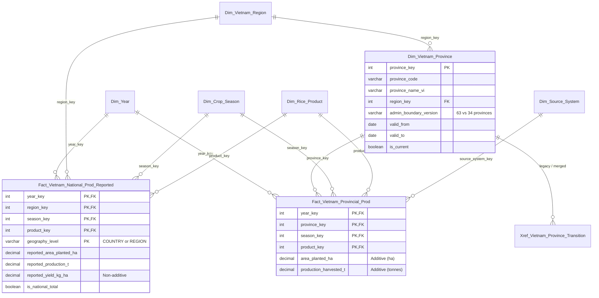
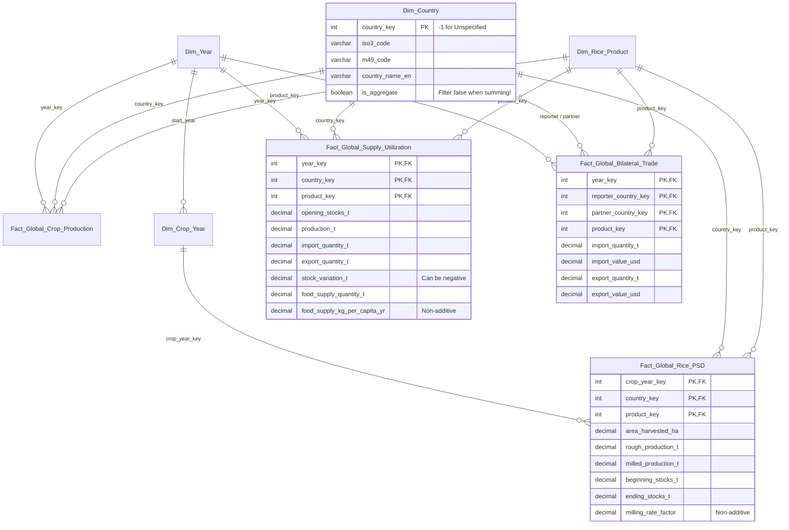
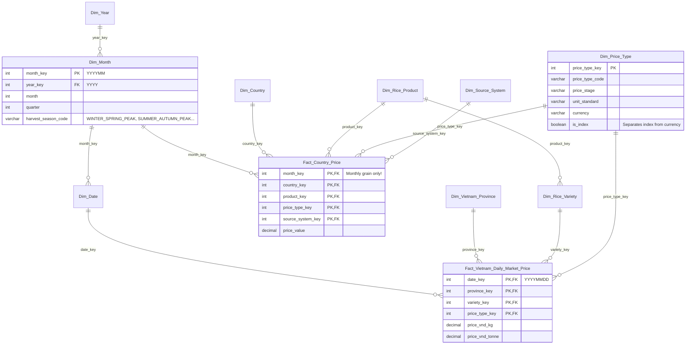
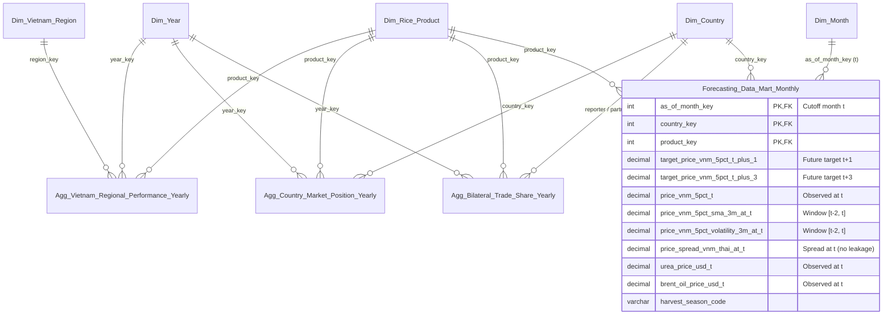

# Đặc tả Kiến trúc Tầng Gold (Dimensional Model v3)

Tài liệu này định nghĩa mô hình dữ liệu **Galaxy Schema (Fact Constellation)** cho tầng **Gold** của Rice Lakehouse, đi kèm file đặc tả DBML tại [`docs/gold/dim_fact_v3.dbml`](dim_fact_v3.dbml). Thiết kế v3 giải quyết triệt để toàn bộ các vấn đề ở nhóm **A (Chặn/Critical)**, **B (Thiết kế/Architecture)** và **C (Chuẩn hóa & Trình bày)** trước khi triển khai pipeline `Silver → Gold`.

---

## 1. Bảng Đối Chiếu Khắc Phục Thiết Kế (v2 → v3)

| Mã | Vấn đề ở bản cũ (v2) | Giải pháp ở bản chuẩn hóa (v3) |
|---|---|---|
| **A1** | `Dim_Date` bị trùng khóa `20230101` cho cả ngày `01/01/2023`, tháng `01/2023` và năm `2023` (nhân dòng thầm lặng $\times 3$ trên Iceberg). | Tách thành **Rollup Time Hierarchy**: `Dim_Date (YYYYMMDD)` $\rightarrow$ `Dim_Month (YYYYMM)` $\rightarrow$ `Dim_Year (YYYY)`, và tách riêng `Dim_Crop_Year` cho niên vụ USDA PSD. |
| **A2** | `Fact_Country_Price` trộn dòng tháng và dòng `Annual value` (`7021`), trộn `USD/tonne` với `Price Index`, dùng 2 cột `varchar` trong PK. | Chỉ nạp grain **tháng** (`month_key`, lọc `time_grain = 'monthly'`). Tách `Dim_Price_Type` (có cờ `is_index`, `currency`, `unit_standard`) và `Dim_Source_System`. PK thuần `int`. |
| **A3** | `Fact_Global_Supply_Utilization` để dạng EAV, thiếu `date_key`, trộn số âm (`Stock Variation`) và số bình quân đầu người (`kg/capita`). | Pivot thành các cột định lượng cộng được theo đơn vị **tấn (`_t`)**, gắn `year_key` + `product_key`. Tách riêng 2 cột bình quân đầu người có hậu tố rõ ràng và ghi chú `NON-ADDITIVE`. |
| **A4** | `Forecasting_Data_Mart_Monthly` bị **Target Leakage** (dùng `price_spread_vnm_thai`, `sma_3m`, `volatility_3m` và giá Pink Sheet tại cùng tháng với target). | Định nghĩa rõ mốc quan sát `as_of_month_key` ($t$) và 2 cột mục tiêu tương lai `target_price_vnm_5pct_t_plus_1` ($t+1$), `target_price_vnm_5pct_t_plus_3` ($t+3$). Mọi feature chỉ dùng dữ liệu $\le t$. |
| **B5** | Bảng `Agg_*` thiếu `product_key` (nhập nhằng Paddy vs Milled), `region_name` là `varchar`, `avg_yield` có nguy cơ trung bình cộng sai. | Thêm `product_key` vào cả 3 bảng `Agg_*`. Thêm `Dim_Vietnam_Region` (`region_key`). Bắt buộc tính `weighted_yield_tonnes_ha = SUM(prod) / NULLIF(SUM(area), 0)` và ghi rõ 2 mẫu số tính tỉ trọng vùng. |
| **B6** | Sản lượng xuất hiện ở nhiều nguồn (QCL, SUA, PSD, NSO) với cơ sở hạt (paddy vs milled) và đơn vị khác nhau (`1000 MT`, `Nghin_tan`, `t`). | Thiết lập **Bảng Quy tắc System of Record (SoR)** bên dưới. Chuẩn hóa mọi đơn vị ở Gold về **tấn (`_t`)**, **hecta (`_ha`)**, và **USD (`_usd`)**. Thêm `product_key` vào `Fact_Global_Rice_PSD`. |
| **B7** | `Dim_Vietnam_Province` thiếu SCD2 cho sáp nhập tỉnh 2025 (63 $\rightarrow$ 34) và chứa dòng `"Cả nước"`; `Dim_Country` thiếu `is_aggregate`; `Dim_Rice_Variety` rời rạc. | Rút `"Cả nước"` khỏi `Dim_Vietnam_Province`, thêm SCD2 (`province_code`, `valid_from`, `valid_to`, `is_current`) + bảng `Xref_Vietnam_Province_Transition`. Thêm `is_aggregate` vào `Dim_Country` + `Xref_Country_SourceAlias`. Nối `Dim_Rice_Variety.product_key` $\rightarrow$ `Dim_Rice_Product`. Đổi `Bridge_...` thành `Xref_Product_SourceAlias`. |
| **B8** | `is_harvest_season_vnm` chỉ phủ T2–T4 (Đông Xuân), bỏ sót vụ Hè Thu (T6–T8). | Thay bằng `harvest_season_code` trên `Dim_Month` (`WINTER_SPRING_PEAK`, `SUMMER_AUTUMN_PEAK`, `AUTUMN_WINTER_MAIN`, `OFF_SEASON`). |
| **C** | Lưu tỉ số non-additive (`calculated_unit_price`, `yield`) trong bảng atomic; thiếu lineage, thiếu dòng `-1`, diagram quá rối. | Chuyển các tỉ số sang Semantic Views; chuẩn hóa `decimal(18,2)` / `decimal(18,4)`; thêm `_source_file`, `_ingest_ts`, `etl_batch_id`; quy ước khóa `-1 (Unknown)` cho mọi Dimension; tách ERD thành 4 Subject Areas. |

---

## 2. Enterprise Bus Matrix (Fact × Conformed Dimension)

Ma trận dưới đây thể hiện cách các bảng Fact và Mart chia sẻ hệ thống **Conformed Dimensions** trong Galaxy Schema:

| Bảng Fact / Mart | Phân loại Fact | `Dim_Date` | `Dim_Month` | `Dim_Year` | `Dim_Crop_Year` | `Dim_Crop_Season` | `Dim_Country` | `Dim_VN_Region` | `Dim_VN_Province` | `Dim_Rice_Product` | `Dim_Rice_Variety` | `Dim_Price_Type` | `Dim_Source_System` |
|---|---|---|---|---|---|---|---|---|---|---|---|---|---|
| **`Fact_Vietnam_Provincial_Prod`** | Periodic Snapshot (Atomic) | | | $\checkmark$ | | $\checkmark$ | | *(qua Province)* | $\checkmark$ | $\checkmark$ | | | $\checkmark$ |
| **`Fact_Vietnam_National_Prod_Reported`** | Periodic Snapshot (Published Agg) | | | $\checkmark$ | | $\checkmark$ | | $\checkmark$ | | $\checkmark$ | | | $\checkmark$ |
| **`Fact_Global_Crop_Production`** | Periodic Snapshot (Atomic) | | | $\checkmark$ | | | $\checkmark$ | | | $\checkmark$ | | | $\checkmark$ |
| **`Fact_Global_Rice_PSD`** | Periodic Snapshot (Balance Sheet) | | | *(qua Crop_Year)* | $\checkmark$ | | $\checkmark$ | | | $\checkmark$ | | | $\checkmark$ |
| **`Fact_Global_Supply_Utilization`** | Periodic Snapshot (Balance Sheet) | | | $\checkmark$ | | | $\checkmark$ | | | $\checkmark$ | | | $\checkmark$ |
| **`Fact_Global_Bilateral_Trade`** | Periodic Snapshot / Cumulative Flow | | | $\checkmark$ | | | $\checkmark$ *(×2 Role)* | | | $\checkmark$ | | | $\checkmark$ |
| **`Fact_Country_Price`** | Periodic Snapshot (Monthly) | | $\checkmark$ | *(qua Month)* | | | $\checkmark$ | | | $\checkmark$ | | $\checkmark$ | $\checkmark$ |
| **`Fact_Vietnam_Daily_Market_Price`** | Transaction / Daily Snapshot | $\checkmark$ | *(qua Date)* | *(qua Month)* | | | | *(qua Province)* | $\checkmark$ | *(qua Variety)* | $\checkmark$ | $\checkmark$ | $\checkmark$ |
| **`Agg_Vietnam_Regional_Performance_Yearly`** | Derived Aggregate | | | $\checkmark$ | | | | $\checkmark$ | | $\checkmark$ | | | |
| **`Agg_Country_Market_Position_Yearly`** | Derived Aggregate | | | $\checkmark$ | | | $\checkmark$ | | | $\checkmark$ | | | |
| **`Agg_Bilateral_Trade_Share_Yearly`** | Derived Aggregate | | | $\checkmark$ | | | $\checkmark$ *(×2 Role)* | | | $\checkmark$ | | | |
| **`Forecasting_Data_Mart_Monthly`** | ML Feature & Target Mart | | $\checkmark$ | *(qua Month)* | | | $\checkmark$ | | | $\checkmark$ | | | |

> [!IMPORTANT]
> **Quy ước Dòng Unknown (`key = -1`):** Mọi bảng Dimension đều bắt buộc khởi tạo bản ghi mặc định với khóa chính `-1` (`Unknown / Unspecified`). Ví dụ: khi `silver.faostat_trade` có đối tác thương mại là `"Unspecified"` hoặc vùng chưa xác định, khóa `partner_country_key` sẽ trỏ về `-1` thay vì `NULL`, giúp bảo toàn tính toàn vẹn của khóa chính tổ hợp (Composite PK) và không làm rơi dòng khi `INNER JOIN`.

---

## 3. Khai Báo Grain (Grain Declarations) & Phân Loại Fact

Mỗi bảng Fact trong tầng Gold tuân thủ nghiêm ngặt **1 câu khai báo Grain** trước khi xác định Measures:

1. **`Fact_Vietnam_Provincial_Prod`** *(Periodic Snapshot – Atomic)*:
   - **Grain:** Một dòng biểu diễn diện tích gieo trồng và sản lượng thu hoạch lúa (quy về đơn vị ha và tấn) của **1 tỉnh/thành phố trực thuộc TW (atomic)**, trong **1 vụ mùa cụ thể (`is_annual_summary = false`)**, thuộc **1 năm dương lịch**.
2. **`Fact_Vietnam_National_Prod_Reported`** *(Periodic Snapshot – Published Reference)*:
   - **Grain:** Một dòng biểu diễn các chỉ tiêu diện tích, năng suất, sản lượng và chỉ số phát triển YoY chính thức do Tổng cục Thống kê (NSO) công bố sẵn ở cấp **Cả nước (`COUNTRY`) hoặc Vùng kinh tế - xã hội (`REGION`)**, theo **từng vụ hoặc cả năm**, trong **1 năm dương lịch**.
3. **`Fact_Global_Crop_Production`** *(Periodic Snapshot – Atomic)*:
   - **Grain:** Một dòng biểu diễn tổng diện tích thu hoạch (`ha`) và sản lượng lúa thóc (`paddy tonnes`) của **1 quốc gia/vùng lãnh thổ**, đối với **1 mặt hàng (`RICE_PADDY`)**, trong **1 năm dương lịch** theo FAOSTAT QCL.
4. **`Fact_Global_Rice_PSD`** *(Periodic Snapshot – Marketing Year Balance Sheet)*:
   - **Grain:** Một dòng biểu diễn bảng cân đối cung - cầu và tồn kho gạo xay xát (`RICE_MILLED`, đơn vị ha và tấn) của **1 quốc gia**, trong **1 niên vụ thương mại (`crop_year_key`)** theo USDA PSD.
5. **`Fact_Global_Supply_Utilization`** *(Periodic Snapshot – Annual Food Balance)*:
   - **Grain:** Một dòng biểu diễn các thành phần nguồn cung và hình thái sử dụng nội địa (lương thực, thức ăn chăn nuôi, giống, hao hụt, chế biến — đơn vị tấn) của **1 quốc gia**, cho **1 sản phẩm**, trong **1 năm dương lịch** theo FAOSTAT SUA.
6. **`Fact_Global_Bilateral_Trade`** *(Periodic Snapshot – Annual Bilateral Flow)*:
   - **Grain:** Một dòng biểu diễn tổng khối lượng (`tonnes`) và kim ngạch (`USD`) xuất/nhập khẩu song phương giữa **1 quốc gia báo cáo (`reporter`)** và **1 quốc gia đối tác (`partner`)**, cho **1 mã sản phẩm lúa gạo cụ thể**, trong **1 năm dương lịch** theo FAOSTAT Trade Matrix.
7. **`Fact_Country_Price`** *(Periodic Snapshot – Monthly)*:
   - **Grain:** Một dòng biểu diễn mức giá hoặc chỉ số giá trung bình trong **1 tháng dương lịch (`month_key`)**, tại **1 quốc gia (hoặc benchmark quốc tế)**, cho **1 sản phẩm**, ứng với **1 loại giá/tiền tệ (`price_type_key`)** từ **1 hệ thống nguồn (`source_system_key`)**.
8. **`Fact_Vietnam_Daily_Market_Price`** *(Transaction / Daily Snapshot)*:
   - **Grain:** Một dòng biểu diễn mức giá giao dịch (VND/kg và VND/tấn) ghi nhận vào **1 ngày (`date_key`)**, tại **1 thị trường/tỉnh (`province_key`)**, cho **1 giống lúa/chủng loại gạo nội địa (`variety_key`)**, theo **1 hình thức giá (`price_type_key`: Bán buôn/Bán lẻ)**.
9. **`Agg_Vietnam_Regional_Performance_Yearly`** *(Derived Aggregate)*:
   - **Grain:** Một dòng tổng hợp diện tích, sản lượng, năng suất bình quân gia quyền và tỉ trọng đóng góp của **1 vùng kinh tế - xã hội Việt Nam (`region_key`)**, cho **1 sản phẩm**, trong **1 năm dương lịch**.
10. **`Agg_Country_Market_Position_Yearly`** *(Derived Aggregate)*:
    - **Grain:** Một dòng tổng hợp vị thế sản xuất, xuất nhập khẩu, thị phần và thứ hạng toàn cầu của **1 quốc gia độc lập (`is_aggregate = false`)**, theo **từng sản phẩm cụ thể (`product_key`)**, trong **1 năm dương lịch**.
11. **`Agg_Bilateral_Trade_Share_Yearly`** *(Derived Aggregate)*:
    - **Grain:** Một dòng tổng hợp kim ngạch, sản lượng, đơn giá bình quân gia quyền và tỉ trọng đối tác thương mại giữa **1 cặp quốc gia (`reporter`, `partner`)**, theo **từng sản phẩm (`product_key`)**, trong **1 năm dương lịch**.
12. **`Forecasting_Data_Mart_Monthly`** *(ML Feature & Target Mart)*:
    - **Grain:** Một dòng biểu diễn vector đặc trưng (features tính từ dữ liệu $\le t$) và biến mục tiêu dự báo giá gạo xuất khẩu (`t+1`, `t+3`) tại **1 tháng chốt quan sát (`as_of_month_key = t`)**, cho **1 quốc gia (`VNM`)** và **1 mặt hàng mục tiêu (`RICE_MILLED_5PCT`)**.

---

## 4. Quy Tắc "System of Record" (SoR) & Chuẩn Hóa Đơn Vị ([B6], [C])

Để tránh xung đột khi nhiều nguồn dữ liệu cùng cung cấp số liệu sản lượng/thương mại với cơ sở hạt (`Paddy` vs `Milled`) và đơn vị khác nhau, tầng Gold áp dụng bảng phân quyền **System of Record (SoR)** sau:

| Chỉ tiêu phân tích (Business Measure) | System of Record (Bảng chuẩn ưu tiên) | Cơ sở hạt (Basis) | Đơn vị chuẩn tại Gold | Quy tắc chuyển đổi từ Silver |
|---|---|---|---|---|
| **Sản lượng & Diện tích Lúa Việt Nam (cấp Tỉnh)** | `Fact_Vietnam_Provincial_Prod` (từ `silver.nso_rice_statistics`) | Lúa thóc (`RICE_PADDY`) | `tonnes` (`_t`), `hectares` (`_ha`) | Silver đã nhân `1000` từ `Nghin_tan` $\rightarrow$ `tonne` và `Nghin_ha` $\rightarrow$ `hectare`. Chỉ lấy `geography_level = 'PROVINCE_CITY'` và `is_annual_summary = false`. |
| **Sản lượng Lúa Việt Nam (Số công bố Cả nước/Vùng)** | `Fact_Vietnam_National_Prod_Reported` (từ `silver.nso_rice_statistics`) | Lúa thóc (`RICE_PADDY`) | `tonnes` (`_t`), `hectares` (`_ha`), `kg/ha` | Dùng để đối chiếu (reconciliation) và báo cáo số công bố chính thức của GSO. Không cộng gộp chung với bảng Tỉnh. |
| **Sản lượng & Diện tích Lúa Thóc Toàn cầu** | `Fact_Global_Crop_Production` (từ `silver.faostat_production`) | Lúa thóc (`RICE_PADDY`, CPC `0113`) | `tonnes` (`_t`), `hectares` (`_ha`) | Lấy `element_code = 5510` (tonnes) và `5312` (ha). Lọc `Dim_Country.is_aggregate = false` khi cộng toàn cầu. |
| **Cung cầu, Tiêu thụ & Tồn kho Gạo Xay xát Toàn cầu** | `Fact_Global_Rice_PSD` (từ `silver.usda_rice_psd`) | Gạo xay xát (`RICE_MILLED`) | `tonnes` (`_t`), `hectares` (`_ha`) | Nhân `value * 1000` (từ `1000 MT` $\rightarrow$ `tonnes` và `1000 HA` $\rightarrow$ `ha`). Cột `rough_production_t` giữ riêng cho thóc. |
| **Cân đối Lương thực & Khấu hao (Feed, Seed, Loss, Food)** | `Fact_Global_Supply_Utilization` (từ `silver.faostat_supply_utilization`) | Theo `product_key` (`Paddy` / `Milled`) | `tonnes` (`_t`) | Pivot các `element_code` khối lượng về `tonnes`. Tách riêng `food_supply_kg_per_capita_yr` (`NON-ADDITIVE`). |
| **Thương mại Song phương Quốc tế (Xuất/Nhập khẩu)** | `Fact_Global_Bilateral_Trade` (từ `silver.faostat_trade`) | Theo `product_key` (`Paddy`, `Husked`, `Milled`, `Broken`) | `tonnes` (`_t`), `USD` (`_usd`) | Khối lượng giữ nguyên `tonnes`; Giá trị nhân `1000` (từ `1000 USD` $\rightarrow$ `USD`). |
| **Giá Gạo Xuất khẩu FOB Chuẩn (Benchmark ML)** | `Fact_Country_Price` (từ `silver.worldbank_commodity_monthly` & `silver.usda_rice_yearbook`) | `RICE_MILLED_5PCT` / `25PCT` / `FRAGRANT` | `USD/tonne` | Lọc qua `Dim_Price_Type` (`is_index = false`, `currency = 'USD'`). |

### Quy tắc Cấm Lưu Tỉ Số Non-Additive ở Atomic Facts ([C])
- **Năng suất (`Yield`)**: Không lưu ở `Fact_Vietnam_Provincial_Prod` và `Fact_Global_Crop_Production`. Luôn tính động trên Semantic View hoặc bảng `Agg_*` theo công thức:
  $$\text{Weighted Yield (tonnes/ha)} = \frac{\sum \text{production\_t}}{\text{NULLIF}(\sum \text{area\_ha}, 0)}$$
- **Đơn giá Thương mại (`Unit Price USD/tonne`)**: Không lưu ở `Fact_Global_Bilateral_Trade`. Luôn tách rõ đơn giá xuất khẩu (FOB) và đơn giá nhập khẩu (CIF) trên View/Agg:
  $$\text{Export Unit Price (USD/t)} = \frac{\sum \text{export\_value\_usd}}{\text{NULLIF}(\sum \text{export\_quantity\_t}, 0)}, \quad \text{Import Unit Price (USD/t)} = \frac{\sum \text{import\_value\_usd}}{\text{NULLIF}(\sum \text{import\_quantity\_t}, 0)}$$

---

## 5. Sơ Đồ ERD Theo Từng Subject Area (Mermaid Diagrams)

Để tránh một sơ đồ tổng quá rối khi trình bày báo cáo, mô hình Galaxy Schema được chia thành **4 Subject Areas** liên kết qua các Conformed Dimensions:

### 5.1. Subject Area 1: Sản Xuất Lúa Gạo Việt Nam (Vietnam Production & SCD2 Geography)

### 5.2. Subject Area 2: Cung Cầu, Tồn Kho & Thương Mại Quốc Tế (Global Supply & Bilateral Trade)

### 5.3. Subject Area 3: Hệ Thống Thời Gian Rollup & Giá Nông Sản (Time Hierarchy & Prices)

### 5.4. Subject Area 4: Bảng Tổng Hợp & ML Forecasting Mart (Aggregates & Point-in-Time Mart)

---

## 6. Kiểm Thử Ràng Buộc & Chất Lượng Dữ Liệu Tầng Gold (Iceberg DQ Gates)

Vì Apache Iceberg không tự động thực thi (enforce) khóa chính (`PK`) và khóa ngoại (`FK`) ở tầng vật lý như RDBMS truyền thống, pipeline `Silver → Gold` phải kiểm tra tự động 5 cổng chất lượng (DQ Gates) sau trước khi commit snapshot:

1. **Composite PK Uniqueness Gate**: Kiểm tra `COUNT(*) == COUNT(DISTINCT pk_cols)` trên tất cả các bảng `Dim_*`, `Fact_*`, `Agg_*` và `Forecasting_Data_Mart_Monthly`.
2. **Rollup Key Disjointness Gate ([A1])**:
   - `Dim_Year.year_key` $\in [1900, 2100]$ (4 chữ số `YYYY`).
   - `Dim_Month.month_key` $\in [190001, 210012]$ (6 chữ số `YYYYMM`).
   - `Dim_Date.date_key` $\in [19000101, 21001231]$ (8 chữ số `YYYYMMDD`).
3. **Referential Integrity & Unknown Member Gate ([C])**: Mọi khóa ngoại (`_key`) trong bảng Fact không được `NULL`; nếu không khớp crosswalk phải gán về `-1` (`Unknown`).
4. **No Double-Counting Gate ([A2], [B7])**:
   - `Fact_Vietnam_Provincial_Prod` không chứa bất kỳ dòng nào có `geography_level IN ('COUNTRY', 'REGION')` hoặc `is_annual_summary = true`.
   - `Fact_Country_Price` không chứa bất kỳ dòng nào có `month_code = '7021'` (`Annual value`).
   - `Agg_Country_Market_Position_Yearly` không chứa quốc gia có `Dim_Country.is_aggregate = true`.
5. **Point-in-Time Anti-Leakage Gate ([A4])**: Trong `Forecasting_Data_Mart_Monthly`, kiểm tra bất biến `target_price_vnm_5pct_t_plus_1 == LEAD(price_vnm_5pct_t, 1)` và `price_spread_vnm_thai_at_t == price_vnm_5pct_t - price_thai_5pct_t` (tuyệt đối không lấy hiệu số tại $t+1$).
