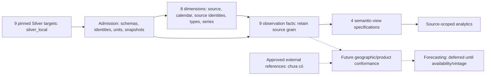

# TLCN Rice Lakehouse — Canonical Gold Schema

**Thiết kế `gold-20261025.1` · 25/10/2026 · Asia/Bangkok · baseline `main@1bb662c49cac2f82af14ce4b5c9a5d909c2a0e05`.**

**Schema design: READY WITH BLOCKERS để owner review. ETL/runtime Gold: NOT IMPLEMENTED.** DBML là đề xuất canonical cho phạm vi khả thi; chưa được owner phê duyệt, chưa có Gold tables/jobs/DAG. Silver physical schema được kiểm tra mới không đồng nghĩa đã nghiệm thu toàn bộ Bronze/Silver hoặc Gold.

## Mục lục

- [1. Baseline](#1-baseline)
- [2. Silver inventory](#2-silver-inventory)
- [3. Architecture](#3-architecture)
- [4. Dimensions và keys](#4-dimensions-và-keys)
- [5. Facts và bus matrix](#5-facts-và-bus-matrix)
- [6. Mapping và units](#6-mapping-và-units)
- [7. Semantics và System of Record](#7-semantics-và-system-of-record)
- [8. Semantic views](#8-semantic-views)
- [9. Design DQ gates](#9-design-dq-gates)
- [10. Quyết định cho 27 bảng cũ](#10-quyết-định-cho-27-bảng-cũ)
- [11. Blockers và deferred scope](#11-blockers-và-deferred-scope)
- [12. Implementation roadmap](#12-implementation-roadmap)
- [13. Validation](#13-validation)
- [14. Approval gate](#14-approval-gate)

## 1. Baseline

| Artifact | Phân loại và cách dùng |
|---|---|
| [dim_fact_v3.dbml](dim_fact_v3.dbml) | **Canonical schema hiện tại**, giữ filename để links ổn định; nội dung thay thế v3 cũ. 17 physical-table specifications = 8 dimensions + 9 facts, 262 columns, 40 logical FK refs. |
| [source_to_gold_mapping.csv](source_to_gold_mapping.csv) | **Canonical field mapping** mới: 488 source-branch mappings phủ đủ 262 columns. Có schema version, Git HEAD, contract SHA-256, source columns, expression/lookup, units, grain, joins, NULL/unknown và availability. Được lập trước khi thay DBML. |
| [design_audit_2026-10-22.md](design_audit_2026-10-22.md) | Historical audit của thiết kế 27 bảng tại commit `1bb662c`; findings và kết quả đo giữ nguyên. Đề xuất MVP 14 bảng bên trong đã được thay bằng thiết kế này, chưa từng là approval. |
| [design_audit_2026-10-22_schema_and_mapping.md](design_audit_2026-10-22_schema_and_mapping.md) | Historical appendix, 261 fields của DBML cũ; không dùng để implement schema hiện tại. |
| [design_audit_2026-10-22_field_mapping.csv](design_audit_2026-10-22_field_mapping.csv), [audit_2026-10-22_evidence.json](audit_2026-10-22_evidence.json) | Immutable historical evidence: không overwrite hay đổi số liệu thành kết quả 25/10. |
| [PROJECT_CONTEXT](../handoff/PROJECT_CONTEXT.md), [PROJECT_STATUS](../handoff/PROJECT_STATUS.md), [NEXT_STEPS](../handoff/NEXT_STEPS.md) | Handoff 23/10, đã đối chiếu lại; không chỉnh sửa trong nhiệm vụ này. H01–H05 vẫn là foundation backlog, H06 là schema work hiện tại, H08 là implementation sau approval. |

Đầu nhiệm vụ: local `main` vẫn ở `1bb662c`; user có thay đổi `.gitignore` để allowlist handoff và ba handoff files chưa track. Do đó câu “handoff đang bị ignore” trong handoff đã cũ đối với working tree này. Giữ nguyên toàn bộ các thay đổi đó. Không pull/checkout/merge/commit/push.

Căn cứ ưu tiên: executable [contracts](../../contracts/silver/), [local_profile](../../src/silver/local_profile.py), active [framework](../../src/silver/framework.py), [transformers](../../src/silver/transformers/), [engines](../../src/silver/engine/), [registry](../../config/ingestion/source_registry.yaml), [NSO metadata](../../config/silver/nso_v2_metadata.json), [DAGs](../../dags/), [runner/jobs](../../jobs/silver/) và tests tương ứng. Legacy `*_transformer.py` không phải dispatch hiện hành.

**Evidence mới 25/10:** 7 containers local đang chạy; trước profiling Windows available ~2,74 GiB, WSL MemAvailable ~5,29 GiB, runner chưa chạy Spark job (~10 MiB). Read-only Trino `SHOW TABLES` và `information_schema.columns` xác nhận 9 targets và toàn bộ tên/type nghiệp vụ khớp contracts. Bốn query DISTINCT trên SUA/PSD/Yearbook/NSO dùng session cap 128 MB, execution limit 20 s, output LIMIT 20–50; chỉ scan các bảng nhỏ đó, không scan trade toàn bộ. LIMIT giới hạn output, không tự giới hạn số input rows. Không start/rebuild/reset, trigger DAG, gọi runner /run hay ghi dữ liệu.

Chưa kiểm tra full-table counts, toàn bộ NULL/duplicate distributions, historical-vintage availability, pipeline replay/physical NOOP hoặc full H05. Counts/profile của 22/10 là historical, không tái sử dụng làm nghiệm thu mới.

## 2. Silver inventory

Input profile cố định là **`local_nine`**, prefix **`iceberg.silver_local`**. YAML gốc còn ghi `iceberg.silver`; overlay trong local_profile mới quyết định physical local target. Proposed Gold output là **`iceberg.gold_local`**, namespace chưa được tạo. Không fallback sang `silver`/release/production khi thiếu bảng.

Registry có thêm fixture enabled `faostat_trade_validation`; whitelist thực vẫn 9 nguồn. NSO ID canonical `nso`, không đổi thành `nso_vietnam_v2`.

| Source ID → physical target dưới input prefix | Silver business key | Time / geography / product semantics | Gold route |
|---|---|---|---|
| faostat_production → faostat_production | country_code, commodity_code, year, element_code | Calendar annual; source M49 areas, CPC. 5312 area, 5412 reported yield, 5510 production; units đã hectare/kg/hectare/tonne. | fact_fao_production_observation |
| faostat_monthly_price → faostat_monthly_price | country_code, commodity_code, year, month_code, element_code | 7001–7012 monthly; 7021 annual với month NULL. M49/CPC; 5530 LCU, 5531 SLC, 5532 USD, 5539 index. | fact_price_monthly **hoặc** fact_fao_price_annual, phân hoạch rời nhau |
| faostat_supply_utilization → faostat_supply_utilization | country_code, commodity_code, year, element_code | Calendar annual; exact source M49/CPC; 12 elements tonne, signed 5071/5166. | fact_fao_sua_observation |
| faostat_trade → faostat_trade | reporter_country_code, partner_country_code, commodity_code, year, element_code | Calendar annual; reporter/partner roles; quantity tonne, monetary 1000 USD; mọi code nguồn được bảo toàn. | fact_fao_trade_observation |
| usda_psd → usda_rice_psd | country, commodity, attribute, market_year | Marketing-year label/crop_year, không phải calendar FK. Profile mới thấy Vietnam/Rice, Milled; đủ 15 attributes, có rough/milled, MY/TY, stock/flow/yield/fraction. | fact_usda_psd_observation |
| usda_rice_yearbook → usda_rice_yearbook | location, commodity_class, year, reference_period, statistic_type | Source year label; month names/YEAR/MARKETING là các reference_period riêng; không suy calendar year. Country/location và price class không tự conformed. USD/tonne. | fact_usda_price_reference |
| worldbank_pinksheet → worldbank_commodity_monthly | commodity_code, period_date | Calendar month, period_date đầu tháng. Commodity code là exact benchmark identity; không tự suy exporter từ tên series. Units đa dạng, series_name hiện do code đặt NULL. | fact_price_monthly, namespace series WorldBank riêng |
| thitruongnongsan → thitruongnongsan | market, commodity, price_type, unit, currency, source, date | Daily quote, market label không phải official province key; commodity là nhãn giống/grade; source là nguồn thông tin báo giá. | fact_vn_market_quote_daily |
| nso → nso_rice_statistics | source_table, source_geography_key, year, measure, season, statistic_kind | Reporting year, source publication, raw geography identity; annual/seasonal, quantity/index riêng. Official geography_code/boundary_version NULL theo contract. | fact_nso_observation |

**Các cột và nullable chính xác:** hậu tố `!` nghĩa `nullable:false` trong YAML, `?` là nullable. Framework còn bắt mọi business-key column không NULL dù YAML cho nullable (đặc biệt VN unit/currency/source). Đây là admission policy, không phải fresh physical NULL counts.

**faostat_monthly_price** — [contract](../../contracts/silver/faostat_monthly_price.yaml), SHA-256 `3ea124204428f0b8168d9013e53ecca77c368f8e3b2262043c000c0d21ca781b`.

```text
domain_code: string!
domain: string!
country_code: string!
country_name: string!
element_code: string!
element: string!
commodity_code: string!
commodity_name: string!
year: integer!
month_code: string!
month_name: string!
unit: string?
value: decimal(18,4)?
flag: string?
flag_description: string?
time_grain: string!
month: integer?
currency: string?
price_kind: string!
value_raw: string?
unit_raw: string?
missing_reason: string?
```

**faostat_production** — [contract](../../contracts/silver/faostat_production.yaml), SHA-256 `f36722ee085ee2af800e3ad7a80ddef76d47f0a0cd2e13d21b475f4ed04e96e1`.

```text
domain_code: string!
domain: string!
country_code: string!
country_name: string!
element_code: string!
element: string!
commodity_code: string!
commodity_name: string!
year: integer!
unit: string?
value: decimal(18,2)?
flag: string?
flag_description: string?
value_raw: string?
unit_raw: string?
missing_reason: string?
```

**faostat_supply_utilization** — [contract](../../contracts/silver/faostat_supply_utilization.yaml), SHA-256 `835fb126bb41ea966219b18a6f4295aa104851c6bbdd224ea31c5db70dd8fdff`.

```text
domain_code: string!
domain: string!
country_code: string!
country_name: string!
element_code: string!
element: string!
commodity_code: string!
commodity_name: string!
year: integer!
unit: string?
value: decimal(18,2)?
flag: string?
flag_description: string?
note: string?
value_raw: string?
unit_raw: string?
missing_reason: string?
```

**faostat_trade** — [contract](../../contracts/silver/faostat_trade.yaml), SHA-256 `80d858386ab9d81ab50c5ac004189f2a2a5e49bed5b6daeb03c2edd398aa7e8b`.

```text
reporter_country_name: string!
reporter_country_code: string!
partner_country_name: string!
partner_country_code: string!
commodity_name: string!
commodity_code: string!
element_name: string!
element_code: string!
year: integer!
unit: string?
value: decimal(18,2)?
flag: string?
value_raw: string?
unit_raw: string?
missing_reason: string?
```

**nso** — [contract](../../contracts/silver/nso.yaml), SHA-256 `9246124b891138c18d851356a95d62b2fe177adb2c73df7968fb6d7e5ee0eb8b`.

```text
bronze_read_snapshot_id: long!
source_table: string!
source_column: string!
source_geography_key: string!
geography_raw: string?
geography_name_candidate: string?
geography_level: string!
geography_status: string!
geography_code: string?
boundary_version: string?
geography_mapping_version: string!
geography_evidence: string!
period_raw: string!
year: integer!
measure: string!
season: string!
statistic_kind: string!
release_status: string!
value_raw: string?
value_source: decimal(28,8)?
unit_raw: string?
unit_source_reference: string!
conversion_factor: decimal(8,0)!
value: decimal(28,8)?
unit: string!
unit_status: string!
unit_reference: string!
unit_evidence: string!
unit_mapping_version: string!
metadata_version: string!
quality_status: string!
missing_reason: string?
review_reason: string?
diagnostic_evidence: string!
```

**thitruongnongsan** — [contract](../../contracts/silver/thitruongnongsan.yaml), SHA-256 `fddafa3e94a53dcc08986b647885a66a083e7c846f8c6559030684b365e46a25`.

```text
commodity: string!
market: string!
price_type: string!
unit: string?
currency: string?
source: string?
date: date!
price_value: decimal(18,2)?
year: integer!
value_raw: string?
unit_raw: string?
missing_reason: string?
```

**usda_psd** — [contract](../../contracts/silver/usda_psd.yaml), SHA-256 `2e92234590772f4aed1c9c22fad45e7ab485b26eb7e37eb0ccae1795c89ffb3c`.

```text
country: string!
commodity: string!
attribute: string!
market_year: integer!
crop_year: string!
unit: string?
value: decimal(18,4)?
value_source: decimal(28,8)?
source_unit: string?
conversion_factor: decimal(18,6)!
value_raw: string?
missing_reason: string?
```

**usda_rice_yearbook** — [contract](../../contracts/silver/usda_rice_yearbook.yaml), SHA-256 `d7ce91e44a2872005d4f56a80abbaff01038f7d0dcaf6470d325ac0df57c9173`.

```text
table_name: string?
table_number: integer?
commodity: string!
commodity_class: string!
year: integer!
reference_period: string!
location: string!
statistic_type: string!
value: decimal(18,2)?
unit: string?
value_raw: string?
unit_raw: string?
missing_reason: string?
```

**worldbank_pinksheet** — [contract](../../contracts/silver/worldbank_pinksheet.yaml), SHA-256 `9adcb9d88fd3afc61efd78d0673ae734f47a81bbffe86241152446e1e305ff6a`.

```text
commodity_code: string!
commodity_name: string!
period_code: string!
period_date: date!
year: integer!
month: integer!
price: decimal(18,2)?
unit: string?
series_name: string?
value_raw: string?
unit_raw: string?
missing_reason: string?
```

Mỗi target còn có **8 audit columns** `_ingestion_run_id, _ingestion_batch_id, _ingestion_chunk_id, _ingestion_timestamp, _source_id, _source_file, _source_checksum, _source_snapshot_id`, cộng `_dq_warnings` và `_silver_processed_at`. Schema mới của cả 9 bảng có đủ 10 cột này. DQ warnings là array ở Silver; Gold serialize deterministic JSON string, không giả định Iceberg có native JSON type.

Silver đã preprocess → try_cast → required/source/contract DQ → quarantine → deterministic latest dedup → change-aware MERGE. SQL UNKNOWN không pass blocking DQ; LOG/KEEP có thể giữ warning. Latest ingestion timestamp là survivorship kỹ thuật, không phải publication precedence. FULL Silver read hiện không tự xóa observations đã bị source rút; Gold phản ánh pinned Silver state, không hứa là Raw replacement hay vintage archive.

## 3. Architecture

Mục tiêu: phân tích sản xuất, cung cầu/tồn kho, thương mại và giá trên laptop 16 GB; giữ grain có thể kiểm chứng trước khi thêm conformance hoặc aggregate. Giảm từ 27 tables cũ xuống 17 specifications; không thêm dịch vụ. Tất cả bảng dưới đây mới là thiết kế.



Physical facts giữ một source observation trên mỗi row, không pivot tại storage layer. Đây là quyết định có chủ đích: unit/measurement type luôn xác định, không SUM cột value chung; presentation views mới pivot sau kiểm tra uniqueness. NSO publication, FAO flags, missing cell và PSD 15 attributes vì vậy không bị mất khi ghép measures.

Conformed thực sự trong MVP: calendar year/month/day; **exact FAOSTAT M49 code và exact FAOSTAT CPC source code** dùng chung trong code family đã xác minh. Không conformed USDA names, VN market labels, NSO candidates, WorldBank benchmarks vào cùng official country/product identity. Tên display giống nhau không đủ để join. All-source analytics là so sánh có source/basis labels; cross-source country/grade rankings đợi refs.

## 4. Dimensions và keys

### K1 — Deterministic surrogate keys

Mọi hash key là lowercase SHA-256 đầy đủ, `varchar(64)`, của UTF-8 canonical JSON array:

```text
["K1", entity_domain, [typed natural-key values in documented order]]
```

JSON không whitespace thừa, không ASCII-escape Unicode, không tự trim/case-fold/normalize NFC thêm ngoài Silver; NULL khác string "null", empty khác NULL, integer khác string. Date key component dùng ISO YYYY-MM-DD; không có float/decimal/timestamp trong natural keys hiện tại. Không concat bằng delimiter, không truncate hash, không increment/row_number/monotonically_increasing_id. Model version không là source identity; chỉ đổi K1 khi có migration thiết kế được duyệt.

Fact `observation_key=K1("observation",[source_id, ordered Silver BK tuple])`; `source_business_key_json` giữ tuple chưa hash để collision/reconciliation checks. Rebuild, input order và repartition không đổi keys. Cần kiểm tra một hash không map nhiều natural tuples; không gọi SHA-256 là bằng chứng toán học không collision.

Calendar PK là true integer YYYY, YYYYMM, YYYYMMDD tại các bảng riêng; validate actual date và FK rollup, không chỉ numeric range. `dim_year` chỉ calendar years; không đưa PSD marketing label hoặc Yearbook reference year vào đó.

### G1 — Geography identity

| Input | identity_namespace | identity_scope | source_identity |
|---|---|---|---|
| FAO production/price/SUA/trade | faostat_m49 | faostat | country_code; trade reporter và partner tạo hai roles |
| NSO | nso_raw_label | exact source_table | source_geography_key; raw hash hoặc __national_table_scope__ |
| USDA PSD | usda_psd_country | usda_psd | exact country |
| USDA Yearbook | usda_yearbook_location | usda_rice_yearbook | exact location |
| VN quote | vn_market_label | thitruongnongsan | exact market |

Key `K1("dim_source_geography",[namespace,scope,source_identity])`. M49 giữ leading zeros, China/aggregate/historical codes không ép thành ISO3 hay successor hiện đại. NSO geo key có table scope; national-table-scope khác national raw label. Source geography identity không đồng nghĩa cùng boundary qua thời gian.

`source_labels_json` ở geography là sorted distinct JSON array các objects `{"role":"source|raw|candidate|technical","label":"exact text"}`, sort theo role rồi label, bỏ NULL label. NSO raw và candidate gắn vai trò riêng, không thay raw identity bằng candidate; national-table-scope có thể có array rỗng. Technical WB row dùng role technical. Product labels là sorted distinct array strings. Source levels NSO giữ `national/region/province/unknown` nhưng các nhãn vẫn candidate; ngoài NSO là `source_area/market_label/source_location`, không chứng nhận administrative level. Conflict của thuộc tính bắt buộc không được sửa bằng arbitrary first/MAX.

**Unknown policy:** chỉ `dim_source_geography` có một technical non-geographic member key gồm 64 số 0, namespace `__technical__`, scope `not_geographic`, identity `not_applicable`, level/status `not_applicable`. WorldBank benchmark tham chiếu member này; benchmark identity vẫn ở series. Không dùng member đó cho country/product/market/NSO chưa map. Source identity hợp lệ nhưng chưa có official mapping vẫn có member riêng. Calendar/source/product/type/series không có catch-all sentinel: thiếu mandatory identity thì FAIL admission, không drop hay collapse thành -1.

### P1 — Product identity

Key `K1("dim_source_product",[namespace,source_identity])`. FAO namespace `faostat_cpc`, identity exact commodity_code; USDA PSD namespace dataset + commodity; Yearbook dataset + commodity_class; WB dataset + commodity_code; VN dataset + commodity. Labels là attributes, không merge codes theo tên.

Mọi trade code được giữ, bao gồm source-defined equivalents/byproducts; `F0030` không thành `23161.02`, không SUM equivalent với components. Không tạo default paddy→milled factor. Yearbook class/commodity phải thỏa functional dependency trước khi seed; nếu cùng class có nhiều commodity definitions thì FAIL và review grain, không tự chọn một.

### S1 — Price-series identity

Key `K1("dim_price_series",[source_id,tuple])`, tuple đúng thứ tự:

| Dataset | Ordered tuple |
|---|---|
| faostat_monthly_price | country_code, commodity_code, element_code |
| worldbank_pinksheet | commodity_code |
| usda_rice_yearbook | location, commodity_class, statistic_type |
| thitruongnongsan | market, commodity, price_type, unit, currency, source |

Geography/product keys chỉ là lookup attributes của series, không thay tuple. Cùng country và tên “gạo 5%” không đủ gộp regular/parboiled/double-polished; wheat SRW/HRW riêng; VN hai information sources giữ hai quotes. FAO annual và monthly có thể cùng series, nhưng nằm facts khác nhau.

Unit/currency/price kind phải functional-dependent vào series theo code/source semantics. Nếu source mới phá FD, FAIL admission và đề xuất versioned series policy; không overwrite lịch sử, không thêm unit vào key âm thầm khiến source BK mất quan hệ một-một.

### Dimension inventory và lifecycle

| Dimension | Business purpose / natural key | SK, attributes và SCD | Availability / unknown |
|---|---|---|---|
| dim_source_system | Một canonical source_id trong 9 nguồn; provider/dataset từ registry | K1(source_id); identity Type 0, display metadata Type 1; source_id unique | Config có sẵn; không tạo source thứ 10 từ fixture; thiếu source FAIL |
| dim_year | Calendar year dùng chung FAO/NSO/WB/VN | PK YYYY; decade/leap deterministic, Type 0 | Chỉ years có calendar semantics; không sentinel |
| dim_month | Calendar month spine của FAO monthly/WB/VN | PK YYYYMM, FK year, month/quarter/start date Type 0 | Dense giữa endpoints được duyệt; không impute fact; không sentinel |
| dim_date | Calendar day cho VN quote | PK YYYYMMDD, full_date unique, FK month; ISO weekday | Dense trong khoảng ngày VN được duyệt, không tạo daily spine cho mọi NSO historical year; không sentinel |
| dim_source_geography | G1 source identity; FAO M49 chia sẻ exact code, các namespace khác tách | K1(namespace,scope,identity); labels/status Type 1; không SCD2/ISO/hierarchy | Candidate vẫn usable để đọc nguồn; chỉ WB dùng technical not_applicable |
| dim_source_product | P1 code/class/benchmark/commodity identity | K1(namespace,identity); labels Type 1; không inferred processing factor | Source identities có sẵn; không default Unknown khi required product thiếu |
| dim_observation_type | Metric của production/SUA/trade/PSD, natural key source_system + exact code/attribute | K1(source_id,metric); unit/factor/aggregation rule phải khớp U1/A1, thay semantic cần version review | Source metadata + reviewed finite rule table; unknown rule FAIL, không auto-convert |
| dim_price_series | S1 exact quote/benchmark identity, FK source/geography/product | K1(source_id,tuple); Type 0 identity, FD-checked descriptions Type 1 | 4 source families; no alias collapse, no catch-all series |

PK/UNIQUE/FK trong [DBML](dim_fact_v3.dbml) đều **logical assertions**, không phải indexes/constraints được Iceberg tự enforce. Mỗi dimension có unique natural key như khai báo; mỗi fact vừa có observation_key PK vừa có composite analytical-grain UNIQUE. Field types và nullable chi tiết ở DBML và canonical CSV; calendar `full_date` còn unique riêng.

## 5. Facts và bus matrix

| Fact | Grain / logical composite key | Measures, unit và NULL | Business purpose / use |
|---|---|---|---|
| fact_fao_production_observation | year_key, geography_key, product_key, observation_type_key | value decimal(18,2), unit qua observation type; 5312 ha, 5510 tonne, 5412 kg/hectare. NULL giữ nguyên | Country/area production, harvested area và reported-yield reference; không auxiliary animal/seed |
| fact_fao_sua_observation | year_key, geography_key, product_key, observation_type_key | value decimal(18,2) tonne; đủ 12 elements, signed 5071/5166 | Cung/sử dụng theo exact CPC và metric; không tự closing/domestic supply/nutrition |
| fact_fao_trade_observation | year_key, reporter_geography_key, partner_geography_key, product_key, observation_type_key | value decimal(22,2): quantity tonne ×1, monetary USD ×1000 | Bilateral import/export reported observations, mọi source product code; no mirror summation |
| fact_usda_psd_observation | geography_key, product_key, observation_type_key, market_year | value decimal(22,4), U1 units; crop_year label retained; 15 attrs | Marketing-year balance/stock/reference yield/rate; hiện profile Vietnam, không global ranking |
| fact_price_monthly | price_series_key, month_key | value decimal(20,4); FAO value hoặc WB price; unit/currency/index qua series | Calendar-month series comparison trong cùng compatible benchmark/unit; không Yearbook |
| fact_fao_price_annual | price_series_key, year_key | value decimal(18,4); chỉ time_grain=annual, month_code=7021 | Published annual price/index, không tạo từ monthly AVG và không đưa vào monthly fact |
| fact_usda_price_reference | price_series_key, reference_year, reference_period | value decimal(18,2) USD/tonne; year/period nguồn giữ nguyên | Yearbook source-period prices, monthly-labelled/MARKETING/YEAR tách bằng period; chưa calendar-aligned |
| fact_vn_market_quote_daily | date_key, price_series_key | value decimal(18,2), exact series unit/currency; current VND/kg; NULL/zero khác nhau | Daily source quote monitoring, không transaction volume hay province AVG |
| fact_nso_observation | source_table, source_geography_key, year_key, measure, season, statistic_kind | value decimal(28,8), unit trực tiếp; native value_source và Silver factor giữ làm evidence | Việt Nam theo publication/geography candidate/season; mọi quantity/index/missing rows giữ grain |

Mọi fact có `source_system_key`, exact `source_business_key_json`, 8 upstream audit fields, `_silver_processed_at`, warnings JSON, `silver_table_uuid`, `silver_read_snapshot_id`, compact source context và model version. Actual Silver read snapshot phải lấy catalog khi ghim input; `_source_snapshot_id` có thể bằng 0 và không thay thế snapshot đó. NSO còn giữ riêng `bronze_read_snapshot_id` của transformer.

**Reconciliation:** không pivot/materially dedup thêm tại fact load. Mỗi Silver BK hợp lệ map đúng một observation; riêng FAO price chia hai facts theo mutually exclusive predicates. Không thêm unit/currency mới vào identity khi Silver BK không có chúng mà chưa kiểm FD. Những cột mô tả không nằm typed fact được giữ trong context dưới đây, không MAX một source flag cho nhiều observations.

### Enterprise bus matrix

D = FK trực tiếp; I = thông qua dimension/series; — = không conformed ở scope này.

| Fact | Source | Year | Month | Date | Source geography | Source product | Observation type | Price series |
|---|---|---|---|---|---|---|---|---|
| fact_fao_production_observation | D | D | — | — | D | D | D | — |
| fact_fao_sua_observation | D | D | — | — | D | D | D | — |
| fact_fao_trade_observation | D | D | — | — | D × reporter/partner | D | D | — |
| fact_usda_psd_observation | D | — | — | — | D | D | D | — |
| fact_price_monthly | D | I | D | — | I | I | — | D |
| fact_fao_price_annual | D | D | — | — | I | I | — | D |
| fact_usda_price_reference | D | — | — | — | I | I | — | D |
| fact_vn_market_quote_daily | D | I | I | D | I | I | — | D |
| fact_nso_observation | D | D | — | — | D | — | — | — |

NSO product scope ngầm định bởi dataset rice-statistics, chưa gán một international product key/factor không có reference. PSD và Yearbook không đi qua calendar dimensions chỉ vì có số year.

## 6. Mapping và units

[Canonical CSV](source_to_gold_mapping.csv) là field-level contract của Gold: **262 fields / 488 mappings**. Mỗi dòng có exact source table dưới `iceberg.silver_local`, source columns JSON array (không trỏ nhầm Bronze source_column), expression hoặc lookup, units trước/sau, grain, join cardinality, NULL/unknown và contract SHA-256.

| Mapping status | Nghĩa |
|---|---|
| DIRECT | Giá trị lấy từ source column đã tồn tại; không chứng minh row-level completeness |
| DERIVED | Công thức, deterministic metadata/seed/calendar hoặc serialize từ inputs đã nêu |
| LOOKUP | Join dimension bằng exact natural key, yêu cầu đúng 1 match |
| EXTERNAL | Cần reference ngoài Silver, chưa đưa thành required MVP field |
| UNSUPPORTED | Chưa có dữ liệu/phương pháp đáng tin để derive; loại khỏi MVP |
| AMBIGUOUS | Nhiều diễn giải chưa chọn được; defer thay vì đoán |

Canonical required fields hiện chỉ dùng DIRECT/DERIVED/LOOKUP. Điều đó không chứng minh cross-source conformance hoặc ETL đã xong: EXTERNAL/UNSUPPORTED/AMBIGUOUS requirements được công khai ở mục 11. Các fields từ run metadata/config không được giả thành Silver columns; CSV có source_columns=[] và ghi rõ availability cần bind tại ETL đã được phép.

### U1 — Observation measures

| Input / condition | Raw → Silver đã làm | Silver → Gold | Gold unit / guard |
|---|---|---|---|
| FAO production 5312 | ha → hectare | value ×1 | hectare |
| FAO production 5510 | t → tonne; kg ×0.001 nếu gặp | value ×1 | tonne; không scale lại |
| FAO production 5412 | hg/ha ×0.1, t/ha ×1000 hoặc kg/ha trực tiếp | value ×1 | kg/hectare, non-additive reference |
| SUA cả 12 supported elements | t/tonne → tonne | value ×1 | tonne, signed 5071/5166 |
| Trade 5610/5910 | t/tonne → tonne | value ×1 | tonne |
| Trade 5622/5922 | còn 1000 USD | value ×1000 | USD, checked decimal(22,2) |
| PSD unit=1000 HA | giữ 1000 HA | value ×1000 | hectare, checked decimal(22,4) |
| PSD unit=1000 MT | giữ 1000 MT | value ×1000 | tonne; không tự đổi rough/milled |
| PSD Yield, unit=MT/HA | giữ numeric | value ×1 | tonne/hectare, non-additive |
| PSD exact Milling Rate (.9999) | raw numeric /10000 → fraction | **Silver value ×1** | fraction; không nhân conversion_factor=0.0001 lần nữa |
| NSO area / production quantity | native nghìn ×1000 → hectare/tonne | **value ×1** | đã normalized |
| NSO yield quantity | native tạ/ha ×100 → kg/hectare | **value ×1** | reported yield, non-additive |
| NSO development_index | value ×1 → percent | value ×1 | index previous-year=100, không phải growth percent |

Chỉ admitted code/attribute/unit tuples được áp dụng U1; unit không nhận diện/overflow/precision loss phải FAIL, không try_cast thành NULL rồi coi là missing. Intermediate decimal đủ rộng; NULL stays NULL. `value_source` của NSO giữ **native** unit theo unit_source_reference, không cộng lẫn normalized `value`.

**SUA exact rules**, xác nhận code và bounded query hiện hành:

| Code | Name | View column | Additivity / sign |
|---|---|---|---|
| 5016 | Loss | loss_t | tonne, không âm |
| 5023 | Processed | processed_t | tonne, không âm |
| 5071 | Stock Variation | stock_variation_t | signed tonne; không đảo dấu theo công thức tự đoán |
| 5113 | Opening stocks | opening_stocks_t | tonne, stock: không SUM qua years |
| 5141 | Food supply quantity (tonnes) | food_supply_quantity_t | tonne, không phải kcal/per-capita |
| 5165 | Other uses (non-food) | other_uses_t | tonne, không âm |
| 5166 | Residuals | residuals_t | signed tonne, negative review warning giữ nguyên |
| 5510 | Production | production_t | tonne, không âm |
| 5520 | Feed | feed_t | tonne, không âm |
| 5525 | Seed | seed_t | tonne, không âm |
| 5610 | Import quantity | import_quantity_t | tonne, không âm |
| 5910 | Export quantity | export_quantity_t | tonne, không âm |

Không dùng 5123/5131/5153/5170; không thêm 5301 domestic supply, 5114 closing stocks, 645/664 nutrition khi input không có và chưa có derivation methodology.

**PSD exact attributes**, bounded profile mới xác nhận đầy đủ:

| Attribute | Silver unit | Gold factor / semantic |
|---|---|---|
| Area Harvested | 1000 HA | 1000 / area |
| Beginning Stocks | 1000 MT | 1000 / stock |
| Domestic Consumption | 1000 MT | 1000 / consumption; không đổi tên thành Domestic Consumption and Residual |
| Ending Stocks | 1000 MT | 1000 / stock |
| Exports | 1000 MT | 1000 / MY export |
| Imports | 1000 MT | 1000 / MY import |
| Milling Rate (.9999) | fraction | 1 / rate đã scale |
| Production | 1000 MT | 1000 / source commodity Rice, Milled |
| Rough Production | 1000 MT | 1000 / rough basis, giữ tách biệt |
| TY Exports | 1000 MT | 1000 / TY export, không cộng MY export |
| TY Imp. from U.S. | 1000 MT | 1000 / subset của TY Imports, không cộng total |
| TY Imports | 1000 MT | 1000 / TY import |
| Total Distribution | 1000 MT | 1000 / total, không cộng components |
| Total Supply | 1000 MT | 1000 / total, không cộng components |
| Yield | MT/HA | 1 / reported ratio |

Preserve crop_year label và market_year; không invent start/end dates hoặc coi TY/MY cùng calendar period. Negative PSD source numeric có thể được Silver giữ dưới LOG; Gold giữ warning/source observation, không tự đổi sign/zero.

### U2 — Price units

- FAO 5530/5531/5532: value ×1, source unit LCU/SLC/USD được diễn giải thành LCU/tonne, SLC/tonne, USD/tonne từ exact element definition. 5539: value ×1, Gold unit index(2014-2016=100), currency NULL; source unit NULL không bị hiểu là thiếu currency price.
- WorldBank: giữ nguyên normalized unit từng series: USD/tonne, USD/kg, USD/barrel, USD/MMBtu, USD/troy_oz, USD/cubic_meter, USD/dmtu, cents/sheet, index(2010=100). Không scale mọi giá về tonne, không map mọi series thành rice. Currency chỉ USD khi unit có USD/; còn lại NULL nếu chưa chứng minh.
- Yearbook: USD/tonne ×1; reference year/period nguyên trạng, không tạo calendar month từ month-name đơn độc.
- VN: exact normalized quote unit/currency, hiện VND/kg; giữ từng information source. VND/tonne có thể derive ×1000 trong presentation khi unit đúng VND/kg, không bắt buộc lưu trùng.
- Không historical FX, không COALESCE giữa providers/benchmarks để lấp missing, không AVG price/index khác currency/unit/base/stage.

LCU/SLC là **source currency placeholders**, không phải ISO currency codes dùng chung giữa các nước. Cùng nhãn LCU/tonne không làm hai countries có cùng currency; không cross-country AVG/compare mức giá đó khi thiếu country/time-specific currency và FX evidence. Gold không tự rebase redenomination hoặc diễn giải SLC thành USD.

Monthly fact dùng **decimal(20,4)**: cast WB decimal(18,2) sang decimal(18,4) không đảm bảo giữ 16 integer digits; thiết kế này mở precision thay vì giảm range. Các values nguồn khác giữ precision contract hoặc widen đủ cho ×1000.

### Context và provenance projection

8 audit fields vẫn là typed columns. `source_business_key_json` giữ exact source key; `source_context_json` giữ **chính xác** các fields sau. Serialize object keys theo thứ tự lexicographic; NULL giữ key+JSON null; decimal thành fixed-scale string theo source type, không qua float; arrays giữ thứ tự nguồn trừ các label sets đã chỉ định sort. Evidence vốn là JSON string giữ nguyên string, không tự parse/reformat nội dung. Typed timestamps là UTC instants; nếu serialize metadata thì ISO-8601 UTC microseconds. Không copy/cache full wide Bronze payload.

- `faostat_production`: `domain_code`, `domain`, `country_name`, `commodity_name`, `element`, `unit`, `flag`, `flag_description`, `value_raw`, `unit_raw`.
- `faostat_supply_utilization`: `domain_code`, `domain`, `country_name`, `commodity_name`, `element`, `unit`, `flag`, `flag_description`, `note`, `value_raw`, `unit_raw`.
- `faostat_trade`: `reporter_country_name`, `partner_country_name`, `commodity_name`, `element_name`, `unit`, `flag`, `value_raw`, `unit_raw`.
- `faostat_monthly_price`: `domain_code`, `domain`, `country_name`, `commodity_name`, `element`, `month_code`, `month_name`, `time_grain`, `month`, `year`, `unit`, `currency`, `price_kind`, `flag`, `flag_description`, `value_raw`, `unit_raw`.
- `usda_psd`: `unit`, `value_source`, `source_unit`, `conversion_factor`, `value_raw`.
- `usda_rice_yearbook`: `table_name`, `table_number`, `commodity`, `unit`, `value_raw`, `unit_raw`.
- `worldbank_pinksheet`: `commodity_name`, `period_code`, `period_date`, `unit`, `series_name`, `value_raw`, `unit_raw`.
- `thitruongnongsan`: `year`, `value_raw`, `unit_raw`.
- `nso`: `geography_raw`, `geography_name_candidate`, `geography_level`, `geography_status`, `geography_code`, `boundary_version`, `geography_mapping_version`, `geography_evidence`, `unit_raw`, `unit_source_reference`, `unit_status`, `unit_reference`, `unit_evidence`, `unit_mapping_version`, `metadata_version`, `value_raw`.

## 7. Semantics và System of Record

### A1 — Additivity, missing và coverage

| Nhóm | Cho phép | Cấm / điều kiện |
|---|---|---|
| Area/production quantity | SUM cùng metric/unit/product và các members không overlap trong scope được duyệt | Không national + region + province, annual + seasonal, hay FAO + NSO cùng thành một total; planted area không mặc định unique land footprint |
| Beginning/ending/opening stocks | So sánh từng source statistical period; SUM disjoint geography chỉ khi basis phù hợp | Không SUM qua time; không cộng beginning + ending |
| Supply/distribution và components | Hiển thị từng metric; balance reconciliation theo đúng source methodology | Không cộng total với components, MY với TY, rough với milled, hoặc TY US imports với TY total |
| Prices/index/reported yield/fraction | Giữ observation, filter exact series/metric; derive ratio trên paired coverage | Không SUM/AVG khác series, units, index bases hoặc scope; không AVG province yields |
| Stock variation/residual | Giữ signed source values; negative residual có warning | Không ABS, zero-fill hay đổi convention dấu khi chưa có methodology |
| Missing/zero | Missing row vẫn tồn tại với NULL+reason; source zero giữ zero | Không COALESCE(value,0), interpolation, forward fill hoặc drop missing để làm đẹp biểu đồ |
| Trade | Chọn reporter-side import **hoặc** export theo câu hỏi, product code và partner scope rõ | Không cộng mirror export(A,B)+import(B,A); không World total + detailed partners; không equivalent + physical components |

Giá trị `dim_observation_type.aggregation_rule` lấy từ finite rule dictionary: `NEVER_SUM` cho FAO production5412 và PSD Yield/Milling Rate; `NO_SUM_OVER_TIME` cho SUA5113 và PSD Beginning/Ending Stocks; `NO_SUM_WITH_COMPONENTS` cho PSD Total Supply/Total Distribution; `SIGNED_FLOW` cho SUA5071/5166; `MY_FLOW` cho PSD Imports/Exports; `TY_FLOW` cho PSD TY Imports/TY Exports; `TY_SUBSET` cho PSD TY Imp. from U.S.; `AREA_OR_FLOW_NONOVERLAP` cho các metrics còn lại đã được U1 nhận diện. Mọi SUM vẫn phải filter đúng một source_metric_id, unit/product/period/scope; rule label không cho phép cộng các metric khác nhau.

Unknown aggregate membership không được mặc định atomic=false/true. Không có official country population/historical boundary refs trong model này: **cross-geography total/rank/share mặc định chưa publish**, trừ member set đã được owner/reference duyệt. Source-reported national/region/world observations nếu có được trình bày riêng, không cộng với components.

### System of Record theo câu hỏi

| Câu hỏi | Primary source / fact | Giới hạn |
|---|---|---|
| Việt Nam theo reporting geography/vụ | NSO → fact_nso_observation, chọn source_table/season/measure/statistic_kind | Candidate geography, chưa harmonized official historical provinces; các publications giữ riêng |
| Sản xuất toàn cầu theo source areas | FAO production observation, exact CPC và calendar year | Không ép USDAPSD/NSO thay QCL; không tự SUM mọi M49 aggregate/historical entities |
| Cung/sử dụng theo FAO | SUA observation, exact CPC/element/year | Không tự suy closing stock/nutrition; không cộng total/components |
| USDA supply/stocks | PSD observation theo market_year/crop_year và attribute | Bounded profile hiện chỉ Vietnam; không global milled ranking, không calendar bridge |
| Thương mại song phương | FAO trade observation theo reporter/partner/CPC/element/year | Valuation basis không tự khẳng định CIF/FOB; mirror asymmetry là review signal, không ép equality |
| Giá producer | FAO price monthly hoặc annual reported | LCU/SLC không là cùng currency, indices không là price tiền |
| Giá benchmark quốc tế | WB exact source series; Yearbook source periods trình bày riêng | Không merge providers/grades, không suy country từ benchmark name, Yearbook chưa calendar-resolved |
| Giá trong nước | VN full source quote series/date | Quote không phải transaction; không AVG tùy tiện theo province/variety |

NSO enums: `measure={area,yield,production}`, `statistic_kind={quantity,development_index}`, `season={annual,winter_spring,summer_autumn,summer_autumn_autumn_winter,main_season}`. Giữ `release_status={provisional,unconfirmed}`, không tạo FINAL hoặc is_preliminary theo assumption cũ. Quantity/value_source/missing/diagnostics đều giữ; index previous-year=100 không được trình bày như tăng trưởng 100%. `source_table` luôn thuộc grain, không dùng MAX/value mới nhất để hòa giải publication conflicts.

### Crosswalk và geography SCD2 strategy

**0 physical crosswalk trong MVP.** Exact source identity lookup không được gọi là official cross-source conformance. Nếu bổ sung reference sau approval, cả country/product/administrative crosswalk phải có source namespace + natural key + source-series/time/basis scope + canonical identity + reference_version + evidence. Cardinality mỗi observation **0 hoặc 1**; >1 active match FAIL; 0 giữ source member và label unresolved, không đổi fact identity sang catch-all.

Historical validity chỉ thêm khi có authority xác nhận; convention interval [valid_from,valid_to) không tự chứng minh geographic basis của annual publication. SCD2 cần code/boundary/version/effective evidence và non-overlapping interval gate. Không suy 63→34 mapping từ source year hoặc nhãn hiện đại; transition weights theo measure/basis, không default 1 cho split hay dùng land-area ratio thay rice production ratio. Official regions/transition/SCD2 và province rollup defer.

## 8. Semantic views

**4 view specifications, chưa tạo view.** DBML chỉ có 17 physical-table specifications; views không giả thành Iceberg tables. SQL phía dưới là design/query examples, chưa chạy trên Gold.

| View | Inputs / grouping key | Measures / formulas / guards |
|---|---|---|
| vw_nso_source_observations | fact_nso_observation + dim_source_geography; grain bằng fact BK, không GROUP BY | Expose source_table, candidate/raw labels và level/status, year/measure/season/kind, value/unit/missing/release/evidence. Không preferred publication ngầm định; mỗi biểu đồ chọn explicit source_table và scope. |
| vw_fao_production_yield | fact_fao_production_observation + observation type; group year_key, geography_key, product_key | Pivot 5312 area_ha, 5510 production_t, 5412 reported_yield_kg_ha bằng conditional projection sau uniqueness gate; giữ count/presence và contributor observation keys. computed_yield_kg_ha=1000*production_t/NULLIF(area_ha,0) khi cả hai non-null và area>0. |
| vw_sua_supported_balance | fact_fao_sua_observation + observation type; group year_key, geography_key, product_key | 12 named columns theo đúng codes ở U1; mỗi cell có present flag và observation key. Absent element khác present-but-NULL. Không tự derive domestic_supply/closing stock/calories; không SUM các columns thành một grand total. |
| vw_trade_reported_unit_values | fact_fao_trade_observation + observation type; group year_key, reporter_geography_key, partner_geography_key, product_key | Pivot 5610 import_quantity_t, 5622 import_value_usd, 5910 export_quantity_t, 5922 export_value_usd; preserve presence/contributor keys. Ratio value/NULLIF(quantity,0) trên paired non-null cells cùng direction. Tên là reported unit value, không giả là exact FOB/CIF price. |

Pivot chỉ dùng MAX/conditional aggregation như phép chọn sau khi count(source metric per cell)<=1; **không dùng MAX để giải quyết conflict**. Mỗi named SUA column có expression `MAX(CASE WHEN source_metric_id = '<code>' THEN value END)`, thêm `present_<code> = count_if(source_metric_id='<code>')` (0/1) và contributor observation_key. Vì count_if đếm cả observation có value NULL, absent cell khác present-but-NULL. Các production/trade pivots áp dụng cùng presence/provenance pattern. Mỗi view output cell truy được observation_key của fact gốc cùng flags/context/snapshot. Uniqueness failure FAIL view admission, không dedup tùy tiện.

Weighted yield cho nhiều paired members được duyệt:

```text
eligible = members có production và area non-null, area > 0,
           cùng year/season/unit/product/publication-family và non-overlapping scope
weighted_yield_kg_ha = 1000 * SUM(eligible.production_t) / NULLIF(SUM(eligible.area_ha),0)
coverage = eligible members / expected approved member set
```

Không lấy production của một tập tỉnh chia area của tập khác. Source-reported yield giữ làm reference; sai khác do nguồn/rounding/methodology là WARN, không ghi đè source. Đối với NSO, paired area/production chỉ theo family được review từ metadata và exact raw geo key; không join mọi source_table hoặc dùng geography_key scoped ở bảng khác như thể đã official-conformed. Official regional yield/annual seasonal rollup chưa là active view vì thiếu hierarchy/boundary/coverage policy.

Trade unit value/shares khi aggregate nhiều partners phải dùng **cùng paired population** cho numerator và denominator, không SUM all values rồi chia quantities chỉ ở rows non-null. Partner share/global ranking defer đến khi aggregate/unspecified membership và denominator được duyệt; không tự loại unspecified làm inflate share.

Ví dụ weighted yield: area 10/30 ha, production 20/30 t → 50/40=1,25 t/ha (1250 kg/ha), không AVG(2,1)=1,5 t/ha.

## 9. Design DQ gates

Các gates là **acceptance design cho ETL tương lai**, không phải Gold tests/runtime đã PASS. FAIL nghĩa không publish batch; không silently filter/drop source observations để làm gates xanh.

| ID | Invariant và test strategy | Expected outcome |
|---|---|---|
| DQ01 Input admission | Exact 9 input tables, schema/types/contract hashes/profile; bind Silver table UUID + actual snapshot IDs trước read; native snapshot >0 | Drift/missing namespace/unknown outcome FAIL; không dùng _source_snapshot_id=0 làm proof |
| DQ02 Source grain | GROUP BY full Silver BK; required fields non-null; conflicting duplicates ở pinned read | Duplicate/conflict FAIL; không chọn MAX hoặc latest ingestion làm business precedence |
| DQ03 Deterministic keys | Natural/SK unique; same tuple reorder/repartition cùng key; NULL/string-null/delimiter/non-ASCII fixtures; no hash maps many tuples | Collision/key drift FAIL |
| DQ04 Lookup/FK | Exact natural-key joins 1:1; anti-join mọi FK; source role/source_id consistency với metric và price series | >1/0 required match, orphan hoặc wrong-source FK FAIL; WB zero-hash chỉ cho not_applicable |
| DQ05 Unknown member | NSO unmatched candidate và FAO aggregate codes giữ separate identities; optional WB geography technical member tồn tại | Không collapse unmapped source members; missing mandatory key FAIL |
| DQ06 Row reconciliation | Full pinned Silver BK set = Gold BK set theo source; FAO price = monthly UNION annual, intersection empty | Missing/extra observations FAIL; count không đủ, cần key anti-join |
| DQ07 Time grain | Valid calendar date/month FK; FAO monthly 7001–7012, annual 7021/month NULL; Yearbook source-year/PSD marketing-year không calendar join | Invalid month 202413/YEAR vào monthly/calendar inference FAIL |
| DQ08 Unit/precision | U1/U2 tuple rules + Python Decimal/max-range fixtures; source non-null không thành NULL; scale exactly once | Double scale, unknown conversion, overflow/rounding loss FAIL; rate0.625 giữ0.625 |
| DQ09 Missing/zero/sign | Per source/metric compare counts NULL/missing/zero/negative và values; giữ source reason/warnings | Zero-fill/lost zero/sign change FAIL; valid signed SUA ACCEPT, residual negative WARN |
| DQ10 Pivot | Per cell <=1 source metric; compare view unpivot với fact cells incl presence/NULL/contributor | Lost cell/fanout/conflict resolution by MAX FAIL |
| DQ11 No double count | Require explicit source_table/level/kind/season/CPC/direction; no annual+season, aggregate+components, MY+TY, mirror double count | Violated scope FAIL semantic publication |
| DQ12 Yield/coverage | Paired eligible set, same unit/basis/year/family, coverage ledger; ratio-of-sums fixture | AVG yield/unequal populations FAIL; source discrepancy/partial coverage WARN/NULL labelled partial |
| DQ13 Stock/flow | Unit and aggregation_rule dictionary; source total/components and source-year basis tests | Stock-over-time SUM/MY-calendar merge/rough-milled blend FAIL |
| DQ14 Provenance | Every fact source BK, 8 audits, source flags/notes/context, warnings và pinned Silver metadata retained | Lost provenance hoặc fabricated available_at/official_code FAIL |
| DQ15 Reconciliation values | Per source/metric/year compare values và signed sums trong same unit; trade/PSD reverse known factor; per-row Decimal equality | Numeric change, field swap, residual sign flip FAIL |
| DQ16 Idempotency | Same pinned inputs + model/reference version → same keys/content; pre-write change check và actual snapshot/datafile readback | Snapshot đổi vô cớ FAIL; mock/unit assertions không chứng nhận physical NOOP |
| DQ17 Batch publish | Readback mọi committed table; unknown commit outcome kiểm catalog trước retry; publish snapshot manifest chỉ sau toàn required scope đạt | Partial/unknown outcome không publish; no multi-table transaction assumption |
| DQ18 Geography conformance | Future reference interval/scope/cardinality and approved member populations; source labels không chứng minh hierarchy | Official rollup khi thiếu refs BLOCKED; source-scoped observations vẫn retained |
| DQ19 Forecasting | Dense months, exact calendar t+1/t+3, availability<=cutoff, archived vintage, temporal split/embargo và train-only preprocessing | Hiện DEFER; không claim leakage-free bằng period<=t hoặc LEAD |

### SQL design examples, chưa thực thi trên Gold

```sql
-- Expected: 0 rows. Exact NSO grain, không bỏ source_table.
SELECT source_table, source_geography_key, year_key, measure, season,
       statistic_kind, count(*) AS n
FROM iceberg.gold_local.fact_nso_observation
GROUP BY source_table, source_geography_key, year_key, measure, season, statistic_kind
HAVING count(*) > 1;

-- Expected: 0 rows. FK tồn tại và source scope phải đồng nhất.
SELECT f.observation_key
FROM iceberg.gold_local.fact_price_monthly f
LEFT JOIN iceberg.gold_local.dim_price_series s
  ON f.price_series_key = s.price_series_key
WHERE s.price_series_key IS NULL
   OR f.source_system_key <> s.source_system_key;

-- Expected: 0 rows. Hash không collapse hai natural source keys.
SELECT observation_key
FROM iceberg.gold_local.fact_vn_market_quote_daily
GROUP BY observation_key
HAVING count(DISTINCT source_business_key_json) > 1;

-- Expected: 0 rows. Market-year label không bị diễn giải thành calendar date.
SELECT observation_key
FROM iceberg.gold_local.fact_usda_psd_observation
WHERE crop_year <> cast(market_year AS varchar) || '/' ||
                   cast(market_year + 1 AS varchar);
```

Exact source-key anti-joins, per-unit reconciliation và pivot-unpivot checks phải chạy thêm tại staging; các query trên không thay thế cả bộ gates. Với nullable measures, COUNT(non-null value) không đại diện số observations. Không viết test “mọi price>0” chung vì Silver WB/PSD có LOG policies; source warnings được giữ, không đổi admission thành business rule khác.

### Iceberg và vận hành local

- DBML `varchar`/JSON strings → Spark string; `timestamptz` biểu diễn upstream UTC instants (Trino timestamp with time zone), không dùng datetime nguồn giả. Integers/bigints/Decimals giữ đúng miền; fields NULL theo mapping.
- Không sequence/auto-increment, không hidden key allocator. Calendar/source references nhỏ; seed source identities từ distinct admitted tuples. Versioned external refs chỉ thêm khi được review.
- Dimensions và facts nhỏ mặc định unpartitioned; trade có thể partition coarse year_key sau khi đo file/query metrics, không partition source×country×CPC/ngày. Không tạo 17 writer jobs song song; đọc/ghi tuần tự, không cache full provenance JSON, không tăng Compose RAM caps.
- Mỗi table commit riêng. Sau approval, batch publication manifest cần ghi stable input table UUID/snapshots, code/model/reference fingerprints, output snapshots và outcomes. Chỉ publish pointer khi readback/gates của toàn scope thành công; consumers đọc published snapshot set, không “latest” của một batch đang ghi dở.
- Manifest là metadata của **Gold publication tương lai**, không phục hồi Raw archive. Đề xuất dùng MinIO hiện hữu: immutable object `s3://warehouse/gold_publications/<scope>/<batch_fingerprint>.json`; fingerprint từ sorted input UUID/snapshots + model/code/reference versions + declared scope. Chỉ ghi published pointer sau readback, một writer có lock; không đặt attempt timestamps vào fingerprint/content comparison. Demo chỉ đọc sau publish thành công; readers muốn đọc xuyên lúc build phải pin đủ output snapshot set theo manifest, không dùng unversioned latest views. Đây là storage/consumer policy cần owner duyệt, chưa tạo object/table và không hứa cross-table atomicity.
- Gold full rebuild phải phản ánh pinned Silver key set và xử lý withdrawals có policy rõ; không suy full Silver MERGE đã xóa source-withdrawn rows. Không auto-delete dataset runtime trong thiết kế này.


## 10. Quyết định cho 27 bảng cũ

Bảng này thay thế proposal 14-table trong audit cũ. Purpose/input/grain/measure/dependency của target được định nghĩa ở mục 2–9; EXTERNAL requirements dưới đây chưa trở thành nguồn dữ liệu có thật.

| Bảng v3 cũ | Decision → canonical target | Business purpose / actual input | Grain, availability và reasoning |
|---|---|---|---|
| Dim_Year | KEEP → dim_year | Calendar reports từ FAO/NSO/WB/VN | YYYY; calendar reference có đủ input; loại marketing/reference year khỏi conformed calendar |
| Dim_Month | MODIFY → dim_month | Calendar monthly/daily rollup | YYYYMM; bỏ harvest-season heuristic không có geo/year evidence |
| Dim_Date | KEEP → dim_date | Daily VN date | YYYYMMDD; valid date+rollup, bỏ fake Unknown date |
| Dim_Crop_Year | MERGE → PSD fact attributes | usda_rice_psd.market_year/crop_year | Marketing label ở fact; không cần dimension hay ngày country-MY chưa có nguồn |
| Dim_Crop_Season | MERGE → NSO fact.season | nso_rice_statistics.season | Exact lowercase enums, combined season giữ riêng; không map thành monthly harvest calendar |
| Dim_Source_System | MODIFY → dim_source_system | Whitelist/registry 9 sources | Source ID stable, bỏ default cadence trộn refresh với observation period |
| Dim_Country | MODIFY → dim_source_geography | FAO codes, PSD country, Yearbook location | Source namespaces; exact FAO M49 conformed trong family, không ISO/historical successor inference |
| Dim_Vietnam_Region | MERGE → dim_source_geography | NSO region candidate labels | Giữ reporting level/status; official hierarchy/English codes thiếu, defer |
| Dim_Vietnam_Province | MERGE → dim_source_geography | NSO raw identity và VN market label | Hai source namespaces, không ép market thành tỉnh; official SCD2/boundary thiếu reference, defer |
| Xref_Vietnam_Province_Transition | DEFER | Không có approved external crosswalk/measure weights | Không tạo ratio1/effective-date giả; không áp boundary hiện tại cho historical data |
| Dim_Rice_Product | MODIFY → dim_source_product | Exact FAO CPC, source commodity/class/benchmark | Giữ code/basis identity; bỏ standard milling factor, không ép 12 historical trade codes thành bốn sản phẩm |
| Dim_Rice_Variety | MERGE → source product + price series | VN commodity, Yearbook commodity_class | Exact labels/classes đủ grain; grain_length/fragrance/broken% enrichment cần reviewed refs |
| Dim_Price_Type | MERGE → dim_price_series attributes | FAO element, Yearbook statistic, VN price_type, WB unit/kind | Unit/currency/index/stage source-specific, không universal FOB/wholesale assumption |
| Xref_Product_SourceAlias | DEFER | Chỉ exact source identity lookup có sẵn | Cross-source equivalence cần version/evidence/cardinality 0..1; source strings không official conversion |
| Xref_Country_SourceAlias | DEFER | FAO code vs USDA name/location | ISO/hierarchy/historical alias map không có; preserve source identity để không collapse Unknown |
| Fact_Vietnam_Provincial_Prod | MERGE → fact_nso_observation | NSO province/candidate observations | Full six-part Silver BK, giữ annual/seasonal và reported yield; normalized values ×1 |
| Fact_Vietnam_National_Prod_Reported | MERGE → fact_nso_observation | NSO national/region publications | source_table trong grain; không MAX hoặc cộng publications, quantity/index riêng |
| Fact_Global_Crop_Production | MODIFY → fact_fao_production_observation | FAO production | Long element grain giữ flags/NULL/yield, pivot vào view sau uniqueness; bỏ auxiliary unsupported |
| Fact_Global_Rice_PSD | MODIFY → fact_usda_psd_observation | USDA PSD | Attribute × marketing year, giữ cả15 attrs; units rule riêng, không trộn MY/TY hoặc rough/milled |
| Fact_Global_Supply_Utilization | MODIFY → fact_fao_sua_observation | FAO SUA | Full element grain; 12 supported codes/signed cells; wide balance chỉ là view, không nutrition/closing giả |
| Fact_Global_Bilateral_Trade | MODIFY → fact_fao_trade_observation | FAO trade | Exact reporter/partner/CPC/year/element; USD scale đúng, không mirror/equivalent sum |
| Fact_Country_Price | MODIFY → fact_price_monthly + fact_fao_price_annual + fact_usda_price_reference | FAO/WB/Yearbook | Monthly calendar, annual reported, source reference period tách hẳn; full series identity giữ benchmark |
| Fact_Vietnam_Daily_Market_Price | MODIFY → fact_vn_market_quote_daily | VN full quote BK | date + six-component series; không mất source/unit/currency/market, không province AVG |
| Agg_Vietnam_Regional_Performance_Yearly | DEFER | NSO + official boundary/hierarchy/coverage reference | Muốn regional rollup/denominator phải có approved reference; không physical aggregate hoặc publish “official region” hiện tại |
| Agg_Country_Market_Position_Yearly | DEFER | FAO production/trade cùng calendar/CPC, reviewed population | Membership/global coverage chưa chứng minh; không dùng Vietnam-only PSD marketing-year làm global calendar ranks |
| Agg_Bilateral_Trade_Share_Yearly | REPLACE_WITH_VIEW → vw_trade_reported_unit_values | Trade observation fact | Ratio-of-sums paired cells; partner shares chờ denominator/aggregate/unspecified policy |
| Forecasting_Data_Mart_Monthly | DEFER | Price target + features thiếu vintage/availability | Không trong DBML/MVP; LEAD hay period<=t không chứng minh point-in-time |

**Không có bảng nào bị xóa khỏi runtime**, vì Gold chưa được tạo. REMOVE áp dụng cho unsupported fields trong thiết kế: animal/seed auxiliary, default paddy→milled factor, fabricated official geo/date/transition ratio, unsupported SUA nutrition/closing columns và unproven harvest/ML feature columns không còn nằm trong canonical DBML. Evidence cũ vẫn giữ nguyên.

## 11. Blockers và deferred scope

### Foundation blockers tách khỏi Gold design

| Handoff | Tình trạng xác minh / tác động | Điều kiện trước Gold production-like acceptance |
|---|---|---|
| H01 | Source QuarantineManager vẫn tạo URI/status nhưng không persist diagnostic | Sửa và test error path riêng; không sửa Bronze trong task schema này |
| H02/H03 | Trino verifier NSO cũ và test import/dependency/temp issues trong handoff | Update verifier/test environment bằng task riêng; schema inspection mới không giải quyết các lỗi đó |
| H04 | Bronze DELETE/APPEND không atomic; best-effort metadata; Silver source withdrawal policy | Failure-recovery/metadata/gate tests và policy phải được nghiệm thu riêng |
| H05 | Mới verify physical schemas và một số bounded domains 25/10; chưa full row/DQ/NOOP/orchestration acceptance | Pin snapshots, source-key checks, units/missing/lineage, serial replay và readback khi owner cho phép; không gọi H05 complete |

### Gold requirements ngoài MVP hoặc cần approval

| Requirement | Status | Policy hiện tại / dependency để mở rộng |
|---|---|---|
| Official Vietnam code, boundary versions, region membership, SCD2 intervals | EXTERNAL | Không có fields bắt buộc đó trong model; source identity/candidate retained. Cần authority, source-series/boundary basis, effective evidence và 0..1 join |
| Province transition allocation weights | UNSUPPORTED | Không mặc định 1; cần đúng measure/time/basis, split weights có evidence và sum policy |
| ISO3/current-country hierarchy/non-overlapping global population | EXTERNAL | Không suy từ M49 hay USDA names; global totals/ranks/shares bị chặn đến khi reviewed population có thật |
| Cross-provider product/variety/grade equivalence | AMBIGUOUS | Source product và price series tách; cần source taxonomy edition/basis/grade evidence, không generic milling conversion |
| FAO/SUA derived domestic supply, closing stocks, nutrition | UNSUPPORTED/EXTERNAL | Không đưa fields vào DBML; cần sign/methodology/completeness hoặc population/nutrition inputs |
| Yearbook reference YEAR/month → calendar date | AMBIGUOUS | Giữ reference_year/reference_period; verify source workbook/footnotes qua Dec–Jan và reviewed mapping trước calendar views |
| NSO preferred publication và official rollup | AMBIGUOUS/EXTERNAL | Giữ mọi source_table; reviewer chọn explicit series, không tự preference theo ingestion; hierarchy/paired coverage cần duyệt |
| CIF/FOB, trade partner denominator và equivalent/core analysis allowlist | AMBIGUOUS | Không gắn valuation chắc chắn, không publish global share; giữ source codes, direction và reported values |
| Historical FX / replacement missing prices | EXTERNAL/UNSUPPORTED | Không có conversion/imputation trong MVP |
| Forecasting feature availability/vintage | EXTERNAL | ML mart DEFER. Latest revised history/ingestion timestamp không chứng minh historical availability |
| Gold publication manifest location/read window/reference version policy | REVIEW_REQUIRED | Đề xuất MinIO prefix mục9, single writer/published snapshots; cần owner duyệt trước code |

Forecasting chỉ mở lại khi có target series được chọn, dense calendar, exact self-join month+h (không next non-null row), publication/available_at/vintage ledger, rolling windows đủ calendar coverage, temporal splits/embargo theo horizon và train-only fitted preprocessing. Không có cột available_at giả hoặc leakage-free claim trong model hiện tại.

## 12. Implementation roadmap

Mọi bước dưới đây **chỉ triển khai sau schema approval**; hiện chưa viết ETL hay tạo tables. G01–G10 là các task nhỏ có thể giao riêng, không yêu cầu làm toàn bộ một lượt.

| Task | Scope / Silver input → proposed Gold outputs | Dependencies / transformation | DQ và acceptance | Operational risk |
|---|---|---|---|---|
| G01 | Source/time foundations: registry + calendar fields FAO/NSO/WB/VN → dim_source_system, dim_year, dim_month, dim_date | Owner duyệt K1, calendar ranges, output namespace; source whitelist và dense calendar deterministic, không source value imputation | Exactly9 source identities; all natural/SK unique; dates/month/year valid, FK anti-join0; shuffle/rebuild keys unchanged | Daily spine chỉ trong phạm vi VN được duyệt; không kéo marketing/reference year vào calendar |
| G02 | First fact slice: worldbank_commodity_monthly → WB product members, non-geographic geo seed, WB price series, fact_price_monthly(WB branch) | G01; exact commodity_code/month, all named source series, no country/grade inference; lossless decimal(20,4) | Input=Gold source-BK set incl missing, units unchanged, no duplicate series/month, source FK and lineage valid; serial replay physical NOOP | Do not drop named missing series; unknown unit/code drift fail admission |
| G03 | faostat_production → FAO geography/CPC/measurement members, fact_fao_production_observation, yield-view spec implementation | G01; source unit already normalized, retain reported yield/flags, exact metric identity | Per-element count/value/NULL reconciliation; paired yield fixture, no double-scale/no arbitrary geo SUM | Source aggregates must not become global denominator automatically |
| G04 | SUA → fact_fao_sua_observation, supported-balance view | G03 shared dictionary/key policy; independently add12 metric definitions, no 5301/5114/645/664 | All12 supported codes preserved, signed5071/5166 exact; pivot-unpivot with presence and per-cell provenance | Total/components/sign conventions, missing vs absent cells |
| G05 | Trade → fact_fao_trade_observation, reported-unit-value view | G01/G03; roles reporter/partner, all observed CPC/source codes; USD×1000 exact | Source BK/count/value per element, FK/cardinality, unit/overflow checks; mirror/direction/zero-denominator fixtures | Largest input; one serial job, coarse year pruning if measured; no equivalent/component SUM |
| G06 | PSD → fact_usda_psd_observation + exact15 metric rules | G01; country/source-product scoped; market/crop labels and MT/HA/rate retained | 15 attrs coverage, quantity×1000/rate×1/yield×1; MY/TY/stock/rough semantics tests | Current Vietnam-only scope; no global/calendar assumptions |
| G07 | NSO → fact_nso_observation + source-observation view | G01; six-part grain; source_table-scoped geography, full precision/diagnostics | Exact key-set reconciliation; publications remain distinct, normalized units×1; NULL/zero, enums, source flags retained | Official hierarchy/precedence unavailable; warnings do not authorize rewriting source measurements |
| G08 | VN quotes → full source series + fact_vn_market_quote_daily | G01/G02 series pattern; market label not official province, no arbitrary alias/AVG | Different information sources remain distinct; quote FK/key sets exact; zero retained warnings | Source quote != transaction or provincial representative price |
| G09 | FAO prices → monthly branch plus fact_fao_price_annual | G01/G02; disjoint 7001–7012 vs7021, same exact source series identity | Monthly+annual source sets union=input, intersection0; index currency NULL and base retained | No monthly fill from annual, no LCU/SLC/USD/index blending |
| G10 | Yearbook → source series + fact_usda_price_reference | G01/G02; preserve location/class/statistic/year/period; no calendar join | All reference periods preserved, USD/tonne direct, no source-key collision; period FD tests | YEAR calendar interpretation unresolved; MARKETING and monthly-labelled data not averaged together |
| G11 | Finish semantic layer + batch publication/readback | All declared slice dependencies; implement4 reviewed views, immutable publication manifest and explicit scope | DQ01–18, physical NOOP, partial-commit/recovery, same-source reconciliation and read-window tests | Separate table commits; no unversioned mixed-batch reads |
| G12 | Conditional official conformance/ML expansion | Approved external refs and availability/vintage policies, separate design review | Geographic 0..1/time mapping, scope membership, DQ19 anti-leakage/temporal fixtures | Not in required Gold MVP; no auto extension after G11 |

**Recommended first Gold task: G01 duy nhất.** Input là canonical registry/source whitelist và calendar fields có semantics đã chứng minh; outputs là bốn dimensions source/year/month/date ở proposed gold_local. Không phụ thuộc country/province crosswalk, không cần sửa Silver. Acceptance cụ thể ở hàng G01; phải có tests key stability, actual calendar validity, unknown policy và FK integrity. First fact sau G01 là **G02 WorldBank**, vì exact benchmark/month grain và units đã rõ.

H01–H05 là prerequisites cho confidence/operational acceptance, không phải lý do tự sửa foundation trong task này. Có thể viết static design fixtures/seed specifications sau approval, nhưng runtime reads/writes/replay phải nằm trong task owner giao rõ.

## 13. Validation

### Kết quả đã thực hiện trong nhiệm vụ thiết kế 25/10

- Canonical mapping được lập trước DBML: 262 fields, 488 source-branch records, dùng đúng 6-value classification vocabulary; required MVP không có unresolved field mappings. Historical CSV/JSON giữ nguyên bytes.
- Official parser **@dbml/core 10.3.1**, cài vào thư mục tạm ngoài repo với package scripts disabled: parse DBML bằng cả `dbmlv2` và `dbml`; 17 tables / 262 columns / 40 FK refs. [Parser API chính thức](https://dbml.dbdiagram.io/js-module/core/) là căn cứ kiểm tra syntax/binding; không export/execute DDL.
- Physical Silver inspection qua Trino: 9 table targets, business names/types khớp toàn bộ contracts; 10 technical columns mỗi target có mặt. Không suy row-level non-null/uniqueness từ metadata này.
- Bounded domains: SUA đúng12 elements; PSD đúng15 attributes và units, current country Vietnam; Yearbook thấy12 month names + MARKETING (YEAR chỉ code-allowed); NSO thấy13 source tables với đúng measure/season/statistic_kind/unit combinations.
- `python -B scripts/validate_silver_contracts.py`: **9/9 executable contracts hợp lệ**. Static schema/mapping checks: không missing/duplicate table/column, không orphan/type-mismatched FK, không thiếu field mapping, không sai source column/namespace/contract hash hay nullable policy; 488 rows = 138 DIRECT + 293 DERIVED + 57 LOOKUP.
- **30 focused synthetic design fixtures đạt**: K1 delimiter/NULL/type/Unicode/source-scope cases, NSO publication/season/kind, VN information source, WB benchmark, FAO product/area separation, annual/month partition, Decimal range (WB/trade/PSD/NSO), direct NSO value mapping, milling fraction, signed residual, missing/zero, paired weighted yield, valid/invalid leap-day, USDA no-calendar-FK và calendar-horizon gap. Đây là specification/arithmetic/identity checks, không phải Gold ETL/runtime tests.
- Documentation checks: **87 relative links/anchors hợp lệ**, code fences cân bằng, không có high-confidence private-key/token pattern hits. `git diff --check` không lỗi; historical report bodies khớp Git HEAD sau annotation. Parser/dependency artifacts chỉ ở temporary directory ngoài repo; không thêm application modules/tests/jobs.
- Technical schema metadata mới cũng xác nhận trên cả9 targets: chunk/snapshot lineage IDs là bigint, ingestion/processing timestamps là timestamp(6) with time zone, warnings là array(row(rule_id,error_message,failed_column)); Gold type/JSON projection được thiết kế tương ứng.
- Handoff, user edit .gitignore và source/contracts/config không thay đổi; historical report bodies, original dated CSV và evidence JSON không bị viết lại.

### Chưa thực hiện

Chưa có Gold ETL/tables/DAG/jobs, chưa chạy Gold SQL examples/views, chưa kiểm runtime Gold DQ/NOOP/commit recovery, chưa full H05, chưa profile toàn trade/raw hay official crosswalk/Yearbook calendar/vintage. Không claim schema approval hoặc runtime readiness từ parser PASS.

## 14. Approval gate

Owner cần review và phê duyệt trước khi viết Silver → Gold ETL:

1. **MVP 17 physical tables (8 dims/9 facts), 4 view specifications**, không bắt buộc 27-table Galaxy; observation facts và presentation pivots tách nhau.
2. **Source identity strategy:** exact FAO code-family conformance; NSO/USDA/VN/WB source scopes riêng; zero-hash chỉ cho WB non-geographic member, không catch-all Unknown.
3. **Fact grains:** full NSO publication key; full VN quote series; FAO annual/monthly tách; Yearbook source periods và PSD marketing years không calendar-aligned.
4. **Unit/sign/precision policies U1/U2/A1:** không double-scale NSO/milling rate; giữ signed residual/stock variation; monthly decimal(20,4); no FX/imputation/default milling conversion.
5. **Deferred scope:** official geo SCD2/transition, ISO/global population, cross-provider product/grade, Yearbook calendar bridge, partner/global shares và ML/vintage.
6. **Lineage/operational policy:** pinned Silver UUID/snapshot, source-key/context/flags retained, deterministic K1, no multi-table transaction promise, reviewed publication-manifest/read-window proposal.
7. **First implementation task G01**, rồi G02; source/runtime prerequisites H01–H05 được giải quyết bằng tasks riêng, không tự sửa trong Gold task.

**Dừng tại thiết kế.** Sau khi owner duyệt canonical DBML, README, mappings, grains và policies mới được tạo Gold modules/jobs/tables. Không có implementation nào được bắt đầu trong nhiệm vụ này.
