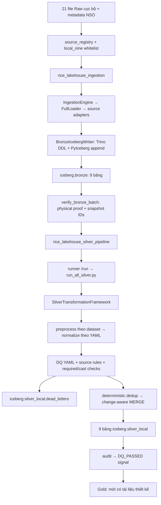

> **HISTORICAL AUDIT — không phải canonical design hiện tại.** Annotation ngày 25/10/2026: nội dung báo cáo bên dưới, findings, counts và kết quả kiểm tra thuộc thiết kế v3 27 bảng tại `1bb662c`, ngày 22/10. Các từ “hiện tại”, số dòng DBML và links tới filename DBML bên trong body phải được hiểu theo phiên bản đó. Xem lại DBML gốc bằng `git show 1bb662c:docs/gold/dim_fact_v3.dbml`.
>
> Canonical proposal mới là [README](README.md), [DBML cùng filename nhưng nội dung mới](dim_fact_v3.dbml) và [source_to_gold_mapping.csv](source_to_gold_mapping.csv), version `gold-20261025.1`: 17 bảng, chưa được owner phê duyệt và chưa triển khai ETL. Proposal 14-table MVP trong audit cũ đã được thay thế. [CSV ngày 22/10](design_audit_2026-10-22_field_mapping.csv) và [evidence JSON](audit_2026-10-22_evidence.json) là historical evidence bất biến; không phải mapping hoặc nghiệm thu của thiết kế mới. Không cập nhật lại số liệu lịch sử.

---

# TLCN Rice Lakehouse — Gold v3 Design Audit

**Ngày audit: 22/10/2026 · Phạm vi: thiết kế, không triển khai · Kết luận: NOT READY.**

Bộ báo cáo gồm tài liệu này, [phụ lục schema và mapping đầy đủ từng cột](design_audit_2026-10-22_schema_and_mapping.md), [mapping CSV để lọc/review](design_audit_2026-10-22_field_mapping.csv), và [kết quả profiling/checksum dạng JSON](audit_2026-10-22_evidence.json). Phụ lục là phần bắt buộc của mục B và E: bao phủ **9 contract Silver, 27 bảng Gold, toàn bộ 261 cột Gold**.

## A. Executive Verdict

**Gold v3 hiện tại NOT READY để triển khai nguyên trạng.** Đây không phải đánh giá thất bại của Silver. Nhiều vấn đề phát sinh vì Gold/tài liệu đang dùng một schema NSO khác với contract và transformer hiện hành, hoặc vì Gold làm mất các thành phần định danh còn được Silver bảo toàn.

Các lý do chặn chính:

1. Namespace local là `iceberg.silver_local`, không phải namespace `iceberg.silver` được ghi xuyên suốt DBML. NSO dùng các enum chữ thường và không có nhiều cột Gold đang giả định. Copy bộ lọc Gold hiện tại sẽ đọc sai namespace hoặc trả về không có dòng.
2. Khóa báo giá nội địa bỏ `source`, `unit`, `currency` và định danh thị trường đầy đủ. Profiling Raw cho thấy **6 nhóm, 12 dòng** sẽ trùng khóa rút gọn ngay cả khi chưa chuẩn hóa alias giống lúa. Chỉ bổ sung `market_key` không giải quyết hết vấn đề.
3. Fact số công bố NSO bỏ định danh bảng xuất bản. Profiling thấy **180 nhóm quan sát quốc gia trùng grain theo measure** sau khi bỏ `source_table`; **6 nhóm có giá trị khác nhau**. Không được chọn `MAX`, cộng hai bản công bố, hoặc lấy ingestion mới nhất để che xung đột.
4. SUA ghi sai bốn mã element và yêu cầu các chỉ tiêu không tồn tại trong Silver. Trade thực có **12 mã sản phẩm**, gồm sản phẩm chế biến và `F0030`, vượt phạm vi bốn loại gạo được mô tả trong Gold.
5. Fact giá tháng thiếu identity của benchmark/grade; Yearbook còn có `MARKETING` và ngữ nghĩa năm cần xác minh trước khi đổi sang tháng dương lịch. Không thể dùng sản phẩm chung `WHEAT` để thay identity hai series SRW/HRW.
6. Mart forecasting chưa chứng minh publication time/vintage. World Bank VNM 5% có **254 giá trị số**, **11 tháng khuyết trong khoảng 2003-12 đến 2025-12**; `LEAD` trên các dòng còn giá không bảo đảm t+1 tháng. Hoãn mart khỏi Gold MVP.

Thiết kế có nền tảng tốt: tách daily/monthly/annual; tách niên vụ PSD; không cộng quốc gia/vùng/tỉnh tùy tiện; nhận diện price index; chuẩn hóa đơn vị; dùng ratio-of-sums. Nhưng các nguyên tắc này chưa được chuyển thành mapping đủ chính xác và có thể nghiệm thu.

### Mức độ bằng chứng và giới hạn

| Nhãn | Ý nghĩa trong báo cáo |
|---|---|
| **VERIFIED FACT — CODE** | Đọc trực tiếp code, YAML, cấu hình, DBML hiện tại; không có nghĩa đã xác minh bảng vật lý. |
| **VERIFIED FACT — RAW** | Đo trực tiếp trên file Raw cục bộ khớp checksum manifest; phép chuẩn hóa mô phỏng chỉ phục vụ profiling, không chạy ETL Silver. |
| **VERIFIED FACT — TEST** | Kết quả kiểm tra thực chạy trong lượt audit này. |
| **REASONED RISK** | Hệ quả suy luận từ grain/mapping; chưa khẳng định đã xảy ra trên Gold vì Gold chưa được load. |
| **UNVERIFIED ASSUMPTION** | Chưa có dữ liệu/reference/runtime để chứng minh; không được dùng làm điều kiện triển khai. |

Docker CLI trả lỗi thiếu pipe `dockerDesktopLinuxEngine`. GET đến Trino `127.0.0.1:18080` timeout; REST `:8181` cũng timeout, nhưng Compose hiện không publish cổng REST ra host nên riêng phép thử REST không chứng minh service dừng. Không đọc được catalog vật lý; **không có kết luận về snapshot ID, physical nullability, số dòng hiện có hay độ duy nhất của Silver đang lưu**. Không khởi động stack, không trigger DAG, không gọi API `/run`, không chạy Bronze/Silver/Gold, không sửa snapshot.

Đã kiểm tra 21/21 input file về size và SHA-256 theo manifest; 13/13 CSV NSO khớp metadata được pin. `scripts/validate_silver_contracts.py`: **9/9 PASS**. Parse AST: **144 file Python, 0 lỗi cú pháp**; đây không phải kiểm tra nghiệp vụ. Nhóm 40 unit tests đã chọn: **34 PASS, 6 lỗi setup PermissionError ở thư mục tạm**; thử chuyển temp vào workspace vẫn có cùng lỗi. Không tuyên bố toàn bộ test suite pass. Không chạy test tích hợp có writer.

`@dbml/core` không có sẵn. Đã inventory cấu trúc/cột/ref bằng phân tích văn bản; **chưa compile DBML bằng parser chính thức**. Không suy diễn DBML hợp lệ hay Gold READY từ inventory này.

## B. Actual Silver Architecture

### B1. Dependency graph thực thi hiện tại



Các đường dẫn quyết định hành vi:

| ID bằng chứng | File và vị trí | Kết luận |
|---|---|---|
| S01 | [compose.yaml](../../compose.yaml), dòng 4–23, 25–48, 101–169 | Bật `local_nine`; LocalExecutor; runner Spark; Trino tạo config từ command; không mount các file config cũ làm cấu hình Trino hiện hành. |
| S02 | [local_profile.py](../../src/silver/local_profile.py), dòng 8–24, 51–83 | Whitelist đúng 9 nguồn; overlay đích thành `silver_local`; registry/NSO contract có checksum gate. |
| S03 | [dag_ingestion_pipeline.py](../../dags/dag_ingestion_pipeline.py), dòng 63–72, 99–167 | Manual-only trong profile local; mỗi lần một task; 9 ingestion tuần tự, batch proof rồi trigger đúng child Silver run. |
| S04 | [dag_silver_pipeline.py](../../dags/dag_silver_pipeline.py), dòng 19–29, 53–116 | Profile local thêm NSO; ghim Bronze snapshot theo proof; 9 transform tuần tự; reconciliation rồi audit và signal. Nhánh mặc định/release cũ chỉ có 8 nguồn. |
| S05 | [ingestion_engine.py](../../src/ingestion/core/ingestion_engine.py), dòng 83–129, 181–207; [full_loader.py](../../src/ingestion/core/full_loader.py), dòng 137–194, 262–320, 379–418 | Source lock, registry, adapter động, FULL loader, checksum skip, checkpoint và metadata. **Raw hiện ở disk**, artifact URI `local://`, manifest dựng trong memory; không có upload Raw landing trong đường runtime này dù docstring cũ nói có. |
| S06 | [bronze_writer.py](../../src/ingestion/storage/bronze_writer.py), dòng 125–145, 414–535 | PyIceberg REST dùng chung warehouse/MinIO với Spark/Trino; giữ per-file lineage, sanitize trước append. DELETE chunk và APPEND là hai thao tác riêng; không mô tả Bronze như một transaction toàn batch. |
| S07 | [framework.py](../../src/silver/framework.py), dòng 22–26, 59–87, 89–130, 146–227 | Import `silver.transformers.<dataset>`; ghim snapshot thực; normalize/cast/DQ; chỉ publish cột contract + 8 audit fields + warnings + processing timestamp. |
| S08 | [quality.py](../../src/silver/engine/quality.py), dòng 15–40; [merge.py](../../src/silver/engine/merge.py), dòng 21–101; [quarantine.py](../../src/silver/engine/quarantine.py), dòng 17–68 | SQL UNKNOWN là fail; action quyết định routing; dedup sau DQ; giữ warning; MERGE tránh write khi không đổi; dead letter định danh bằng dataset + payload. |
| S09 | [nso.yaml](../../contracts/silver/nso.yaml), dòng 8–125, 133–179; [nso.py](../../src/silver/transformers/nso.py), dòng 192–296 | Source-table grain; enum chữ thường; code/boundary NULL; label chỉ là candidate; unit đã scale; giữ discrepancy dưới dạng diagnostic. |
| S10 | [faostat_supply_utilization.py](../../src/silver/transformers/faostat_supply_utilization.py), dòng 8–35 | Chỉ 12 element đã quan sát, đơn vị tonne; `5071` và `5166` được âm. |
| S11 | [thitruongnongsan.yaml](../../contracts/silver/thitruongnongsan.yaml), dòng 8–18; [thitruongnongsan.py](../../src/silver/transformers/thitruongnongsan.py), dòng 15–50 | Quote grain đủ market/commodity/type/unit/currency/source/date; competing prices cùng grain bị quarantine toàn bộ. |
| S12 | [usda_psd.py](../../src/silver/transformers/usda_psd.py), dòng 7–49; [usda_psd.yaml](../../contracts/silver/usda_psd.yaml), dòng 38–96, 120–133 | Crop-year giữ nguyên; quantity chưa nhân 1000; exact milling rate đã chia 10000 thành fraction. |
| S13 | [usda_rice_yearbook.py](../../src/silver/transformers/usda_rice_yearbook.py), dòng 6–17 | Giữ `reference_period`; nhận cả tháng, `YEAR`, `MARKETING`; unit USD/tonne. Không có calendar-month field. |
| S14 | [worldbank_pinksheet.py](../../src/silver/transformers/worldbank_pinksheet.py), dòng 7–60; [worldbank_adapter.py](../../src/ingestion/adapters/worldbank_adapter.py), dòng 143–185 | 71 series có tên; unit từ workbook; bỏ synthetic rỗng có bằng chứng; giữ missing; `series_name` hiện NULL. |
| S15 | [faostat_source.py](../../src/silver/transformers/faostat_source.py), dòng 47–81, 106–121; [faostat_production.py](../../src/silver/transformers/faostat_production.py), dòng 11–35; [faostat_monthly_price.py](../../src/silver/transformers/faostat_monthly_price.py), dòng 17–44 | M49/CPC là chuỗi; restore riêng `0113`; chuẩn hóa unit; không suy ra ISO hay FX; tách monthly/annual/index. |
| S16 | [faostat_trade.py](../../src/silver/transformers/faostat_trade.py), dòng 7–29 | Bảo toàn M49/CPC nguồn; không restrict về bốn mã sản phẩm; tiền vẫn `1000 USD`. |
| S17 | [verify_silver_trino.py](../../jobs/silver/verify_silver_trino.py), dòng 119–130; [schemas.md](../silver/schemas.md), dòng 129–159; [cleaning_rules.md](../silver/cleaning_rules.md), dòng 44–46, 125–131 | Có drift tài liệu/validator NSO và mô tả âm Residuals so với code hiện hành; không dùng chúng thay contract để thiết kế Gold. |
| S18 | `data/raw/faostat/Trade_DetailedTradeMatrix_E_All_Data_(Normalized)/Trade_DetailedTradeMatrix_E_{ItemCodes,ReporterCountries,PartnerCountries,Elements,Flags}.csv` | Có 5 codebooks cục bộ: 572 product rows, 232 reporter rows, 255 partner rows, 10 element rows, 4 flag rows. Có thể seed source-code/label references, không có ISO3/approved geographic membership hay historical boundary validity. |

Compose có 7 service chạy lâu dài: MinIO, PostgreSQL, REST catalog lưu SQLite trong volume, Trino, runner, scheduler, webserver; thêm `airflow-init` chạy một lần. Không có Celery/Redis trong stack hiện tại. Tài nguyên được giới hạn theo service; Gold nên tái sử dụng runner và chạy tuần tự. Không có căn cứ cần thêm dịch vụ cho đồ án.

Registry có thêm `faostat_trade_validation` enabled cho fixture ZIP; **không thuộc whitelist local_nine**, không phải nguồn thứ10 của pipeline hiện hành. Năm FAO codebooks S18 cũng không phải 5 dataset được ingest thêm. Codebooks dùng dấu chấm phẩy trong một số labels trong khi main data dùng dấu phẩy: join theo đúng code-system/code rồi kiểm tra alias, không raw name-only join. Codebook có World/EU/regions không đồng nghĩa các rows đó xuất hiện trong actual trade observations của snapshot.

`config/trino/etc/*`, `config/spark/spark-defaults.conf`, `query_silver_usda.py` là tài liệu/cấu hình hoặc tiện ích khác; không thay thế đường Compose → Spark factory. Utility USDA còn tham chiếu `silver.data_quarantine`, không phải `silver_local.dead_letters`. Không chạy utility đó để audit.

Các module `faostat_trade_transformer.py`, `usda_psd_transformer.py`, `usda_export_price_transformer.py`, `worldbank_transformer.py` kế thừa `BaseSilverTransformer` được legacy tests import. Các job hiện tại đều gọi `run_all_silver.main`; runtime dùng module không có hậu tố `_transformer`. Vì vậy cờ aggregate do legacy transformer tạo không phải cột Silver hiện hành. `src/ingestion/utils/{hashing,retry,error_classifier}` là facade tới `src/common`; chúng vẫn nằm trong dependency graph, không phải toàn bộ là dead code.

### B2. Chín nguồn, grain, đơn vị, DQ và ứng viên Gold

Tên bảng bên dưới có prefix đầy đủ **`iceberg.silver_local.`**. YAML gốc vẫn ghi `iceberg.silver.*`; overlay S02 mới xác định namespace runtime local. Số lượng trong cột coverage là **Raw profiling**, trừ số Silver tham chiếu được ghi rõ; không phải kết quả SELECT trên Iceberg.

| Source → Silver table | Actual grain theo executable contract / business key | Time / geography / coverage Raw | Units và biến đổi thực tế | DQ / ứng viên Gold |
|---|---|---|---|---|
| `faostat_production` → `faostat_production` | Country-code × CPC × year × element; BK `(country_code,commodity_code,year,element_code)` | Annual 1961–2024; 146 area identities; 22.738 observations; CPC `0113` | `5312→hectare`, `5510→tonne`, `5412→kg/hectare`; kg/t, hg/ha nếu gặp được convert trước rounding | 229 missing, 572 zero Raw; âm bị quarantine. Global production; giữ reported yield để đối chiếu dù view tính ratio. S15 + contract. |
| `faostat_monthly_price` → `faostat_monthly_price` | Area × CPC × year × month-code × element; BK đủ 5 trường đó | 1991–2025; 104 areas; 15.334 dòng, **9.993 annual / 5.341 monthly** | `5530/5531/5532=LCU/SLC/USD` theo element; `5539` index 2014–2016, unit/currency NULL; `7021` có month NULL | 2 zero, không missing số Raw. Không phải mọi area có monthly coverage. Monthly price fact và annual reported view riêng. S15. |
| `faostat_supply_utilization` → `faostat_supply_utilization` | Area × CPC × year × element; BK `(country_code,commodity_code,year,element_code)` | Annual 2010–2023; 179 areas; 36.380 dòng; `0113`, `23161.02` | Tất cả measure được nhận đều `tonne`; **12 mã element** trong S10 | 257 missing, 8.660 zero, 1.516 âm: 1.280 `5071`, 236 `5166`; Residuals âm giữ warning. SUA fact chỉ pivot supported columns. |
| `faostat_trade` → `faostat_trade` | Reporter × partner × CPC × year × element; BK đủ 5 trường | Annual 1986–2024; 1.226.470 dòng; 195 reporters / 211 partners; **12 CPC/source product codes** | Quantity `tonne`; import/export value còn `1000 USD`; chỉ Gold monetary multiply 1000 | Raw không missing/âm; 133.948 zero. Cần product allowlist và coverage/exclusion audit. Không có World/Unspecified trong các label đã profile của snapshot này; vẫn phải xử lý nếu input sau có. S16. |
| `usda_psd` → `usda_rice_psd` | Country × commodity × attribute × market-year; BK `(country,commodity,attribute,market_year)` | **Chỉ Vietnam**; 15 dòng rộng × 66 năm = 990 ô; 1960/1961–2025/2026 | `1000 HA`, `1000 MT`, `MT/HA` giữ nguyên; `Milling Rate (.9999)` đã thành `fraction`, value_source ×0,0001 | Không missing trong Raw; negative quantity hiện warning, không mặc nhiên cấm. PSD fact là Vietnam coverage hiện tại, tên Global không tạo thêm quốc gia. S12. |
| `usda_rice_yearbook` → `usda_rice_yearbook` | Location × class × year × reference-period × statistic-type; BK đủ 5 trường | 4 countries, 16 class labels; source YEAR 1985–2025; 13.131 Raw → 12.936 BK unique, gồm 11.929 monthly-labelled / 1.007 MARKETING | `DOLLARS PER METRIC TON→USD/tonne`; giữ location/class/statistic; chưa có calendar_month | 195 duplicate rows; 4.594 token NA trước dedup. VNM 5%: 343 monthly-labelled records, 327 numeric, 16 NULL. Monthly fact chỉ sau calendar rule; MARKETING view riêng. S13. |
| `worldbank_pinksheet` → `worldbank_commodity_monthly` | Source commodity-code × period-date; BK `(commodity_code,period_date)` | 792 monthly periods 1960-01–2025-12 × **71 named series = 56.232 ô** | USD/tonne, USD/kg, USD/barrel, USD/MMBtu, USD/troy_oz, USD/cubic_meter, USD/dmtu, cents/sheet, index(2010=100); không quy tất cả về USD/tonne | Named missing observations được giữ; 17 synthetic empty columns được loại có bằng chứng. VNM5 numeric 2003-12–2025-12, 254 giá; 11 internal NULL. Price benchmark fact/macro analytics. S14. |
| `thitruongnongsan` → `thitruongnongsan` | **Quote**, không chỉ province/variety/day; BK `(market,commodity,price_type,unit,currency,source,date)` | Daily 2021-01-04–2026-08-03; 17 market labels (có alias chữ hoa), 195 commodity labels, 8 price-type labels, 13 information-source labels | US-format ngày `M/d/yyyy h:mm:ss a`; unit `VND/kg`, currency `VND`; không map chính thức tỉnh/giống/grade | 20.394 Raw; 4 conflict rows + 3 duplicates → 20.387 ứng viên; 29 zero được giữ warning. Daily quote fact, không gọi là transaction mua bán thực. S11. |
| `nso` → `nso_rice_statistics` | **Source-publication observation**; BK `(source_table,source_geography_key,year,measure,season,statistic_kind)` | 13 CSV V06.12–24; 833 Raw rows, 13 structural; 23.060 ô, 1990–2024 (matrices 1995–2024); 920 national / 1.980 region / 20.160 province candidate observations | area ha ×1000, production tonne ×1000, yield kg/ha ×100, development_index percent ×1 **đã làm tại Silver** | 946 missing, 5 zero; `geography_code`, `boundary_version` NULL; all non-national need geography review. Gold reported observation fact; official geo/SCD2 cần reference mới. S09. |

Các số sau xử lý được tái kiểm chứng từ Raw/logic đơn giản khi có thể, và trùng tham chiếu trong `docs/silver/data_catalog.md`: tổng 1.414.527 observations, dead letters tham chiếu 4 quote conflicts + 13 structural records. **Chưa kiểm chứng tổng này đang tồn tại trong catalog**; không biến historical/reference counts thành runtime evidence.

### B3. Data contract chính xác và nullability

Toàn bộ tên cột, kiểu Spark và `nullable` theo YAML được liệt kê trong phụ lục. Đó là **logical requiredness**. `try_cast`, outer join, projection và cách tạo bảng từ DataFrame có thể tạo physical fields nullable; phải `DESCRIBE`/đọc Iceberg schema để khẳng định physical nullability. Các trường unit/currency/source của IPSARD khai báo nullable trong schema nhưng nằm trong business key: framework S07 bổ sung SYS_REQUIRED nên row được nhận phải non-null.

Các bảng đều publish tám cột audit nếu có trong Bronze: `_ingestion_run_id`, `_ingestion_batch_id`, `_ingestion_chunk_id`, `_ingestion_timestamp`, `_source_id`, `_source_file`, `_source_checksum`, `_source_snapshot_id`; cùng `_dq_warnings` và `_silver_processed_at`. NSO bắt buộc lineage và thêm `bronze_read_snapshot_id`. `_source_snapshot_id` được FullLoader truyền **0** khi ghi chunk; đó không phải Iceberg snapshot đang đọc và không được dùng làm input snapshot cho Gold.

Thông tin còn nguyên source semantics: FAO area/CPC/flags, USDA attribute/class/year/reference period, domestic market/source/commodity/type, NSO source-table/geography key/raw label/diagnostic. Silver **chưa** có conformed ISO countries, official province codes, historical boundary mapping, regional hierarchy, canonical rice grades, FX rates hay publication history.

Các NULL biểu diễn thiếu nguồn; không phải zero. Missing markers không phải tất cả đồng nghĩa “không áp dụng”; NSO chỉ chấp nhận source NULL/blank/`..` theo policy hiện tại, không tự phân loại nguyên nhân nghiệp vụ. `release_status='unconfirmed'` không được đổi thành FINAL; `provisional` mới có bằng chứng sơ bộ. DQ pass không có nghĩa geography candidate đã được phê duyệt.

### B4. NSO và các định nghĩa phải giữ nguyên

- Canonical source/dataset ID: `nso`; Bronze: `iceberg.bronze.nso`; đích local: `iceberg.silver_local.nso_rice_statistics`. `nso_vietnam` là registry alias; không có dataset runtime tên `nso_vietnam_v2`.
- `geography_level`: `national`, `region`, `province`, `unknown`; `statistic_kind`: `quantity`, `development_index`; `season`: `annual`, `winter_spring`, `summer_autumn`, `summer_autumn_autumn_winter`, `main_season`.
- `V06.12` là national-wide gồm quantity và development-index cho area/production, seasonal/annual. `V06.13–15`: annual area/yield/production; `16–18`: winter-spring; `19–21`: **summer-autumn + autumn-winter gộp**; `22–24`: main-season. Không tách phần gộp thành hai vụ bằng tỷ lệ tự chọn.
- Các candidate có 64 province labels, gồm lịch sử; không phải danh sách 63 hay 34 tỉnh đã chuẩn hóa. Không suy ra version ranh giới từ năm của số liệu. Số liệu hiện tại kết thúc năm 2024 không cung cấp bằng chứng để dựng chuyển đổi năm 2025.
- Giữ reported annual observations, season coverage và reported yield. Weighted yield từ production/planted area cần tên mẫu số rõ ràng, không mặc nhiên tương đương FAO yield trên harvested area. Discrepancy NSO vốn được giữ warning; Gold không được sửa số nguồn để ép cân bằng.

## C. Gold v3 Architecture Summary

Inventory trực tiếp DBML: **27 tables, 261 columns** = **12 dimensions + 3 crosswalks + 8 facts + 3 aggregates + 1 ML mart**. `Dim_Year/Month/Date/Crop_Year/Crop_Season` là 5 time/season dimensions; source/country/region/province/product/variety/price-type là 7 dimensions còn lại. Crosswalk Province Transition không tính lần nữa vào dimensions.

Điểm hợp lý: time grain riêng; fact NSO published totals tách khỏi provincial rollup; PSD và FAO không bị coi là cùng nguồn; import/export reporter roles rõ; quantity và value riêng; index không trộn currency; stock variation có dấu; weighted yield và unit-price dùng ratio-of-sums; FK/uniqueness được nhận là ETL responsibility.

Điểm chưa đáp ứng executable design: không có Gold ETL/DAG/contract/reference seeds/test trong repository; source aliases chỉ là tên thiết kế, chưa liên kết registry; geography reference chưa tồn tại; product identities bị giản lược; lineage singular không đủ cho pivot nhiều publication; tổng hợp có thể join khác time basis; DQ gates chưa kiểm tra bảo toàn observations và publication availability. Số bảng 27 tự nó không sai, nhưng nhiều bảng chưa mang giá trị đủ để đổi lấy chi phí dựng reference và vận hành.

## D. Findings by Severity

Mỗi finding ghi vị trí Gold bằng `DBML:Lx–Ly` và `README:Lx–Ly`; evidence code Sxx tra bảng B1. Các scenario là hành vi sẽ xảy ra nếu triển khai đúng mô tả hiện tại, không phải tuyên bố đã chạy Gold.

### G01 — P0 BLOCKER — Sai routing và schema NSO

**Bảng/cột:** mọi fact đọc `silver.*`; đặc biệt hai fact Vietnam, `geography_level`, `statistic_kind`, `season`, province/region fields. **Vị trí:** DBML:77, 114, 123, 213–265; README:51–54, 84–85. **Bằng chứng VERIFIED CODE:** S01/S02/S09; không có `parent_region_vi`, `geography_name_vi`, `is_preliminary`, `admin_boundary_version` trong contract NSO hiện tại. **Scenario/impact:** đọc namespace `silver` có thể không có bảng hoặc đọc bảng cũ; lọc `PROVINCE_CITY`/`QUANTITY` trên enum lowercase cho ra zero rows; season gộp hiện tại không match dimension. **Sửa:** cấu hình input profile rõ ràng, cập nhật mapping theo contract, giữ candidate status; không sửa Silver để hợp tên Gold. **Test:** schema/type admission trên 9 input và snapshot; assert observed enum domain nằm trong mapping; input eligible >0 nhưng output 0 phải FAIL.

### G02 — P0 BLOCKER — Khóa fact giá nội địa làm mất báo giá

**Bảng/cột:** `Fact_Vietnam_Daily_Market_Price` PK, `market_label_raw`, thiếu `source` và full quote identity. **Vị trí:** DBML:429–450; README:65–66, 258–264. **VERIFIED CODE/RAW:** S11; có 6 nhóm ×2 dòng sau khi loại conflict/dedup đúng quote grain. Ngày **2024-12-10**, market An Giang, commodity OM 5451, type Thu mua: `source=Long Xuyên` 7.450 và `source=Tỉnh An Giang` 7.900 VND/kg. 17 giá trị `market` hiện là nhãn tỉnh/alias; **chưa có bằng chứng nhiều tên chợ nằm trong cột market cùng province**. Nhưng `source` có tên điểm ghi nhận khác nhau và đủ chứng minh collision. **Scenario/impact:** cả hai về cùng province/variety/type/date; MERGE lỗi, dedup mất dòng hoặc AVG làm đổi nghiệp vụ. **Sửa:** PK `(date,quote_series_key)` với series giữ nguyên `(dataset,market,commodity,price_type,unit,currency,source)`; geography chỉ là thuộc tính mapping. **Test:** trước/sau map 20.387 quote candidates, mỗi quote identity đúng một Gold row; mẫu 7.450/7.900 giữ cả hai. Alias giống phải test injectivity trước khi conformance.

### G03 — P0 BLOCKER — NSO published totals mất source-publication grain

**Bảng/cột:** `Fact_Vietnam_National_Prod_Reported` PK, các reported measures, `_source_file`. **Vị trí:** DBML:238–266; README:53–54. **VERIFIED CODE/RAW:** NSO BK có `source_table`; 180 nhóm national quantity theo year/measure/season trùng khi bỏ bảng; 6 nhóm khác số. Năm 1996 annual production: `V06.12=26396,7` và `V06.15=26192,0` nghìn tấn. **Scenario/impact:** pivot chung cho cùng Gold row phải bỏ một số công bố hoặc cộng hai nguồn; mất khả năng reconciliation. S07 dedup Silver không giải quyết việc này vì hai observation có BK khác nhau hợp lệ. **Sửa:** giữ `source_series/publication` trong grain; MVP dùng observation fact dài. View “preferred reported” chọn bảng theo policy được review, các bản khác vẫn giữ. **Test:** uniqueness tại grain đầy đủ; hai giá trị 26.396.700 và 26.192.000 tấn cùng tồn tại, chênh lệch được audit; cấm source-precedence dựa vào ingestion time.

### G04 — P0 BLOCKER — SUA sai element mapping và cột chưa có nguồn

**Bảng/cột:** `waste_loss_t`, `processing_t`, `other_uses_t`, `residuals_t`, `domestic_supply_t`, `closing_stocks_t`, hai chỉ tiêu per-capita. **Vị trí:** DBML:340–357; README:13, 88. **VERIFIED CODE/RAW:** S10; Loss=`5016` (không phải 5123), Processed=`5023` (không phải 5131), Other uses=`5165` (không phải 5153), Residuals=`5166` (không phải 5170). Không có `5301`, `5114`, `645`, `664` trong input/allowed rules. **Scenario/impact:** pivot theo notes cho NULL giả ở bốn measure và không thể load các measure được hứa; giữ only-5071-negative còn làm sai 236 residual observations hợp lệ. **Sửa:** pivot đúng 12 elements; defer closing/domestic derived balance cho tới khi xác minh sign/methodology và completeness; per-capita/nutrition cần external input, không zero-fill. **Test:** reconcile từng element count/value/NULL/sign sau unpivot; 236 residual negatives giữ nguyên và kèm cảnh báo; unknown element phải audited quarantine/FAIL contract, không bị bỏ im lặng.

### G05 — P0 BLOCKER — Conformance sản phẩm trade không giữ tập mã thực tế

**Bảng/cột:** `Dim_Rice_Product`, `Xref_Product_SourceAlias`, `Fact_Global_Bilateral_Trade.product_key`, các aggregate theo product. **Vị trí:** DBML:144–153, 183–193, 372–394; README:62, 89. **VERIFIED RAW/CODE:** Trade có 12 mã, gồm `0113`, `23161.01`, `23161.02`, `23161.03`, `23162`, `21691.01`, `21910.01`, `23120.01`, `23490.01`, `24230.02`, `39120.02`, `F0030`. Active transformer không filter về bốn loại. **REASONED RISK:** map `F0030` và `23161.02` cùng RICE_MILLED hoặc map hai loại husked vào cùng product làm nhiều source rows vào cùng key; cộng rice equivalent với components có thể double count. **Sửa:** canonical product phải giữ source basis/classification; allowlist core và audit exclusions cho byproducts; `F0030` giữ riêng dưới nhãn source-defined equivalent, chưa coi là giao dịch milled vật lý. Không đoán equivalence từ tên. **Test:** `(source product,source basis)→canonical` mapping đủ/đơn trị; assert không collision tại grain pivot; input=eligible+excluded+quarantined theo code và element.

### G06 — P0 BLOCKER — Monthly price fact không có benchmark/grade identity đầy đủ

**Bảng/cột:** `Fact_Country_Price` PK; `Dim_Rice_Product.product_code`; alias grade. **Vị trí:** DBML:146, 183–193, 402–425. **VERIFIED RAW:** WB có cả Wheat US SRW và HRW; Yearbook có 16 classes, gồm regular 5%, parboiled 5%, double-water-polished 5%, basmati, A.1 Super/Special. **REASONED RISK:** hai wheat series cùng WHEAT, country, WB price type/source/month; giữ generic variety/grade sẽ collision dù tất cả PK đều int. Một số thông tin grade có nhiều trục và không thể gói vào một broken %. **Sửa:** `price_series_key` giữ source benchmark/class/statistic/unit/currency; product dimension chỉ conformed các equivalence được chứng minh. **Test:** từng source series/date duy nhất; SRW/HRW và regular/parboiled/double-polished luôn giữ riêng; không dùng averaging để sửa collision.

### G07 — P1 MAJOR — Yearbook còn marketing summaries và năm chưa phải calendar month

**Bảng/cột:** `Fact_Country_Price.month_key`, `Forecasting_Data_Mart_Monthly.*`; `Dim_Source_System.default_cadence`. **Vị trí:** DBML:403, 423, 425, 549–559; README:12, 64, 90. **VERIFIED CODE/RAW:** S13; 1.007 BK-unique `MARKETING` records; YEAR 2025 có August…December rồi January/February; Silver không tạo calendar year. **REASONED RISK:** note chỉ lọc annual FAO 7021, không quy định Yearbook annual filter; ghép YEAR=2025 với January sẽ có thể lệch một năm. USDA documentation giải thích marketing year August–July, nhưng **chưa đọc được workbook gốc matching snapshot để xác minh riêng cột YEAR của file này**. **Sửa:** chỉ monthly-labelled rows; phải approve mapping source-year→calendar-year. Giả thuyết cần kiểm chứng: Jan–Jul thuộc YEAR+1; Aug–Dec thuộc YEAR. MARKETING giữ view theo marketing-year. **Test:** đối chiếu ít nhất 2 ranh giới Dec/Jan với workbook/footnote chính thức, giá trị và checksum/vintage; count bảo toàn 11.929 monthly candidates; không gán ngày giả cho MARKETING.

### G08 — P1 MAJOR — Geography/SCD2 và transition weights chưa được chứng minh

**Bảng/cột:** `Dim_Vietnam_Region.*`, `Dim_Vietnam_Province.province_code/region_key/admin_boundary_version/valid_from/valid_to/is_current`; `Xref_Vietnam_Province_Transition.*`. **Vị trí:** DBML:111–141; README:17, 84. **VERIFIED CODE:** S09 chủ động tạo geography code/boundary NULL và warning `historical_geography_unmapped`; không có official hierarchy/dates/crosswalk seed. **Scenario/impact:** gán mỗi nhãn tỉnh vào phiên bản trước/sau 2025 bằng year hoặc lấy tên hiện đại sẽ restate sai lịch sử; interval ngày đơn thuần không xác định geographic basis của số annual. **Sửa:** MVP giữ source geography identity/candidate; official mapping cần reference có authority/version/source-series/time basis. Transition 2025 defer. Full merge ratio=1 chỉ khi có bằng chứng; land-area ratio không phải rice-production ratio khi split. **Test:** mỗi observation match 0/1 approved mapping; >1 FAIL, 0 giữ audit; interval không chồng lấn trong cùng mapping scope; split weights [0,1] và tổng 1 chỉ cho đúng measure/basis đã phê duyệt. Không dùng `9999-12-31` như bằng chứng biết ngày bắt đầu.

### G09 — P1 MAJOR — Nhân đơn vị NSO lần hai và PSD attribute mismatch

**Bảng/cột:** Vietnam area/production/yield; PSD `domestic_consumption_t`, `milling_rate_factor`. **Vị trí:** DBML:221–222, 249, 304–318; README:84, 87. **VERIFIED CODE:** NSO value đã ×1000/×100; DBML hướng dẫn lấy “Normalized from Nghin_ha (*1000)” trong khi README nói đã convert. PSD quantity còn thousand-units; fraction đã convert; source attribute là **Domestic Consumption**, không phải note “Domestic Consumption and Residual”. **Scenario/impact:** người implement làm theo một note khác sẽ ×1000 NSO lần nữa; nhầm fraction thành mass hoặc để consumption NULL vì filter sai tên. **Sửa:** mapping theo tuple `(dataset,element/attribute,unit)`; NSO dùng value trực tiếp theo unit; PSD quantity value×1000, milling fraction value×1; source exact attribute map. **Test:** NSO normalized 1.000 ha giữ 1.000; PSD 1 thousand MT→1.000 t; milling raw 6250→Silver0,625→Gold0,625. Unit không khớp thì quarantine/FAIL, không đoán theo tên cột.

### G10 — P1 MAJOR — Unknown dùng như catch-all có thể phá uniqueness

**Bảng/cột:** mọi FK trong grain, `Dim_Country`, `Xref_Country_SourceAlias`, `Xref_Product_SourceAlias`. **Vị trí:** DBML:100–108, 183–206; README:42–43, 315. **VERIFIED CODE:** active Silver không có ISO/conformed keys/legacy aggregate flags; code nguồn và label vẫn riêng. **Scenario/impact:** hai country/product/variety chưa map cùng -1 làm collapse Gold key; global benchmark N/A, unknown mapping và unspecified partner bị đồng nhất. Historical USSR/Sudan former hoặc FAO China aggregate không có quan hệ 1:1 với ISO hiện đại. **Sửa:** giữ stable source identity trong grain; xref có source code-system/code/label và validity nếu cần. Tách known N/A/unspecified khỏi unmatched lỗi; mapping không đủ cho core thì FAIL publish hoặc quarantine có ledger, không drop. **Test:** cardinality/coverage xref; unresolved multi-source groups vẫn không merge nhau; FAO China159 không ép cùng ISO/key với mainland156; natural và surrogate keys unique.

### G11 — P1 MAJOR — Aggregate trộn calendar/marketing year và khác basis

**Bảng/cột:** `Agg_Country_Market_Position_Yearly.production_t/share/rank`, `product_key`. **Vị trí:** DBML:485–511; README:69–70, 86–89. **VERIFIED CODE/RAW:** FAO calendar year, PSD market_year; PSD hiện chỉ Vietnam. **Scenario/impact:** gắn crop-year start_year vào year_key như cùng kỳ lịch, hoặc ranking “global milled production” chỉ với Vietnam; RICE_MILLED aggregate không tự bao gồm 5%-grade/broken đúng phạm vi. **Sửa:** view market-position calendar dùng FAO production và trade cùng exact basis; PSD balance view riêng marketing-year. Không dùng generic default milling factor để tạo production quan sát. Ghi rõ country coverage; không gọi global share khi denominator incomplete/chồng lấn. **Test:** align period_kind/product_basis/source; denominator countries được định nghĩa và non-overlapping; không join một annual row với nhiều crop-year rows.

### G12 — P1 MAJOR — Weighted yield và provincial annual coverage chưa đủ điều kiện SUM

**Bảng/cột:** `Fact_Vietnam_Provincial_Prod`, `Agg_Vietnam_Regional_Performance_Yearly` measures/denominators. **Vị trí:** DBML:216, 231–234, 462–472; README:52, 84, 93–94. **VERIFIED CODE/RAW:** season summer-autumn national và matrix summer-autumn+autumn-winter là hai series khác; seasonal matrix không phủ giống nhau; source có missing cells và historical candidates. **REASONED RISK:** SUM tất cả non-annual seasons không bảo đảm đủ/không overlap; loại annual khỏi fact duy nhất làm mất annual published provincial coverage; SUM production trên tập khác với area làm ratio sai. **Sửa:** giữ annual và seasonal dưới observation grain, default view chọn một declared season basis; ratio dùng paired non-null area/production trên cùng geo/season/publication-family và coverage ledger. Tên yield thể hiện planted denominator. **Test:** complete pairing, mutually exclusive season set, historic geo scope nhất quán; thiếu phần thì partial/WARN hoặc NULL, không zero; official national join chỉ chọn national annual đúng series trước khi join 1:1.

### G13 — P1 MAJOR — Trade aggregation chưa có population/partner policy đủ rõ

**Bảng/cột:** trade facts, country-position sums, bilateral share/price. **Vị trí:** DBML:372–394, 491–500, 525–537; README:95–96. **VERIFIED CODE/RAW:** reporter/import và reporter/export là hai phía báo cáo; current input chưa có World/Unspecified labels. **REASONED RISK:** cộng export(A→B)+import(B←A) đếm hai lần; World cùng bilateral nếu input thay đổi; loại unspecified khỏi denominator làm market-share bị inflate; qty/value missing/zero hoặc CIF/FOB khác khiến reconciliation exact sai. **Sửa:** global exports chỉ một reporting side; partner total và bilateral tách scope, không ép mirror equality; unresolved partner giữ identity riêng; ratio dùng numerator/denominator cùng covered set. Source statistic mới xác nhận valuation, không lấy suffix `_usd` làm bằng chứng CIF/FOB. **Test:** không cộng hai reporting roles; so mirror asymmetry dưới WARN/tolerance; share sum theo declared denominator, zero quantity trả NULL, value>0/qty=0 cảnh báo.

### G14 — P1 MAJOR — Forecasting chưa point-in-time và thiếu vintage

**Bảng/cột:** mart as-of, toàn bộ exogenous/annual/PSD features, lineage. **Vị trí:** DBML:542, 553–575, 583–584; README:14, 73–74, 320. **VERIFIED CODE/RAW:** Silver giữ event/reference period và local ingestion time; không có observation-level publication/available_at/vintage history. WB header ghi “Updated on January 06, 2025” nhưng dữ liệu tới 2025-12, nên header riêng không xác định vintage tin cậy. **Scenario/impact:** dùng giá tháng t ngay cuối t dù published tháng sau; annual year(t)-1 có thể chưa công bố; completed crop-year stocks còn forecast/revision; lịch sử mới nhất chứa thông tin chỉnh sửa tương lai. **Sửa:** hoãn mart; model issue timestamp rõ; availability ledger + archived vintage/pinned inputs; annual/PSD features phải match available_at, không chỉ period. **Test:** mỗi feature có `available_at<=prediction_cutoff` và vintage khả dụng; không có bằng chứng thì không gắn nhãn leakage-free. Bằng chứng lịch công bố hiện tại không thay lịch sử từng observation.

### G15 — P1 MAJOR — Target gaps, LEAD và lựa chọn benchmark chưa được xử lý

**Bảng/cột:** `target_price_vnm_5pct_t_plus_1/+3`, lag/SMA/volatility, `price_spread_vnm_thai_at_t`. **Vị trí:** DBML:549–568, 584; README:320. **VERIFIED RAW:** WB VNM5: 254 numeric trong 265 tháng phủ, thiếu 11 tháng nội bộ; Yearbook VNM5: 343 monthly-labelled, 16 NA, calendar rule còn unverified. WB Thai5 có 792 numeric. **Scenario/impact:** drop NULL rồi LEAD qua tháng khuyết thành 2+ tháng; chọn tùy nguồn cho VNM/Thai hoặc WHEAT tạo target/feature không nhất quán; không có partition trong window example khi mở rộng country/product. **Sửa:** dense month spine; self-join theo `date_add('month',h,...)`, giữ NULL; khóa series/country/product; chọn một canonical target series, cấm COALESCE hai provider không có calibration. SMA/stddev chỉ publish khi đủ 3 numeric trong 3 tháng lịch, nêu `stddev_samp` hoặc `stddev_pop` rõ. **Test:** fixture Jan/Mar không có Feb phải target Jan+1=NULL; +3 đúng April; count coverage/horizon eligibility; temporal holdout, embargo theo horizon và fit preprocessing chỉ trên train.

### G16 — P1 MAJOR — Lineage nhiều nguồn và quality flags bị mất khi pivot

**Bảng/cột:** mọi fact `_source_file/_ingest_ts/etl_batch_id`; QCL `fao_flag`, prices `observation_flag`; NSO is_preliminary. **Vị trí:** DBML:225–228, 254–259, 284–288 và lineage blocks; README:19, 308. **VERIFIED CODE:** S05/S07/S09 giữ 8 audit fields, warnings, source-scale values; `_ingest_ts`/`etl_batch_id` không phải cột tên đó trong Silver; source_snapshot_id có thể 0. **Scenario/impact:** pivot area+production từ khác source tables/checksum/flags rồi lấy MAX filename/flag che provenance; mỗi run gán current timestamp/UUID vào content gây snapshot mới dù dữ liệu không đổi. **Sửa:** định nghĩa `_ingest_ts` là max upstream ingestion timestamp trong đúng contributor set nếu giữ tên; `etl_batch_id` derivation từ stable input-snapshot manifest + code/reference version; attempt/run ID lưu log riêng. Per-measure flags và contributor source refs; Gold input **Silver snapshot IDs** lấy catalog, không `_source_snapshot_id`. **Test:** trace mỗi measure về đúng source observation; mixed flags không biến thành một official flag; same inputs/versions rerun giữ snapshot ID/datafiles/processing timestamp.

### G17 — P1 MAJOR — Năm DQ gates hiện tại chưa enforce được thiết kế

**Bảng/cột:** mọi Gold table; Unknown/time gates; mart. **Vị trí:** README:306–320. **VERIFIED DESIGN:** key ranges không kiểm tra tháng/ngày hợp lệ và mâu thuẫn -1 member; gate kiểm tra `month_code`, `geography_level` không tồn tại trực tiếp ở một số Gold fact; FK-null check không bảo đảm referenced row tồn tại; LEAD equality không test availability. **Scenario/impact:** gate pass nhưng xref fan-out, unknown collision, sai units/pivot coverage hoặc leakage vẫn lọt. **Sửa:** bộ gates DQ01–DQ18 mục F; source checks ở transformed staging, dimension attributes qua join, publish gates dựa reconciliation ledger. **Test:** inject missing xref, double-match xref, invalid month 202413, negative residual hợp lệ, missing Feb và future publication; kiểm tra từng expected outcome.

### G18 — P1 MAJOR — Surrogate keys và MERGE lifecycle chưa có thiết kế khả thi

**Bảng/cột:** các dimension `[increment]`, SCD2 PK/natural key, xref uniqueness; mọi fact MERGE key. **Vị trí:** DBML:67, 76, 90, 100, 112, 121, 134–139, 145, 157, 168, 184, 197. **VERIFIED DESIGN/CODE:** chưa có Gold allocator/seed/hash/key tests; Silver MERGE S08 không cấp ID hay xử lý SCD2 thay Gold. **Scenario/impact:** sequence/row_number/monotonically_increasing_id thay key khi rebuild; SCD2 overlap nhân fact; rename alias làm key drift; rerun UUID/batch thay content. **Sửa:** nhỏ nhất là committed reference seeds có IDs ổn định hoặc deterministic hash khóa nghiệp vụ có scope + collision gate; dùng BIGINT/STRING nếu cần thay vì ép int/hash32. Mapping versions không tự đổi source identity. SCD2 chỉ dựng khi có reference. **Test:** rebuild/input reorder/repartition không đổi FK; thêm member không renumber cũ; same-input physical NOOP; snapshot readback khi commit outcome unknown.

### G19 — P2 MINOR — Over-engineering và các mô tả nghiệp vụ quá mạnh

**Bảng/cột:** 3 Agg tables, `Dim_Month.harvest_season_code`, source cadence, variety attributes, atomic-ratio policy. **Vị trí:** DBML:49, 94, 151, 161–162, 457–584; README:18, 92–96. **VERIFIED DESIGN/REASONED RISK:** harvest pattern duy nhất cho Việt Nam không có geography/year; `FRAGRANT`/`GLUTINOUS` không cùng trục grain length; generic 0,65–0,67 chưa có empirical authority; annual publication cadence khác observation monthly. **Impact:** hiển thị season/grade không đúng, bảng lặp dữ liệu tăng công bảo trì. **Sửa:** aggregates thành views; season ngoài Dim_Month hoặc chỉ label heuristic có evidence/scope; source registry tách event frequency/publication cadence; bỏ default milling conversion khỏi MVP. Non-additive measure có thể lưu nếu có semantic rule, không có nguyên tắc dimensional modeling bắt buộc cấm mọi ratio trong atomic facts. **Test:** view totals bằng underlying curated facts; dimension domain/units rõ; không cộng price/yield/index hoặc tồn kho qua thời gian.

### G20 — P2 MINOR — Documentation/DBML và reproducibility cần chỉnh sau approval

**Bảng/cột:** compound PK authoring, docs Silver NSO, hỗ trợ laptop khác, pinned runtime image. **Vị trí:** toàn bộ fact/aggregate/mart inline `[pk]`; README Gold:3; docs Silver S17. **VERIFIED CODE:** nhiều inline pk chưa dùng `indexes { (k1,k2,...) [pk] }` theo tài liệu DBML; chưa có parser để xác minh cách tool hiện hành diễn giải. `docker/silver-spark.Dockerfile:5` assert PyIceberg0.7.1 nhưng lock Spark chỉ thêm psycopg2, nên version thực dựa base-image digest chưa chạy; không gọi đây là bug đã chứng minh. Trade Raw lớn bị gitignore, repo checkout một mình chưa đủ dữ liệu. **Impact:** ERD/DDL có thể diễn giải khóa khác ý đồ; docs tái tạo sai schema; laptop khác thiếu file hoặc image cache. **Sửa:** sau approval compile DBML và dùng explicit composite index; regenerate docs theo contract, cập nhật validator NSO; ghi quy trình cung cấp 21 files theo manifest và kiểm tra image pin đã có, không tự thêm cloud. **Test:** parser inventory/table/ref/compound-key assertions, data-manifest gate, image import/version smoke test khi runtime được chủ động bật ở giai đoạn triển khai.

## E. Source-to-Gold Mapping Matrix

**Chi tiết field-level:** [Markdown, 261 cột](design_audit_2026-10-22_schema_and_mapping.md) và [CSV, 261 dòng mapping](design_audit_2026-10-22_field_mapping.csv). Đã kiểm tra không thiếu cột, không duplicate `(table,column)`. Phân loại: **DIRECT 30; DERIVED 121; LOOKUP 69; EXTERNAL 14; UNSUPPORTED 4; AMBIGUOUS 23**. Đây là phân loại feasibility, không phải số cột đã được implement. LOOKUP có thể cần reference chưa tồn tại; DERIVED có điều kiện phải đợi đủ evidence trước khi dùng.

Quy tắc quan trọng trong phụ lục: DIRECT chỉ chứng minh giá trị có nguồn; phép pivot vẫn phải kiểm tra uniqueness. `MAX(value) FILTER` chỉ được dùng sau khi mỗi cell tối đa một observation, không dùng để xử lý xung đột. Tất cả LOOKUP đều nêu dimension/reference nguồn và dùng rule L0: >1 match FAIL; 0 match core FAIL/QUARANTINE hoặc giữ source member unresolved không phá PK, có audit đầy đủ.

| Gold table hiện tại | Nguồn / grain / key dự kiến | Transformation, measures và hạn chế chính | Quyết định |
|---|---|---|---|
| `Dim_Year` | Year từ FAO/NSO, calendar spine; PK year_key | Decade/leap derive; PSD start-year chỉ nhãn. | View/reference calendar, không bắt buộc physical. |
| `Dim_Month` | Dense calendar; PK YYYYMM | Month/quarter/name derive; harvest calendar chưa có căn cứ. | Giữ month dimension nhỏ, bỏ harvest claim. |
| `Dim_Date` | Daily calendar và VN.date; PK YYYYMMDD | ISO weekday rõ; không fake Unknown date. | Giữ cho daily analytics. |
| `Dim_Crop_Year` | PSD.crop_year/market_year; PK stable label key | Không có country-specific start/end dates. | Degenerate label/market_year trong PSD fact, chưa cần physical dimension. |
| `Dim_Crop_Season` | NSO.season; source-season key | Actual codes khác DBML; giữ combined season. | Small reviewed reference/attributes, không cần physical table. |
| `Dim_Source_System` | 9 canonical registry IDs | Source code lookup, publisher labels; tách refresh/event cadence. | Giữ, fixed seed IDs. |
| `Dim_Country` | FAO area IDs, PSD.country, YB.location; stable area member | ISO/hierarchy/aggregate membership cần reference; historical giữ riêng. | Giữ bản source-aware, ISO optional. |
| `Dim_Vietnam_Region` | NSO region candidates + reference | Không có parent mapping; code/English external. | Gộp vào source-geography dimension MVP. |
| `Dim_Vietnam_Province` | NSO/VN geography identity + reference | Official code/SCD2/boundary chưa có; annual không suy geography từ date. | Thay bằng source-geography; official SCD2 defer. |
| `Xref_Vietnam_Province_Transition` | External transition reference; key legacy/merged/effective/basis | Allocation unsupported, không default1 cho split. | Defer. |
| `Dim_Rice_Product` | FAO CPC; source classifications/labels | 12 trade codes, price grade/benchmark khác product; generic milling factor unsupported. | Giữ product/basis reference; không default conversion. |
| `Dim_Rice_Variety` | VN.commodity, 195 labels | Grain length/fragrance/glutinous/grade không cùng trục; raw label chưa đủ conformance. | Thuộc tính/source alias của price series; defer cultivar enrichment. |
| `Dim_Price_Type` | PP.element, YB.statistic, VN.type, WB.series/unit | Unit/currency/index/stage lookup phải source-specific. | Thuộc tính trong price-series dimension/reference. |
| `Xref_Product_SourceAlias` | source code-system/code/label + mapping version | NOT NULL source-code không phù hợp tất cả sources; 0/1 match, không collision. | Versioned reference file, có thể materialize view nhỏ khi cần join. |
| `Xref_Country_SourceAlias` | source area code/name/time scope | Name-only unique không đủ lịch sử; WB country từ series metadata. | Versioned reference file; identity không phụ thuộc tên hiển thị. |
| `Fact_Vietnam_Provincial_Prod` | NSO province quantities; intended PK year/province/season/product | Area/production đã ha/t; thiếu official geo; annual bị loại làm thiếu coverage. | Hợp vào source-publication observation fact. |
| `Fact_Vietnam_National_Prod_Reported` | NSO national/region, source publications; original PK thiếu publication | Quantity/index/yield pivot chỉ sau source-family policy; preserve conflicts/NULL. | Hợp observation fact, published views tách scope. |
| `Fact_Global_Crop_Production` | QCL; year/area/CPC, supported element pivot | Area hectare, production tonne, reported yield reference; unsupported auxiliary bỏ. | Giữ annual fact; country totals chọn non-overlap. |
| `Fact_Global_Rice_PSD` | PSD country/commodity/marketing year; hiện Vietnam | Qty×1000, fraction×1; stock không cộng qua time; MY/TY khác nhau. | Giữ, tên thể hiện marketing-year và coverage thực. |
| `Fact_Global_Supply_Utilization` | SUA year/area/CPC, 12 element cells | Tonnes, signed stocks/residuals; nutritional/closing/domain-supply chưa đủ nguồn. | Giữ 12 supported measures + lineage/flags. |
| `Fact_Global_Bilateral_Trade` | TM year/reporter/partner/source-product basis | 4 measures qty×1, value×1000; aggregate scope và source product phải đủ. | Giữ; separate reporter roles, no equivalent/component sum. |
| `Fact_Country_Price` | PP/WB/YB monthly; corrected PK month/series | Price/index value trực tiếp; YB calendar rule, grade identity, NULL policy chưa chốt. | Giữ với price_series_key; scope annual riêng. |
| `Fact_Vietnam_Daily_Market_Price` | VN full quote BK; corrected PK date/series | VND/kg direct, VND/t×1000; source information field bắt buộc trong identity. | Giữ daily quote fact. |
| `Agg_Vietnam_Regional_Performance_Yearly` | Curated provincial views + approved hierarchy | Matched-set SUMs/weighted yield/shares; denominator đúng national publication. | View sau geography reference; chưa publish “official region” ngay. |
| `Agg_Country_Market_Position_Yearly` | Calendar QCL + reporter trade; exact product | PSD không trộn calendar; denominator/coverage rõ, không fake global ranking. | Calendar view, PSD view riêng. |
| `Agg_Bilateral_Trade_Share_Yearly` | Trade fact, grain như fact | Unit prices ratio-of-sums, shares cùng partner scope. | View, không cần physical aggregate. |
| `Forecasting_Data_Mart_Monthly` | Chosen target price series + macro + annual/PSD PIT refs | Dense calendar, t+1/t+3, availability/vintage; chưa đủ điều kiện. | Defer phase ML. |

### E1. Các giá trị đặc biệt cần kết luận rõ

- `province_code`, `region_code`, official `valid_from/valid_to`, boundary version: **không có trực tiếp trong Silver**; external/reference work, không được hardcode như factual source data. `is_current` derive được chỉ sau khi intervals đã được chứng minh.
- `area_allocation_ratio`: **UNSUPPORTED hiện tại**. Một mapping hành chính có thể chứng minh full containment; không chứng minh tỷ lệ sản lượng/diện tích gieo trồng đối với split.
- `milling_rate_factor`: **có nguồn trực tiếp** ở Silver PSD `value`, exact attribute `Milling Rate (.9999)`, unit `fraction`; không chia 10000 lần nữa, không nhầm với `conversion_factor=0.0001`.
- `food_supply_kg_per_capita_yr`, `calories_kcal_per_capita_day`: **EXTERNAL**, không có các elements Gold mô tả. Food quantity không đủ để suy calories. Không sửa Silver để ép những indicator ngoài scope vào contract.
- `_source_file`: có trực tiếp, nhưng một string không mô tả đủ nhiều files/publications sau pivot NSO. `_ingest_ts`: có thể derive theo định nghĩa MAX upstream ingestion-time, không phải publication-time. `etl_batch_id`: metadata Gold phải định nghĩa, không phải cột Silver tên tương ứng.
- Forecast variables có numeric candidate không đồng nghĩa available đúng as-of. Các phần AMBIGUOUS trong phụ lục phải được resolve hoặc defer; không dùng giá giả/imputation để schema trông đầy.

## F. Proposed Corrected Architecture

### F1. MVP đề xuất: 14 bảng dữ liệu, references nhỏ và views

**Đề xuất, chưa áp dụng:** 7 dimensions + 7 facts; không physical aggregate, không ML mart, không transition/SCD2 chưa có evidence. Số 14 là cấu hình MVP đủ giữ nghĩa của 9 nguồn, không phải mục tiêu bắt buộc phải đạt bằng mọi cách. Các reference CSV/JSON versioned không tính thành một hệ quản trị hay service mới.

| Bảng đề xuất | Grain / PK, FK | Nội dung và điều kiện |
|---|---|---|
| `dim_source_system` | 1 canonical dataset; stable key/unique source_id | 9 sources; provider/publisher và event frequency/refresh cadence riêng. Seed ID commit cố định hoặc source_id làm natural PK. |
| `dim_country` | 1 source-aware canonical area identity; stable key, unique reference identity | Code-system/code, raw aliases, reviewed canonical identity, area type, status; ISO/hierarchy nullable khi chưa có evidence. Không map thực thể lịch sử vào successor hiện tại. |
| `dim_product` | 1 product/classification/basis identity; stable key, unique ref code | Giữ 12 trade identities trong reference, flags core/byproduct/equivalent; product hierarchy không được cộng parent/child/equivalent chung. Giá benchmark dùng thêm series. |
| `dim_month` | 1 calendar month; PK YYYYMM | Year/month/quarter/start/end dates, dense spine; không harvest assertion. `Dim_Year` có thể là view DISTINCT year trên calendar. |
| `dim_date` | 1 ngày lịch; PK YYYYMMDD, FK month | Calendar attributes; build trong phạm vi verified data và nhu cầu horizon; không cần Unknown cho thời gian bắt buộc: ngày sai phải quarantine. |
| `dim_vn_source_geography` | 1 exact source geography identity/scope; PK stable hash(source ID,source_geography_key hoặc source-market identity) | Raw label/candidate level/name/status; official code/boundary/hierarchy nullable. NSO national-table-scope không cùng source ID với national raw row trừ khi approved mapping, và source_table vẫn nằm fact grain. Không tuyên bố dimension này harmonize historical boundaries. |
| `dim_price_series` | 1 source quote/benchmark identity; PK stable SHA256 canonical typed tuple; unique full tuple | Monthly: dataset+source commodity/grade/benchmark+statistic+unit+currency+location. Daily: dataset+market+commodity+price_type+unit+currency+information-source. Frequency rõ; source/country/product/geography keys là thuộc tính; raw identities luôn giữ. Thay need physical variety/type/market dimensions trong MVP. |
| `fact_vn_stat_observation` | PK `(source_table,source_geography_key,year,measure,season,statistic_kind)` hoặc stable observation hash + UNIQUE tuple; FK source/geo/product/year attribute | Normalized NSO `value DECIMAL(28,8)`, `unit`, value_source/raw, missing/release/quality/diagnostic và provenance. Giữ annual/seasonal/national/region/province, từng publication; views tách từng scope và indicator, không SUM EAV bừa. 23k observations nhỏ, lựa chọn này giảm rủi ro pivot hơn chi phí lưu trữ. |
| `fact_crop_production_annual` | PK `(year,country_key,product_key,source_key)`; FK country/product/source | Pivot 5312 ha, 5510 tonne; reported yield kg/ha có thể giữ riêng để reconciliation với tên/aggregation rule rõ. Per-measure source flag/presence. Không auxiliary unsupported. |
| `fact_rice_psd_marketing_year` | PK `(market_year,crop_year,country_key,product_key,source_key)`; FK country/product/source | Qty t/area ha; MY/TY measures tách; milling fraction; reported yield MT/HA reference nếu giữ. Account cho 15 source attributes: giữ measures cần dùng, còn TY US imports/Total Distribution/Yield phải đưa view/reconciliation hoặc có explicit exclusion, không silently lose. Hiện chỉ Vietnam, không gắn ngày country marketing-year giả. |
| `fact_supply_utilization_annual` | PK `(year,country_key,source_product_basis_key,source_key)` | 12 supported quantity columns tonne, signed5071/5166, per-element presence/flags. Domestic/closing/nutrition defer; preserve source CPC. |
| `fact_trade_annual` | PK `(year,reporter_key,partner_key,source_product_basis_key,source_key)` | 4 measures tonne/USD; per-element presence/flags. Có thể include cả12 codes với safe analysis scopes; core dashboard chỉ approved codes. Nếu chỉ load core thì exclusion ledger bắt buộc cho phần còn lại, Silver vẫn đầy đủ. |
| `fact_price_monthly` | PK `(month_key,price_series_key)`; FK month/series | Value, native normalized unit/currency/index context qua series; valid missing row giữ NULL+reason/presence. MVP WB chọn rice benchmarks/Brent/Urea/Maize và SRW/HRW riêng; các WB series khác scope-defer có audit, không giả tất cả là rice price. PP annual view riêng; Yearbook chỉ load calendar-resolved months. |
| `fact_vn_quote_daily` | PK `(date_key,price_series_key)`; FK date/series | Quote value VND/kg; VND/tonne nên derive trong view, không bắt buộc lưu trùng. Full source quote identity, zero warnings và raw lineage. Không coi quote như giao dịch có khối lượng. |

NSO long observation fact là quyết định giữ grain nguồn có nhiều publications, không phải quay về một EAV không có metadata. `measure`, `unit`, `statistic_kind`, season và source-publication đều bắt buộc; không có measure `value` tổng hợp chung trên dashboard. SUA có 12 supported tonne elements nên wide pivot đơn giản hơn và phù hợp. Non-additive reported yield/index/fraction có thể lưu để bảo toàn thông tin, nhưng semantic layer phải cấm SUM/AVG sai; không cần xóa số nguồn vì nó non-additive.

### F2. Reference và conformed strategy

References đề xuất: `config/gold/source_systems.csv`, `country_aliases.csv`, `product_aliases.csv`, `price_series_rules.csv`, `nso_series_policy.yaml`; geography reference chính thức chỉ thêm khi tìm được authority. Đây là **đường dẫn đề xuất chưa tạo**. Mỗi reference row có natural source identity, canonical target, mapping_status, version, evidence/reference và validity/basis nếu có ý nghĩa.

Tận dụng 5 FAO codebooks S18 đã có để seed mapping source codes/labels, đủ tra 12 source products trong trade. Đây là dữ liệu reference cục bộ thật, không phải cần tải lại từ ngoài. Chúng chưa cung cấp full cross-source equivalence, ISO3, membership để tránh tổng chồng lấn hay lịch sử ranh giới; các phần đó vẫn cần reviewed/reference evidence riêng.

Country xref: ưu tiên code có scope, dùng name để đối chiếu; không name-only fuzzy lookup. Product xref: giữ CPC string, basis và grade; `F0030` source equivalent tách khỏi physical milled, hai husked identifiers chưa được mặc nhiên gộp. Với domestic chưa đủ stage/variety evidence, source series vẫn hợp lệ, canonical product descriptive field có thể unresolved; identity không vì thế về cùng Unknown. Với NSO, geography candidate có thể dùng hiển thị nhãn “chưa xác minh”, chưa dùng để restate totals về bản đồ 2025.

Dùng explicit deterministic ID cho reference nhỏ, giữ append-only identity map khi thêm member; price/source-geography có thể dùng SHA256 của canonical structured tuple. Serialize NULL/empty/Unicode rõ và version thuật toán; không concat bằng separator dễ đụng. Collision gate vẫn cần. Không cần int-only PK: đó không phải điều kiện đúng nghiệp vụ và Iceberg không cấp auto-increment như DBML.

Views nên có: `v_nso_provincial_annual_reported`, `v_nso_provincial_seasonal_reported`, `v_nso_national_publications_compare`, `v_crop_yield_calculated`, `v_trade_unit_value`, `v_trade_partner_share`, `v_country_calendar_market_position`, `v_psd_marketing_year_balance`, `v_faostat_price_annual_reported`, `v_yearbook_marketing_price_reported`. Regional-performance view đợi approved hierarchy và coverage rule. View export-price domestic-vs-FOB phải giữ stage, quality, moisture, currency, unit; không vẽ chênh lệch VND/kg với USD/t nếu chưa có FX, không coi spread giữa khác basis là margin thuần.

### F3. Quy tắc measures, time, numeric và Iceberg

| Loại measure | Có thể tổng hợp thế nào | Điều kiện/cấm |
|---|---|---|
| Production/area theo kỳ, trade flow | SUM các thành viên không overlap và cùng basis; year-to-year sum chỉ diễn giải như cumulative output/flow | Không national+region+province; không annual+season; không equivalent+components; area gieo trồng qua vụ không phải unique physical land area. |
| Beginning/ending/opening stocks | Có thể SUM countries cùng statistical period/basis nếu không overlap | Không SUM qua months/years; không cộng beginning và ending. Global PSD local MY khác nhau cần nhãn scope, không coi là cùng instant. |
| Total supply/distribution/components | Source balance sheet hoặc reconciliation | Không cộng total với components trong cùng output metric; MY trade/TY trade không là hai flow cần cộng. |
| Prices/index/yield/fraction/shares | Selected statistic hoặc ratio-of-sums trên đúng coverage | Không SUM price/index; không AVG province yields; không dùng mean của đơn giá thương mại; không gộp khác index base/currency/stage. |
| YoY index base100 | Giữ percent-index do NSO báo cáo | 105,2 không đồng nghĩa growth105,2%; growth chỉ =index−100 khi semantic đã nói rõ. |

Giữ DECIMAL source precision tới bước semantic cần rounding. NSO `DECIMAL(28,8)` không nên co về `DECIMAL(18,2)` mà không có loss check; dữ liệu hiện tại có thể biểu diễn tốt nhưng contract tương lai chưa được bảo đảm. Output DECIMAL(18,2) có 16 chữ số phần nguyên, DECIMAL(18,4) có 14; nhân1000/tổng hợp dùng intermediate precision đủ rộng và range check, không để overflow biến NULL. Ratio trả NULL khi denominator0/NULL; không đổi zero thật thành missing. Negative residual/stock variation là signed measures; negative price cần source-specific gate. `_t` trong Brent phải đổi tên thể hiện **barrel** và lag tháng riêng để không lẫn tonne.

Calendar key ranges chỉ là sanity check; validate bằng calendar date và month/date relationship. Crop-year label được bảo toàn nhưng country-specific marketing dates, TY boundaries và source reference conventions là dữ liệu riêng; chưa có thì không tạo start/end dates. `valid_from/valid_to` của reference dùng convention `[from,to)`, nhưng thời gian observation annual và basis của publication phải match independently, không lấy ngày 01/01 của năm làm effective date giả.

Iceberg v2 PK/FK/unique trong DBML là **logical ETL assertions**; identifier fields không tự enforce uniqueness. MERGE source phải unique ở target grain trước lệnh ghi. Dùng null-safe comparison cho content, bỏ attempt timestamp khỏi quyết định change. Upstream Silver pin bằng table UUID/schema/snapshot IDs thực; references/code có hash/version. Same input + same mapping/code phải cùng keys và content; kiểm tra trước write để đạt physical NOOP. Không tuyên bố MERGE có predicate “không update” tự bảo đảm không sinh metadata snapshot; Silver S08 đã có precheck đáng học lại.

Dimensions và facts nhỏ có thể unpartitioned; trade annual khoảng1,2 triệu long observations trước pivot có thể partition identity `year`, hoặc thử unpartitioned trước và đo file/query metrics. Daily giá20k/NSO23k/PSD990 không cần partition ngày/tỉnh/country; monthly price không cần partition mỗi series. Chọn coarse year nếu có lợi pruning, không bucket/source×country×product dày đặc. Có thể evolution partition về sau; không đồng nghĩa tự rewrite old files. Schema evolution có explicit review/type compatibility, không auto-add cho xong. Không cần chạy compaction/expire snapshots trong audit.

Mỗi Iceberg table commit riêng; 7 fact + dimensions không phải một transaction toàn Gold. Build tuần tự, preflight + candidate DQ trước writes, publish batch manifest sau khi toàn bộ required tables/readback đạt; consumers dùng batch/snapshots đã publish hoặc chỉ truy cập sau successful batch trong demo. Không hứa consistency của một schema Gold đang được cập nhật dở.

### F4. Đánh giá lại 5 gates trong README và bộ gates đề xuất

| Gate README | Giá trị giữ lại | Phần phải sửa |
|---|---|---|
| 1. PK uniqueness | Cần, mọi table có declared grain | Kiểm tra NULL riêng và GROUP BY tuple thật; dimension natural key/xref uniqueness cũng cần; không dựa vào DISTINCT concat. |
| 2. Rollup disjointness | Dễ phát hiện format sai | Key khác bảng không cần disjoint toàn cục mới đúng; ranges vẫn nhận month13/invalid dates, loại Unknown -1. Thay valid calendar + rollup relationships. |
| 3. FK/Unknown | FK phải tham chiếu member tồn tại | NOT NULL/-1 không chứng minh RI hay preserve source identities; thêm anti-join, unmatched ledger và collision gate. |
| 4. No double count | Tách scope/time grain đúng | Chạy source filters ở staging và dimension flags qua join; add publication/basis/partner scopes, paired coverage, explicit exclusions. |
| 5. Anti-leakage | Kiểm tra arithmetic và target relation có ích | LEAD equality không phải PIT test; phải calendar horizon, available_at/vintage/issue time, train split. Gate này chưa thể pass bằng dữ liệu hiện có. |

Các gates dưới đây là **thiết kế kiểm thử có thể thực thi sau approval**, chưa có code Gold trong repo. ACCEPT luôn nghĩa trường hợp đạt invariant; còn ba outcome thể hiện cách xử lý vi phạm.

| ID / gate | Cách thực thi | Expected behavior |
|---|---|---|
| DQ01 Input admission | Metadata schema/types/enums/source/UUID/snapshot; Python + bounded metadata SQL | Mismatch/missing input hoặc drift sau pin: **FAIL**; exact expected manifest/schema: **ACCEPT**. Không fallback namespace cũ. |
| DQ02 Fact grain uniqueness | SQL GROUP BY full target grain HAVING count>1 trước/sau xref/pivot; PySpark | Collision/conflicting measure: **FAIL**; identical source duplicate chỉ dedup khi có policy/contributor count, **ACCEPT** có audit. |
| DQ03 Dimension keys/xref cardinality | SQL unique natural/surrogate key, source alias 0/1 mapping; Python refs | Duplicate IDs, one alias→many active targets: **FAIL**; valid mapping: **ACCEPT**. |
| DQ04 FK integrity | SQL LEFT ANTI JOIN vào dimension at batch version, NULL checks riêng | Orphan core key: **FAIL**; row-level unresolved có full source identity: **QUARANTINE** hoặc retained unresolved với **WARN** theo contract; never silently drop. |
| DQ05 Crosswalk completeness | Source-key distinct sets anti-join refs + audit rows/counts per dataset/product | Missing required core reference: **FAIL publish**; unresolved observation đưa **QUARANTINE** có reason/payload; optional description NULL+**WARN**; resolved **ACCEPT**. |
| DQ06 Unit/conversion | Python Decimal/PySpark typed expression + SQL unit distributions, source→Gold totals per element | Unknown unit/incompatible stage/overflow: **QUARANTINE**, conversion systemic sai: **FAIL**; exact conversion+no precision loss: **ACCEPT**. |
| DQ07 Missing/zero/sign semantics | SQL per measure present/null/missing_reason/zero/negative counts | Coalesced missing→0, mất genuine0 hoặc sign đảo: **FAIL**; signed5071/5166: **ACCEPT**, residual âm kèm **WARN**; zero quote giữ **WARN**, không tự quarantine. |
| DQ08 Atomic/aggregate separation | SQL predicates trên source scope + approved country hierarchy/season scope | National/region lọt atomic sum hoặc aggregate+components overlap: **FAIL**; reported aggregate view tách riêng **ACCEPT**. |
| DQ09 Geography/time join | Python interval validation + SQL count matches per observation, source-basis conditions | >1 match/overlap: **FAIL**; 0 match **QUARANTINE/WARN** có identity; correct1match **ACCEPT**. Không ép current boundaries vào historical series. |
| DQ10 Source completeness / exclusion | Count source observations/cells = loaded contributors + approved exclusions + quarantine, by source/measure/year | Chênh không giải thích: **FAIL**; explicit approved scope exclusion **ACCEPT** có ledger; quarantine tăng **WARN** và tùy core completeness có **FAIL publish**. |
| DQ11 Pivot/unpivot reconciliation | PySpark cell presence + SQL unpivot mapped measures; counts/nulls/flags/sums từng element/code/unit | One-to-many/fanout, measure lost hoặc overwrite publication: **FAIL**; correct values+presence+lineage **ACCEPT**. Không so row count wide với row count long trực tiếp. |
| DQ12 Yield/season coverage | Paired rows SQL, ratio Python Decimal, source native rounding envelope theo NSO policy | Arithmetic ETL sai/AVG yields: **FAIL**; source-reported discrepancy/partial coverage: **WARN**, giữ nguồn; view không đủ coverage trả NULL hoặc label partial. |
| DQ13 Trade/reporting scopes | SQL partner population/type, reporter-side sums, mirror comparison | World+detail hoặc export+mirror sum: **FAIL**; trade asymmetry/CIF–FOB difference **WARN**, không ép equality; 0 denominator→NULL **ACCEPT**. |
| DQ14 Stock/flow/SoR | SQL semantic view tests, code rule assertions | SUM stocks over time/MY+TY/PSD-to-calendar silent bridge: **FAIL**; source-specific balance difference **WARN** với coverage/sign definitions, không tự sửa source. |
| DQ15 Calendar continuity/horizons | SQL dense months anti-join, exact date_add horizon, partitioned windows | Missing source months **WARN**/NULL, không drop rows; target next-row vượt calendar horizon: **FAIL**; correct dense gaps **ACCEPT**. |
| DQ16 PIT/vintage | Feature lineage ledger SQL MAX(available_at)<=cutoff; metadata archived vintage; Python temporal folds | Feature future publication, missing availability evidence hoặc training/test leakage: **FAIL ML release**; absent feature vẫn NULL có policy; chưa có ledger thì **DEFER**, không gắn nhãn ACCEPT/leakage-free. |
| DQ17 Idempotency/determinism | Metadata refs/snapshots/datafiles + content checksum before/after same-input rerun, seed reorder tests | Key/content/snapshot đổi không vì source/code/reference change: **FAIL**; exact physical NOOP **ACCEPT**. Chỉ thực hiện khi implementation đã được phép. |
| DQ18 Batch provenance/quality | Metadata input/output snapshot manifest + contributor refs, warning distributions, published status | Thiếu refs/flags/attempt outcome unknown: **FAIL publish**, catalog readback trước retry; đầy đủ **ACCEPT**; source warnings được truyền tiếp **WARN**. |

Reconciliation theo **cell** cần lưu cả presence: source có một observation với value NULL khác với source không có observation. Trong wide fact có thể dùng per-measure provenance/presence struct hoặc reconciliation manifest có source business keys; không suy completeness chỉ từ COUNT(non-null values). Tổng toàn cầu không SUM mọi source area khi chưa loại membership chồng lấn như China group và components.

### F5. SQL minh họa chỉ đọc — chưa thực thi vì runtime unavailable

Đây là câu mẫu để reviewer dùng khi runtime được bật; không phải kết quả SQL của audit này. Profiling trade lớn nên chạy tuần tự theo một year trước, không đồng thời full scan cả chín bảng.

```sql
-- Bằng chứng grain quote: unit/currency vẫn tham gia để không đổ lỗi sai cho units.
SELECT date, market, commodity, price_type, unit, currency,
       count(*) AS rows, count(DISTINCT source) AS information_sources
FROM iceberg.silver_local.thitruongnongsan
WHERE year = 2024
GROUP BY date, market, commodity, price_type, unit, currency
HAVING count(*) > 1
ORDER BY date
LIMIT 20;

-- Các publication quốc gia hợp lệ có thể trùng target grain.
SELECT year, measure, season, statistic_kind, count(*) AS contributors,
       count(DISTINCT source_table) AS publications,
       min(value) AS min_value, max(value) AS max_value
FROM iceberg.silver_local.nso_rice_statistics
WHERE geography_level = 'national' AND statistic_kind = 'quantity'
GROUP BY year, measure, season, statistic_kind
HAVING count(DISTINCT source_table) > 1
ORDER BY year, measure, season
LIMIT 30;

-- Không giả định Gold SUA note đúng: kiểm kê mã/unit/sign trước pivot.
SELECT element_code, element, unit, count(*) AS observations,
       count_if(value IS NULL) AS missing, count_if(value < 0) AS negatives
FROM iceberg.silver_local.faostat_supply_utilization
GROUP BY element_code, element, unit
ORDER BY element_code;

-- Kiểm tra forecast candidate theo tháng lịch, giữ NULL và source series.
WITH spine AS (
  SELECT month_start
  FROM UNNEST(sequence(DATE '2003-12-01', DATE '2025-12-01',
                       INTERVAL '1' MONTH)) AS t(month_start)
), candidate AS (
  SELECT period_date AS month_start, price
  FROM iceberg.silver_local.worldbank_commodity_monthly
  WHERE commodity_code = 'rice_viet_namese_5'
)
SELECT s.month_start, c.price AS at_t,
       c1.price AS target_t_plus_1, c3.price AS target_t_plus_3
FROM spine s
LEFT JOIN candidate c ON c.month_start = s.month_start
LEFT JOIN candidate c1 ON c1.month_start = date_add('month', 1, s.month_start)
LEFT JOIN candidate c3 ON c3.month_start = date_add('month', 3, s.month_start)
ORDER BY s.month_start;
-- Đây là horizon correctness, chưa phải PIT availability proof.
```

Anti-join/reference tests phải chạy trên **bản reference và Silver snapshots được pin cùng batch**, không đối chiếu “latest” ở mỗi query. Metadata `refs/main`, snapshot list và data-file set trước/sau rerun là bằng chứng NOOP tốt hơn `COUNT(*)` bằng nhau.

### F6. Quyết định forecasting và ML validity

**Hoãn `Forecasting_Data_Mart_Monthly` sang phase ML.** Giá trị analytics/dashboard hiện tại đủ để Gold MVP có ích; thêm model mart không sửa được thiếu publication vintages.

| Nội dung audit ML | Kết quả / điều kiện cần |
|---|---|
| Target VNM5 | WB có source code `rice_viet_namese_5`, 254 numeric 2003-12–2025-12; 538 missing toàn792tháng. YB có 327 numeric/343 monthly-labelled records VNM5, nhưng calendar mapping chưa xác minh. Hai provider không phải một chuỗi có thể ghép tùy tiện. |
| Missing months | WB có 11 internal gaps: 2005-12; 2006-11/12; 2007-01/12; 2008-01…05; 2009-03. Source row có NULL phải còn trong spine. Missing leading coverage khác internal gap và training eligibility. |
| LEAD/lag/windows | Exact calendar t±h, partition country/product/series; rolling [t−2,t] cần3 numeric nếu định nghĩa full3-month window. Không forward-fill target hay học imputer trên whole timeline. |
| Pink Sheet publication | Trang World Bank hiện ghi September2026 prices được công bố02/10/2026; đó là ví dụ rõ event month khác release month. Không suy mọi historical release theo một offset cố định; workbook local header không chứng minh vintage. |
| Yearbook publication | USDA documentation nói yearbook update annually; monthly-labelled observations không đồng nghĩa có thể lấy từ chính file này mỗi tháng ở thời điểm lịch sử. Cần release archive/source-of-quote lịch sử. |
| Annual production | “year(t)−1” có thể chưa published hoặc còn revised. Phải chọn publication/version thực khả dụng ở cutoff; NSO/QCL definitions và release lag không giống nhau. |
| PSD ending stocks | Source label “prior crop year” không đủ biết crop hoàn tất/forecast revision đã có; phải có country marketing calendar và release/version ledger. Không dùng latest historical PSD như thể biết từ quá khứ. |
| Event / observation / publication / available | Event period là thời kỳ thống kê; observation period là kỳ mà record/quote biểu diễn; publication time là lúc producer công bố; available-to-model là lúc hệ thống dự báo nhận/được phép dùng phiên bản đó. Local ingestion2026 không tái dựng availability2003. Cần lưu tách, không rename một timestamp thay cả bốn. |
| Split và evaluation | Chronological train/validation/test theo target calendar; walk-forward/expanding window; training chỉ dùng labels đã available tại fit cutoff, purge/embargo tương ứng horizon tối đa3tháng (và release lags nếu dài hơn); baseline seasonal/last-observed; fit scaling/imputation/selection trên train. Ghi số mẫu sau gaps/lag/horizon, không chỉ tổng monthly rows. |
| Reproducibility | Manifest source snapshots/raw checksums, publication vintage, availability policy, feature version, target series/horizons, split boundaries và preprocessing version. Thiếu vintage thì chỉ mô tả retrospective latest-vintage exploration, không gọi leakage-free/backtest có thể triển khai. |

## G. Gold MVP Roadmap

Các phase bên dưới chỉ bắt đầu sau khi chủ đồ án review/approve kiến trúc sửa; lượt này kết thúc ở audit.

| Phase | Deliverable nhỏ và dependency | Acceptance criteria cụ thể |
|---|---|---|
| 1. Conformed identities và references | Input admission profile; source/country/product/series refs; calendar; NSO source-series policy. Chưa làm official SCD2/transition. | Đọc metadata đúng9tables/silver_local, pin UUID/schema/snapshot; 100% distinct input source identity được resolved hoặc explicit excluded/unresolved-ledger; không có alias→many target; keys ổn định qua reorder/rebuild; mỗi required external claim có evidence hoặc được bỏ/defer. Resolve Yearbook calendar trước branch YB. |
| 2. Essential facts, lần lượt từng source | QCL, WB/PP monthly, VN quotes; SUA12elements; trade scoped12codes; PSD Vietnam; NSO observation fact. Chạy tuần tự, test fixtures trước writer. | Grain uniqueness/FKs đạt; mẫu quote12dòng giữ đủ; NSO23060sourcecells được accounted và publications conflicting không mất; scale đúng; annual+monthly/grade/basis giữ riêng. Source row/cell reconciliation đạt cho từng snapshot, không dùng số đếm lịch sử nếu inputs khác hash. |
| 3. DQ, reconciliation và physical rerun | Implement DQ01–15,17–18 + per-measure lineage/presence/batch manifest. Phụ thuộc từng fact tương ứng, không chờ cuối mới kiểm tra. | DQ failures chặn publish; quarantine/exclusion có payload/BK/reason/count; same-input replay giữ snapshot/datafiles/keys/content; commit outcome readback trước retry; Trino/Spark schema+values concordance. Không có write vào Silver. |
| 4. Analytics views / dashboard | Yield, trade unit values/shares, calendar market position, NSO publication comparison, native-unit price history. Regional view đợi approved geography. | Từng view có grain/period/basis/denominator/coverage; ratios pass matched-set tests; không double-count; query từng view trong giới hạn laptop16GB, không cần thêm service/physical aggregate khi chưa có bottleneck đo được. |
| 5. ML eligibility, rồi forecasting mart | Chốt target series, source availability ledger/archive, source-year/calendar mapping, point-in-time feature specs và temporal validation. | DQ16 có bằng chứng available_at/vintage cho mọi feature; gaps/horizons correct; đủ mẫu sau eligibility để tách train/validation/test; baseline và reproducibility manifest đầy đủ. Không đạt thì mart tiếp tục defer, không block analytics MVP. |

## H. Prioritized Action Plan

Các vị trí sau là **đề xuất cần thay đổi trong lượt triển khai sau**, không phải các file đã sửa trong audit.

| Thứ tự | Công việc / issue | File cụ thể / dependency |
|---|---|---|
| 1 | Chốt business scope và grain; sửa namespace/enums/PK/unsupported measures (G01–G07) | `docs/gold/dim_fact_v3.dbml`, `docs/gold/README.md`; dựa field matrix261cột. Rewrite README verdict/changelog theo actual mapping, không giữ “đã giải quyết triệt để” khi còn deferred. |
| 2 | Chốt source publication policy NSO và quote/benchmark identities (G02/G03/G06/G10) | Proposed `config/gold/nso_series_policy.yaml`, `price_series_rules.csv`, `country_aliases.csv`, `product_aliases.csv`, `source_systems.csv`. YB calendar proof trước YB mapping. Reference data có evidence/version; không sửa `contracts/silver/nso.yaml` để khớp Gold. |
| 3 | Tách correctness work khỏi descriptive enrichment (G08/G19) | Gold DBML/README: bỏ/defer official province codes/SCD2/transition/weights/nutrition/default milling factor; retain source-geography status. External references chỉ đưa lại sau khi có evidence. |
| 4 | Sửa drift docs và validation NSO thực sự có lỗi (G01/G20) | `docs/silver/schemas.md:129–159`, `data_catalog.md:55–57`, `cleaning_rules.md:44–46,125–131`; `jobs/silver/verify_silver_trino.py:119–130` còn dùng `geography_name_vi`/uppercase. Đây là validator/docs fix, **không đổi dữ liệu hay semantics của Silver transformer**. Tạo contract-driven documentation check. |
| 5 | Thiết kế admission/lineage/NOOP và DQ trước writes (G09/G16–G18) | Proposed `contracts/gold/`, `src/gold/`, `tests/unit/gold/`, read-only reconciliation specs. Tham khảo `src/silver/engine/merge.py`, không reuse cơ học khi có new grain/lineage. Gold input config nhận namespace/profile rõ. |
| 6 | Implement one-source fact rồi mở rộng theo phase2 | Proposed `jobs/gold/run_gold.py` và source modules, tests với quote collision / NSO publications / SUA codes / trade products / yearbook month boundary / WB wheat identity. Các path mới hiện chưa có. |
| 7 | Chạy acceptance khi runtime do user bật ở phase triển khai | Read-only first: `DESCRIBE`, counts theo partitions, keys, flags/missing/units, pinned snapshots. Viết Gold chỉ trong approved scope sau fixture checks. Giải quyết Windows temp permission trong test environment trước khi gọi fullsuite pass; không đòi reset stack. |
| 8 | Views và ML ở thứ tự sau | Proposed `sql/gold/views/`; ML spec riêng. Không nối Gold DAG vào signal hiện tại trước khi input consistency và publish gates được nghiệm thu. |

Các tests hiện có đáng bảo toàn: contract loader/path/registry/local-profile; NSO identity, missing/unit evidence và diagnostic warning; milling-rate conversion; quote conflict rules; SQL NULL DQ; deterministic dedup/change-aware merge; quarantine physical NOOP; orchestration source lock/snapshot pinning và failure recovery. Legacy transformer tests chứng minh legacy behavior riêng, không chứng minh đường framework đang chạy. Integration tests có writer và các script acceptance không được chạy trong lượt này.

## I. Open Questions & Unverified Data

1. Catalog hiện lưu những namespaces/tables nào, schema IDs/nullability/snapshot IDs/counts/coverage ra sao? Không có runtime evidence trong audit; không khẳng định current data bằng reference count1.414.527.
2. Source `YEAR` của đúng Yearbook snapshot có chắc là year-beginning-August? Pattern Raw và USDA marketing documentation ủng hộ giả thuyết Jan–Jul=YEAR+1, nhưng workbook/footnote matching snapshot chưa lấy được. Đây là blocker cho YB calendar conformance, không phải lý do tự sửa YEAR ở Silver.
3. Những province/candidate identities nào tương ứng đúng official historical boundary/region membership của từng source series, đặc biệt Hà Tây/Hà Nội và các nhãn sau2025 trong daily prices? Không có authoritative reference; date/name một mình chưa đủ.
4. Nguồn authority và scope của transition2025, full/split allocations theo land area/planted area/production là gì? Không xác minh legal effective date trong audit; defer thay vì khẳng định một ngày/tỷ lệ.
5. Country membership/historical identities, FAO China159/group vs components, commodity equivalence `23161.01`/`23162` và definition `F0030` cần reference nào được chấp nhận? Giữ riêng tới khi có bằng chứng; không normalize về ISO/CPC mới theo tên.
6. Ưu tiên publication nào của NSO cho dashboard “official national” khi có6conflictinggroups? Silver cố tình bảo toàn tất cả. Quyết định SoR phải explicit theo measure/season/series, không lấy latest ingestion.
7. Definition/sign của SUA Stock Variation đối với domestic/closing balance và coverage của uses/food có cho phép tính closure không? Hiện không đủ proof để tạo hai cột balance bị thiếu. Không tự thêm population/nutrition source chỉ để fill Gold.
8. Monthly price target dùng World Bank hay USDA, source quote comparability/grade/month-year mapping và valuation/export-stage chính xác thế nào? Không có benchmark calibration; không trộn hai provider để đủ coverage.
9. Publication calendar/vintage/archive lịch sử cho Pink Sheet, Yearbook, QCL/NSO/PSD có tồn tại và được lưu đâu? Ingestion timestamp hiện tại không chứng minh available-to-model quá khứ. Cần archive/reference trước ML.
10. DBML chính thức parse composite keys thế nào trên version reviewer dùng? Chưa có `@dbml/core`; cần compile sau approval và assert explicit compound indexes. Không nêu syntax error đã chứng minh khi chưa chạy parser.
11. Six test setup errors do quyền tạo/đọc temp directories trên Windows chưa được giải quyết; 34testpass không thay fullsuite/integration/runtime acceptance. Base image versions theo digests chưa smoke-test trong lượt này.
12. Snapshot counts/quality flags/sum reconciliation thực sau current refactor chưa có; các tỷ lệ missing/zero/count được ghi là RAW evidence hoặc code semantics. Required runtime queries và gates đã nêu để nghiệm thu sau, không phỏng đoán kết quả.

### Nguồn công khai đã kiểm tra cho các quy tắc ngoài repository

- [Apache Iceberg specification — identifier field IDs](https://iceberg.apache.org/spec/): identifier không enforce row uniqueness; ETL/engine chịu trách nhiệm.
- [Iceberg 1.8.0 Spark writes](https://iceberg.apache.org/docs/1.8.0/spark-writes/): một target row không được update bởi nhiều source rows trong MERGE. Báo cáo không suy physical NOOP chỉ từ SQL predicate.
- [Iceberg 1.8.0 evolution](https://iceberg.apache.org/docs/1.8.0/evolution/): partition/schema evolution là khả năng của format; partition evolution không tự rewrite dữ liệu cũ.
- [DBML official syntax](https://dbml.dbdiagram.io/docs/): compound primary key có cách khai báo trong `indexes`; không đồng nghĩa Iceberg enforcement.
- [USDA ERS Rice Yearbook documentation](https://www.ers.usda.gov/data-products/rice-yearbook/documentation): annual update và marketing-year conventions. **Không dùng generic documentation này như proof đầy đủ cho YEAR của đúng CSV snapshot.** [Trang dataset](https://www.ers.usda.gov/data-products/rice-yearbook) có export-price workbook, nhưng fetch workbook qua tool bị lỗi và network sandbox không lấy được bản matching để kiểm tra footnotes.
- [World Bank Commodity Markets](https://www.worldbank.org/en/research/commodity-markets): ví dụ công bố02/10/2026 cho prices September2026, chứng minh event month và publication time cần tách; không thay thế historical release ledger.

**Trạng thái kết thúc:** audit hoàn thành ở phạm vi design/code/Raw evidence; Gold v3 hiện tại **NOT READY**. Đã cung cấp corrected architecture, mapping261fields và validation contract khả thi; chưa triển khai, chưa thay hai file thiết kế gốc, chưa ghi Gold hay sửa Bronze/Silver, chưa commit/push. Chỉ sau khi kiến trúc sửa được review/phê duyệt mới cập nhật DBML và thực hiện Silver→Gold ETL.

