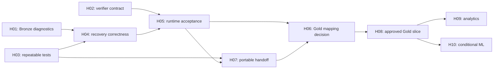

# TLCN Rice Lakehouse — Next Steps

## Current next steps — 27/10/2026

Baseline `feat(gold)@4bccf05ef1ba91f58d94df141cbbe6b97a28a6f4`; H01–H05 đã triển khai và nghiệm thu theo [scope/limitations](../foundation/ACCEPTANCE.md). Không reimplement các findings lịch sử bên dưới nếu chưa đối chiếu code mới.

1. Giải phóng RAM trước workload mới: sample cuối Windows 0,62 GiB < gate 2 GiB. Không tăng heap/reset stack để vượt gate.
2. Review diff foundation, recovery policy và [Analytics Readiness](../analytics/ANALYTICS_READINESS.md). Legacy interrupted runs thiếu context/UNKNOWN_COMMIT cần explicit catalog/content recovery; không đổi status hoặc xóa rows để ép PASS. Source withdrawal policy vẫn giữ lịch sử/upsert, chưa duyệt broad deletes.
3. Task Analytics đầu tiên: 3–4 fixed query definitions + CLI trong runner, allowlist/typed bounded parameters, `gold.consumer.read_window`, exact published snapshot bindings, batch/query hash/cache identity, query budgets và tests fail-closed. Consumer Gold hiện chỉ trả 20 sample rows; không dùng samples tính dashboard aggregates. Giữ bốn Gold SQL definitions và Gold fingerprint đã publish.
4. Sau query acceptance mới thêm local Streamlit UI cho publication/coverage, NSO, FAO production/yield và một price series. Trade đợi benchmark theo reporter/product/year. Chưa thêm service/dependency/UI trong foundation task.
5. Teammate tiếp tục second-laptop portability acceptance. Không tự takeover H07, không tự commit/push/pull/merge/rebase.

Commands/môi trường test: [TESTING](../foundation/TESTING.md). Chín nguồn thật không bị FULL replay; selected owned integration/mocks không thay thế toàn bộ nine-source failure-recovery E2E. Các H01–H05/H06/H08 trạng thái cũ bên dưới thuộc baseline audit 23/10 và Gold history, được giữ để truy vết.

> **Sau G12 26/10/2026: GOLD_MVP_COMPLETE.** Trade OOM blocker đã được loại khỏi actual acceptance workload: 156 exact partitions PASS trên 448/512 MiB; hai Gold runs SUCCESS, publication/consumers và formal NOOP 17/17 PASS. Không cần tiếp tục retry nghiệm thu. Next work khi owner giao: analytics/demo qua published consumer, operational hardening cho stop/start và resource admission, hoặc thiết kế reference/conformance/availability datasets cho expansion. Uncached full Trade validation ~51 phút; full Gold replay ~36 phút, runner chạm3 GiB có reclaim nhưng không OOM. Không tự tăng heap, nâng catalog, triển khai FX/geo/ML hay đóng H01–H05. Failed evidence và snapshots giữ nguyên. [VALIDATION](../gold/VALIDATION.md), [JSON](../gold/runtime_acceptance.json), [workflow](../gold/IMPLEMENTATION.md). Body backlog 23/10 là lịch sử, không phải current Gold readiness.

Audit **2026-10-23, Asia/Bangkok**, baseline `main` / `1bb662c49cac2f82af14ce4b5c9a5d909c2a0e05`. Đọc [PROJECT_CONTEXT](PROJECT_CONTEXT.md) và [PROJECT_STATUS](PROJECT_STATUS.md) trước khi nhận việc. Backlog dưới đây là đề xuất triển khai sau audit; audit hiện tại chỉ tạo ba tài liệu, không sửa code/config/dữ liệu.

## Mục lục

- [Milestone và thứ tự thực hiện](#milestone-và-thứ-tự-thực-hiện)
- [Backlog](#backlog)
- [Task đầu tiên duy nhất và kế hoạch cụ thể](#task-đầu-tiên-duy-nhất-và-kế-hoạch-cụ-thể)
- [Quyền thực hiện và rollback](#quyền-thực-hiện-và-rollback)
- [Definition of Done](#definition-of-done)
- [COPY-READY PROMPT FOR NEXT AGENT](#copy-ready-prompt-for-next-agent)

## Milestone và thứ tự thực hiện

Milestone gần nhất: **baseline Bronze/Silver local có diagnostics trung thực, test tái lập và acceptance trên đúng HEAD**. Gold chỉ bắt đầu sau khi baseline và source-to-Gold policies được chốt. Không cần mở rộng cloud infrastructure.

Thứ tự giao việc đề xuất: **H01 → H02 → H03 → H04 → H05 → H07 → H06 → H08 → H09**. H10 chỉ nhận khi có nhu cầu ML và đủ dữ liệu point-in-time; H11 làm sau correctness. Thứ tự H07 trước H06 chủ ý ưu tiên khả năng bàn giao foundation. Mỗi lần giao một task; không yêu cầu agent làm toàn backlog.



P0 = lỗi correctness/blocker nghiêm trọng; P1 = nền tảng bắt buộc; P2 = feature mới; P3 = cleanup/polish. Complexity S/M/L là độ lớn tương đối, không phải cam kết thời gian. “An toàn” dưới đây chỉ áp dụng khi owner giao task ở phiên triển khai, không mở rộng quyền của audit hiện tại.

## Backlog

### H01 — P0 — Bronze quarantine diagnostics

- **Component / complexity:** Bronze reliability, **M**.
- **Vấn đề / evidence / files:** [QuarantineManager](../../src/ingestion/reliability/quarantine_manager.py) bỏ qua injected sinks, không persist diagnostic nhưng trả `is_quarantined=True` cùng artifact/JSON paths không tồn tại. Nhánh validation failure trong [FullLoader](../../src/ingestion/core/full_loader.py) sử dụng kết quả này. Diff `34b4003` và reproducer mới trong [status](PROJECT_STATUS.md) xác nhận regression của error path.
- **Đề xuất:** inject [MetadataRepository](../../src/ingestion/storage/metadata_repository.py), dùng `save_dead_letter`/`ingestion.dead_letter_records` hiện có để ghi diagnostic có source/run/batch/checksum/validation context; giữ original Raw local. Diagnostic reference phải tra cứu được và đúng loại storage; không hứa có file/object nếu chưa ghi. Sửa success/failure reporting khi persistence lỗi. Chi tiết bên dưới.
- **Dependencies / risk:** không phụ thuộc Gold/Docker; cần Python test environment đủ dependencies của module đang kiểm tra. Risk M: caller assumptions về QuarantineResult, che mất validation cause, duplicate diagnostics khi retry. Không thêm schema/storage mới trong task này.
- **Expected outcome / acceptance:** invalid Raw bị từ chối, diagnostic được gửi tới durable sink đúng context; trạng thái trả về không báo thành công khi sink lỗi; không URI giả, không upload/archive Raw, happy path không đổi. Mọi caller bị ảnh hưởng được rà.
- **Test strategy:** mocked repository/storage/logger; invalid/corrupt/empty/schema-drift, explicit-error path, missing validation context, sink exception, FullLoader integration bằng mocks; assertion không ghi Bronze/MinIO khi validation fail. Chạy regression liên quan; không cần live PostgreSQL.
- **Quyền:** có thể triển khai code/unit tests trong scope được giao; không cần quyết định Gold. Owner approval chỉ cần nếu muốn đổi Raw storage policy, DB schema, hoặc ghi runtime. Không tự mở rộng task sang các việc đó.

### H02 — P1 — Đồng bộ Trino verifier với NSO contract

- **Component / complexity:** Silver acceptance tooling, **S**.
- **Vấn đề / evidence / files:** nhánh non-release trong [verify_silver_trino.py](../../jobs/silver/verify_silver_trino.py) dùng `geography_name_vi` và `UNMAPPED`, không khớp [nso.yaml](../../contracts/silver/nso.yaml)/[nso.py](../../src/silver/transformers/nso.py). Đây là utility query lỗi, chưa phải evidence DAG thất bại.
- **Đề xuất:** query columns/enums hiện hành, phân biệt `unknown` hợp lệ với geography mapping sai; kiểm tra NULL/missing/value policy theo contract. Rà phần docs NSO đi cùng verifier, không rename source IDs.
- **Dependencies / risk:** độc lập H01; H03 giúp chuẩn hóa lệnh test; risk S: validator quá chặt làm false failure hoặc quá lỏng bỏ lỗi.
- **Expected outcome / acceptance:** mọi column được query tồn tại trong contract; không loại `unknown`/provisional theo assumption cũ; giữ missing khác zero và phát hiện invalid missing/value combinations.
- **Test strategy:** mocked Trino query/representative report payloads cho branch local và release, regression rows có unknown/missing; không cần query live. Read-only SQL smoke chỉ khi runtime có sẵn và được phép.
- **Quyền:** sửa utility/docs/tests an toàn trong task; không đổi Silver contract hay dữ liệu để khớp query cũ.

### H03 — P1 — Test environment và import entrypoints tái lập

- **Component / complexity:** Python packaging/tests, **M**.
- **Vấn đề / evidence / files:** [pyproject.toml](../../pyproject.toml) chỉ thêm `src`; [run_all_silver.py](../../jobs/silver/run_all_silver.py) và [test_silver_orchestration.py](../../tests/unit/test_silver_orchestration.py) dùng bare helper imports. Mặc định 4 test fail; thêm process-local `jobs/silver` thì 4/4 đạt. Collection còn thiếu Airflow/responses/PyIceberg; 5 tmp setup errors chưa giải quyết.
- **Đề xuất:** chọn package-safe imports hoặc một test entrypoint rõ ràng tương thích container/CLI; phân nhóm pure unit và runtime/integration dependencies; tài liệu hóa supported Python/environment theo [Dockerfiles](../../docker/)/[locks](../../requirements/). Dùng writable test temp directory hợp lệ, không sửa ACL hệ thống hay skip rộng để che lỗi.
- **Dependencies / risk:** dùng kết quả H01/H02 làm regression scope; risk M: đổi import phá CLI runner hoặc kéo Airflow nặng vào pure unit tests.
- **Expected outcome / acceptance:** documented unit invocation không cần sys.path workaround ngoài tài liệu; collect và chạy nhóm unit được hỗ trợ; giải thích/giải quyết từng failure/setup error, không tuyên bố full suite đạt khi còn dependency skip chưa công bố.
- **Test strategy:** bốn orchestration cases đã nêu, contract/profile tests, unit collection; CLI import smoke không start Spark. Dependency install chỉ trong môi trường task được chọn, không thay global Python tùy tiện.
- **Quyền:** code/test/config cần thiết cho test entrypoint có thể sửa khi task được giao. Không tự build/start container; nếu chọn Docker-based test runner thì cần owner cho phép runtime đó.

### H04 — P1 — Failure recovery và source snapshot semantics

- **Component / complexity:** Bronze reliability, Silver merge semantics, **L**; chia implementation sau khi có failure matrix.
- **Vấn đề / evidence / files:** [bronze_writer.py](../../src/ingestion/storage/bronze_writer.py) replace chunk DELETE rồi APPEND; [FullLoader](../../src/ingestion/core/full_loader.py) có best-effort metadata catches và `_source_snapshot_id=0`; [idempotency_controller.py](../../src/ingestion/reliability/idempotency_controller.py) committed-batch registration không còn durable sink. [merge.py](../../src/silver/engine/merge.py) không tự xử lý source withdrawal.
- **Đề xuất:** trước hết lập failure matrix cho validate → delete → append → metadata → checkpoint → retry/resume; thêm meaningful failure-injection tests. Sửa các paths chứng minh thiếu/trùng/false-success trong phạm vi nhỏ. Chốt ý nghĩa lineage placeholder so với actual read snapshot. Tách policy xử lý row bị rút khỏi FULL source, không tự thêm delete toàn bảng.
- **Dependencies / risk:** H01, H03; risk L: thay transaction/idempotency semantics có thể làm mất dữ liệu. Không coi removal Raw archive là yêu cầu phải hoàn tác.
- **Expected outcome / acceptance:** retry/resume không duplicate/mất chunk trong failure cases đã mô hình hóa; persisted SUCCESS chỉ khi có commit proof; metadata failure không bị báo xanh; Silver gates từ chối evidence thiếu; withdrawal policy ghi rõ phần chưa hỗ trợ.
- **Test strategy:** [test_chunk_idempotency](../../tests/unit/test_chunk_idempotency.py), [test_phase6_failure_recovery](../../tests/unit/test_phase6_failure_recovery.py), [metadata recovery](../../tests/unit/test_metadata_silver_recovery.py), [orphan cleanup](../../tests/unit/test_orphan_cleanup.py), [Bronze identity](../../tests/unit/test_bronze_identity.py), mock catalog unknown-commit/readback. Live destructive failure injection chỉ trên disposable scope được phép.
- **Quyền:** unit-backed fixes có thể làm trong task; migration, purge, replay/reset và changing snapshot deletion policy cần owner approval trước phần phụ thuộc.

### H05 — P1 — Nghiệm thu Bronze/Silver tại HEAD hiện hành

- **Component / complexity:** Local runtime acceptance, **M**.
- **Vấn đề / evidence / files:** Docker engine unavailable tại audit; không có fresh physical tables/counts/NOOP. Workflow thực ở [DAGs](../../dags/), [pipeline_tasks](../../src/ingestion/orchestration/pipeline_tasks.py), [audit.py](../../src/silver/audit.py), [validate_silver_e2e.py](../../jobs/silver/validate_silver_e2e.py), [status.ps1](../../scripts/local_demo/status.ps1).
- **Đề xuất:** recheck HEAD/Raw/env; nếu stack tồn tại thì read-only inventory trước. Verify 9 Bronze + 9 Silver targets, schemas, BK duplicates, missing/units/lineage/DQ, run/snapshot proofs và Spark/Trino parity. FULL/incremental replay để chứng minh physical NOOP là bước có write intent, phải tách khỏi read-only inspection.
- **Dependencies / risk:** H01–H04, Docker engine/images/Raw đủ và quyền vận hành. Risk M: RAM 16 GB, nhầm namespace, replay ghi vào data đang dùng. Không dùng legacy compose harness.
- **Expected outcome / acceptance:** report gắn HEAD, dataset checksums, profile và actual catalog/snapshot IDs; counts lấy mới; physical NOOP so snapshot/metadata trước-sau; orchestration chỉ chấp nhận parent proof đúng. Nếu không có quyền/runtime, báo phần nào BLOCKED, không dùng historical counts lấp chỗ trống.
- **Test strategy:** lifecycle `-CheckOnly` và `status -Smoke` theo [context](PROJECT_CONTEXT.md); SQL read-only queries trước; approved serial pipeline/replay sau. Không chạy [test_silver_isolated.ps1](../../scripts/test_silver_isolated.ps1) dưới nhãn “chỉ đọc”: script tạo container và có thể tải wheels.
- **Quyền:** đọc runtime được cung cấp có thể làm; start/build/DAG trigger/replay/data writes chỉ làm khi owner giao rõ phần đó. Reset không phải điều kiện mặc định để nghiệm thu.

### H07 — P1 — Bàn giao local sang máy khác

- **Component / complexity:** Data provisioning/configuration, **M**.
- **Vấn đề / evidence / files:** [manifest](../../config/local_raw_manifest.json), [`.env.example`](../../.env.example), [_common.ps1](../../scripts/local_demo/_common.ps1), [`.gitignore`](../../.gitignore). Trade CSV bị ignore; helpers bỏ qua `.env.local`, dùng Windows/WSL probes và fixed ports; remote dùng SSH alias riêng máy.
- **Đề xuất:** hướng dẫn data pack đầy đủ theo manifest, kiểm checksum tại máy nhận; một env-file workflow rõ; preflight báo thiếu file/path/port/WSL dễ hiểu. Quyết định cố định ports hay hỗ trợ override rồi đồng bộ template/helper/docs. Track ba handoff docs bằng allowlist nhỏ khi owner muốn lưu trong Git; không include secrets hoặc toàn bộ dữ liệu lớn.
- **Dependencies / risk:** H03 và H05 để bàn giao một baseline đã nghiệm thu; checklist/data-pack spec có thể chuẩn bị trước. Risk M: file ignored không được chuyển, path chứa spaces, docs tưởng đã commit nhưng thực ra chưa track.
- **Expected outcome / acceptance:** từ clone và data pack, agent mới xác định được đủ 21+support files, Raw root, env selection, project/ports; không cần alias/absolute path của máy tác giả. Handoff files không mất khi chỉ chuyển tracked repo.
- **Test strategy:** static path/link/ignore checks; config resolution với Raw root có spaces; read-only/preflight ở máy nhận. Chưa có máy thứ hai thì ghi rõ portability smoke chưa verified.
- **Quyền:** sửa docs, preflight và tests trong task an toàn; không publish data pack ra ngoài hoặc commit large Raw/secrets. Chuyển dữ liệu ra dịch vụ khác hay runtime operations cần owner giao rõ.

### H06 — P1 — Chốt Gold source contracts, grain và unit policies

- **Component / complexity:** Gold design correctness, **L**, ưu tiên từng nhóm mapping.
- **Vấn đề / evidence / files:** [DBML](../gold/dim_fact_v3.dbml), [Gold README](../gold/README.md), [mapping CSV](../gold/design_audit_2026-10-22_field_mapping.csv), [mapping audit](../gold/design_audit_2026-10-22_schema_and_mapping.md) lệch actual [Silver contracts](../../contracts/silver/). Xem bảng Gold blockers trong [status](PROJECT_STATUS.md).
- **Đề xuất:** chọn explicit `silver_local` input; sửa NSO columns/enums/season/geography assumptions, SUA element codes, unit conversions và VN quote grain. Đánh dấu field derive được/lookup cần nguồn/không hỗ trợ. Quyết định country/product/geo crosswalk, publication precedence, calendar/crop-year basis; lập Gold contract của slice được chọn trước ETL.
- **Dependencies / risk:** H05 cho evidence physical Silver; H07 cho handoff reproducibility. Risk L: official geography/weights chưa có, nhiều sources khác commodity/time basis; có thể không đủ dữ liệu cho design cũ.
- **Expected outcome / acceptance:** mọi field slice có exact source/lookup/formula/NULL policy và evidence; PK không collision, FK resolution có unmapped policy, units không double-scale. Owner duyệt grain, lookup sources và scope MVP rõ ràng; không coi đề xuất 14-table MVP cũ là đã duyệt.
- **Test strategy:** static contract-to-mapping checks, targeted read-only profiling khi runtime sẵn, fixtures cho grain/unit/crosswalk; DBML parser nếu environment có hỗ trợ, công bố nếu chưa parse được.
- **Quyền:** audit/mapping proposal có thể chuẩn bị; sửa canonical DBML/Gold schema và chọn nghiệp vụ/crosswalk cần owner giao/duyệt. Không tự tạo official codes/transition weights.

### H08 — P2 — Triển khai một Gold slice đã được duyệt

- **Component / complexity:** Gold dimensions/fact ETL, **L**; giới hạn một slice có input/grain rõ.
- **Vấn đề / evidence / files:** chỉ có [docs/gold/](../gold/), chưa có Gold executable contracts hay jobs. Không thể coi 27 DBML tables là 27 tables đã build.
- **Đề xuất:** triển khai lần lượt dimensions cần cho một fact đã duyệt; explicit input namespace, deterministic keys, unknown member policy, lineage, DQ, idempotent writes và query checks. Đường dẫn implementation mới do task thiết kế, hiện chưa tồn tại; không mô tả chúng như files sẵn có.
- **Dependencies / risk:** H06 có owner-approved mapping và H05 baseline. Risk L: multiplying joins, incompatible grain, unsupported lookups; không build toàn design cùng lúc.
- **Expected outcome / acceptance:** một slice có FK integrity, không duplicate fact key, totals/units khớp approved source aggregation; replay có semantics được kiểm chứng; field unsupported vẫn NULL/explicitly excluded theo policy.
- **Test strategy:** tiny fixtures cho PK/FK/unit/grain và many-to-many join traps; integration trên namespace disposable được phép; đối chiếu source vs fact totals.
- **Quyền:** chỉ triển khai slice owner giao; namespace/schema mới và runtime writes phải nằm trong scope được duyệt. Không mở rộng thành toàn bộ Gold.

### H09 — P2 — Analytics views và dashboard tối thiểu

- **Component / complexity:** Analytics, **M**.
- **Vấn đề / evidence / files:** chưa có dashboard/views implementation được tìm thấy; [Gold README](../gold/README.md) là intent, [EDA](../../tlcn_explain-for_eda/) không phải ứng dụng triển khai.
- **Đề xuất:** owner chọn 2–3 câu hỏi nghiệp vụ dựa trên slice H08, rồi làm query/views và một giao diện local nhỏ; hiển thị units, source/time basis, missing/unmapped rõ ràng. Chưa chọn framework hay tool mới trong audit này.
- **Dependencies / risk:** H08 và business questions được chốt. Risk M: visualization che grain mismatch hoặc cộng indices/khác currencies.
- **Expected outcome / acceptance:** mỗi metric truy ra fact/query, aggregation đúng và khớp SQL mẫu; filters giữ cùng time basis, không biến missing thành zero.
- **Test strategy:** reconciliation queries, tiny metric examples, UI smoke/manual walkthrough; không thêm hạ tầng vượt nhu cầu demo local.
- **Quyền:** cần owner chọn scope/công cụ trước implementation; không publish site/data ra ngoài khi chưa được yêu cầu.

### H10 — P2 — Forecasting chỉ sau khi có point-in-time policy

- **Component / complexity:** Optional ML, **L**.
- **Vấn đề / evidence / files:** `Forecasting_Data_Mart_Monthly` trong [DBML](../gold/dim_fact_v3.dbml) chỉ là design; không có training pipeline và chưa chứng minh availability/vintage của features. LEAD observation tiếp theo không đảm bảo horizon đúng tháng.
- **Đề xuất:** chốt target series, calendar, lag/horizon, publication delay và train/validation/test time splits trước; xác định dữ liệu vintage có sẵn hay chỉ latest snapshot. Chỉ sau đó mới làm baseline forecast và feature mart nhỏ.
- **Dependencies / risk:** H06/H08 và owner thực sự cần ML. Risk L: target leakage, sparse series, benchmark/currency mixing; historical latest-snapshot data không tự trở thành PIT archive.
- **Expected outcome / acceptance:** mỗi feature có availability ≤ prediction time; target là đúng future calendar period; không train/test leakage; baseline và limitations được công bố, không gọi latest-only backtest là leakage-free.
- **Test strategy:** synthetic time-series gaps/revisions/publication delays, horizon assertions, temporal splits; chưa đủ vintage thì dừng ở design và ghi dependency thiếu.
- **Quyền:** không bắt đầu mặc định; cần owner chọn nhu cầu/target và chấp nhận data limitations.

### H11 — P3 — Dọn drift và legacy sau correctness

- **Component / complexity:** Documentation/tooling cleanup, **M**.
- **Vấn đề / evidence / files:** [senior_de_review.md](../../senior_de_review.md) tả storage đã bỏ; [Silver schemas](../silver/schemas.md), [data catalog](../silver/data_catalog.md), [cleaning rules](../silver/cleaning_rules.md) có NSO/SUA drift; [snapshot harness](../../scripts/validate_silver_local_snapshots.py) và [old integration test](../../tests/integration/test_silver_pipeline_isolated.py) dùng compose đã xóa; legacy transformer wrappers còn được tests dùng.
- **Đề xuất:** lập active/compatibility/historical usage map, cập nhật canonical commands và đánh dấu historical docs. Chỉ sửa references có nghĩa runtime; giữ negative tests cố ý chặn old IDs. Lập deletion list có dependency proof trước khi đề nghị bỏ files.
- **Dependencies / risk:** H02/H03/H07; thực hiện sau P0/P1. Risk M: xóa nhầm compatibility API, fixture hoặc bằng chứng lịch sử.
- **Expected outcome / acceptance:** canonical docs không trỏ compose/module đã mất; người mới tìm đúng một local workflow, contracts và namespaces; nếu bỏ legacy thì không còn active import/reference chưa xử lý.
- **Test strategy:** `rg` usage search, Markdown paths/anchors, unit import/contract/DAG tests tương ứng; không chạy obsolete rebuild utilities để “thử xem”.
- **Quyền:** docs fixes có thể làm khi được giao; xóa files/dependencies cần owner cho phép rõ. Không cleanup trong audit hiện tại.

## Task đầu tiên duy nhất và kế hoạch cụ thể

**Giao H01 trước.** Đây là regression đã được tái hiện ở error path, có tác động rõ đến truy vết và khôi phục. Phạm vi có thể kiểm thử bằng mocks, không phụ thuộc Docker đang unavailable và không cần quyết định Gold.

1. Đọc HEAD/status/diff, [QuarantineManager](../../src/ingestion/reliability/quarantine_manager.py), [FullLoader.__init__/execute](../../src/ingestion/core/full_loader.py), [MetadataRepository.save_dead_letter/get_dead_letters](../../src/ingestion/storage/metadata_repository.py), [DDL](../../src/ingestion/storage/init_db.sql), [schemas](../../src/ingestion/storage/metadata_schemas.py), [Bronze validator](../../src/ingestion/reliability/bronze_quality_validator.py). Rà mọi caller bằng `rg`, bao gồm tests.
2. Thêm focused failing regression test cho missing sink call/false URI, trước thay đổi implementation. Có thể tạo **file mới dự kiến** `tests/unit/test_quarantine_manager.py`; file này chưa tồn tại tại audit. Mock logger để test không sinh log file ngoài ý muốn; dùng mocked storage/repository, không mở network.
3. Wire repository từ FullLoader vào default QuarantineManager, giữ dependency injection cho tests. Dùng dead-letter table/API hiện có. Structured record giữ error type/message, validation size/checksum/count/schema diff, source/run/batch, original local reference và context cần phục hồi; giới hạn snippet, không serialize credential/environment. Với context thiếu, fail rõ hoặc biểu diễn thiếu trung thực, không tạo identity giả.
4. Chốt nghĩa `QuarantineResult`: loại input khỏi pipeline và lưu diagnostic không đồng nghĩa chuyển Raw file. Giữ Raw tại local, không move/upload. Chỉ báo diagnostic persisted khi sink đã thành công. Không tự ghép `.error.json` hoặc S3 URI không tồn tại. Repository hiện trả `None`; dùng locator có thể query theo table/source/run/batch hoặc API thật, không bịa row ID/path.
5. Khi sink lỗi, giữ validation cause và diagnostic persistence cause trong kết quả/exception có thể quan sát; pipeline vẫn fail closed, không `SUCCESS`/`SKIPPED` giả và không tuyên bố đã cách ly thành công. Không để exception mới che hoàn toàn lỗi dữ liệu gốc.
6. Tests phải cover validation-result và explicit-error branches, corrupt/empty/schema drift, persistence exception và FullLoader propagation; assert không append Bronze/upload MinIO, không đụng file Raw, happy path không gọi quarantine. Kiểm tra call context/content thay vì chỉ assert function chạy không exception.
7. Chạy focused tests và Bronze regressions trong environment đủ dependencies; ghi rõ setup failures nếu gặp lại temp permissions. Kiểm tra diff để không đổi registry/contracts/Compose/Gold/storage policy. Cập nhật status của H01 theo evidence mới, còn runtime durability giữ `IMPLEMENTED_UNVERIFIED` nếu chỉ có mock tests.

Lệnh đọc/kiểm tra dự kiến (từ root):

```powershell
git status --short
git rev-parse HEAD
rg -n 'QuarantineManager|quarantine_artifact|QuarantineResult|save_dead_letter' src tests
python -B scripts/validate_silver_contracts.py
```

Sau khi đã tạo focused test **ở phiên triển khai H01**, chạy:

```powershell
python -B -m pytest -o addopts= -q -p no:cacheprovider tests/unit/test_quarantine_manager.py
python -B -m pytest -o addopts= -q -p no:cacheprovider `
  tests/unit/test_full_loader.py `
  tests/unit/test_bronze_schema_preservation.py `
  tests/unit/test_bronze_identity.py
git diff --check
git diff --stat
```

Đây là kế hoạch, không phải các tests H01 đã chạy. `test_full_loader.py` có thể cần temp fixtures/dependencies; không báo PASS nếu collection/setup lỗi. Không cần chạy full E2E, start Docker hay khắc phục toàn H03 để viết focused unit tests của H01.

## Quyền thực hiện và rollback

Task được giao cho agent mới cho phép sửa code/tests/docs đúng scope. Reversible local edits và unit tests không cần hỏi lại chỉ vì là implementation. Những phần sau cần owner giao rõ hoặc duyệt concrete proposal: start/build/reset/trigger/replay và data writes, DB/schema migration, đổi Raw storage policy, source identifiers, canonical Gold schema/grain/lookups, publish/chuyển data ra bên ngoài và xóa files. Trong audit hiện tại tất cả implementation đều ngoài phạm vi.

Rollback H01 là hoàn tác **đúng diff của task** sau khi kiểm tra working tree, giữ nguyên thay đổi của người khác. Không dùng `git reset --hard`, `git clean` hay restore toàn repo. Nếu chỉ code/mocks và không migration/runtime writes, không cần reset data. Nếu phát hiện sửa schema/storage mới là bắt buộc, dừng phần phụ thuộc để trình proposal cụ thể thay vì tự migrate. Lưu ý docs/handoff đang bị ignore; không mặc định chúng sẽ theo commit hoặc clean clone.

## Definition of Done

- Task được giới hạn bằng ID/scope; HEAD và working tree trước/sau được ghi rõ, không ghi đè work của người khác.
- Root cause có evidence hiện hành, fix có regression meaningful cho failure và happy path; không thay business policy ngoài scope.
- Lệnh tests, số passed/failed/errors/skipped và environmental blockers được báo đúng; mock verification không đổi thành runtime acceptance.
- Không tạo artifact/URI/row ID giả, không claim “quarantined” khi không có persisted diagnostic, không ghi dataset runtime trái phép.
- Diff/paths/Markdown links/secret exposure được kiểm tra. Không commit/push hay cleanup khi chưa được yêu cầu.
- PROJECT_STATUS và backlog chỉ cập nhật phần task có evidence mới; Gold vẫn DESIGN_ONLY/ETL NOT_STARTED cho đến khi thực sự triển khai và kiểm chứng.
- Báo kết quả, files sửa, tests và limitation còn lại; dừng sau task được giao, không tự chuyển sang task kế tiếp.

## COPY-READY PROMPT FOR NEXT AGENT

```text
Đọc docs/handoff/PROJECT_CONTEXT.md, PROJECT_STATUS.md và NEXT_STEPS.md.
Repo truth ưu tiên hơn tài liệu: kiểm tra AGENTS.md áp dụng, branch/HEAD,
git status/diff hiện tại và giữ toàn bộ uncommitted work. Baseline audit là
main@1bb662c49cac2f82af14ce4b5c9a5d909c2a0e05 ngày 2026-10-23.

Chỉ triển khai H01 (P0): sửa Bronze QuarantineManager/FullLoader để lưu
structured diagnostics qua MetadataRepository/dead_letter_records hiện có
và báo đúng success/failure. Giữ Raw local, không phục hồi MinIO Raw archive;
không trả artifact/JSON URI chưa tồn tại, không che lỗi persistence hoặc
validation gốc. Đọc kế hoạch H01, rà callers và thêm focused regression tests
bằng mocked sinks, cover sink failure và FullLoader fail-closed propagation.

Cho phép sửa code/tests/docs đúng H01. Không đổi source IDs/contracts/Compose/
Gold schema, xóa files, migrate DB, start/build/reset Docker, trigger DAG,
ghi Iceberg/MinIO/PostgreSQL thật, commit/push hoặc làm các tasks còn lại.
Không bypass hash guards. Nếu cần mở rộng storage/schema/runtime scope,
chuẩn bị proposal cụ thể và hỏi owner trước phần phụ thuộc.

Chạy tests phù hợp; thiếu dependencies/tmp permissions thì báo đúng blocker,
không claim full PASS và không chạy admin/skip rộng để che lỗi. Kiểm tra diff,
paths và secrets, cập nhật H01 status theo evidence mới. Lưu ý docs/handoff
đang bị .gitignore bỏ qua. Báo root cause, changes, tests và phần chưa verified;
dừng sau H01.
```
