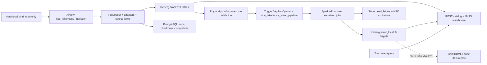

# TLCN Rice Lakehouse — Project Context

> **Cập nhật G12 26/10/2026: GOLD_MVP_COMPLETE — đọc trước audit lịch sử.** Gold `gold-20261025.1` có 8 physical dimensions/9 facts, 1.414.527 observations, 4 version-controlled semantic SQL queries. Hai manual Gold DagRuns SUCCESS; DQ01–18, 9-source exact reconciliation, publication/readback/consumers và formal NOOP 17/17 PASS. Full Trade 1986–2024: 156 partitions, zero exact differences. Giữ Trino 448/512 MiB/REST catalog; không native views, nâng/migrate/reset hoặc Bronze/Silver writes/triggers. Runtime evidence/giới hạn RAM/timeline external interruption tại [VALIDATION](../gold/VALIDATION.md), [JSON](../gold/runtime_acceptance.json), workflow tại [IMPLEMENTATION](../gold/IMPLEMENTATION.md). [Mapping](../gold/source_to_gold_mapping.csv) giữ 488 branches; 17 schemas/262 columns/40 logical FKs không đổi. Body 23/10 là lịch sử; H01–H05/official conformance/FX/ML không tự đóng.

Audit: **2026-10-23, Asia/Bangkok (UTC+07)**. Baseline: `main`, HEAD `1bb662c49cac2f82af14ce4b5c9a5d909c2a0e05`. Tài liệu mô tả code tại HEAD này; không chứng nhận dữ liệu runtime. Đọc tiếp [trạng thái và bằng chứng](PROJECT_STATUS.md), rồi [backlog và prompt bàn giao](NEXT_STEPS.md).

## Mục lục

- [Mục tiêu và phạm vi](#mục-tiêu-và-phạm-vi)
- [Kiến trúc hiện hành](#kiến-trúc-hiện-hành)
- [Cấu trúc và entrypoints](#cấu-trúc-và-entrypoints)
- [Nguồn và hợp đồng dữ liệu](#nguồn-và-hợp-đồng-dữ-liệu)
- [Quy tắc xử lý cần giữ](#quy-tắc-xử-lý-cần-giữ)
- [Cấu hình và vòng đời local](#cấu-hình-và-vòng-đời-local)
- [Git và khả năng chuyển máy](#git-và-khả-năng-chuyển-máy)
- [Đọc trước và quy tắc an toàn](#đọc-trước-và-quy-tắc-an-toàn)

## Mục tiêu và phạm vi

TLCN là đồ án Data Engineering phân tích lúa gạo Việt Nam trong bối cảnh sản xuất, cung cầu, thương mại và giá quốc tế. Kiến trúc mục tiêu: Raw → Bronze → Silver → Gold → Analytics. Ưu tiên hiện tại là chạy local, kiểm chứng được, bàn giao sang laptop khác và vận hành trên máy khoảng 16 GB RAM.

Repository đã có pipeline Bronze/Silver cho **9 nguồn trong profile `local_nine`**. Gold có DBML và tài liệu audit, chưa có ETL. Dashboard và ML chưa có implementation được tìm thấy. Các số nghiệm thu trước đây không thay thế kiểm thử HEAD hiện tại. Không có yêu cầu xây cloud/production infrastructure.

Stack: Python (`pyproject.toml` yêu cầu >=3.11), Airflow LocalExecutor, Spark/PySpark, Iceberg, REST Catalog, MinIO, Trino, PostgreSQL, Docker Compose; lifecycle scripts dùng Windows PowerShell và WSL2. Hai Dockerfiles cùng lock files là căn cứ dựng môi trường container; môi trường Python host không tương đương container.

## Kiến trúc hiện hành

Canonical config là **[compose.yaml](../../compose.yaml)** duy nhất, project **`tlcn-local`**, profile **`local_nine`**. Có 8 service definitions: 7 dịch vụ dài hạn và `airflow-init` chạy một lần.



Hai DAG là `rice_lakehouse_ingestion` và `rice_lakehouse_silver_pipeline`. Compose kích hoạt manual-only: `schedule=None`, `catchup=False`, một active run, một task mỗi DAG, source tasks nối tuần tự. Airflow parallelism=2; không suy ra có lịch tự chạy từ tên DAG.

Bronze chỉ trigger Silver sau khi xác minh persisted task result, metadata run và physical Bronze proof cho cả 9 nguồn. Trigger dùng child run ID xác định, `wait_for_completion=True`, `reset_dag_run=False`. Silver kiểm tra parent DagRun/gate/XCom và đọc lại proof; trigger Silver độc lập không phải workflow hợp lệ của profile này. Xem [pipeline_tasks.py](../../src/ingestion/orchestration/pipeline_tasks.py), [orchestration.py](../../src/silver/orchestration.py) và hai DAG.

| Service | Vai trò | Publish ra host |
|---|---|---|
| `minio` | Iceberg objects trong bucket warehouse | Console `127.0.0.1:9001`; API 9000 nội bộ |
| `postgres` | Airflow DB và ingestion metadata | 5432 nội bộ |
| `iceberg-rest` | REST catalog, SQLite catalog backend | 8181 nội bộ |
| `trino` | Query Iceberg | `127.0.0.1:18080` → 8080 |
| `runner` | Spark API, script allowlist, serialize write jobs | 5005 nội bộ |
| `airflow-scheduler` | LocalExecutor và DAG scheduling | Không publish |
| `airflow-webserver` | UI | `127.0.0.1:8085` → 8080 |
| `airflow-init` | DB migration/bootstrap | One-shot |

Repo bind `/workspace` và Raw bind `/workspace/data/raw` đều read-only trong container. Raw host root lấy từ `SILVER_TEST_RAW_ROOT`. Bốn named volumes trong Compose là `local_minio_data`, `local_postgres_data`, `local_catalog_data`, `local_airflow_logs`; không phải các thư mục Raw. REST lưu catalog tại `/data/catalog/local-nine.db`. Tên volume thực tế do Compose project resolve; chưa kiểm tra volume đang tồn tại trên máy.

## Cấu trúc và entrypoints

| Đường dẫn hiện có | Trách nhiệm / điểm bắt đầu |
|---|---|
| [dags/](../../dags/) | `dag_ingestion_pipeline.py`, `dag_silver_pipeline.py` |
| [src/ingestion/](../../src/ingestion/) | `IngestionEngine.create_default`, `FullLoader`, adapters, registry, reliability, metadata, `BronzeIcebergWriter` |
| [src/silver/](../../src/silver/) | `SilverTransformationFramework`, contract loader, transformers, quality/quarantine/merge, local profile, orchestration |
| [src/common/](../../src/common/) | Shared retry/hash/error utilities; một số ingestion utils là compatibility facades đang dùng |
| [jobs/silver/](../../jobs/silver/) | `spark_api_server.py`, `run_all_silver.py`, `validate_silver_e2e.py`, Trino verifier và wrappers |
| [jobs/bronze/validate_nso_bronze.py](../../jobs/bronze/validate_nso_bronze.py) | Utility kiểm tra Bronze NSO; không phải DAG thứ ba |
| [config/ingestion/source_registry.yaml](../../config/ingestion/source_registry.yaml) | Source configuration |
| [config/local_raw_manifest.json](../../config/local_raw_manifest.json) | 21 input files và support file, sizes/SHA-256 |
| [config/silver/nso_v2_metadata.json](../../config/silver/nso_v2_metadata.json) | NSO table/label semantics được pin |
| [contracts/silver/](../../contracts/silver/) | 9 executable YAML contracts; nguồn sự thật cho output schema và business keys |
| [scripts/local_demo/](../../scripts/local_demo/) | `start.ps1`, `status.ps1`, `stop.ps1`, `reset.ps1`, `_common.ps1` |
| [docker/](../../docker/), [requirements/](../../requirements/) | Image definitions và dependency locks |
| [tests/](../../tests/) | Unit, integration, fixtures; không phải tất cả thuộc active runtime |
| [docs/silver/](../silver/) | Tài liệu vận hành; một số NSO schema/rules đã lệch code |
| [docs/gold/](../gold/) | Design, DBML, audit và field mapping; chưa có Gold pipeline |
| [tlcn_explain-for_eda/](../../tlcn_explain-for_eda/) | EDA notebooks; không chứng minh dashboard/ML đã triển khai |

Active Silver framework import `silver.transformers.<dataset_id>`. Những module có hậu tố `_transformer.py` thuộc framework cũ, không phải đường dispatch 9 nguồn hiện tại. Không xóa chỉ dựa vào tên: tests và compatibility callers có thể còn dùng chúng.

## Nguồn và hợp đồng dữ liệu

Bronze target luôn là `iceberg.bronze.<source_id>`. Source ID cũng là Silver dataset ID trong bảng dưới. Silver YAML mặc định ghi `iceberg.silver.<target>`; **profile hiện hành overlay thành `iceberg.silver_local.<target>`**. Không đọc/ghi nhầm namespace mặc định hay release namespace khác.

| Source ID | Silver target (trong `iceberg.silver_local`) | Số cột nghiệp vụ | Business key |
|---|---|---:|---|
| `faostat_production` | `faostat_production` | 16 | country_code, commodity_code, year, element_code |
| `faostat_monthly_price` | `faostat_monthly_price` | 22 | country_code, commodity_code, year, month_code, element_code |
| `faostat_supply_utilization` | `faostat_supply_utilization` | 17 | country_code, commodity_code, year, element_code |
| `faostat_trade` | `faostat_trade` | 15 | reporter_country_code, partner_country_code, commodity_code, year, element_code |
| `usda_psd` | `usda_rice_psd` | 12 | country, commodity, attribute, market_year |
| `usda_rice_yearbook` | `usda_rice_yearbook` | 13 | location, commodity_class, year, reference_period, statistic_type |
| `worldbank_pinksheet` | `worldbank_commodity_monthly` | 12 | commodity_code, period_date |
| `thitruongnongsan` | `thitruongnongsan` | 12 | market, commodity, price_type, unit, currency, source, date |
| `nso` | `nso_rice_statistics` | 34 | source_table, source_geography_key, year, measure, season, statistic_kind |

Tất cả partition theo `year`, riêng USDA PSD theo `market_year`. Output còn có 8 lineage columns, `_dq_warnings`, `_silver_processed_at`. `dead_letters` và `nso_exclusions` là bảng phụ, không tính thành source thứ 10. Nguồn: [local_profile.MAPPINGS](../../src/silver/local_profile.py) và [contracts](../../contracts/silver/).

Registry có **10 enabled entries** vì chứa thêm fixture `faostat_trade_validation`. Whitelist `local_nine` mới quyết định 9 nguồn thực. Tất cả 9 dùng `LOCAL_FILE`, load strategy `FULL`. Identifier NSO canonical là **`nso`**, adapter có alias `nso_vietnam`; không đổi thành `nso_vietnam_v2`.

Raw root theo [manifest](../../config/local_raw_manifest.json):

- FAOSTAT: `faostat/production_world.csv`, `faostat/price.csv`, `faostat/supply_utilization.csv`, `faostat/Trade_DetailedTradeMatrix_E_All_Data_(Normalized)/rice_trade_data.csv`.
- NSO: 13 file từ `nso/V06.12.csv` đến `nso/V06.24.csv`, cộng support `nso/metadata.txt`.
- USDA: `usda/usda.xls` (nội dung HTML, không mặc định XLS nhị phân) và `usda/Export-prices-Thailand-Vietnam-India-and-Pakistan.csv`.
- World Bank: `world_bank/CMO-Historical-Data-Monthly.xlsx`.
- Thị trường nông sản: `thitruongnongsan/price_luagao.xlsx`.

Tổng input trong manifest: **21 files, 183,728,724 bytes**, chưa tính support file. Audit này xác nhận tồn tại và size; không hash lại toàn bộ Raw hoặc count nội dung. Các codebook FAOSTAT không phải nguồn ingestion bổ sung. Endpoints nguồn trong registry không đồng nghĩa runtime hiện tại tải dữ liệu từ Internet.

## Quy tắc xử lý cần giữ

**Bronze:** file checksum, source advisory lock, checkpoints, schema/numeric/Arrow preflight và source snapshots hỗ trợ idempotency. Writer ưu tiên PyIceberg REST/Arrow, có Trino fallback. Thay chunk bằng DELETE rồi APPEND chưa atomic. `_source_snapshot_id=0` do FullLoader truyền không phải actual snapshot ID của Iceberg. Physical proof trong orchestration phải đọc catalog riêng.

Sau commit `34b4003`, Raw giữ local, artifact URI `local://...`; manifest được dựng trong memory, không có physical archive/manifest trên MinIO. PostgreSQL vẫn là nơi lưu ingestion metadata. `QuarantineManager` hiện chỉ trả URI giả định và `is_quarantined=True`, chưa persist diagnostic. Đây là lỗi P0 trong [NEXT_STEPS H01](NEXT_STEPS.md#h01--p0--bronze-quarantine-diagnostics); không coi removal Raw archive tự nó là lỗi cần đảo ngược.

**Silver:** preprocess nguồn → normalize theo YAML bằng `try_cast` → DQ required/contract/source → quarantine → deterministic dedup → change-aware MERGE. Missing khác 0; SQL UNKNOWN không được coi là DQ hợp lệ. `_source_payload` phục vụ quarantine, không trộn vào output nghiệp vụ. MERGE bỏ qua write nếu payload/audit/warnings không đổi, không so `_silver_processed_at`; full read hiện không tự xóa row đã biến mất khỏi source snapshot. Physical NOOP cần kiểm chứng runtime lại.

- NSO: giữ `source_table` và hash exact raw geography làm identity; mã địa giới chính thức và boundary version để NULL. Enum lowercase `national/region/province/unknown`, `quantity/development_index`; không dùng enum viết hoa của Gold DBML. Có exclusions riêng cho structural rows. Area/production đã chuyển nghìn → hectare/tonne, yield đã sang kg/ha; không nhân lại ở Gold. Publication chỉ `provisional/unconfirmed` theo contract.
- FAOSTAT: giữ source codes/flags. M49 không mặc định ISO; CPC giữ leading zero. Monthly có annual code `7021`, không ép thành tháng. Price index không có currency/unit của giá tiền, không tự FX.
- SUA: `5071` stock variation và `5166` residuals được signed; mapping phải theo element codes thật, không suy diễn từ nhãn Gold cũ.
- USDA PSD: quantity còn đơn vị nghìn theo nguồn; riêng `Milling Rate (.9999)` đã chia 10,000 thành fraction. Yearbook giữ `reference_period`; chưa có bằng chứng để coi mọi `year` là calendar year.
- Giá Việt Nam: giữ đầy đủ quote identity gồm market/source/unit/currency; conflicting quotes bị quarantine. World Bank giữ series identity, missing và units; không gộp các benchmark chỉ vì cùng là gạo.

**Gold:** [dim_fact_v3.dbml](../gold/dim_fact_v3.dbml) có 27 tables: 12 dimensions, 3 crosswalks, 8 facts, 3 aggregates, 1 forecasting mart. Field mapping và audit đã có, nhưng chưa có contracts, jobs hay ETL Gold. Thiết kế còn sai namespace, enum/fields NSO, grain, mappings SUA và thiếu official geography/country/product crosswalk. Đề xuất MVP trong audit cũ chưa phải quyết định owner đã phê duyệt.

## Cấu hình và vòng đời local

Đọc [`.env.example`](../../.env.example) theo tên biến; không chép credential values vào tài liệu, log hay báo cáo. `_common.ps1` dùng `.env` nếu có, nếu không dùng `.env.example`; **không đọc `.env.local`**. Cần đặt `SILVER_TEST_RAW_ROOT` thành đường dẫn tuyệt đối trên máy nhận bàn giao và giữ đủ manifest files.

Compose buộc `SILVER_LOCAL_PROFILE=local_nine`, `SILVER_LOCAL_ENABLED=1`, production/canary=0, accepted release và Bronze schedule rỗng. PYTHONPATH container gồm `/workspace/src:/workspace/jobs/silver:/workspace`. Thay profile/namespace hay registry/NSO contract sẽ gặp hash/allowlist guards; không cập nhật hash chỉ để bỏ qua lỗi.

Các lệnh dưới chạy từ repo root, **chỉ là hướng dẫn; không được chạy trong audit này**:

```powershell
# Preflight: config, Raw sizes/SHA-256, Windows/WSL memory; không tạo container
powershell -NoProfile -ExecutionPolicy Bypass -File scripts/local_demo/start.ps1 -CheckOnly

# Tạo/start stack khi đã được phép; không tự trigger pipeline
powershell -NoProfile -ExecutionPolicy Bypass -File scripts/local_demo/start.ps1

# Read-only runtime inspection
powershell -NoProfile -ExecutionPolicy Bypass -File scripts/local_demo/status.ps1 -Smoke

# Kiểm tra idle, pause DAGs rồi stop; đây là thay đổi runtime
powershell -NoProfile -ExecutionPolicy Bypass -File scripts/local_demo/stop.ps1

# Chỉ in kế hoạch reset; vẫn cần Docker inventory và Raw config hợp lệ
powershell -NoProfile -ExecutionPolicy Bypass -File scripts/local_demo/reset.ps1

# HỦY DATA: chỉ khi owner cho phép và xác nhận tương tác đúng project
powershell -NoProfile -ExecutionPolicy Bypass -File scripts/local_demo/reset.ps1 -DeleteData
```

Start có guards cho competing stacks, partial containers và orphan volumes; không tự recreate stack dở. Stop/reset từ chối nếu không chứng minh idle bằng Airflow DB/Trino/Spark. Reset destructive đòi `DELETE tlcn-local`, kiểm tra external volume references và chỉ nhắm resource đúng project. Chưa kiểm thử guards trên Docker thật tại audit này; không bypass bằng `docker compose down -v`.

Tổng memory caps 7 dịch vụ dài hạn khoảng **8,384 MiB**, init thêm 768 MiB tạm thời; đây là cấu hình, chưa đo RAM thực tế. Không chạy Spark jobs và full scans song song trên laptop 16 GB. `config/trino/etc/` không được mount vào Compose hiện hành: Trino config được sinh từ command/environment. Spark dùng [spark_session.py](../../src/silver/core/spark_session.py); không mặc định sửa checked-in Spark config sẽ có tác dụng.

## Git và khả năng chuyển máy

Working tree tracked/untracked không bị ignore **sạch tại đầu audit**; chưa fetch/pull. Local `main` và cached `origin/main` cùng HEAD; không chứng nhận remote live. Remote dùng SSH host alias `github.com-personal`, có thể thiếu cấu hình trên máy khác.

Lỗi chuyển máy dễ gặp: file FAOSTAT trade lớn bị ignore, `.env` không được commit, Raw absolute path phải đổi, helpers phụ thuộc Windows/WSL2, host ports được helpers cố định ở 8085/9001/18080 dù template cho override. Dockerfiles/locks, manifest, registry, contracts và NSO metadata là dependencies cần mang đủ.

**Ba handoff files này bị rule `docs/*` trong [`.gitignore`](../../.gitignore) bỏ qua.** Audit chỉ tạo đúng ba Markdown files, không sửa ignore/stage/commit. Owner cần quyết định track `docs/handoff/` ở lần làm tiếp hoặc chuyển cả ba file thủ công; clean `git status` không chứng minh chúng đã nằm trong Git.

## Đọc trước và quy tắc an toàn

Thứ tự: ba handoff docs → [Compose](../../compose.yaml) và [_common.ps1](../../scripts/local_demo/_common.ps1) → [local_profile.py](../../src/silver/local_profile.py) + registry/contracts/manifest → [hai DAG](../../dags/) + pipeline_tasks/orchestration → [FullLoader](../../src/ingestion/core/full_loader.py), [Bronze writer](../../src/ingestion/storage/bronze_writer.py), [framework](../../src/silver/framework.py) và [engines](../../src/silver/engine/) → tests liên quan task. Gold đọc DBML và [audit mapping](../gold/design_audit_2026-10-22_schema_and_mapping.md) như tài liệu cần đối chiếu, không phải schema đã nghiệm thu.

Đầu phiên mới đọc Git status/HEAD/diff và các `AGENTS.md` áp dụng nếu xuất hiện; không giả định baseline còn nguyên. Bảo vệ uncommitted work. Chỉ nhận đúng một task theo [NEXT_STEPS](NEXT_STEPS.md). Không tự reset/rebuild/trigger DAG/ghi dữ liệu runtime; không đổi source ID, bypass hash guards, sửa Gold schema hoặc xóa legacy khi chưa có phạm vi được owner giao. Không đưa `.env` hay credential values vào output. Không gọi historical counts hay unit mocks là nghiệm thu E2E.
