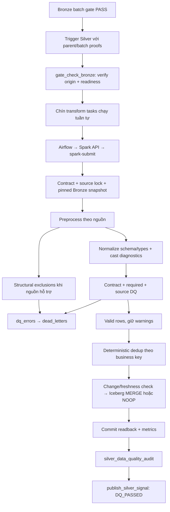

# Thuyết trình lớp Silver — luồng hoạt động thực tế của TLCN

Ngày đối chiếu code: **31/10/2026**. Branch `feat(gold)`, HEAD `cd2f1a77b27d5bcba6f1d925e3d9305952551bae`.

Đây là tài liệu giải thích để bảo vệ đồ án, nối tiếp [bài trình bày Bronze](../bronze/BRONZE_PRESENTATION.md). Nội dung dựa trên active code, chín YAML contracts và profile `local_nine`. Không chạy Spark, DAG, SQL hoặc đo lại dữ liệu runtime khi viết tài liệu này. Ví dụ số liệu trong bài là minh họa, không phải kết quả nghiệm thu mới.

## 1. Nối từ Bronze sang Silver: nên mở đầu như thế nào?

**Bạn có thể nói:**

> “Ở Bronze, em đã đưa dữ liệu từ file nguồn vào bảng Iceberg, giữ thông tin file, checksum và lần ingestion. Tuy nhiên dữ liệu vẫn khác nhau về tên cột, dạng bảng, đơn vị, mã định danh và cách biểu diễn giá trị thiếu. Silver là tầng chuẩn hóa những khác biệt đó, kiểm tra chất lượng theo từng nguồn và giữ một bản ghi hợp lệ theo business key để Gold sử dụng.”

Luồng tổng thể:

```text
Bronze đã có physical proof
    → Kiểm tra parent batch và pin Bronze snapshot
    → Spark preprocess theo nguồn
    → Normalize theo Silver contract
    → Kiểm tra DQ
    → Tách quarantine / warnings / structural exclusions
    → Dedup theo business key
    → Change-aware MERGE vào Iceberg Silver
    → Physical readback + audit + signal
    → Gold là workflow riêng, có admission/publication riêng
```

Đừng chỉ nói “Silver là làm sạch dữ liệu”. Hãy nói cụ thể **làm sạch điều gì, dựa vào quy tắc nào, bản ghi lỗi đi đâu và làm sao biết không làm mất quan sát**.

## 2. Silver giải quyết những vấn đề gì?

| Vấn đề đầu vào | Xử lý ở Silver |
|---|---|
| Tên cột khác nhau giữa các nguồn | Ánh xạ sang schema đích theo contract |
| Số, ngày và mã nguồn có cách biểu diễn khác nhau | Parse và chuẩn hóa có kiểm tra lỗi |
| Bảng wide, nhiều cột năm hoặc commodity | Unpivot thành observations ở grain xác định |
| Đơn vị khác nhau | Chuyển đổi theo mapping được hỗ trợ; lưu bằng chứng/raw fields khi contract có |
| NULL, blank, marker thiếu và 0 | Phân biệt trạng thái, không tự thay thiếu bằng 0 |
| Bản ghi sai schema/required fields/DQ | Quarantine hoặc chặn run tùy loại lỗi |
| Cùng business key xuất hiện nhiều lần | Kiểm tra xung đột riêng của nguồn rồi deterministic dedup |
| Chạy lại dữ liệu không đổi | Tránh MERGE commit không cần thiết |
| Bản ghi cũ đến sau | Freshness guard hạn chế ghi đè dữ liệu mới bằng dữ liệu cũ |
| Cần truy ngược dữ liệu | Giữ lineage Bronze và metadata xử lý Silver |

Silver vẫn giữ **source-scoped identities**. Nó chưa tạo một bộ mã địa lý/sản phẩm chung hoàn chỉnh cho tất cả nguồn, chưa biến paddy thành milled rice và chưa gộp mọi chỉ tiêu thành một bảng tổng hợp.

## 3. Em dùng những công nghệ nào?

| Thành phần | Vai trò trong Silver |
|---|---|
| Python / PySpark | Viết framework, transformers, audit và runner |
| Apache Spark / Spark SQL | Đọc Iceberg, unpivot, cast, DQ, Window dedup và MERGE |
| YAML contracts | Khai báo input/output, schema, business keys, partitions và DQ SQL |
| Apache Iceberg | Quản lý bảng, schema, snapshots và atomic commit trên từng bảng |
| MinIO | Lưu data files và metadata files của Iceberg |
| Iceberg REST Catalog | Tra cứu bảng và commit metadata/snapshot |
| Apache Airflow | Điều phối gate, chín transformations, audit và signal |
| HTTP Spark API trong runner | Nhận yêu cầu allowlisted từ Airflow và gọi `spark-submit` |
| PostgreSQL | Metadata ingestion/parent proof và source advisory locks; không phải kho chứa rows Silver chính |
| Trino | Đọc/kiểm tra Silver bằng SQL độc lập với Spark |
| Docker Compose / WSL2 | Chạy môi trường local `tlcn-local` |

**Điểm khác Bronze:** đường ghi Bronze hiện dùng pandas/Arrow/PyIceberg; đường xử lý Silver chính dùng **Spark DataFrame và Spark SQL**.

Trong local profile, API chạy Spark `local[2]`, `--driver-memory 768m`, tắt Spark UI. Đây là hai worker threads trên máy local, không phải hai máy worker. 768 MiB là driver JVM heap cấu hình, không phải tổng RAM tối đa của cả Python/JVM/process/container.

Spark session đặt timezone UTC, bật Adaptive Query Execution và mặc định tám shuffle partitions nếu không có override. Đây là cấu hình thực thi phù hợp local, không phải cam kết workload nào cũng vừa RAM.

## 4. Input và output hiện tại

Input: `iceberg.bronze.<source_id>`.

Output active profile: **`iceberg.silver_local.<target>`**.

YAML gốc vẫn ghi namespace `iceberg.silver`; [local_profile.py](../../src/silver/local_profile.py) tạo bản contract overlay trong memory để đổi sang `silver_local`. Không đọc YAML rồi kết luận runtime đang ghi vào `iceberg.silver`.

| Dataset ID | Target trong `iceberg.silver_local` | Cột nghiệp vụ trong contract | Business key |
|---|---|---:|---|
| `faostat_production` | `faostat_production` | 16 | `country_code, commodity_code, year, element_code` |
| `faostat_monthly_price` | `faostat_monthly_price` | 22 | `country_code, commodity_code, year, month_code, element_code` |
| `faostat_supply_utilization` | `faostat_supply_utilization` | 17 | `country_code, commodity_code, year, element_code` |
| `faostat_trade` | `faostat_trade` | 15 | `reporter_country_code, partner_country_code, commodity_code, year, element_code` |
| `usda_psd` | `usda_rice_psd` | 12 | `country, commodity, attribute, market_year` |
| `usda_rice_yearbook` | `usda_rice_yearbook` | 13 | `location, commodity_class, year, reference_period, statistic_type` |
| `worldbank_pinksheet` | `worldbank_commodity_monthly` | 12 | `commodity_code, period_date` |
| `thitruongnongsan` | `thitruongnongsan` | 12 | `market, commodity, price_type, unit, currency, source, date` |
| `nso` | `nso_rice_statistics` | 34 | `source_table, source_geography_key, year, measure, season, statistic_kind` |

Các bảng được partition theo `year`, riêng USDA PSD theo `market_year`. Các con số cột trên lấy từ YAML hiện tại, chưa tính lineage và `_dq_warnings`, `_silver_processed_at`.

**Business key** là các cột xác định một quan sát trong dataset. Ví dụ FAOSTAT production phải giữ `element_code` vì diện tích, sản lượng và năng suất cùng năm/country/product là các quan sát khác nhau.

Partition giúp tổ chức dữ liệu và hỗ trợ pruning khi query; không thay thế business key và không tự enforce uniqueness.

## 5. Sơ đồ chạy đầy đủ



Các nhánh lỗi không được bỏ qua để chạy tiếp. Signal Silver không phải Gold publication manifest và không tự trigger Gold trong DAG Silver hiện tại.

## 6. Bước 1 — Nhận bàn giao có bằng chứng từ Bronze

Files: [DAG Silver](../../dags/dag_silver_pipeline.py), [pipeline_tasks.py](../../src/ingestion/orchestration/pipeline_tasks.py).

DAG Silver tên **`rice_lakehouse_silver_pipeline`**, `schedule=None`, `catchup=False`, tối đa một active run và một active task. Local profile đặt retries bằng 0 để không tự chạy lại writer sau kết quả không rõ.

Bronze truyền `profile: local_nine`, `mode: full` và `bronze_batch`. Batch chứa parent DagRun ID, kết quả nguồn và physical identities của Bronze.

Gate kiểm tra:

1. Đúng profile và đúng child run ID xác định từ parent.
2. Parent Bronze DagRun tồn tại và còn ở trạng thái phù hợp trong lúc chờ child.
3. Task `verify_bronze_batch` của parent đã SUCCESS.
4. Batch truyền sang khớp XCom đã persist.
5. Persisted ingestion outcome và physical Bronze proof còn hợp lệ.
6. Các bảng/schema đầu vào đáp ứng readiness/transform requirements.

**Câu nói mẫu:** “Silver không được chạy chỉ vì Bronze table có tồn tại. Nó cần đúng parent batch, successful gate và snapshot proof. Như vậy bảng có dữ liệu cũ hoặc lần ingest dở dang không tự trở thành đầu vào được duyệt.”

## 7. Bước 2 — Airflow gửi công việc sang runner

Bridge: [orchestration.py](../../src/silver/orchestration.py). Server: [spark_api_server.py](../../jobs/silver/spark_api_server.py).

```text
transform_<dataset> trong Airflow
    → HTTP /health kiểm tra capability/profile
    → POST /run với job/dataset/mode/snapshot
    → Validate allowlist và tham số
    → JOB_LOCK
    → spark-submit run_all_silver.py
    → Nhận SILVER_RESULT + exit code
    → Trả metrics hoặc lỗi về Airflow
```

Local API chỉ nhận một dataset được duyệt trong một request và job `run_all_silver.py`. API dùng argument list khi gọi subprocess và serialize Spark jobs bằng lock, không tự chạy câu lệnh tùy ý từ UI.

Spark process có timeout; HTTP call cũng có timeout. Thành công cần exit code 0 và structured result, không chỉ có dòng log “đã chạy”. Đây là bridge nội bộ trong stack, không phải một Spark cluster/cloud service mới.

## 8. Bước 3 — Load và kiểm tra Silver contract

Files: [contract/loader.py](../../src/silver/contract/loader.py), thư mục [contracts/silver](../../contracts/silver/).

Ví dụ rút gọn từ contract production:

```yaml
contract_status: READY
dataset:
  bronze_input: iceberg.bronze.faostat_production
  silver_output: iceberg.silver.faostat_production
grain:
  business_key:
    - country_code
    - commodity_code
    - year
    - element_code
schema:
  columns:
    - name: country_code
      source_column: Area Code (M49)
      data_type: string
      nullable: false
    - name: value
      source_column: Value
      data_type: decimal(18,2)
      nullable: true
```

`validate_executable()` kiểm tra READY status, tên bảng/cột hợp lệ, không trùng cột, kiểu dữ liệu được hỗ trợ, business/partition keys tồn tại và DQ rules có `sql_expr`. Dedup key nếu khai báo phải khớp MERGE business key.

**Phân biệt registry và contract:** registry Bronze nói “đọc file gì, bằng adapter nào”; contract Silver nói “đầu ra là gì, một row mang ý nghĩa gì, cột nào bắt buộc và quy tắc nào phải đạt”.

Không phải mọi câu mô tả tự do trong YAML đều là chương trình thực thi. Framework dùng các trường có logic đọc cụ thể; nghiệp vụ phức tạp nằm trong transformer, còn DQ chạy từ `sql_expr`. Ví dụ mô tả cũ có chữ FULL_OVERWRITE không có nghĩa writer hiện xóa bảng: active writer dùng MERGE.

## 9. Bước 4 — Khóa nguồn và đọc đúng Bronze snapshot

Runner chính: [run_all_silver.py](../../jobs/silver/run_all_silver.py). Framework: [framework.py](../../src/silver/framework.py).

Trong local profile, runner:

1. Lấy PostgreSQL advisory lock theo Bronze source tương ứng.
2. Ghi nhận identity Silver trước xử lý để phục vụ recovery.
3. Kiểm tra Bronze snapshot hiện hành khớp proof truyền vào.
4. Framework đọc bằng `.option("snapshot-id", ...)`, không tự lấy một phiên bản latest khác giữa các bước.

Ví dụ ý tưởng tương đương đường code:

```python
bronze = (
    spark.read.format("iceberg")
    .option("snapshot-id", str(read_snapshot_id))
    .load(contract.bronze_input)
)
```

`full` đọc toàn bộ bảng Bronze ở snapshot đã pin, có thể gồm nhiều ingestion versions. Sau đó source rules/dedup quyết định quan sát hợp lệ. Không hiểu `full` là chỉ đọc rows của run mới nhất hay xóa Silver rồi thay thế.

Framework hỗ trợ `incremental` khi có `run_id` hoặc watermark; lọc `_ingestion_run_id` hoặc `_ingestion_timestamp`. Workflow local hiện bàn giao mặc định `mode: full`. Incremental read không có nghĩa mọi nghiệp vụ đều có thể kiểm tra chỉ trên subset; NSO vẫn đọc toàn pinned snapshot cho diagnostics/xung đột.

## 10. Bước 5 — Preprocess riêng theo nguồn

Framework import module **`silver.transformers.<dataset_id>`** và gọi class tương ứng. Ví dụ `faostat_production` dùng `faostat_production.py`, không mặc định dùng file legacy `faostat_production_transformer.py`.

Preprocess giải quyết khác biệt nguồn trước normalize chung:

| Nguồn | Logic cần giải thích |
|---|---|
| FAOSTAT production | Giữ M49/CPC, raw values, chuẩn đơn vị theo element, kiểm tra code/name, signed values và overflow |
| FAOSTAT monthly price | Phân biệt monthly/annual, monetary price/index, source currencies; không FX conversion |
| FAOSTAT SUA | Giữ long observations theo element; cho phép signed stock variation/residuals đúng quy tắc |
| FAOSTAT trade | Giữ reporter/partner M49, CPC, element; tách quantity tonnes và value `1000 USD` |
| USDA PSD | Unpivot crop-year columns; giữ market/crop year; scale đúng milling rate |
| USDA Yearbook | Chuẩn `DOLLARS PER METRIC TON` thành `USD/tonne`; giữ monthly/YEAR/MARKETING reference periods |
| World Bank | Unpivot commodity columns theo monthly period; giữ missing observations, phân loại unit từ header |
| Thị trường nông sản | Parse đúng ngày nguồn, số có dấu phân nhóm hợp lệ, chuẩn unit/currency và phát hiện competing quotes |
| NSO | Unpivot theo từng publication/layout, giữ source grain, geography evidence, units, missing và exclusions |

Một Bronze row có thể sinh nhiều Silver rows. Ví dụ **minh họa** bảng gồm một hàng commodity và ba cột crop-year sẽ tạo ba observations; nếu một ô là NULL nhưng thuộc series thật, không mặc định xóa observation đó.

## 11. Bước 6 — Normalize schema và kiểu dữ liệu

`framework.normalize()` dùng contract để:

- Ánh xạ tên cột nguồn sang tên cột đích.
- Trim strings trừ các trường có `preserve_whitespace`.
- Nhận diện missing tokens theo logic chung và logic nguồn.
- Dùng `try_cast` sang integer/date/decimal và kiểu tương ứng.
- Nếu thiếu cột bắt buộc: fail run.
- Nếu thiếu cột nullable: tạo NULL đúng kiểu.
- Nếu giá trị không thiếu nhưng cast thất bại: ghi `SYS_CAST_ERR`.

Ví dụ production: cột Bronze đã sanitize là `area_code_m49_`; contract ánh xạ `Area Code (M49)` sang `country_code`. Dấu `_` cuối là kết quả thực của sanitizer hiện tại.

Ví dụ **minh họa**, với numeric field:

| Input | Ý nghĩa và xử lý |
|---|---|
| `"125.50"` | Parse được thành decimal |
| `"0"` | Giá trị số 0, không phải missing |
| NULL hoặc missing token được hỗ trợ | Giữ thiếu; chấp nhận nếu contract/source rules cho phép |
| `"abc"` | Không phải numeric hợp lệ; cast error/source rule, không âm thầm coi là missing hợp lệ |

Framework còn ngăn numeric fractional bị cast sang integer bằng truncation mà không báo lỗi; float NaN/infinity không được coi như numeric hợp lệ.

Decimal giúp biểu diễn số theo precision/scale xác định. Không hứa mọi nguồn giữ vô hạn chữ số: production có `decimal(18,2)`, NSO `decimal(28,8)` và NSO kiểm tra precision loss riêng.

## 12. Bước 7 — Chạy Data Quality theo ba nguồn quy tắc

File: [engine/quality.py](../../src/silver/engine/quality.py).

Rules gồm:

1. DQ rules có `sql_expr` trong YAML contract.
2. System required rules cho business keys và `nullable: false` columns.
3. Source rules từ `transformer.quality_rules()`.

Cast errors được ghép vào blocking errors. Mỗi lỗi có `rule_id`, `error_message`, `failed_column`.

| Action | Hành vi thực tế |
|---|---|
| `QUARANTINE` hoặc mặc định | Rule fail đưa vào `dq_errors`, row không vào tập valid |
| `LOG` | Giữ row hợp lệ nếu không có blocking errors; lưu `_dq_warnings` |
| `KEEP` | Trong engine hiện tại cũng ghi warning khi fail, không bypass rule một cách im lặng |

DQ dùng `coalesce(predicate, false)`: biểu thức SQL trả NULL/UNKNOWN sẽ bị coi là không đạt. Nếu NULL là hợp lệ, rule phải nói rõ, ví dụ `value >= 0 OR value IS NULL`.

**Ví dụ:** production âm là lỗi; SUA stock variation âm có thể hợp lệ; giá thị trường bằng 0 được giữ kèm warning. Không áp một rule “mọi số âm/0 đều sai” lên mọi dataset.

Warning count là số rows có ít nhất một warning, không phải tổng số warning events. Row có warning vẫn có thể có blocking error khác; không dùng warning count như một nhóm rows rời với quarantine.

## 13. Bước 8 — Tách quarantine và structural exclusions

File: [engine/quarantine.py](../../src/silver/engine/quarantine.py).

Trong local framework, bảng dead letters là **`iceberg.silver_local.dead_letters`**. Nó giữ:

```text
quarantine_record_id
source_dataset
pipeline_run_id
detected_at
business_key_hash
errors
payload
```

Payload chứa normalized context và original Bronze payload để debug, giữ NULL trong JSON. Valid output không mang nguyên wide payload này vào bảng chính.

Quarantine ID được tạo xác định từ dataset/payload. Cùng record và errors đã lưu thì không cần MERGE lại; errors thay đổi có thể update diagnostic. Không xóa dữ liệu Bronze để “dọn lỗi”.

**Structural exclusions khác missing measurements:** với NSO, hàng trống hoàn toàn hoặc footer chỉ NUL không tạo observation nghiệp vụ. Framework lưu exclusion record qua dead-letter manager với `source_dataset = 'nso_exclusions'`, và có metrics đối soát riêng. Trong đường ghi hiện tại đây là nhãn dataset trong bảng dead letters, không mặc định một physical table `nso_exclusions` riêng.

Một ô thiếu trong một row/series thật không được loại chỉ vì giá trị NULL. Unknown geography hợp lệ cũng không bị loại chỉ vì chưa có official geography code.

**Khác Bronze quarantine:** Bronze validation diagnostic ở PostgreSQL `ingestion.dead_letter_records`; Silver observation quarantine ở Iceberg `silver_local.dead_letters`. Không gộp hai nơi này thành một bảng.

## 14. Bước 9 — Dedup theo business key

File: [engine/merge.py](../../src/silver/engine/merge.py), phương thức `deduplicate()`.

Spark dùng Window:

```text
PARTITION BY business keys
ORDER BY ingestion timestamp mới trước,
         source file giảm dần,
         các trường còn lại làm tie-break xác định
→ giữ row_number = 1
```

Không cộng các row trùng rồi gọi đó là dedup; cũng không lấy row ngẫu nhiên. `_silver_processed_at` không dùng làm tie-break để tránh processing time thay đổi kết quả.

**Giới hạn:** timestamp ingestion không chứng minh publication nào đúng hơn về nghiệp vụ. NSO chặn conflicting observations trước shared dedup; thị trường nông sản quarantine competing valid prices trong cùng quote key. Vì vậy không mô tả mọi conflict đều được giải quyết bằng “lấy mới nhất”.

## 15. Bước 10 — Change-aware, freshness-aware MERGE

`IcebergMergeEngine.merge()` kiểm tra schema target; nếu bảng đã tồn tại mà thiếu cột/khác kiểu thì fail và yêu cầu migration rõ ràng, không tự sửa schema tùy ý.

Với target mới, code tạo Iceberg format v2, Parquet ZSTD và partition theo contract. Sau đó áp dụng:

| Trường hợp | Kết quả |
|---|---|
| Business key chưa tồn tại | INSERT |
| Key tồn tại, input đủ mới và có thay đổi | UPDATE |
| Key tồn tại nhưng input cũ hơn | Không ghi đè target mới hơn |
| Source/audit/warnings không đổi | Không UPDATE |
| Không có bất kỳ thay đổi đủ điều kiện | Return trước MERGE để tránh empty commit |
| Key trong Silver không có ở input mới | Giữ lại, không DELETE |

So sánh thay đổi dùng NULL-safe equality và **bỏ qua `_silver_processed_at`**. Nếu chỉ giờ xử lý đổi, không tạo snapshot mới. Nếu lineage hoặc warnings thay đổi, code vẫn có thể ghi dù numeric value giống.

MERGE dùng một Spark temporary view làm quan hệ đầu vào rồi drop view sau xử lý. Đây là chi tiết nội bộ, không phải persisted semantic view của Gold.

Atomicity ở mức **một Iceberg table commit**. Target creation, quarantine/exclusions và MERGE là các transaction khác nhau; toàn bộ chín nguồn không có distributed atomic transaction.

**NOOP** nghĩa là tránh ghi khi dữ liệu liên quan không đổi. Muốn chứng minh physical NOOP phải so UUID, snapshot, metadata location và data-file set trước/sau; chỉ nhìn row count bằng nhau là chưa đủ.

## 16. Bước 11 — Readback, reconciliation, audit và signal

Sau framework run, local runner đọc lại table identity và số rows để đưa vào `commit_verified`. Nếu exception, recovery context giữ stage, target trước/sau nếu đọc được và `commit_outcome: UNKNOWN`; yêu cầu catalog readback trước retry.

Metrics trả về gồm `bronze_read_snapshot_id`, `bronze_count`, `prepared_count`, `valid_count`, `quarantine_count`, `warning_count`, `dedup_count`, `duplicate_count`. NSO có thêm observation/exclusion metrics.

Các đẳng thức audit quan trọng:

```text
prepared_count = valid_count + quarantine_count
valid_count    = dedup_count + duplicate_count

Nguồn có observation audit:
observation_count = prepared_count + excluded_count
```

Ví dụ **minh họa**: 100 prepared observations, 5 quarantined → 95 valid; 3 valid duplicates bị loại → 92 dedup survivors. Phải giải trình được 100 = 95 + 5 và 95 = 92 + 3.

Đây là đối soát xử lý batch; **target row count không nhất thiết bằng dedup_count** vì target có thể giữ lịch sử keys không xuất hiện trong input mới.

`silver_data_quality_audit` kiểm tra các đẳng thức rồi gọi [audit.py](../../src/silver/audit.py) đọc persisted Silver:

- Column types khớp contract.
- Required fields và keys không NULL.
- Không trùng business key.
- Không vi phạm blocking SQL rules từ contract.

Lưu ý: persisted audit hiện chạy blocking **contract** rules; toàn bộ source-specific helper rules được áp dụng ở transformation, không mặc định đều được audit này chạy lại trên target. Đẳng thức counts không thay thế exact value/NULL/unit reconciliation của các bước nghiệm thu sâu hơn.

Nếu audit đạt, `publish_silver_signal` trả `silver_status: DQ_PASSED`, danh sách datasets/profile và trạng thái acceptance `CLI_AND_OWNER_REQUIRED`. Signal này không tự biến thành published Gold batch và không tự khởi chạy Gold.

## 17. Những nghiệp vụ theo nguồn thầy có thể hỏi sâu

### FAOSTAT production: tại sao phải giữ element và unit?

Một `value` có thể là diện tích, sản lượng hoặc năng suất:

| Element | Chỉ tiêu | Đơn vị Silver và chuyển đổi được hỗ trợ |
|---|---|---|
| `5312` | Area harvested | `ha/hectare → hectare` |
| `5510` | Production | `t/tonne → tonne`; `kg × 0.001 → tonne` |
| `5412` | Yield | `kg/ha → kg/hectare`; `hg/ha × 0.1`; `t/ha × 1000` |

Không SUM chung ba chỉ tiêu. M49 giữ dạng source code ba chữ số, không tự chuyển thành ISO3. CPC `0113` và `23161.02` được giữ khác nhau; code có sửa lại identity `113 → 0113` đã được nhận diện do numeric inference ở Bronze, không tự pad mọi product code.

### FAOSTAT monthly price, SUA và Trade

- Price: month code `7001–7012` là tháng, `7021` là annual value; producer price index không phải monetary price, không tự FX giữa LCU/SLC/USD.
- SUA: codes `5071` Stock Variation và `5166` Residuals có thể âm hợp lệ; negative residual có warning. Các element khác vẫn theo rule riêng, không `abs()` để làm sạch.
- Trade: reporter và partner là hai vai trò khác nhau; import/export quantity (`5610/5910`) khác import/export value (`5622/5922`). Value còn ở `1000 USD` trong Silver, không đọc nhầm thành USD/tonne. Không SUM mirrored flows để tạo tổng thương mại thế giới.

### USDA PSD và Yearbook

- PSD giữ `market_year` và `crop_year`, không giả định marketing year là calendar year.
- Attribute chính xác `Milling Rate (.9999)` dùng factor `0.0001` để thành `fraction`; giữ `value_source`, `source_unit`, `conversion_factor` để đối soát. Không nhân/chia lại lần nữa ở tầng sau.
- PSD quantities giữ đơn vị nguồn theo rule; không mặc định mọi giá trị là tonnes.
- Yearbook giữ `reference_period` gồm tháng, `YEAR`, `MARKETING`; không biến giá annual/marketing thành monthly bằng cách tự đặt ngày.

### World Bank và giá trong nước

- World Bank chỉ bỏ synthetic `Commodity_N` columns đã chứng minh hoàn toàn NULL; named price series có missing vẫn là series thật. `period_date` ngày 01 đại diện tháng, không chứng minh đó là ngày giao dịch hoặc ngày công bố.
- Giá trong nước có quote key gồm market/commodity/price type/unit/currency/source/date. Cùng ngày và commodity chưa đủ để gọi là duplicate. Hai valid prices cạnh tranh trong cùng exact key bị quarantine, không tự AVG.
- Date parser dùng định dạng nguồn đã kiểm tra `M/d/yyyy h:mm:ss a` và ISO fallback, không đoán `dd/MM` theo ngôn ngữ giao diện.

### NSO: phần nên giải thích kỹ nhất

NSO contract canonical là [nso.yaml](../../contracts/silver/nso.yaml), transformer là [nso.py](../../src/silver/transformers/nso.py), metadata được pin ở [nso_v2_metadata.json](../../config/silver/nso_v2_metadata.json).

Grain: **publication × source geography × year × measure × season × statistic kind**.

Các điểm phải giữ:

1. `source_table` như `V06.12.csv` là identity publication, không được bỏ rồi gộp với V06.14.
2. `measure`: `area/production/yield`; `season`: annual hoặc vụ; `statistic_kind`: `quantity/development_index`. Không trộn chúng thành tổng chung.
3. Quantity area/production nhân 1000 để thành hectare/tonne; yield nhân 100 để thành kg/hectare; development index factor 1, unit percent. Đây là mapping NSO đã duyệt, không áp hệ số này cho mọi nguồn.
4. `value_raw`, `value_source`, `conversion_factor`, `value` giải thích được quá trình chuẩn hóa. `source_null`, `source_blank`, `source_marker_unspecified` khác số 0.
5. Geography enums lowercase `national/region/province/unknown`. Candidate label chưa phải official province mapping; `geography_code` và `boundary_version` để NULL.
6. V06.12 national scope có key `__national_table_scope__`; các bảng geography dùng key `raw:` cộng SHA-256 của exact raw label. Đây là identity nguồn, không phải mã tỉnh hành chính.
7. `release_status` là `provisional` hoặc `unconfirmed`, không tự gắn FINAL vì pipeline chạy thành công.
8. `preprocess()` thông thường bị chặn: NSO cần `preprocess_with_read_context()` nhận snapshot binding thật, trả `bronze_read_snapshot_id` và dùng cùng snapshot cho diagnostics.
9. Checksum/schema/metadata mapping thay đổi chưa được duyệt sẽ chặn xử lý. Conflicting source observations không tự chọn bằng ingestion timestamp.
10. Discrepancies/candidate geography cần review có thể giữ kèm LOG warnings; không sửa measurements để ép các publication khớp nhau.

NSO diagnostics có collect nhưng chỉ lấy dữ liệu gọn và có capacity gate 100.000 rows; vượt ngưỡng sẽ fail để reprofile. Không tuyên bố Silver hoàn toàn không collect hoặc không có giới hạn bộ nhớ.

NSO source rules hiện yêu cầu tám Bronze lineage fields không NULL/rỗng. `_source_snapshot_id` trong lineage vẫn không phải Iceberg read snapshot ID; không thay NULL bằng số bịa để vượt rule. Nếu upstream proof/lineage thiếu phải xử lý compatibility đúng protocol trước khi chạy, không giả định mọi bản Bronze tương lai tự được chấp nhận.

## 18. File/folder nào có vai trò gì?

| Đường dẫn | Trách nhiệm |
|---|---|
| [contracts/silver/](../../contracts/silver/) | Chín executable contracts |
| [src/silver/contract/loader.py](../../src/silver/contract/loader.py) | Đọc/validate contracts |
| [src/silver/local_profile.py](../../src/silver/local_profile.py) | Whitelist chín nguồn, namespace overlay, profile/fingerprint guards |
| [src/silver/framework.py](../../src/silver/framework.py) | Pipeline chung từ read pin đến preprocess/DQ/quarantine/dedup/MERGE |
| [src/silver/transformers/](../../src/silver/transformers/) | Nghiệp vụ nguồn; module active là `<dataset_id>.py` |
| [src/silver/engine/quality.py](../../src/silver/engine/quality.py) | SQL DQ, cast errors, warnings |
| [src/silver/engine/quarantine.py](../../src/silver/engine/quarantine.py) | Dead-letter payload/identity và replay-safe writes |
| [src/silver/engine/merge.py](../../src/silver/engine/merge.py) | Window dedup, freshness/change-aware MERGE |
| [src/silver/core/spark_session.py](../../src/silver/core/spark_session.py) | Spark/Iceberg/MinIO connection config |
| [src/silver/audit.py](../../src/silver/audit.py) | Bronze readiness và persisted Silver audit |
| [src/silver/orchestration.py](../../src/silver/orchestration.py) | HTTP bridge từ Airflow |
| [jobs/silver/run_all_silver.py](../../jobs/silver/run_all_silver.py) | CLI runner, lock, pin, commit/recovery context |
| [jobs/silver/spark_api_server.py](../../jobs/silver/spark_api_server.py) | API allowlist, serial Spark process, structured response |
| [jobs/silver/verify_silver_trino.py](../../jobs/silver/verify_silver_trino.py) | Verifier SQL qua Trino; không phải transformer |
| [dags/dag_silver_pipeline.py](../../dags/dag_silver_pipeline.py) | Gate, chín source tasks, audit, signal |

Các `job_<source>.py` là entrypoint wrappers. Thư mục `core/` và các files hậu tố `_transformer.py` còn có thành phần legacy/compatibility; đừng chỉ dựa tên file để giải thích nó là active dispatch hoặc xóa đi.

Các scripts hỗ trợ:

- [validate_silver_contracts.py](../../scripts/validate_silver_contracts.py): kiểm tra contracts ở phạm vi script, không phải job ETL chính.
- [validate_silver_local_snapshots.py](../../scripts/validate_silver_local_snapshots.py): fixture/local snapshot validation; có thể tạo/ghi tài nguyên test theo script, không gọi là live read-only inspection rồi chạy tùy ý.
- [validate_silver_e2e.py](../../jobs/silver/validate_silver_e2e.py): công cụ nghiệm thu có các kiểm tra sâu hơn; đọc phạm vi và namespace trước khi thực thi.

## 19. Lỗi, recovery và giới hạn phải nói trung thực

| Tình huống | Hành vi cần giải thích |
|---|---|
| Sai parent batch hoặc Bronze pin drift | Chặn trước xử lý hợp lệ |
| Thiếu required source column/contract chưa READY | Fail; không tự thêm dữ liệu bịa |
| Row cast/DQ lỗi | Quarantine nếu thuộc row-level rules |
| Structural row NSO | Exclude có diagnostic và reconciliation, không tính như missing observation |
| Source conflict không có precedence được duyệt | Chặn hoặc quarantine theo rule nguồn |
| Quarantine commit xong, Silver MERGE fail | Partial multi-table state; giữ evidence để recovery |
| MERGE có thể commit nhưng client mất response | Outcome UNKNOWN, đọc catalog trước retry; local tasks không tự retries |
| Raw FULL mới không có một key cũ | Silver hiện giữ key, không tự source withdrawal |
| Query/cache/job quá tài nguyên | Fail và bảo toàn evidence, không đồng nghĩa được reset/drop để chạy lại |

Framework persist các DataFrames cần tái sử dụng ở `MEMORY_AND_DISK` và unpersist trong `finally`. Nó giảm tính toán lại nhưng vẫn có chi phí RAM/disk/shuffle; không hứa toàn dataset luôn nằm RAM hoặc không bao giờ spill.

Source locks chỉ ngăn các writers cùng tuân thủ protocol. Iceberg logical PK/FK/uniqueness không được tự enforce như database constraint; tests/audit mới là nơi kiểm tra các điều kiện này.

## 20. Bằng chứng kiểm thử để chỉ cho thầy

| Tests | Nội dung |
|---|---|
| [test_silver_contract_loader.py](../../tests/unit/test_silver_contract_loader.py) | Contract schema và executable gates |
| [test_silver_quality_engine.py](../../tests/unit/test_silver_quality_engine.py) | Blocking rules, warnings, SQL UNKNOWN |
| [test_silver_quarantine.py](../../tests/unit/test_silver_quarantine.py) | Dead-letter behavior |
| [test_silver_merge_engine.py](../../tests/unit/test_silver_merge_engine.py) | Dedup, update/insert/freshness và replay |
| [test_silver_orchestration.py](../../tests/unit/test_silver_orchestration.py) | Bridge/orchestration |
| [test_silver_trino_verifier.py](../../tests/unit/test_silver_trino_verifier.py) | Contract-compatible NSO verification |
| [test_nso_v2_semantics.py](../../tests/unit/silver/test_nso_v2_semantics.py) | Source grain, missing, units/geography và evidence |
| [test_usda_milling_rate.py](../../tests/unit/silver/test_usda_milling_rate.py) | PSD conversion |
| [test_faostat_nso_transformers.py](../../tests/unit/silver/test_faostat_nso_transformers.py) | Source transformations |
| [test_local_nine_dags.py](../../tests/unit/test_local_nine_dags.py) | Local routing/DAG scope |

Acceptance cũ có phạm vi/bằng chứng riêng: [foundation acceptance](../foundation/ACCEPTANCE.md), [failure/recovery policy](../foundation/RECOVERY.md), [test environments](../foundation/TESTING.md). Không biến kết quả fixtures/mock thành physical acceptance mới. Bài viết này không chạy lại tests hoặc tuyên bố các snapshot hiện tại vừa được nghiệm thu.

## 21. Kịch bản demo read-only khi bảo vệ

1. Nhắc ngắn gọn Bronze đã có file lineage và snapshot proof.
2. Mở `contracts/silver/faostat_production.yaml`: chỉ input, output, key, type, DQ và partition.
3. Mở `framework.run()`: đi theo đúng preprocess → normalize → DQ → quarantine → dedup → MERGE.
4. Mở transformer production để chỉ conversion, rồi `engine/merge.py` để chỉ business key và NOOP check.
5. Mở Airflow `http://localhost:8085`, xem run có sẵn của DAG Silver và logs; không tự trigger DAG mới.
6. Dùng SQL client đã cấu hình để xem schema/sample. Trino tại `http://localhost:18080` là Web UI/query history, không mặc định có SQL worksheet.

Các SQL gợi ý sau **chưa được chạy trong lần viết tài liệu**, chỉ thực thi khi runtime được phép đọc và đủ tài nguyên:

```sql
DESCRIBE iceberg.silver_local.faostat_production;

SELECT country_code, commodity_code, year, element_code,
       value, unit, value_raw, unit_raw, missing_reason,
       _source_file, _ingestion_run_id, _silver_processed_at
FROM iceberg.silver_local.faostat_production
LIMIT 5;
```

Ví dụ kiểm tra duplicate keys có giới hạn phạm vi năm để demo nhẹ hơn; nó chỉ chứng minh phạm vi được lọc, không phải toàn bộ lịch sử:

```sql
SELECT country_code, commodity_code, year, element_code, count(*) AS n
FROM iceberg.silver_local.faostat_production
WHERE year = 2024
GROUP BY country_code, commodity_code, year, element_code
HAVING count(*) > 1;
```

Ví dụ chỉ NSO identity/units để giải thích publication khác nhau:

```sql
SELECT source_table, source_geography_key, geography_level,
       year, measure, season, statistic_kind,
       value_source, conversion_factor, value, unit,
       missing_reason, release_status, bronze_read_snapshot_id
FROM iceberg.silver_local.nso_rice_statistics
WHERE source_table = 'V06.12.csv'
  AND geography_level = 'national'
  AND season = 'annual'
  AND statistic_kind = 'quantity'
  AND year = 2024
LIMIT 10;
```

Không dùng `LIMIT` để kết luận full reconciliation PASS; không phô credentials/env values trong slide hoặc log demo. Không tạo writes để minh họa khi dữ liệu đã có baseline được nghiệm thu.

## 22. Câu hỏi phản biện và câu trả lời gợi ý

**“Bronze đã có bảng rồi, cần Silver làm gì?”**

> “Bronze mới thống nhất cách lưu và truy vết, còn giá trị/cấu trúc vẫn theo nguồn. Silver chuyển về schema có business grain, types, units và DQ rõ ràng để Gold không phải giải quyết lại từng lỗi định dạng.”

**“Có phải Silver xóa hết NULL?”**

> “Không. Missing observation có thể hợp lệ. Em giữ missing reason và NULL, còn lỗi parse hoặc required key thiếu sẽ bị xử lý riêng. Số 0 không được thay bằng NULL và NULL không được thay bằng 0.”

**“Vì sao số dòng Bronze và Silver khác nhau?”**

> “Một row wide có thể chứa nhiều observations; ngoài ra có exclusions, quarantine và duplicate handling. Em đối soát candidate/prepared/valid/quarantine/dedup counts ở đúng grain, không ép tổng rows của hai tầng phải bằng nhau.”

**“Dữ liệu trùng thì em giữ row nào?”**

> “Shared engine dùng business key và deterministic ordering ưu tiên ingestion timestamp. Nhưng source conflicts có rule riêng: NSO không dùng ingestion time làm publication precedence; competing market quotes cũng không tự lấy AVG.”

**“Chạy full có xóa Silver cũ không?”**

> “Không. Full là phạm vi đọc Bronze. Writer hiện dùng upsert MERGE và giữ keys không có trong input mới. Source withdrawal cần quyết định retention riêng.”

**“Tại sao không dùng pandas cho Silver?”**

> “Silver có unpivot, Window dedup, join/DQ và Iceberg MERGE trên dữ liệu lớn hơn từng chunk. Em dùng Spark để thực thi DataFrame/SQL cùng Iceberg integration; môi trường này chạy local[2] để phù hợp laptop.”

**“Bảng có PK thì Iceberg tự chặn duplicate không?”**

> “Business key là logical contract. Framework dedup và persisted audit kiểm tra uniqueness; em không coi Iceberg như database tự enforce primary key.”

**“Một nguồn lỗi thì các nguồn đã chạy có rollback không?”**

> “Không có transaction chung cho chín nguồn và quarantine tables. Các commits đã xảy ra được giữ lại, workflow fail và cung cấp recovery context. Vì vậy downstream phải kiểm tra snapshot/batch proof, không chỉ nhìn table existence.”

**“Unknown geography có nghĩa dữ liệu sai không?”**

> “Không nhất thiết. NSO giữ exact source geography key, candidate label và trạng thái review. Chưa có official mapping thì để mã/boundary NULL, không tự bịa để làm schema có vẻ đầy đủ.”

**“Silver PASS là có thể đọc latest để làm báo cáo luôn?”**

> “Silver audit là điều kiện chất lượng của tầng này. Báo cáo dự án dùng Gold published snapshots qua consumer gate riêng; không tự đổi sang latest Silver/Gold để bỏ qua publication.”

## 23. Bài nói liền mạch khoảng ba đến bốn phút

> “Sau Bronze, dữ liệu đã được lưu thành bảng Iceberg và có thông tin truy vết, nhưng vẫn mang cấu trúc và cách biểu diễn riêng của từng nguồn. Vì vậy em xây Silver để chuẩn hóa schema, đơn vị, thời gian, business keys và kiểm tra chất lượng trước khi đưa sang Gold.
>
> Silver sử dụng Spark và chạy qua DAG `rice_lakehouse_silver_pipeline`. DAG không tự chạy theo lịch trong profile local. Bronze phải truyền parent batch và physical snapshot proofs; Silver kiểm tra lại gate, XCom và identities trước khi nhận dữ liệu. Sau đó Airflow gửi từng dataset sang API nội bộ của runner để gọi spark-submit. Các jobs được chạy tuần tự để phù hợp laptop.
>
> Mỗi nguồn có một YAML contract, khai báo bảng Bronze đầu vào, bảng Silver đầu ra, kiểu dữ liệu, nullable fields, business keys và DQ rules. Profile local đổi namespace output thành `iceberg.silver_local`. Runner khóa source và đọc đúng Bronze snapshot đã được bàn giao, thay vì tùy ý đọc một latest version khác.
>
> Trong framework, bước đầu là preprocess riêng từng nguồn. Ví dụ FAOSTAT chuẩn hóa mã và đơn vị; World Bank và USDA PSD tách bảng wide thành observations; NSO giữ publication, geography, mùa vụ và loại thống kê. Sau đó normalize chung ánh xạ tên cột và cast theo contract. Giá trị không thiếu nhưng cast lỗi phải được ghi nhận, không âm thầm biến thành missing hợp lệ.
>
> Tiếp theo, DQ chạy các rules từ contract, required fields và transformer. Blocking errors đưa row vào dead letters; warnings được giữ trên row; structural exclusions có đối soát riêng. Em không xóa NULL, không tự thay giá thiếu thành 0 và không gộp annual với seasonal.
>
> Tập valid được dedup theo business key bằng thứ tự xác định. Writer dùng Iceberg MERGE để insert key mới và update dữ liệu thay đổi đủ mới. Nếu dữ liệu, lineage và warnings không đổi, engine tránh MERGE để không tạo snapshot thừa. Các keys biến mất trong input không tự bị xóa khỏi Silver.
>
> Cuối cùng runner đọc lại table identity, DAG kiểm tra các đẳng thức prepared, valid, quarantine và dedup rồi audit schema, required fields, unique keys và contract DQ trên dữ liệu đã lưu. Chỉ khi đạt mới phát signal DQ_PASSED. Gold vẫn là một workflow riêng, có snapshot admission và publication protocol riêng.
>
> Em không khẳng định toàn bộ Silver là một transaction. Quarantine và từng target có commits riêng; nếu lỗi giữa chừng phải giữ evidence và recovery có kiểm chứng. Mục tiêu của em là dữ liệu chuẩn hóa có thể giải trình và đối soát được, không chỉ có một task màu xanh.”

## 24. Checklist trước khi bảo vệ

- Nói được Silver khác Bronze ở đâu và không nhầm schema Silver với Gold.
- Nhớ namespace đang dùng là `iceberg.silver_local`.
- Phân biệt source registry, Silver contract và transformer.
- Kể đúng chuỗi pin → preprocess → normalize → DQ → quarantine → dedup → MERGE → audit.
- Giải thích được grain, business key, partition, NULL/0 và warning/error.
- Hiểu vì sao unpivot làm số rows thay đổi và dùng đúng reconciliation equations.
- Biết NSO giữ source publication, geography key, seasonal/statistic identity và pinned snapshot.
- Không double-convert NSO/PSD units; không gộp stock/flow hoặc currencies.
- Không hứa FULL là replace, MERGE là transaction toàn pipeline hay Iceberg tự enforce PK.
- Có thể mở đúng active code và chỉ historical acceptance mà không tuyên bố vừa chạy lại runtime.
