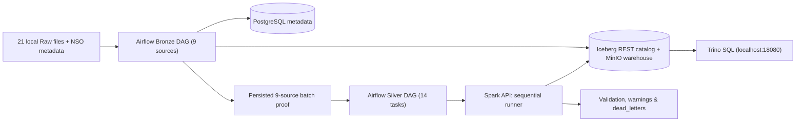

# Kiến trúc Local Rice Lakehouse (`tlcn-local`)

Hệ thống sử dụng một cấu hình Docker Compose duy nhất ([`compose.yaml`](../../compose.yaml)) với project name `tlcn-local` và profile `local_nine`. Toàn bộ dữ liệu đầu ra của tầng Silver trong môi trường local được ghi vào namespace `iceberg.silver_local`.

## 1. Lưu trữ & Thực thi (Storage and Execution)

- **MinIO (`minio`)**: Lưu trữ các bản sao Raw archive của tầng Bronze và các file Parquet/metadata của Apache Iceberg trong bucket `s3://warehouse/`. Giao diện quản trị MinIO Console được publish tại `http://localhost:9001` (S3 API `9000` chỉ dùng nội bộ trong mạng Docker).
- **Iceberg REST Catalog (`iceberg-rest`)**: Quản lý metadata bảng Iceberg bằng SQLite bền vững trong volume `local_catalog_data`.
- **PostgreSQL (`postgres`)**: Lưu trữ metadata của Airflow và lịch sử chạy ingestion (`ingestion.ingestion_runs`, `ingestion.Dataset_registry`), được gắn vào volume `local_postgres_data`.
- **Spark Runner (`runner`)**: Cung cấp HTTP API nội bộ (`http://runner:5005/run`) để chạy tuần tự từng job biến đổi Silver (`jobs/silver/job_*.py`, bao gồm `jobs/silver/job_nso.py`) với `local[2]` và bộ nhớ driver `768m`.
- **Trino (`trino`)**: Kết nối trực tiếp tới Iceberg REST Catalog và MinIO để phục vụ truy vấn SQL kiểm chứng tại `http://localhost:18080`.
- **Bốn Named Volumes bền vững**: `local_minio_data`, `local_postgres_data`, `local_catalog_data` và `local_airflow_logs` đảm bảo việc dừng (`stop.ps1`) và mở lại (`start.ps1`) không làm mất dữ liệu.

## 2. Điều phối & An toàn Dữ liệu (Orchestration and Safety)

- Cả 2 DAG (`rice_lakehouse_ingestion` và `rice_lakehouse_silver_pipeline`) đều được cấu hình `schedule=None`, `catchup=False`, `max_active_runs=1`, `max_active_tasks=1`, và `retries=0`.
- Danh sách 9 nguồn dữ liệu được định nghĩa tường minh trong [`src/silver/local_profile.py`](../../src/silver/local_profile.py):
  - `faostat_production`, `faostat_monthly_price`, `faostat_supply_utilization`, `faostat_trade`
  - `usda_psd`, `usda_rice_yearbook`, `worldbank_pinksheet`, `thitruongnongsan`, `nso`
- **Cơ chế chống chạy trùng (Checksum & Batch Proof)**: Khi file Raw không thay đổi, bước ingestion có thể trả về trạng thái `SKIPPED` sau khi đối chiếu checksum và xác nhận snapshot/số dòng thực tế của bảng Iceberg Bronze. Task `verify_bronze_batch` kiểm tra đủ 9 nguồn trước khi `trigger_silver_release` sinh `dag_run_id` tất định cho DAG Silver.
- **Khóa tư vấn & Snapshot Pinning**: Mỗi job Silver giữ PostgreSQL advisory lock theo từng nguồn, ghim chính xác `bronze_snapshot_id` đã xác thực và từ chối tự động thay đổi schema nếu phát hiện xung đột.

## 3. Truy vết nguồn gốc (Provenance) & Tính chất Idempotent NOOP

- Mọi bảng Silver đều giữ nguyên 8 cột audit từ tầng Bronze: `_ingestion_run_id`, `_ingestion_batch_id`, `_ingestion_chunk_id`, `_ingestion_timestamp`, `_source_id`, `_source_file`, `_source_checksum`, `_source_snapshot_id`.
- Riêng nguồn `nso` (`nso_rice_statistics`) lưu thêm cột `bronze_read_snapshot_id` (`BIGINT`) phản ánh đúng snapshot Iceberg Bronze mà Spark reader đã đọc.
- Thao tác `MERGE` vào bảng Silver và bảng `dead_letters` so sánh toàn bộ giá trị nghiệp vụ, DQ warnings và lineage (loại trừ `_silver_processed_at` mới sinh). Nếu toàn bộ dữ liệu không đổi khi chạy lại (replay), framework bỏ qua lệnh ghi để không tạo ra snapshot Iceberg thừa (strict physical NOOP).
- Xem thêm chi tiết tại [Data Catalog](data_catalog.md), [Quy tắc làm sạch](cleaning_rules.md), [Đặc tả Schema](schemas.md) và [Hướng dẫn vận hành](demo_guide.md).
