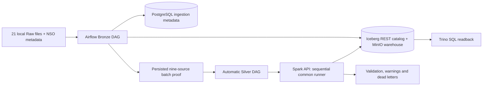

# Local Rice Lakehouse architecture

The local profile is `local_nine`; its output namespace is
`iceberg.silver_local`. It extends the existing Bronze and Silver DAGs and common
runner. It does not activate the eight-source shared release or production.

## Storage and execution

- MinIO stores archived Raw artifacts and Iceberg Parquet/metadata objects.
  The warehouse is `s3://warehouse/`; there is no separate database copy of Silver.
- The REST catalog uses persistent SQLite metadata in the isolated catalog
  volume. PostgreSQL stores Airflow and ingestion tracking; it is not the Iceberg
  REST catalog database in this local configuration.
- Spark performs normalization, DQ, deduplication and Iceberg MERGE.
  The API serializes jobs and launches `local[2]`, driver 768 MiB.
- PyIceberg provides independent native scans; Trino reads the same REST catalog
  and objects for SQL validation.
- Four project-scoped volumes preserve PostgreSQL, MinIO, catalog and Airflow
  logs. A new Compose project name creates independent storage.

## Orchestration and safety

Both DAGs have `schedule=None`, `catchup=False`, `max_active_runs=1`,
`max_active_tasks=1`; approved local tasks use `retries=0`. Sources are explicit
in [local_profile.py](../../src/silver/local_profile.py), not inferred from every
enabled registry entry. Fixture ingestion and legacy NSO Silver are excluded.

Bronze checksums may yield persisted `SKIPPED` ingestion outcomes. These are
successful Airflow tasks only after verifying the prior committed ingestion run,
checksum and actual Iceberg row/snapshot identity. The batch gate rechecks all
nine inputs. The trigger creates a deterministic child ID, never resets it and
waits for its result through the database. The current automatic child uses full
mode. Independent manual Silver DagRuns are rejected.

Each Silver job holds a source advisory lock through write/outcome verification,
pins the verified Bronze snapshot and refuses schema drift. There is no automatic
ALTER/overwrite or retry of an unknown commit. Silver and quarantine commits are
separate transactions and must be reconciled separately after interruption.

## Provenance and NOOP

Every source retains `_ingestion_run_id`, `_ingestion_batch_id`,
`_ingestion_chunk_id`, `_ingestion_timestamp`, `_source_id`, `_source_file`,
`_source_checksum`, `_source_snapshot_id`. NSO additionally stores the runner's
actual `bronze_read_snapshot_id` as BIGINT, including missing observations.
This is distinct from `_source_snapshot_id`.

MERGE compares source, quality and lineage fields while excluding the newly
computed processing timestamp from change detection. Identical rows return
before MERGE. Quarantine similarly excludes identical ID/payload/errors from
its delta, preserving `pipeline_run_id` and `detected_at`. A row-count-only check
is insufficient: strict NOOP includes UUID, snapshot, schema, metadata location,
active-file hashes and dead-letter audit fields.

The final signal is `DQ_PASSED`; it neither runs Gold nor emits READY_FOR_GOLD.
NSO's production contract remains DRAFT; only the exact approved local in-memory
overlay is executable. See [NSO details](nso_v2.md), [catalog](data_catalog.md),
[runbook](local_runbook.md) and [evidence index](evidence/index.md).
