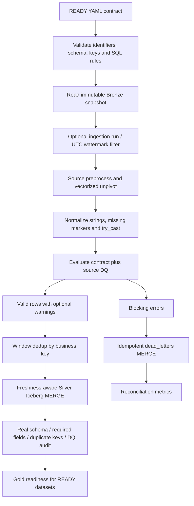

> Historical/legacy reference. Current local nine-source routing, NSO V2 and acceptance are documented in [README](README.md), [data catalog](data_catalog.md) and [validation](validation.md). Original bytes are preserved in [archive](archive/manifest.json).

# Silver Layer Architecture

Cập nhật 11/10/2026. Xem [README](README.md) để chạy và
[schemas](schemas.md) để tra contract. Tài liệu này thay thế mô tả cũ về hai
luồng Silver độc lập và các kết quả nghiệm thu chưa được tái xác nhận.

## Cấu trúc repository và trạng thái phát triển

| Thư mục | Trách nhiệm |
|---|---|
| `src/ingestion/` | Adapters Pandas, loaders full/incremental, checkpoint/retry, Bronze quality, storage và PostgreSQL metadata |
| `src/common/` | Error classification, retry và hashing dùng chung |
| `src/silver/contract/` | Load/validate YAML specification |
| `src/silver/transformers/` | Preprocess theo nguồn; các transformer legacy giữ cho preview/tương thích |
| `src/silver/engine/` | DQ, quarantine và deterministic dedup/MERGE |
| `src/silver/framework.py` | Điều phối toàn bộ read → preprocess → normalize → DQ → quarantine → dedup → MERGE |
| `src/silver/audit.py` | Read-only kiểm tra schema/key/DQ thực tế |
| `src/silver/orchestration.py` | HTTP bridge standard library từ Airflow tới Spark container |
| `contracts/silver/` | 9 contract READY |
| `jobs/silver/` | Unified CLI, compatibility jobs và HTTP API |
| `dags/` | Bronze ingestion DAG có Silver hooks và Silver DAG độc lập |
| `config/` | Source registry, Spark và Trino configuration |
| `data/raw/`, `data/fixtures/` | Local source snapshots và Trade validation ZIP |
| `tests/` | Unit tests, Spark SQL fixtures và isolated Iceberg integration tests |
| `docs/silver/` | Quy tắc, schema, runbook và bằng chứng kiểm thử |

Bronze hiện nhận CSV/Excel/HTML theo source adapters, lưu artifact/manifest trên
MinIO và append bảng Iceberg với tám audit fields. PostgreSQL giữ run,
checkpoint, snapshot và trạng thái Silver. Gold chưa được triển khai trong
phạm vi công việc này.

Trước tích hợp, CLI/DAG gọi bốn transformer legacy không dùng contract DQ;
framework riêng có FAOSTAT adapters nhưng chưa nối quality hooks. Hiện tất cả
production entry points cùng dùng contract framework. Không dùng kết quả
`legacy_transformer.transform()` trực tiếp để nghiệm thu toàn pipeline;
`.execute()` của legacy transformer cũng chuyển sang shared framework.

## Luồng xử lý

Framework từ chối contract non-READY trước khi truy cập catalog. Nó bắt lỗi
missing dependency trong transformer thay vì bỏ qua ImportError rồi ghi data
chưa preprocess. Transformer không tồn tại được bỏ qua chỉ cho nguồn không
cần preprocess; executable contract vẫn được kiểm tra.

Preprocessing giữ original source payload. Normalization dùng một projection
để alias không vô tình ghi đè cột nguồn dùng bởi mapping khác. Required source
column vắng là schema failure toàn job; required field NULL là row failure
đưa vào quarantine. Source-specific diagnostic columns chỉ tồn tại tới DQ.

## Kiểm soát chất lượng và đối soát

Metrics cho một run:

- `bronze_count`: số row input sau incremental filter, trước unpivot.
- `prepared_count`: số observation sau preprocess/unpivot.
- `valid_count`: số observation không có blocking error.
- `quarantine_count`: số observation có ít nhất một blocking error.
- `warning_count`: số observation có warning, có thể overlap quarantine.
- `dedup_count`: số business keys hợp lệ sau dedup, được đưa tới MERGE.
- `duplicate_count`: `valid_count - dedup_count`.
- NSO thêm `observation_count`, `excluded_count`, `excluded_record_count`: audit
  candidates trước unpivot và những record all-source-NULL.

Invariant: `prepared_count = valid_count + quarantine_count`,
`valid_count = dedup_count + duplicate_count`; với NSO thêm
`observation_count = prepared_count + excluded_count`.
Không so trực tiếp Bronze count với Silver count sau unpivot. Không dùng
`dedup_count` làm số row thực sự INSERT/UPDATE: MERGE có thể bỏ qua row
không đổi hoặc timestamp cũ; bảng đích có thể chứa keys từ các batch trước.

Silver audit thực sự đọc target để kiểm tra contract types, all required
fields, unique keys và các blocking DQ SQL rule đã công bố. DQ đã dùng thêm
source rules trong processing; các raw diagnostic flags không có trong target
nên không được chạy lại sau write. Audit fail thì không publish Gold signal.

## Storage và schema evolution

Bảng mới dùng Iceberg v2, Parquet ZSTD và partition columns theo contract:
`year` cho đa số nguồn và IPSARD, `market_year` cho PSD.
Quarantine partition theo `source_dataset` và `days(detected_at)`.

Bảng mới khai báo `write.distribution-mode=hash`,
`write.merge.distribution-mode=hash`, `write.spark.fanout.enabled=false`.
IPSARD có `year` derived từ date thay vì partition theo ngày để giảm small
files/open writers. Snapshot thực từng gây Java heap OOM ở cấu hình fanout;
cấu hình mới đã xử lý được đầy đủ snapshot với heap 1 GB.

Writer tạo namespace và bảng kể cả batch có zero valid rows. Không nuốt
catalog/network failures thành “table missing”. Temp views có UUID riêng và
được cleanup trong finally. Thêm cột là migration additive tự động; type
mismatch yêu cầu migration rõ ràng, không overwrite table silently.

Không tự cấu hình lại partition spec hoặc compression của bảng đã tồn tại.
Engine join incoming/stored theo key, freshness và data equality trước MERGE.
Replay không đổi data bỏ qua SQL MERGE, giữ processing time và Silver snapshot.
Quarantine vẫn có detection/run update riêng.

## Airflow và Spark API

- Ingestion DAG: task Silver sau mỗi source READY; lock theo source, lấy
  oldest pending successful Bronze run, submit incremental đúng run ID.
  Không khởi tạo Spark driver hoặc download JARs bên trong Airflow.
- Silver DAG: gate đọc/resolve Bronze schema thật, chín task transform,
  reconciliation kết quả XCom, audit Spark đọc target thật, rồi publish signal.
- Cả hai lịch dùng `Asia/Bangkok`: Bronze 06:00 và Silver 08:00 ngày 15 hàng
  tháng. Silver gate vẫn độc lập với lịch vì Bronze có thể chạy lỗi/chậm.
- `max_active_runs=1`; Silver DAG `max_active_tasks=1` và API job lock serial
  phù hợp tài nguyên dev/catalog hiện tại. Không dùng task song song để đẩy
  nhiều Spark drivers và dead-letter commits cạnh tranh trong môi trường 1 GB.
- API whitelist job, validate action/mode, argv list không qua shell; chỉ trả
  SUCCESS khi spark-submit exit 0 và có structured `SILVER_RESULT`.
  HTTP server dùng threads để healthcheck vẫn phản hồi trong lúc job chạy;
  lock đảm bảo chỉ một Spark subprocess xử lý tại một thời điểm.
- Metadata chỉ ghi SUCCESS sau khi Spark job trả thành công và input run có
  row queryable. Job fail propagates lên Airflow và có thể retry an toàn.

Một trigger Bronze hook xử lý một pending run. Nếu có backlog nhiều run,
chạy lại hooks hoặc CLI theo từng run; Silver full scan vẫn reconcile toàn bộ
Bronze nhưng không tự đổi trạng thái metadata cho từng ingestion run.
Signal nêu rõ chín READY datasets. Downstream vẫn cần reviewed geography mapping
cho NSO và phải tách quantity/index/season/source level.

## Hiệu năng

1. Dùng Spark built-ins: array/explode, SQL expressions, higher-order filter,
   trim/regex, Window, JSON và hashing. Không Python UDF, không Pandas apply
   trên Silver, không collect dataset về driver.
2. Filter incremental ngay sau table read để Iceberg/Spark prune dữ liệu.
3. Cache classified data và dedup result bằng MEMORY_AND_DISK để count/DQ/
   quarantine/MERGE không chạy lại toàn bộ preprocessing mỗi lần. Unpersist
   trong finally cả khi exception.
4. Các metrics DQ được tính trong một aggregation; driver chỉ nhận một row
   metrics. Bronze count vẫn cần scan riêng để phân biệt physical rows và
   observations sau unpivot.
5. Chuỗi `_source_payload` lớn chỉ giữ trong cache/quarantine. Output valid
   giữ các raw fields nhỏ khi contract yêu cầu (NSO/USDA), giúp truy nguyên
   giá trị/đơn vị mà không mang toàn bộ source record vào Silver.
6. AQE bật; tune `SILVER_SHUFFLE_PARTITIONS` theo dữ liệu và số cores. Không
   áp `coalesce(1)` để tạo bottleneck toàn job.
7. Với Trade thực cỡ lớn, benchmark shuffle skew và memory từ Spark UI,
   scale executor/partition trước chạy production. Fixture 2.000 rows không
   chứng minh throughput dataset hàng chục triệu dòng.
8. Theo dõi small files/snapshot growth; compaction và snapshot expiry cần
   maintenance job và retention policy riêng, chưa tự chạy trong pipeline.

## Giới hạn đã biết

NSO đã publish schema và pipeline; geography chưa xác minh giữ NULL code và
warning; tên có dấu được phục hồi bằng exact candidate lookup, giữ raw name
và tỉnh lịch sử. Không có historical province master tự đoán. Local Trade full CSV
vẫn thiếu, nhưng Bronze catalog có dữ liệu Trade để nghiệm thu E2E thật;
fixture 2.000 rows chỉ là smoke test offline. Full catalog acceptance chạy
trên đúng checkout với REST/MinIO. Xem [validation.md](validation.md) cho
counts và phạm vi thực sự đã kiểm chứng; benchmark toàn bộ 35 triệu rows
và Gold aggregation nằm ngoài nghiệm thu này.
