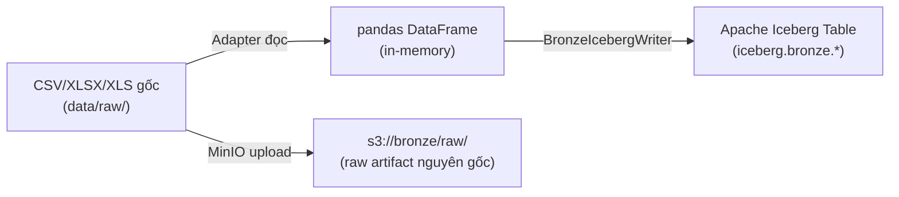

# 🔍 Senior Data Engineer Review: Bronze & Silver Layers

## Tóm tắt nhanh (Executive Summary)

| Tiêu chí | Nhánh hiện tại (`handoff/local-nine-phase2`) | Nhánh `feat_silver_layer` |
|-----------|----------------------------------------------|--------------------------|
| Bronze Writer | 671 dòng, có **schema_policy** + **approved_evolution** | 511 dòng, **không có** schema governance |
| Schema Evolution | Fail-fast + allowlist gate | Silent `ALTER TABLE ADD COLUMN` (nguy hiểm) |
| Numeric Validation | `_validate_numeric_values()` trước write | ❌ Không có |
| Arrow Conversion Preflight | Schema check trước DELETE | ❌ Convert sau DELETE (mất data nếu fail) |
| Idempotency | DELETE rồi APPEND (cùng cơ chế) | DELETE rồi APPEND (cùng cơ chế) |
| Kết luận | ✅ **Production-grade** | ⚠️ **Development-grade** |

---

## 1. Bronze Layer — Tại sao lại thành Parquet?

### Hiểu lầm: "Bronze = giữ nguyên CSV/XLSX"

> **Thực tế đây là kiến trúc Medallion (Bronze-Silver-Gold) trên Apache Iceberg**, không phải copy file thô.

Trong dự án này, tầng Bronze **KHÔNG** chuyển CSV → Parquet file đơn giản. Luồng thực sự là:



### Raw artifact GIỮ NGUYÊN trong MinIO

File CSV/XLSX/XLS gốc **vẫn được lưu nguyên trạng** ở 2 chỗ:
1. **`s3://bronze/raw/{source_group}/raw/{batch_id}/{filename}`** — Archive lossless qua [`BronzeStorageLayout.archive_raw_artifact()`](file:///c:/Users/hoang/source/repos/final%20term/tieu%20luan%20chuyen%20nganh/source/nhanh2/TLCN/src/ingestion/storage/bronze_storage_layout.py#L121-L126)
2. **`s3://bronze/{source_id}/{date}/{run_id}/{filename}`** — Raw landing qua MinIO trong [`FullLoader.execute()`](file:///c:/Users/hoang/source/repos/final%20term/tieu%20luan%20chuyen%20nganh/source/nhanh2/TLCN/src/ingestion/core/full_loader.py#L382-L401)

### Iceberg Table = Queryable Bronze (format nội bộ là Parquet)

Apache Iceberg **tự động** sử dụng Parquet làm format lưu trữ nội bộ cho các table. Đây là **data file format** của Iceberg, không phải bạn chủ động convert.

**Vì sao đây là thiết kế đúng (theo Senior DE):**

| Giữ nguyên CSV/XLSX | Iceberg Bronze (Parquet nội bộ) |
|---------------------|-------------------------------|
| Không query được bằng SQL | Query bằng Trino/Spark SQL |
| Không có schema enforcement | Schema tracked, versioned |
| Không có audit trail per row | Có `_ingestion_run_id`, `_source_checksum`... |
| Không hỗ trợ time-travel | Iceberg snapshot time-travel |
| Silver phải re-parse CSV mỗi lần | Silver đọc trực tiếp Iceberg table |

> [!TIP]
> **Kết luận:** Design hiện tại là **đúng chuẩn Medallion Architecture**. File gốc CSV/XLSX/XLS vẫn được archive nguyên vẹn trong MinIO (`raw/`). Iceberg Bronze table chỉ là **queryable replica** để Silver đọc hiệu quả.

---

## 2. Bronze & Silver chạy tuần tự (từng file) — Ổn không?

### Cách Bronze chạy tuần tự hiện tại:

```python
# dag_ingestion_pipeline.py - Line 146-149
if LOCAL_PROFILE:
    for previous, following in zip(ingestions, ingestions[1:]):
        previous >> following  # Chạy nối tiếp
```

```python
# dag_silver_pipeline.py - Line 109-111  
if LOCAL_PROFILE:
    for previous, following in zip(transformations, transformations[1:]):
        previous >> following  # Chạy nối tiếp
```

### Đánh giá:

| Tiêu chí | Verdict | Giải thích |
|-----------|---------|------------|
| Chạy Bronze tuần tự | ✅ Ổn cho local/dev | `max_active_tasks=1` cho `LOCAL_PROFILE`, tránh race condition Iceberg |
| Chạy Silver tuần tự | ✅ Ổn cho local/dev | `max_active_tasks=1` luôn, Spark job nặng nên serial hợp lý |
| Production Bronze | ✅ Hỗ trợ parallel | `max_active_tasks=4` khi production, có `source_lock()` bảo vệ |
| Bronze → Silver trigger | ✅ Tốt | `verify_bronze_batch()` gate check trước khi trigger Silver DAG |
| Error propagation | ✅ Tốt | Chain task nên source fail → toàn bộ batch dừng |

> [!IMPORTANT]
> **Cách chạy tuần tự từng file (LOCAL_PROFILE) là thiết kế có chủ đích**, phù hợp cho môi trường demo/test/local. Production thì parallel 4 tasks.

### Tuy nhiên, có 2 concerns nhỏ:

1. **Thiếu retry cho LOCAL_PROFILE**: `retries=0` cho local profile. Nếu network flicker hay MinIO restart, cả pipeline fail mà không tự recover.

2. **`pass` trong `_record_run_start`/`_record_run_end`** — Silent failure cho metadata recording:
   ```python
   # ingestion_engine.py L212-213
   except Exception:
       pass  # metadata recording is best-effort; do not block ingestion
   ```
   → **Acceptable** cho Bronze (best-effort metadata), nhưng nên log warning thay vì silent `pass`.

---

## 3. So sánh Bronze: Nhánh hiện tại vs `feat_silver_layer`

### 3.1. Schema Governance — **Nhánh hiện tại thắng xa**

**Nhánh hiện tại** có `schema_policy` + `approved_schema_additions`:
```python
# bronze_writer.py (current) - Constructor
schema_policy: str = "fail_fast",
approved_schema_additions: Optional[Dict[str, Dict[str, str]]] = None,
```

```python
# plan_schema_additions() - Gate kiểm soát chặt chẽ
if self.schema_policy == "approved_evolution":
    for name, dtype in approved.items():
        if dtype != "string" or name in TECHNICAL_METADATA_COLUMNS:
            raise SchemaError("Evolution permits only approved nullable source strings")
```

**Nhánh `feat_silver_layer`** — Silent ALTER TABLE, KHÔNG kiểm soát:
```python
# feat_silver_layer ensure_table() 
for clean_col, sql_type in all_cols_to_check.items():
    if clean_col.lower() not in existing_col_names:
        alter_sql = f'ALTER TABLE {full_table} ADD COLUMN "{clean_col}" {sql_type}'
        self.execute_query(alter_sql)  # ← Silent schema change, no governance!
```

> [!CAUTION]
> Nhánh `feat_silver_layer` tự động ALTER TABLE khi gặp column mới mà **không có governance gate**. Trong production, một adapter bug return column lạ → schema drift không kiểm soát → Silver pipeline break.

### 3.2. Data Integrity Validation — **Nhánh hiện tại thắng**

| Validation | Nhánh hiện tại | `feat_silver_layer` |
|-----------|---------------|---------------------|
| `_validate_numeric_values()` | ✅ Reject lossy coercion | ❌ Không có |
| `_validate_schema_columns()` | ✅ Column collision check | ❌ Không có |
| Arrow conversion preflight | ✅ Convert **trước** DELETE | ❌ Convert **sau** DELETE |
| `SchemaError` exception class | ✅ Có, imported | ❌ Không có |

**Vấn đề nghiêm trọng ở `feat_silver_layer`:**

```
DELETE existing chunk  →  Arrow conversion fails  →  DATA LOST!
```

Ở nhánh hiện tại:
```
Arrow conversion (preflight)  →  DELETE existing chunk  →  APPEND  →  Safe
```

### 3.3. `ensure_table()` — Column Collision Detection

**Nhánh hiện tại:**
```python
incoming = [sanitize_column_name(c) for c in df.columns]
self._validate_schema_columns(incoming, incoming)  # Detect collision EARLY
if any(not c for c in incoming):
    raise SchemaError("Empty sanitized source column; refusing write")
```

**`feat_silver_layer`:** Không có check này. Nếu 2 columns sanitize thành cùng tên → silent data loss.

### 3.4. Điểm `feat_silver_layer` có lợi thế

| Khía cạnh | `feat_silver_layer` | Nhánh hiện tại |
|-----------|--------------------|-----------------| 
| Code đơn giản hơn | ✅ 511 vs 671 dòng | Phức tạp hơn |
| Dễ hiểu cho team mới | ✅ Ít abstraction | Nhiều layer hơn |
| Prototype speed | ✅ Nhanh hơn | Chặt chẽ hơn |

→ Nhưng "đơn giản" ở đây đồng nghĩa với "thiếu safeguard".

---

## 4. Đánh giá tổng thể Bronze + Silver

### Bronze Layer (nhánh hiện tại): **8.5/10**

**Điểm mạnh:**
- ✅ Dual-path: Raw archive (lossless) + Iceberg table (queryable)
- ✅ Schema governance (fail-fast + approved evolution)
- ✅ Idempotency (DELETE + APPEND per chunk)
- ✅ Checkpoint/resume cho failed runs
- ✅ Quality validation (pre-flight)
- ✅ Quarantine workflow cho bad data
- ✅ Advisory lock (`source_lock`) chống concurrent writes
- ✅ Comprehensive audit trail (metadata, batch, manifest, audit entries)
- ✅ PyIceberg native write + Trino fallback

**Điểm cần cải thiện:**
- ⚠️ DELETE + APPEND không atomic (documented nhưng vẫn là risk)
- ⚠️ `except Exception: pass` ở một số chỗ metadata nên log warning
- ⚠️ Thiếu data freshness monitoring/alerting
- ⚠️ Hardcoded `batch_size=500` cho Trino fallback — nên configurable

### Silver Layer (nhánh hiện tại): **8/10**

**Điểm mạnh:**
- ✅ Contract-driven (YAML contracts cho mỗi dataset)
- ✅ Bronze readiness check trước transform
- ✅ Snapshot-pinned reads (time-travel consistency)
- ✅ DQ audit (reconciliation checks)
- ✅ Quarantine + dead letters cho invalid rows
- ✅ Deduplication trước merge
- ✅ `_source_payload` lineage tracking

**Điểm cần cải thiện:**
- ⚠️ `persist(MEMORY_AND_DISK)` có thể OOM với datasets lớn
- ⚠️ Thiếu circuit breaker nếu Bronze table rỗng/corrupt
- ⚠️ `max_active_tasks=1` luôn cho Silver — bottleneck khi có nhiều datasets

---

## 5. Verdict: Nhánh nào tốt hơn cho Bronze?

### 🏆 Nhánh hiện tại (`handoff/local-nine-phase2`) — **Tốt hơn rõ rệt**

```diff
+ Schema governance (fail-fast + approved evolution)
+ Numeric validation trước write
+ Arrow conversion preflight (không mất data)
+ Column collision detection
+ SchemaError exception hierarchy
+ Comprehensive validation pipeline
- Phức tạp hơn (~160 dòng thêm)
```

### Nhánh `feat_silver_layer` — **Chỉ phù hợp cho prototyping**

```diff
+ Code đơn giản, dễ đọc
+ Nhanh cho demo ban đầu  
- Thiếu schema governance → silent schema drift
- Thiếu numeric validation → lossy coercion
- Arrow conversion sau DELETE → data loss risk
- Silent ALTER TABLE → uncontrolled evolution
```

> [!IMPORTANT]
> **Recommendation:** Giữ Bronze của nhánh hiện tại (`handoff/local-nine-phase2`). Đây là production-grade implementation với đầy đủ safeguards mà một Senior DE sẽ yêu cầu cho data lakehouse.
